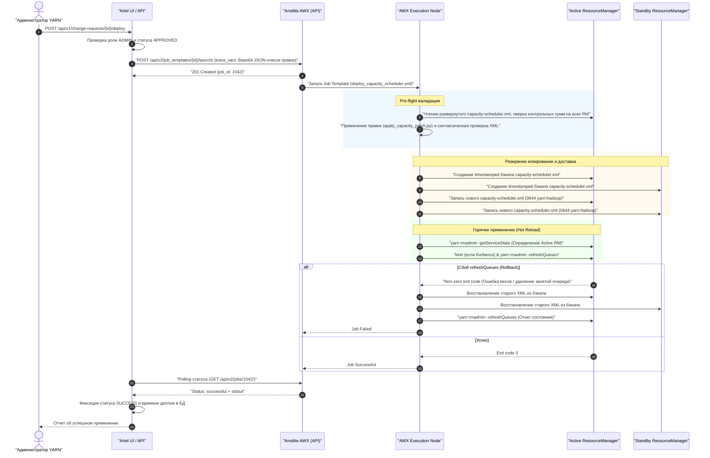

# Доставка и применение конфигурации YARN через Ansible AWX

Документ описывает, как Artel доставляет изменения `capacity-scheduler.xml` на кластеры Apache Hadoop YARN через Ansible AWX / Red Hat Ansible Automation Platform и применяет их командой `yarn rmadmin -refreshQueues` без перезапуска ResourceManager. Здесь же — настройка AWX, узлов ResourceManager и Artel.

---

## 1. Последовательность развертывания

Взаимодействие компонентов при развертывании согласованной заявки:



---

## 2. Структура Ansible-репозитория

Все артефакты Ansible хранятся в каталоге `ansible/`:

```text
ansible/
├── inventory.example.ini             # Шаблон инвентаря для кластеров YARN
├── playbooks/
│   └── deploy_capacity_scheduler.yml # Плейбук верхнего уровня для Job Template в AWX
└── roles/
    └── yarn_capacity_scheduler/      # Роль доставки и применения
        ├── defaults/main.yml         # Переменные по умолчанию
        ├── files/
        │   └── apply_capacity_patch.py # Применение JSON-правок к XML
        ├── meta/main.yml             # Метаданные роли
        ├── tasks/
        │   ├── main.yml              # Главный оркестратор с блоком rescue
        │   ├── patch.yml             # Чтение развернутого файла и применение правок
        │   ├── backup.yml            # Создание резервных копий
        │   ├── deploy.yml            # Запись файла конфигурации
        │   └── refresh.yml           # kinit и rmadmin -refreshQueues
        └── README.md
```

### Поведение роли `yarn_capacity_scheduler`
1. Правки вместо полного файла. Artel передает в `capacity_scheduler_patch_b64` (Base64) JSON-список правок только тех свойств, которые меняет заявка. Роль читает файл, развернутый на RM, применяет к нему правки и раскладывает результат. Свойства, которых заявка не касается (ACL очередей, глобальные лимиты, `resource-calculator` и т. п.), не меняются. Полный файл Artel не генерирует: при файловом хранилище RM не отдает его по REST. Если файл на разных RM различается, роль останавливается до любых изменений.
   Полная замена файла по-прежнему доступна через `capacity_scheduler_xml_b64`.
2. Pre-flight-проверка. Синтаксис итогового XML проверяется на Runner до изменения файлов на кластере.
3. Откат (rollback). Если `yarn rmadmin -refreshQueues` завершился ошибкой, блок `rescue` возвращает файл из резервной копии на всех узлах RM, повторно вызывает `refreshQueues` и завершает задачу со статусом failed.

---

## 3. Настройка в интерфейсе AWX

### Шаг 1: Создание Machine Credentials (SSH)
1. В боковом меню откройте **Administration → Credentials → Add**.
2. **Name**: `YARN RM Deployer Key`.
3. **Credential Type**: `Machine`.
4. **Username**: `deployer` (пользователь с доступом по SSH на узлы RM).
5. **SSH Private Key**: закрытый ключ пользователя `deployer`.

### Шаг 2: Создание Inventory
1. Откройте **Automation Content → Inventories → Add → Add inventory**.
2. **Name**: `Hadoop Clusters Inventory`.
3. Во вкладке **Hosts** добавьте все узлы ResourceManager кластера:
   * Хост 1: `rm1.hadoop.company.local`
     * В поле **Variables (YAML)** укажите:
       ```yaml
       rm_id: rm1
       ```
   * Хост 2: `rm2.hadoop.company.local`
     * В поле **Variables (YAML)** укажите:
       ```yaml
       rm_id: rm2
       ```
4. Во вкладке **Groups** создайте группу `yarn_rm` и включите в нее оба хоста.
5. Задайте переменные группы `yarn_rm`:
   ```yaml
   hadoop_conf_dir: "/etc/hadoop/conf"
   hadoop_user: "yarn"
   hadoop_group: "hadoop"
   kerberos_enabled: true
   yarn_keytab: "/etc/security/keytabs/yarn.service.keytab"
   yarn_principal: "yarn/{{ inventory_hostname }}@COMPANY.LOCAL"
   ```

### Шаг 3: Подключение Git-проекта (Project)
1. Откройте **Automation Content → Projects → Add**.
2. **Name**: `Pristan Automation`.
3. **Execution Environment**: стандартный или собственный EE с Python 3.9+ (нужен для `apply_capacity_patch.py`).
4. **Source Control Type**: `Git`.
5. **Source Control URL**: URL вашего Git-репозитория.
6. **Branch**: `main` или ветка релиза.

### Шаг 4: Создание Job Template
1. Откройте **Automation Execution → Templates → Add → Add job template**.
2. **Name**: `YARN - Deploy Capacity Scheduler`.
3. **Job Type**: `Run`.
4. **Inventory**: `Hadoop Clusters Inventory`.
5. **Project**: `Pristan Automation`.
6. **Playbook**: `ansible/playbooks/deploy_capacity_scheduler.yml`.
7. **Credentials**: `YARN RM Deployer Key`.
8. **Privilege Escalation**: отметьте `Enable Privilege Escalation` (become: true).
9. **Variables (Extra Variables)**: отметьте чекбокс **Prompt on launch** напротив поля **Variables**.

   **Внимание**: без **Prompt on launch** AWX отбрасывает `extra_vars`, которые передает Artel, и задача падает с ошибкой `Provide exactly one of 'capacity_scheduler_patch_b64' or 'capacity_scheduler_xml_b64'` (см. раздел 7).
10. Нажмите **Save**. Запишите ID шаблона из адресной строки браузера (например, `/templates/job_template/101`): он нужен для `default-job-template-id`.

### Шаг 5: Выпуск Application Token
1. В профиле пользователя AWX откройте вкладку **Tokens → Add**.
2. **Application**: оставьте пустым (Personal Access Token) или выберите приложение.
3. **Description**: `Pristan Token`.
4. **Scope**: `Write`.
5. Скопируйте токен: AWX показывает его один раз.

---

## 4. Настройка серверов YARN ResourceManager

### 4.1 Доступ пользователя в ОС (`sudoers`)
Разрешите пользователю `deployer` переключаться на пользователя `yarn` без пароля:
```bash
# /etc/sudoers.d/deployer
deployer ALL=(yarn) NOPASSWD: ALL
```

### 4.2 Права администратора в YARN (`yarn-site.xml`)
Учетная запись, от имени которой выполняется `yarn rmadmin`, должна входить в список `yarn.admin.acl`:
```xml
<property>
  <name>yarn.admin.acl</name>
  <value>yarn,hadoop-admins</value>
</property>
```

### 4.3 Kerberos Keytab
Положите сервисный keytab по пути из переменной `yarn_keytab` (например, `/etc/security/keytabs/yarn.service.keytab`), права `0400`, владелец `yarn:hadoop`.

---

## 5. Конфигурация Artel (`application.yml`)

Параметры AWX в конфигурации бэкенда Artel (`backend/artel/src/main/resources/application.yml`):

```yaml
artel:
  awx:
    # Включение интеграции с AWX
    enabled: true
    # URL инстанса AWX
    base-url: "https://awx.company.local"
    # Токен доступа (рекомендуется передавать через переменную окружения AWX_TOKEN)
    token: "Ваш_Секретный_AWX_Токен"
    verify-ssl: true
    # Идентификатор (ID) шаблона запуска в AWX по умолчанию
    default-job-template-id: 101
    # Интервал опроса статуса выполнения задачи в секундах
    poll-interval-seconds: 2
    # Максимальное время ожидания завершения деплоя в секундах. Если задача не успела
    # завершиться, заявка остается в статусе RUNNING, а итог подтягивается через /deploy-status
    timeout-seconds: 180
    # Только для демо-стендов: имитировать успешную задачу, не вызывая AWX
    simulate: false

  clusters:
    - id: "prod-yarn"
      name: "Production Hadoop Cluster"
      resource-manager-urls:
        - "http://rm1.prod.company.local:8088"
        - "http://rm2.prod.company.local:8088"
      kerberos-enabled: true
      # Индивидуальные параметры AWX для конкретного кластера:
      awx:
        enabled: true
        job-template-id: 101 # Переопределяет default-job-template-id
      acl:
        roles:
          admin:
            users: ["admin_user"]
            groups: ["hadoop-admins"]
```

Статус `SUCCESS` ставится только когда AWX сообщил `successful`. Если AWX отключен (`enabled: false`) или не задан `base-url`, деплой завершается со статусом `FAILED`: изменения не применены. Раньше в этом случае возвращался имитированный успех.

### Переменные окружения

В `application.yml` параметры AWX читаются из переменных окружения:
- `ARTEL_AWX_BASE_URL=https://awx.prod.company.local`
- `ARTEL_AWX_TOKEN=xxxxxx`
- `ARTEL_AWX_JOB_TEMPLATE_ID=101`

### Контракт `extra_vars`

| Переменная | Описание |
|---|---|
| `capacity_scheduler_patch_b64` | Base64 от JSON-списка правок: `[{"op": "set", "name": "...", "value": "..."}, ...]`. Операции: `set`, `remove`, `remove_prefix`, `list_add`, `list_remove` |
| `capacity_scheduler_xml_b64` | Base64 от полного `capacity-scheduler.xml` (только прямой деплой) |
| `cluster_id` | Идентификатор кластера в Artel |
| `change_request_id` | Номер заявки или `direct` |
| `applied_by` | Пользователь, запустивший деплой |
| `deploy_comment` | Комментарий |

---

## 6. Использование через REST API

### Вариант 1: Деплой согласованной заявки (Change Request)

1. Создайте заявку (роль `WRITER` или `ADMIN`):
   ```http
   POST /api/v1/change-requests
   Content-Type: application/json

   {
     "cluster_id": "prod-yarn",
     "title": "Добавление очереди analytics.spark",
     "changes": [ ... ]
   }
   ```
2. Согласуйте заявку (роль `ADMIN`; автор заявки согласовать ее не может — принцип четырех глаз):
   ```http
   POST /api/v1/change-requests/{cr_id}/approve
   Content-Type: application/json

   {
     "comment": "Одобрено на совете инфраструктуры"
   }
   ```
   Заявка переходит в статус `APPROVED`. Правки пересчитываются против текущего состояния кластера и сохраняются в заявке; если все изменения уже есть на кластере, сервис отвечает `409`.

3. Запустите деплой через AWX (роль `ADMIN`):
   ```http
   POST /api/v1/change-requests/{cr_id}/deploy?wait=true
   Authorization: Bearer <ADMIN_JWT_TOKEN>
   ```
   Ответ `200 OK`:
   ```json
   {
     "cr_id": 42,
     "cluster_id": "prod-yarn",
     "awx_job_id": 1042,
     "status": "SUCCESS",
     "message": "Конфигурация успешно развернута и применена на кластере через AWX",
     "deployed_at": "2026-09-09T11:20:00.000Z",
     "stdout": "PLAY [Deploy YARN Capacity Scheduler via AWX] ... ok=5 changed=2 failed=0"
   }
   ```

4. Проверьте статус деплоя:
   ```http
   GET /api/v1/change-requests/{cr_id}/deploy-status
   ```

### Вариант 2: Прямой деплой XML администратором (Direct Deploy)

Прямой деплой обходит согласование, поэтому при `artel.acl.enforce-four-eyes: true` (значение по умолчанию) он запрещен (`403`). Если принцип «четырех глаз» отключен, администратор может применить полный файл. Artel проверяет, что это корректный XML с корнем `<configuration>`, только со свойствами `yarn.scheduler.capacity.*` и с заданным `yarn.scheduler.capacity.root.queues`:

```http
POST /api/v1/clusters/prod-yarn/deploy-xml
Authorization: Bearer <ADMIN_JWT_TOKEN>
Content-Type: application/json

{
  "xml_content": "<configuration>...</configuration>",
  "comment": "Оперативное изменение лимитов"
}
```

---

## 7. Устранение неполадок и диагностика

1. Ошибка `Provide exactly one of 'capacity_scheduler_patch_b64' or 'capacity_scheduler_xml_b64'`:
   * Проверьте, что в настройках Job Template в AWX включена опция **Prompt on launch** для поля **Variables**.
2. Ошибка `capacity-scheduler.xml differs between ResourceManagers`:
   * Файлы на RM разошлись (например, после ручной правки на одном узле). Выровняйте их вручную и повторите деплой: после статуса `FAILED` повторный запуск разрешен.
3. Ошибка `Cannot refresh queues: sum of child capacity != 100%`:
   * ResourceManager отклонил конфигурацию: сумма capacity дочерних очередей не равна 100%.
   * Роль выполнила откат: предыдущая версия файла восстановлена из `capacity-scheduler-<timestamp>.xml` в `backup_dir` и применена повторным `refreshQueues`, очереди остались в прежнем состоянии.
4. Ошибка `User yarn cannot run rmadmin -refreshQueues`:
   * Проверьте список администраторов в `yarn-site.xml` (`yarn.admin.acl`).
5. Таймаут ожидания в API (`HTTP 504`):
   * Увеличьте параметр `timeout-seconds` в `application.yml` или вызывайте деплой с параметром `?wait=false` с последующим опросом через `GET /deploy-status`.

---

## 8. Связанная документация

- [Руководство пользователя Artel (YARN)](artel-user-guide.md) — интерфейс, согласование Change Requests, окно экспорта XML.
- [Архитектура платформы Pristan](ARCHITECTURE.md) — архитектура, подсистемы безопасности и отказоустойчивости.
- [Руководство по конфигурации платформы](CONFIGURATION.md) — секция `awx:`, переменные окружения, RBAC.
- [README бэкенда Artel](../backend/artel/README.md) — REST API деплоя, запуск тестов.
- [README каталога Ansible](../ansible/README.md) — структура плейбуков и ролей.
- [Главная страница репозитория](../README.md) — обзор монорепозитория Pristan.
