

# Руководство пользователя: Sklad

---

Sklad — веб-интерфейс для работы с файлами в Apache Hadoop HDFS: навигация по каталогам, предпросмотр файлов аналитических форматов, пакетная загрузка, распаковка архивов и копирование данных между кластерами. Руководство описывает работу в интерфейсе для пользователей с ролями администратора, инженера данных и аналитика.

---

## Содержание

1. [Возможности Sklad](#1-возможности-sklad)
2. [Архитектура и потоки данных](#2-архитектура-и-потоки-данных)
3. [Аутентификация и роли](#3-аутентификация-и-роли)
4. [Главный экран и навигация](#4-главный-экран-и-навигация)
5. [Предпросмотр файлов (Preview Modal)](#5-предпросмотр-файлов-preview-modal)
   - [Просмотр структурированных таблиц (CSV, TSV, Parquet, ORC)](#51-просмотр-структурированных-таблиц-csv-tsv-parquet-orc)
   - [Просмотр текстовых и конфигурационных файлов (JSON, XML, YAML, Logs)](#52-просмотр-текстовых-и-конфигурационных-файлов-json-xml-yaml-logs)
6. [Загрузка данных в HDFS (Upload Modal)](#6-загрузка-данных-в-hdfs-upload-modal)
   - [Загрузка отдельных файлов (Drag & Drop)](#61-загрузка-отдельных-файлов-drag--drop)
   - [Загрузка папок целиком с сохранением иерархии](#62-загрузка-папок-целиком-с-сохранением-иерархии)
   - [Распаковка ZIP-архивов на сервере](#63-распаковка-zip-архивов-на-сервере)
   - [Загрузка больших файлов по частям (chunked upload)](#64-загрузка-больших-файлов-по-частям-chunked-upload)
7. [Управление объектами HDFS](#7-управление-объектами-hdfs)
   - [Создание директорий](#71-создание-директорий)
   - [Переименование и перемещение](#72-переименование-и-перемещение)
   - [Скачивание файлов и потоковая архивация папок в ZIP](#73-скачивание-файлов-и-потоковая-архивация-папок-в-zip)
   - [Удаление файлов и рекурсивное удаление каталогов](#74-удаление-файлов-и-рекурсивное-удаление-каталогов)
   - [Мультивыбор и пакетные операции (Batch Actions)](#75-мультивыбор-и-пакетные-операции-batch-actions)
8. [Межкластерная передача данных (Cross-Cluster Copy)](#8-межкластерная-передача-данных-cross-cluster-copy)
9. [Горячие клавиши](#9-горячие-клавиши)
10. [Диагностика ошибок](#10-диагностика-ошибок)

---

## 1. Возможности Sklad

Без Sklad с файлами в HDFS работают через командную строку (`hdfs dfs -ls`, `hdfs dfs -cat`, `hdfs dfs -put`) или веб-интерфейс NameNode (порт 9870). Веб-интерфейс NameNode не показывает содержимое Parquet и ORC и требует сетевого доступа к узлам кластера. Sklad работает через серверный шлюз:

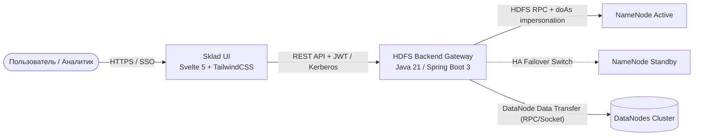

### Функции

- Список файлов с виртуализацией: браузер рисует только видимые строки, поэтому каталоги с десятками и сотнями тысяч файлов прокручиваются без задержек.
- Несколько кластеров: переключение между HDFS-кластерами (Development, Staging, Production DataLake, DMZ) в одном окне без повторного входа.
- Предпросмотр: CSV, TSV, JSON, XML, YAML, SQL, скрипты Python, логи, а также Apache Parquet и ORC без скачивания файла целиком.
- Загрузка: Drag & Drop файлов, рекурсивная загрузка локальных каталогов, загрузка ZIP-архивов с распаковкой на стороне кластера.
- Скачивание каталога: сервер упаковывает каталог HDFS в ZIP и отдает его потоком, без временных файлов на своем диске.
- Межкластерное копирование (Cross-Cluster Transfer): шлюз передает данные потоком из одного кластера в другой.
- Безопасность: вход через Kerberos SPNEGO SSO или LDAP, роли (RBAC), права на уровне кластеров (Read-Only / Full-Access); операции выполняются от имени пользователя через Hadoop UGI `doAs`.

---

## 2. Архитектура и потоки данных

Sklad состоит из веб-интерфейса (SPA) и серверного шлюза на Java 21. Шлюз обращается к NameNode и DataNode напрямую. Последовательность вызовов при открытии каталога и предпросмотре файла:

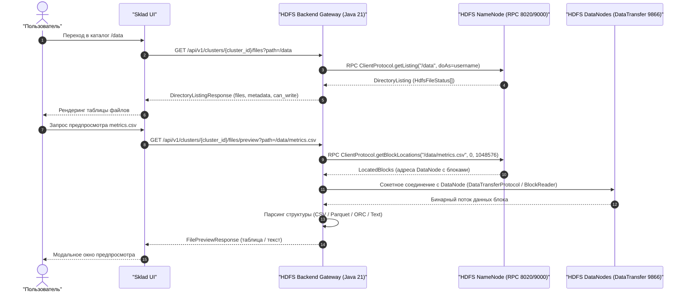

Шлюз использует нативный клиент Apache Hadoop (`NativeHdfsClient`): операции выполняются от имени пользователя через Kerberos doAs (`UserGroupInformation.createProxyUser`), переключение NameNode в HA-конфигурации — через `ConfiguredFailoverProxyProvider`. Метаданные запрашиваются по RPC (порты 8020/9000), блоки данных читаются напрямую с DataNode по протоколу передачи данных (порт 9866). Промежуточные HTTP-шлюзы (WebHDFS, HttpFS) для этого не нужны.

---

## 3. Аутентификация и роли

Sklad поддерживает два способа входа:
- Kerberos SPNEGO SSO: вход без пароля по билету Kerberos рабочей станции в домене Active Directory / FreeIPA.
- LDAP / Active Directory: вход по имени пользователя и паролю; роли определяются по группам каталога.

  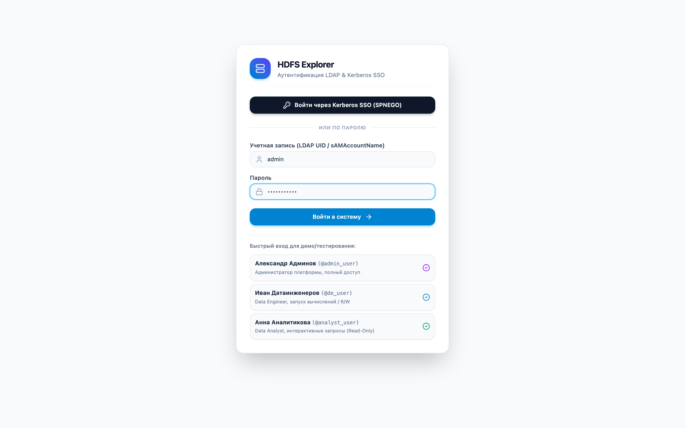
  
<em>Рисунок 1: Экран аутентификации LDAP & Kerberos SSO</em>

### Тестовые учетные записи на демо-стенде
На демо- и тестовых стендах окно входа предлагает три тестовые учетные записи, по одной на роль:

| Пользователь | Логин | Пароль | Роль |
|---|---|---|---|
| Александр Админов | `admin_user` | `password123` | Администратор HDFS, полный доступ к пространству имен (`ADM`) |
| Владимир Инженеров | `writer_user` | `password123` | Инженер данных, запись и загрузка файлов (`RW`) |
| Екатерина Наблюдателева | `reader_user` | `password123` | Аналитик данных, чтение и скачивание (`RO`) |

Над списком учетных записей расположены вкладки приложений платформы (**Универсальные**, **HDFS**, **YARN**, **Replicator**, **SQL**, **Spark**); вкладка переключает набор тестовых пользователей и описания их ролей.

### Роли и права доступа (RBAC)

Права определяются группами пользователя в конфигурационном файле кластеров `clusters.yaml`:

| Группа / Роль | Права на чтение (Read) | Загрузка и создание (Write) | Удаление и перемещение | Межкластерное копирование |
| :--- | :---: | :---: | :---: | :---: |
| Hadoop Admins (`hadoop-admins`) | Да, полный доступ | Да, все каталоги | Да, все каталоги | Да, любые кластеры |
| Data Engineers (`data-engineers`) | Да, полный доступ | Да, разрешенные каталоги | Да, личные и проектные папки | Да, доступные кластеры |
| Data Analysts (`analytics`) | Да, только чтение | Нет | Нет | Нет |
| Domain Users (`domain users`) | Да, базовый доступ | Ограниченно: по квоте / домашняя папка | Ограниченно: только в `/user/{username}` | Нет |

Операции с файлами выполняются от имени вошедшего пользователя (Hadoop UGI `doAs`), а не от имени сервисной учетной записи Sklad. NameNode проверяет POSIX-права (`rwxr-xr-x`) и HDFS ACL этого пользователя: роль в Sklad не дает доступа к каталогам, закрытым для пользователя в HDFS.

---

## 4. Главный экран и навигация

После входа открывается главный экран файлового менеджера с домашним каталогом пользователя (`/user/{username}`) или корнем кластера (`/`).

  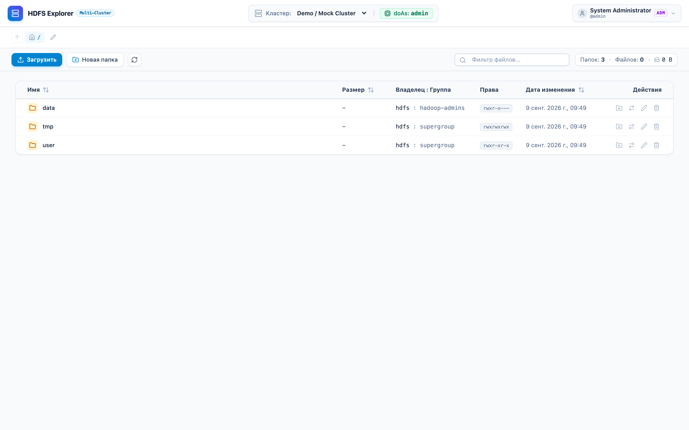
  
<em>Рисунок 2: Главный экран файлового менеджера HDFS (корневой каталог кластера)</em>

### Элементы интерфейса

- Верхняя панель (Header):
  - выбор HDFS-кластера из списка с индикатором состояния подключения;
  - имя пользователя и его роли;
  - кнопка **Logout**.
- Панель навигации (Breadcrumbs):
  - строка пути: щелчок по элементу открывает соответствующий родительский каталог;
  - кнопка **/** открывает корневой каталог;
  - кнопка **Вверх** поднимает на один уровень;
  - кнопка редактирования пути (карандаш) открывает поле для ввода абсолютного пути HDFS.
- Панель действий (Action Toolbar):
  - **Загрузить** — диалог загрузки файлов, папок и архивов;
  - **Новая папка** — создание каталога;
  - **Скачать папку** (иконка архива) — скачивание текущего каталога в ZIP;
  - **Обновить** — повторный запрос списка файлов;
  - строка фильтра — отбор файлов текущего каталога по подстроке;
  - счетчики — число каталогов, файлов и суммарный объем в текущем каталоге.

  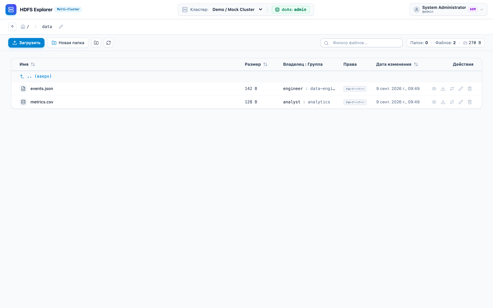
  
<em>Рисунок 3: Просмотр содержимого директории /data с аналитическими файлами</em>

### Таблица файлов

| Колонка | Содержимое |
|---|---|
| Имя | Имя файла или папки и иконка типа (каталог, документ, код, табличные данные, архив) |
| Размер | Размер в B, KB, MB, GB, TB; для каталогов — прочерк |
| Владелец и группа | Владелец и POSIX-группа (`owner:group`) |
| Права доступа | POSIX-права, например `rwxr-xr-x` или `rw-r--r--` |
| Дата изменения | Дата и время последнего изменения |
| Действия (Quick Actions) | **Предпросмотр** (для файлов), **Скачать файл** или **Скачать папку в ZIP**, **Скопировать в другой кластер**, **Переименовать / Переместить**, **Удалить** |

---

## 5. Предпросмотр файлов (Preview Modal)

Окно предпросмотра показывает схему и первые строки файла без скачивания его на рабочую станцию. Окно открывается щелчком по строке файла или кнопкой **Предпросмотр**.

### 5.1. Просмотр структурированных таблиц (CSV, TSV, Parquet, ORC)

Табличные и колоночные файлы разбираются на сервере и выводятся таблицей с номерами строк и закрепленными заголовками колонок:
- CSV / TSV: построчный разбор с определением разделителя, выводятся первые строки.
- Apache Parquet: схема колонок читается из футера файла (`MessageType`, типы `INT64`, `BINARY`, `DOUBLE` и др.), первые 100 строк декодируются через `AvroParquetReader` по RPC HDFS без скачивания всего файла.
- Apache ORC: читаются метаданные страйпов (`orc-core`, `hive-storage-api`) и схема типов (`struct<txn_id:string, amount:double, ...>`), первые 100 строк — векторизованным чтением (`VectorizedRowBatch`).

  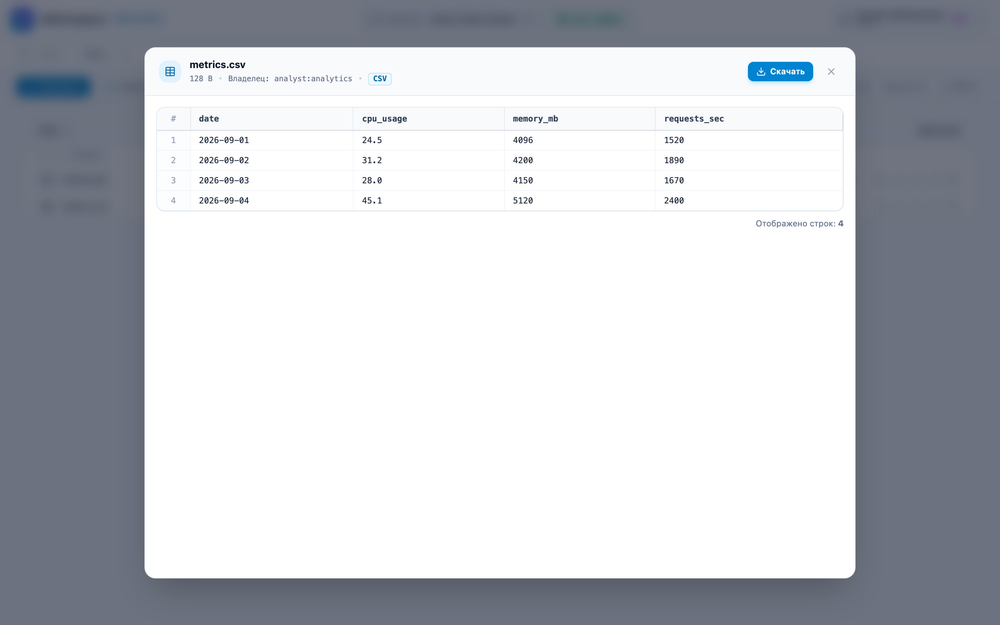
  
<em>Рисунок 4: Табличный предпросмотр файла metrics.csv</em>

Для Parquet и ORC сервер читает только футер, метаданные и первые строки (Range/RPC-запросы), поэтому файлы в десятки гигабайт открываются так же, как маленькие, и не загружаются в память шлюза целиком. Кнопки **Копировать** и **Скачать** в правом верхнем углу окна выгружают файл целиком.

### 5.2. Просмотр текстовых и конфигурационных файлов (JSON, XML, YAML, Logs)

Текстовые файлы (JSON, XML, YAML, SQL, скрипты Python, `.properties` и логи) выводятся моноширинным шрифтом с исходным форматированием.

  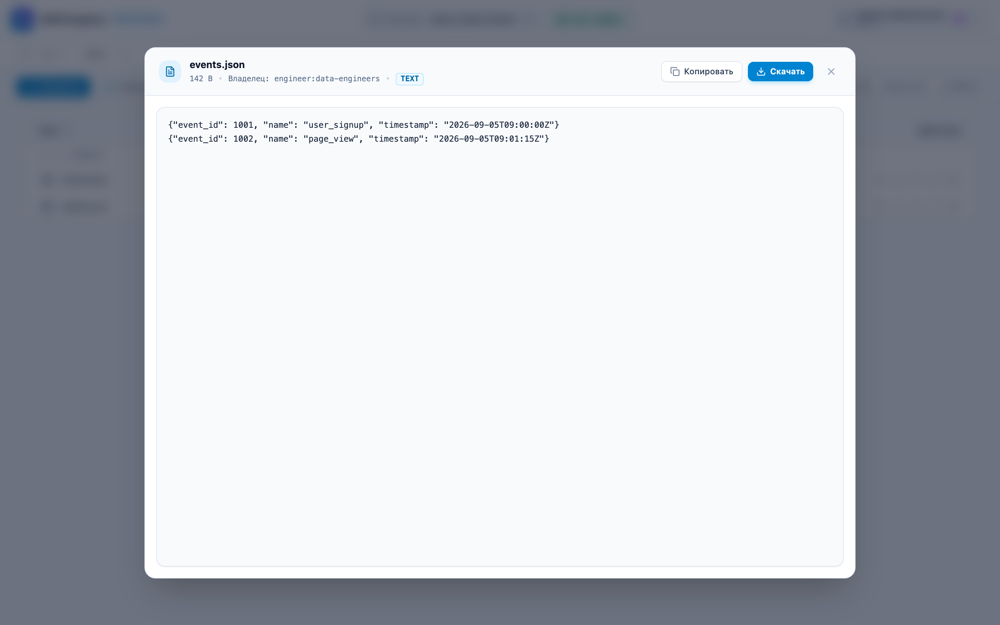
  
<em>Рисунок 5: Просмотр структурированного JSON-файла events.json</em>

---

## 6. Загрузка данных в HDFS (Upload Modal)

Окно загрузки открывается кнопкой **Загрузить** и имеет три режима, которые переключаются вкладками:

  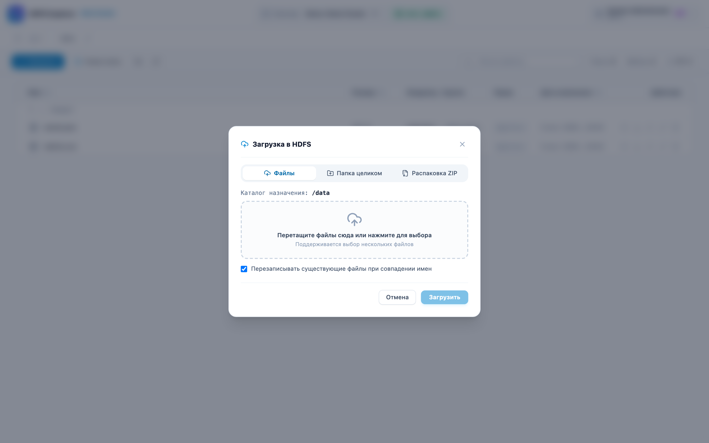
  
<em>Рисунок 6: Окно загрузки файлов, каталогов и ZIP-архивов</em>

### 6.1. Загрузка отдельных файлов (Drag & Drop)
1. Перетащите файлы в область Drag & Drop или выберите их в диалоге ОС. Перед отправкой окно показывает список файлов с размерами.
2. Чтобы заменить файлы с совпадающими именами, отметьте **Перезаписывать существующие файлы при совпадении имен**.

### 6.2. Загрузка папок целиком с сохранением иерархии
Выберите локальный каталог. Браузер передаст все вложенные каталоги и файлы, и Sklad повторит ту же структуру папок в текущем каталоге HDFS.

### 6.3. Распаковка ZIP-архивов на сервере
Перетащите `.zip`-архив. Шлюз распакует его потоком прямо в текущий каталог кластера, без промежуточной записи на диск. Этот режим подходит для загрузки большого числа мелких файлов, логов или датасетов одним архивом.

### 6.4. Загрузка больших файлов по частям (chunked upload)
- Отдельный файл больше 5 МБ браузер режет на части (чанки) по 2 МБ и отправляет их по очереди.
- Если отправка чанка не удалась, браузер повторяет ее, всего до трех попыток; после третьей неудачи загрузка файла прерывается с ошибкой.
- Окно показывает прогресс, текущую скорость и объем переданных данных.
- Шлюз собирает файл в HDFS из чанков потоком, не держа его в памяти целиком.

---

## 7. Управление объектами HDFS

### 7.1. Создание директорий

Нажмите **Новая папка** на панели действий, введите имя каталога и нажмите **Создать** или `Enter`.

  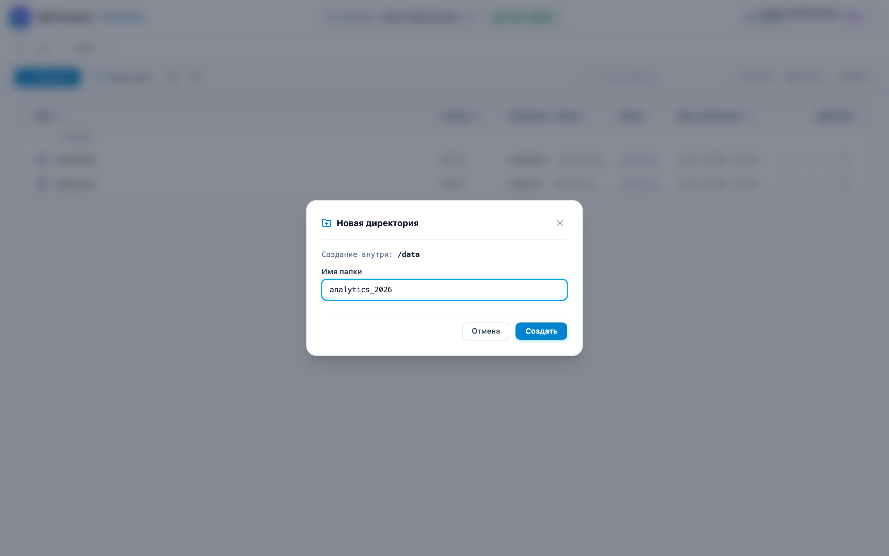
  
<em>Рисунок 7: Создание новой директории в HDFS</em>

---

### 7.2. Переименование и перемещение

Нажмите **Переименовать** в строке файла или папки. В открывшемся диалоге:
- чтобы переименовать, введите новое имя;
- чтобы переместить, введите полный путь от корня, например `/archive/2026/events.json`.

  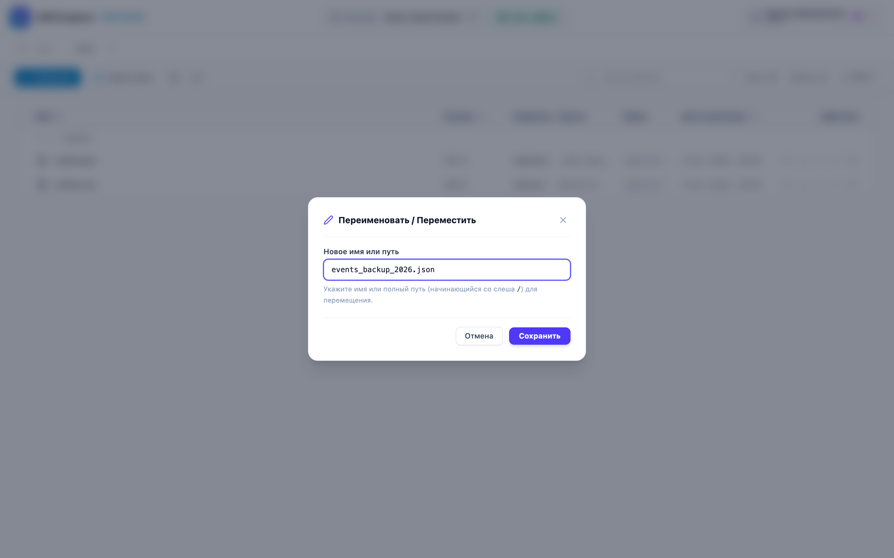
  
<em>Рисунок 8: Переименование и перемещение файла events.json</em>

---

### 7.3. Скачивание файлов и потоковая архивация папок в ZIP

- Файл: нажмите иконку скачивания в строке таблицы, браузер скачает файл из HDFS.
- Каталог: нажмите **Скачать папку** в строке каталога или на панели действий. Сервер упакует все вложенные файлы в ZIP на лету и отдаст архив потоком; ограничения на размер нет.

---

### 7.4. Удаление файлов и рекурсивное удаление каталогов

Нажмите **Удалить** в строке файла или папки и подтвердите удаление в открывшемся окне:

  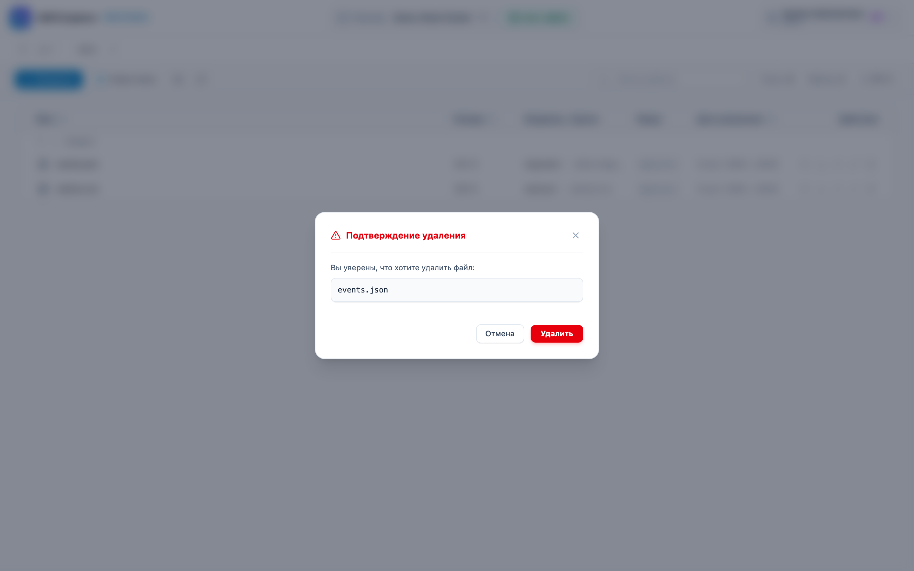
  
<em>Рисунок 9: Окно подтверждения удаления файла или каталога</em>

> [!WARNING]
> **Внимание**: удаление в HDFS необратимо, если в кластере не настроена корзина `.Trash`. Чтобы удалить непустой каталог, отметьте **Рекурсивное удаление**: будет удалено все его содержимое.

---

### 7.5. Мультивыбор и пакетные операции (Batch Actions)

Групповые действия выполняются над несколькими выбранными файлами и папками:

- Отдельные объекты: чекбоксы в первой колонке таблицы.
- Все объекты каталога: чекбокс в заголовке таблицы выделяет или снимает выделение со всех файлов текущего каталога.
- Диапазон: отметьте первый элемент, затем щелкните последний с нажатой `Shift`; выделятся все элементы между ними.
- Клавиатура: `Cmd + A` (macOS) или `Ctrl + A` (Linux/Windows) выделяет все файлы списка, `Escape` снимает выделение.

Когда выбран хотя бы один объект, внизу экрана появляется панель пакетных действий (Batch Action Bar):

  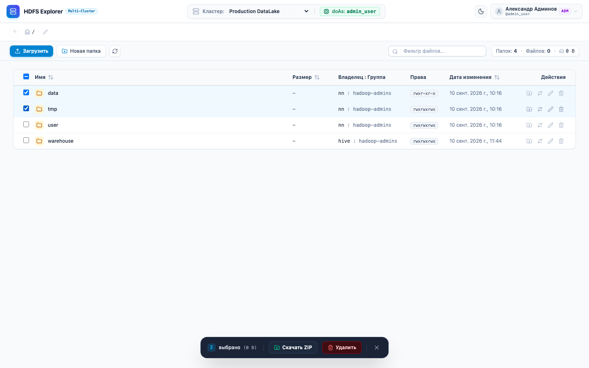
  
<em>Рисунок 10: Плавающая панель пакетных действий со счетчиком выбранных объектов и суммарным объемом</em>

#### Пакетные операции
- **Скачать ZIP** (Batch Download):
  - шлюз собирает выбранные файлы и папки и упаковывает их в один ZIP-архив на лету;
  - браузер получает архив одним потоком, без временных файлов на диске клиента;
  - имя архива содержит идентификатор кластера и метку времени, например `hdfs-batch-cluster-1-2026-09-10.zip`.
- **Удалить** (Batch Delete):
  - открывает окно подтверждения со списком удаляемых объектов и их размерами;
  - для каталогов есть флаг рекурсивного удаления;
  - после выполнения окно показывает удаленные пути и причины ошибок по остальным (например, нехватка POSIX-прав в HDFS).

  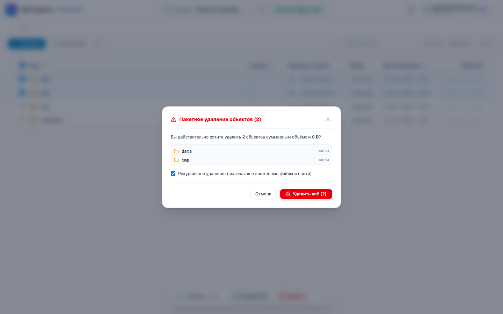
  
<em>Рисунок 11: Модальное окно пакетного удаления объектов HDFS</em>

---

## 8. Межкластерная передача данных (Cross-Cluster Copy)

Межкластерное копирование передает файлы и каталоги между независимыми Hadoop-кластерами без ручного запуска `hadoop distcp`.

  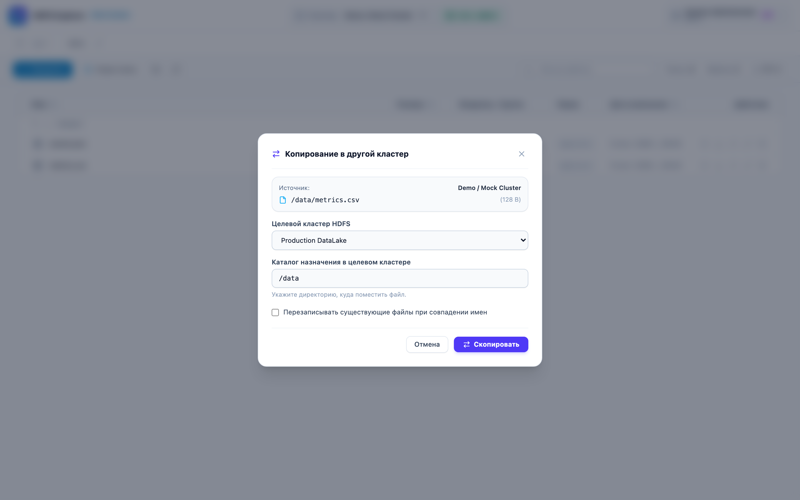
  
<em>Рисунок 12: Копирование датасета metrics.csv в целевой HDFS-кластер</em>

### Копирование в другой кластер
1. В строке файла или папки нажмите **Скопировать в другой кластер**.
2. В поле **Целевой кластер HDFS** выберите кластер; в списке только кластеры, доступные вам для записи.
3. В поле **Каталог назначения** укажите путь в целевом кластере.
4. Чтобы заменить существующие файлы, отметьте флаг перезаписи.
5. Нажмите **Скопировать**. Шлюз передаст данные потоком и покажет уведомление о завершении.

---

## 9. Горячие клавиши

| Клавиша / Комбинация | Область действия | Выполняемое действие |
| :--- | :--- | :--- |
| `Cmd + A` / `Ctrl + A` | Таблица файлов | Выделить все файлы и папки в текущем каталоге |
| `Shift + клик` | Чекбоксы файлов | Диапазонное выделение от предыдущего выбранного элемента |
| `Escape` | Панель / модальные окна | Снять выделение со всех файлов или закрыть модальное окно |
| `Enter` | Формы создания / переименования | Подтвердить операцию и отправить форму |
| Клик по строке папки | Таблица файлов | Переход внутрь выбранной директории |
| Клик по строке файла | Таблица файлов | Открытие окна предпросмотра файла |
| Клик по заголовку колонки | Шапка таблицы | Сортировка по имени, размеру или дате изменения |

### Как обрабатываются большие каталоги и файлы
- Виртуализация списка: в DOM есть только видимые строки таблицы плюс запас, поэтому число DOM-узлов не растет с размером каталога.
- Потоковая передача: файлы для предпросмотра и скачивания передаются частями, сервер не держит файл в памяти целиком.
- Пул RPC-соединений Hadoop IPC с keep-alive: соединения к NameNode переиспользуются, и Kerberos-рукопожатие не повторяется на каждый запрос.

---

## 10. Диагностика ошибок

### Q: Почему при попытке загрузки или удаления возникает ошибка «Permission Denied»?
> О: Sklad выполняет операции от вашего имени через `doAs`. Если у вас в HDFS нет права на запись (`w`) в каталог или права на выполнение (`x`) в родительских каталогах, NameNode отклонит операцию. Попросите администраторов кластера выдать POSIX-права или HDFS ACL.

---

### Q: Что делать, если при входе через Kerberos SSO возникает ошибка «SPNEGO ticket not provided»?
> О: Проверьте:
> 1. Домен Sklad добавлен в доверенные для Negotiate: параметр `network.negotiate-auth.trusted-uris` в Firefox или групповая политика `AuthServerAllowlist` в Chrome/Edge.
> 2. На рабочей станции есть действующий билет Kerberos TGT: `klist` в терминале.
>
> Пока SSO не работает, войдите по логину и паролю LDAP.

---

### Q: Поддерживается ли работа с NameNode High Availability (HA Active/Standby)?
> О: Да. В `clusters.yaml` для кластера задается список URL всех NameNode (`webhdfs_urls`). Шлюз находит активную NameNode, а при переключении (failover) направляет запросы на бывшую Standby NameNode, ставшую Active.

---

### Q: Какой максимальный размер файла поддерживается для предпросмотра?
> О: По умолчанию читается первый 1 МБ файла; лимит задает параметр `preview_max_bytes` в `clusters.yaml`. Поэтому размер самого файла на предпросмотр не влияет, хоть сотни гигабайт. Чтобы получить файл целиком, нажмите **Скачать**.
