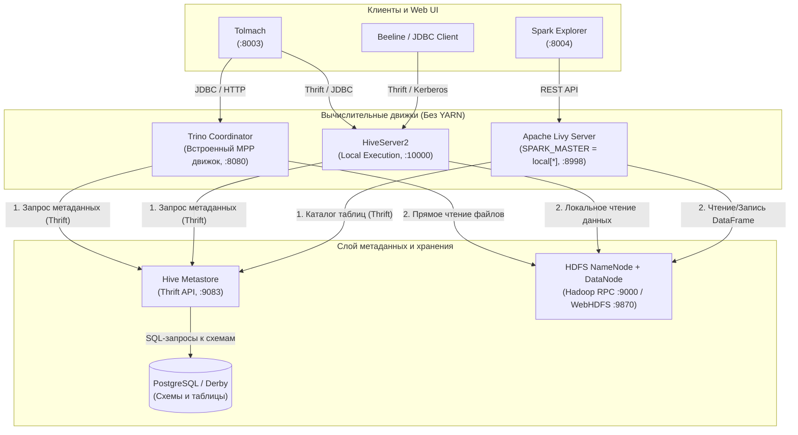

# Архитектура и работа Apache Hive и Apache Spark без кластера YARN

Документ описывает, как Apache Hive и Apache Spark работают на тестовых, локальных и демонстрационных стендах без Apache Hadoop YARN (ResourceManager и NodeManager): схему взаимодействия компонентов и конфигурацию.

---

## Содержание

- [1. Накладные расходы YARN на стенде](#1-накладные-расходы-yarn-на-стенде)
- [2. Apache Spark без YARN](#2-apache-spark-без-yarn)
  - [2.1 Режим `local[*]`](#21-режим-local)
  - [2.2 Интеграция с Apache Livy](#22-интеграция-с-apache-livy)
  - [2.3 Spark Standalone и Spark on Kubernetes](#23-spark-standalone-и-spark-on-kubernetes)
- [3. Apache Hive без YARN](#3-apache-hive-без-yarn)
  - [3.1 Hive Metastore (HMS) как независимый сервис](#31-hive-metastore-hms-как-независимый-сервис)
  - [3.2 HiveServer2 (HS2) в локальном режиме](#32-hiveserver2-hs2-в-локальном-режиме)
  - [3.3 Делегирование вычислений Trino и Spark](#33-делегирование-вычислений-trino-и-spark)
- [4. Схема взаимодействия компонентов](#4-схема-взаимодействия-компонентов)
- [5. Примеры конфигурации стенда](#5-примеры-конфигурации-стенда)
  - [5.1 Конфигурация Livy и Spark (`livy.conf`, `spark-defaults.conf`)](#51-конфигурация-livy-и-spark-livyconf-spark-defaultsconf)
  - [5.2 Конфигурация HiveServer2 (`hive-site.xml`)](#52-конфигурация-hiveserver2-hive-sitexml)
- [6. Сравнение режимов работы: YARN vs Standalone/Local](#6-сравнение-режимов-работы-yarn-vs-standalonelocal)

---

## 1. Накладные расходы YARN на стенде

В промышленном кластере Hadoop YARN отвечает за централизованное распределение ресурсов CPU и RAM, планирование очередей (*Capacity Scheduler*, *Fair Scheduler*) и изоляцию процессов через cgroups в NodeManager-контейнерах.

На стендах для локальной разработки, CI/CD и демонстраций YARN добавляет накладные расходы:
- Демоны RM, NM и JobHistoryServer занимают 4–8 GB RAM.
- Согласование контейнеров, запуск `ApplicationMaster` и регистрация исполнителей добавляют 10–30 секунд задержки.
- Для NodeManager нужно настраивать Kerberos-тикеты.

Без YARN компоненты стенда запускаются за 1–3 секунды, весь стек занимает до 1–2 GB RAM.

---

## 2. Apache Spark без YARN

### 2.1 Режим `local[*]`

В режиме `local[*]` Spark не обращается к внешним кластерным менеджерам:
- Один процесс JVM: Spark Driver и вычислительные потоки (*Executors*) выполняются в одном Java-процессе.
- Число потоков: `*` означает все логические ядра хоста или контейнера; вместо `*` можно указать число, например `local[4]`.
- Доступ к данным: Spark считывает и записывает файлы в HDFS (`hdfs://namenode:9000`) по прямому протоколу Hadoop RPC / WebHDFS или в S3/MinIO по протоколу S3A, используя встроенные библиотеки Hadoop Client.

### 2.2 Интеграция с Apache Livy

Apache Livy предоставляет REST API для интерактивного создания сессий и отправки пакетных заданий (PySpark, Spark SQL, Scala Spark):
1. Веб-клиент (*Spark Explorer*) отправляет POST-запрос на создание сессии в Livy.
2. Livy стартует локальный процесс `spark-submit` в режиме `deploy-mode = client` с параметром `master = local[*]`.
3. Сессия сразу переходит в статус `idle` и готова принимать код на исполнение, не ожидая аллокации ресурсов от YARN.
4. Ограничение ресурсов регулируется напрямую параметрами JVM: `spark.driver.memory` и `spark.executor.memory`.

### 2.3 Spark Standalone и Spark on Kubernetes

- Spark Standalone Mode: встроенный мастер Spark (`spark://master:7077`), не требующий компонентов Hadoop. Поднимается один контейнер `spark-master` и один или несколько `spark-worker`.
- Spark on Kubernetes: Driver обращается напрямую к Kubernetes API и динамически создает Pod'ы для каждого исполнителя.

---

## 3. Apache Hive без YARN

Apache Hive состоит из уровня хранения метаданных (Hive Metastore) и уровня выполнения запросов (HiveServer2).

### 3.1 Hive Metastore (HMS) как независимый сервис

Hive Metastore не зависит от YARN:
- HMS — это самостоятельный Thrift-сервис (порт `9083`), управляющий каталогом метаданных (схемы таблиц, типы данных колонок, партиции, пути хранения файлов в HDFS/S3, статистика).
- Данные метастора сохраняются в реляционной СУБД (PostgreSQL, MySQL, MariaDB или локальная встраиваемая Apache Derby).
- Любые внешние движки (Trino, Spark, HiveServer2, Presto) обращаются к HMS напрямую по протоколу Thrift.

### 3.2 HiveServer2 (HS2) в локальном режиме

HiveServer2 принимает SQL-запросы по протоколу JDBC/ODBC (Thrift порт `10000`):
- Fetch Task: DDL-команды (`CREATE TABLE`, `ALTER`, `DROP`, `SHOW TABLES`, `DESCRIBE`) и простые выборки (`SELECT * FROM table LIMIT 50`) выполняются самим процессом HS2 без генерации задач MapReduce/Tez.
- Local Mode: для аналитических запросов с агрегацией и фильтрацией при отсутствии YARN движок переключается в локальный режим (Local MapReduce или Local Tez), исполняя вычисления в пуле потоков внутри JVM HiveServer2.

### 3.3 Делегирование вычислений Trino и Spark

На стендах задачи MapReduce/Tez заменяют запросами к MPP-движку Trino или к Spark SQL:
- Trino Coordinator получает из Hive Metastore только схему и метаданные каталога, затем параллельно читает Parquet/ORC-файлы из HDFS и обрабатывает их в памяти своих worker-узлов.
- Spark Explorer использует `spark.hadoop.hive.metastore.uris` и обращается к метастору напрямую через `HiveContext` / `SparkSession.builder().enableHiveSupport()`.

---

## 4. Схема взаимодействия компонентов



---

## 5. Примеры конфигурации стенда

### 5.1 Конфигурация Livy и Spark (`livy.conf`, `spark-defaults.conf`)

Файл `livy.conf`:
```properties
livy.server.port = 8998
livy.server.host = 0.0.0.0
# Указание локального мастера Spark
livy.spark.master = local[*]
livy.spark.deploy-mode = client
livy.repl.enable-hive-context = true
livy.impersonation.enabled = true
```

С `livy.impersonation.enabled = true` сессия работает от имени `proxyUser`. В режиме `local[*]` при Hive Metastore с Kerberos такая сессия не подключается к метастору: `SHOW DATABASES` и `spark.read.table(...)` завершаются ошибкой `Unable to instantiate org.apache.hadoop.hive.ql.metadata.SessionHiveMetaStoreClient`, в логе сессии (`curl -s 'http://<livy_host>:8998/sessions/<id>/log?size=3000'`) — `TTransportException: GSS initiate failed`. Spark получает делегационные токены HDFS и Hive Metastore для `proxyUser` только при отправке приложения в YARN, а в `local[*]` у пользователя нет ни токена, ни своего билета Kerberos. HDFS при этом работает: Hadoop RPC входит от principal Livy и действует от имени пользователя (`de_user (auth:PROXY) via hive/hive-server@COMPANY.LOCAL`). Поэтому демо-стенд `demo/spark` запускает сессии в YARN cluster mode, конфигурация описана в `demo/spark/README.md`, раздел «Запуск сессий в YARN».

**Внимание.** В этом режиме `livy.impersonation.enabled = true` не изолирует пользователей. При `livy.spark.master = local[*]` и `livy.spark.deploy-mode = client` драйвер и код каждого пользователя выполняются на хосте Livy под ОС-учеткой `livy`, а `proxyUser` меняет только имя, от которого идут обращения к HDFS и Hive. Код пользователя может прочитать keytab Livy; эта учетка входит в `livy.superusers` и `hadoop.proxyuser.livy.*`, поэтому с ее keytab можно имперсонировать любого пользователя. Признак режима — `"appId": null` у сессий в ответе `curl -s http://<livy_host>:8998/sessions`. Конфигурация из этого раздела подходит для однопользовательского стенда или стенда, где все пользователи доверенные; для разграничения прав нужен Livy с `livy.spark.master = yarn` и `livy.spark.deploy-mode = cluster`.

Файл `spark-defaults.conf`:
```properties
# Локальный мастер
spark.master = local[*]
spark.app.name = LivySparkApp

# Прямое подключение к файловой системе HDFS
spark.hadoop.fs.defaultFS = hdfs://hdfs-cluster-1:9000

# Прямое подключение к метастору Hive
spark.hadoop.hive.metastore.uris = thrift://hive-metastore-1:9083
spark.sql.catalogImplementation = hive
spark.sql.warehouse.dir = hdfs://hdfs-cluster-1:9000/warehouse

# Лимиты памяти локальной JVM
spark.driver.memory = 1g
spark.executor.memory = 1g
```

### 5.2 Конфигурация HiveServer2 (`hive-site.xml`)

```xml
<configuration>
  <!-- Адрес сервиса Hive Metastore -->
  <property>
    <name>hive.metastore.uris</name>
    <value>thrift://hive-metastore-1:9083</value>
  </property>

  <!-- Путь к хранилищу таблиц в HDFS -->
  <property>
    <name>hive.metastore.warehouse.dir</name>
    <value>hdfs://hdfs-cluster-1:9000/warehouse</value>
  </property>

  <!-- Порт и хост HiveServer2 -->
  <property>
    <name>hive.server2.thrift.port</name>
    <value>10000</value>
  </property>
  <property>
    <name>hive.server2.thrift.bind.host</name>
    <value>0.0.0.0</value>
  </property>

  <!-- Отключение тяжелого кэширования для легкого стенда -->
  <property>
    <name>hive.query.results.cache.enabled</name>
    <value>false</value>
  </property>
</configuration>
```

---

## 6. Сравнение режимов работы: YARN vs Standalone/Local

| Характеристика | Стенд без YARN (`local[*]`) | Кластер с Apache Hadoop YARN |
|---|---|---|
| Назначение | Разработка, демонстрационные стенды, CI/CD тесты, локальная отладка | Продакшн-эксплуатация, многопользовательская аналитика больших данных |
| Потребление ресурсов | Минимальное (~1–2 GB RAM на весь стек сервисов) | Высокое (от 8–16 GB RAM на служебные демоны и контейнеры) |
| Время запуска сессии Spark | 1–3 секунды (in-process JVM) | 15–45 секунд (согласование с RM, запуск AM и контейнеров) |
| Управление очередями | Отсутствует (FIFO среди потоков процесса) | Иерархические очереди *Capacity Scheduler* с весами и квотами |
| Изоляция вычислений | На уровне потоков единой JVM | На уровне cgroups и операционной системы контейнеров |
| Горизонтальное масштабирование | Ограничено ресурсами одного хоста/контейнера | Распределение на десятки и сотни физических серверов |
| Сложность инфраструктуры | Низкая (несколько Docker-контейнеров) | Высокая (требуется мониторинг нод, Healthcheck, ZooKeeper, HA) |
