<div align="center">


# Руководство пользователя Iskra (Spark)

<p>Веб-студия для разработки, отладки и запуска аналитических задач и ETL на Apache Spark (PySpark, Scala Spark, Spark SQL) с управлением сессиями Apache Livy и ресурсами YARN</p>

</div>

---

Руководство для дата-инженеров, ML-специалистов и аналитиков данных, работающих в Iskra (Spark). Iskra — веб-среда в стиле notebook-IDE для работы с кластерами Apache Spark через шлюз Apache Livy. В ней можно переключаться между PySpark, Scala Spark и Spark SQL, просматривать метаданные таблиц Hive Metastore и Apache Iceberg, задавать ресурсы драйвера и executor'ов и очередь YARN. Вход выполняется через LDAP или Kerberos SSO, доступ ограничивается ролевой моделью.

---

## Содержание

1. [Функции Iskra (Spark)](#1-функции-iskra-spark)
2. [Архитектура и интеграция компонентов](#2-архитектура-и-интеграция-компонентов)
3. [Аутентификация, безопасность и имперсонация](#3-аутентификация-безопасность-и-имперсонация)
4. [Главный экран и организация рабочей студии](#4-главный-экран-и-организация-рабочей-студии)
5. [Каталог метаданных (Hive Metastore & Apache Iceberg)](#5-каталог-метаданных-hive-metastore--apache-iceberg)
6. [Разработка и выполнение кода](#6-разработка-и-выполнение-кода)
   - [Поддержка языков: PySpark, Scala Spark и Spark SQL](#61-поддержка-языков-pyspark-scala-spark-и-spark-sql)
   - [Независимые буферы кода и кэширование результатов](#62-независимые-буферы-кода-и-кэширование-результатов)
   - [Табличный предпросмотр DataFrame и экспорт CSV](#63-табличный-предпросмотр-dataframe-и-экспорт-csv)
   - [Консоль вывода, логирование стадий и Execution Plan](#64-консоль-вывода-логирование-стадий-и-execution-plan)
7. [Управление сессиями Spark и интеграция с YARN](#7-управление-сессиями-spark-и-интеграция-с-yarn)
   - [Параметры сессии и профили ресурсов](#71-параметры-сессии-и-профили-ресурсов)
   - [Матрица версий Spark и виртуальные окружения Python](#72-матрица-версий-spark-и-виртуальные-окружения-python)
   - [Внешние библиотеки: Maven Packages, JAR и Py-Files](#73-внешние-библиотеки-maven-packages-jar-и-py-files)
   - [Очереди YARN и разграничение прав доступа (Queue ACL)](#74-очереди-yarn-и-разграничение-прав-доступа-queue-acl)
8. [Вкладки и сохранение рабочего пространства](#8-вкладки-и-сохранение-рабочего-пространства)
9. [Горячие клавиши](#9-горячие-клавиши)
10. [Диагностика ошибок и частые вопросы](#10-диагностика-ошибок-и-частые-вопросы)

---

## 1. Функции Iskra (Spark)

Схема компонентов:

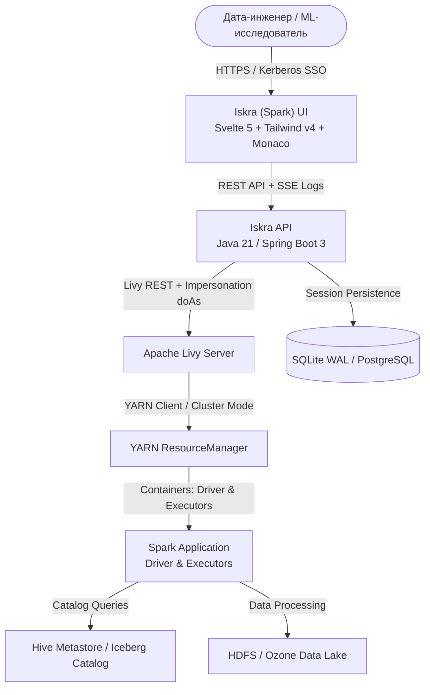

### Функции

- Три языка в одном редакторе: PySpark, Scala Spark и Spark SQL, для каждого языка хранится отдельный контекст.
- Управление сессиями Livy: создание, отображение состояния (`idle`, `busy`, `dead`), перезапуск и сброс интерактивной сессии без перезапуска приложения YARN.
- Выбор версии Spark (3.5.1, 3.2.4, 2.4.8 legacy) и предустановленной среды Conda/venv из HDFS (`py310-default`, `py310-ml` с PyTorch/Scikit-Learn).
- Контроль доступа: аутентификация LDAP или Kerberos SPNEGO, имперсонация (`proxyUser / doAs`) и проверка прав на запуск в очередях YARN (`root.analytics`, `root.etl`, `root.adhoc`).
- Каталог данных: базы, таблицы и колонки из Hive Metastore и Apache Iceberg Catalog в боковой панели, вставка шаблона чтения таблицы в код.
- Результаты DataFrame: таблица с постраничным просмотром, фильтрацией и выгрузкой в CSV с защитой от формульных инъекций.
- Рабочее пространство на сервере: вкладки, текст скриптов, параметры сессий и буферы сохраняются, и работу можно продолжить с другого компьютера.

---

## 2. Архитектура и интеграция компонентов

Бэкенд Iskra — сервис на Java 21 / Spring Boot 3. Запросы к Apache Livy он отправляет через Circuit Breaker. Последовательность выполнения кода:

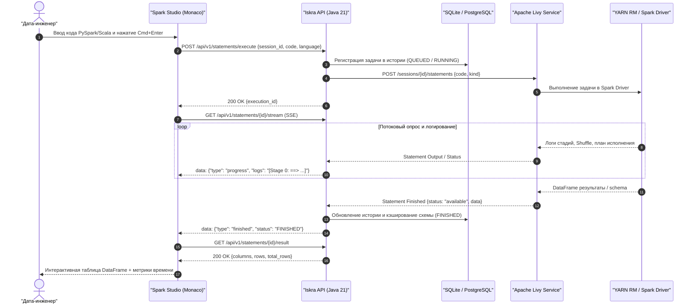

---

## 3. Аутентификация, безопасность и имперсонация

Вход выполняется на экране аутентификации. Поддерживаются Active Directory / OpenLDAP и вход по Kerberos SPNEGO SSO.

<div align="center">
  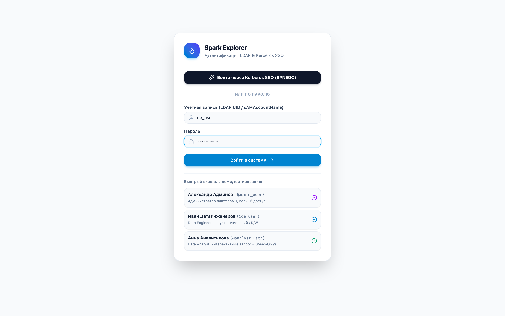
  <p><em>Рисунок 1: Экран аутентификации LDAP & Kerberos SSO</em></p>
</div>

### Ролевая модель (RBAC)

| Ролевая группа | Доступные кластеры | Разрешенные очереди YARN | Профили ресурсов | Действия с кодом |
| :--- | :---: | :---: | :---: | :---: |
| Platform Admins (`hadoop-admins`) | Все кластеры | `root.*` (все очереди) | Small, Medium, Large | Полный доступ (RW) |
| Data Engineers (`data-engineers`) | Prod / Sandbox | `root.etl`, `root.analytics` | Small, Medium, Large | Полный доступ (RW) |
| BI Analysts (`bi-analysts`) | Sandbox / Prod (Spark SQL) | `root.analytics`, `root.adhoc` | Small, Medium | Только чтение (SELECT / display) |

### Имперсонация в Livy и YARN (`proxyUser` / `doAs`)

Код, отправленный через шлюз, выполняется на узлах YARN от имени вошедшего пользователя (в примерах — `de_user`). Поэтому к нему применяются права HDFS POSIX и политики Ranger/Sentry этого пользователя, а не сервисной учётной записи.

Дерево каталога (базы, таблицы, колонки) на реальном кластере строится запросами `SHOW DATABASES`, `SHOW TABLES` и `DESCRIBE` в вашей активной сессии: без запущенной сессии вместо дерева показывается сообщение «Для просмотра каталога запустите сессию Spark на кластере …» и кнопка **Обновить**. После выхода из Iskra ваши сессии закрываются, в том числе открытые в других вкладках.

---

## 4. Главный экран и организация рабочей студии

После входа открывается главный экран Iskra.

<div align="center">
  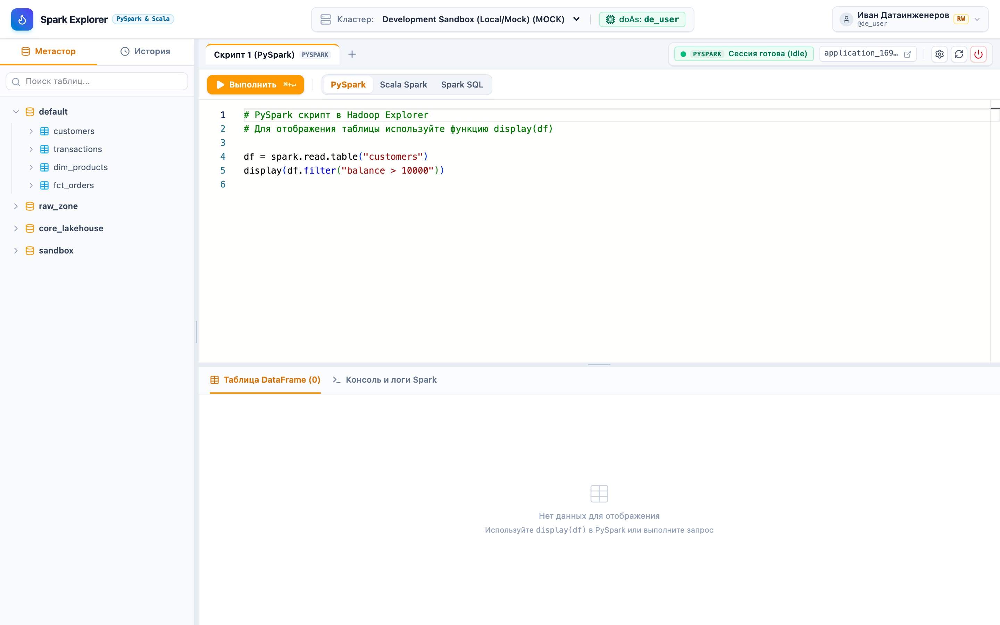
  <p><em>Рисунок 2: Главный экран рабочей студии Iskra</em></p>
</div>

### Элементы интерфейса

1. Верхняя панель (Header Bar):
   - Логотип и бейдж платформы (`Iskra PySpark & Scala`).
   - Селектор активного кластера Hadoop (например, `Development Sandbox` или `Production Hadoop`).
   - Индикатор текущего контекста имперсонации (`doAs: de_user`).
   - Профиль пользователя с бейджами ролей (`RW` — чтение/запись, `RO` — только чтение).
2. Панель сессии (Session Bar):
   - Кнопка **«Выполнить» (`⌘+↵` / `Ctrl+Enter`)** и кнопка прерывания задачи **«Остановить»**.
   - Переключатель языка скрипта (**PySpark**, **Scala Spark**, **Spark SQL**).
   - Индикатор статуса сессии Livy (например, зелёный индикатор и `PYSPARK Сессия готова (Idle)`).
   - Ссылка на YARN Application Tracking URL (`application_169...`).
   - Кнопки конфигурации параметров сессии, перезапуска и завершения.
3. Левая боковая панель (Sidebar):
   - Вкладка **Метастор**: иерархическое дерево каталогов, баз данных, таблиц и атрибутов колонок.
   - Вкладка **История**: архив выполненных задач с метриками и временем запуска.
4. Редактор (Monaco Editor) в центре:
   - Номера строк, мини-карта и подсветка синтаксиса.
5. Панель результатов внизу (Resizable Split Panel, высота меняется перетаскиванием):
   - Переключение между интерактивной таблицей **DataFrame** и консолью **Логи Spark**.
   - Панель фильтрации строк и кнопка экспорта в CSV.

---

## 5. Каталог метаданных (Hive Metastore & Apache Iceberg)

В боковой панели отображаются метаданные озера данных: схему таблицы можно посмотреть до написания кода и запуска задачи на кластере.

<div align="center">
  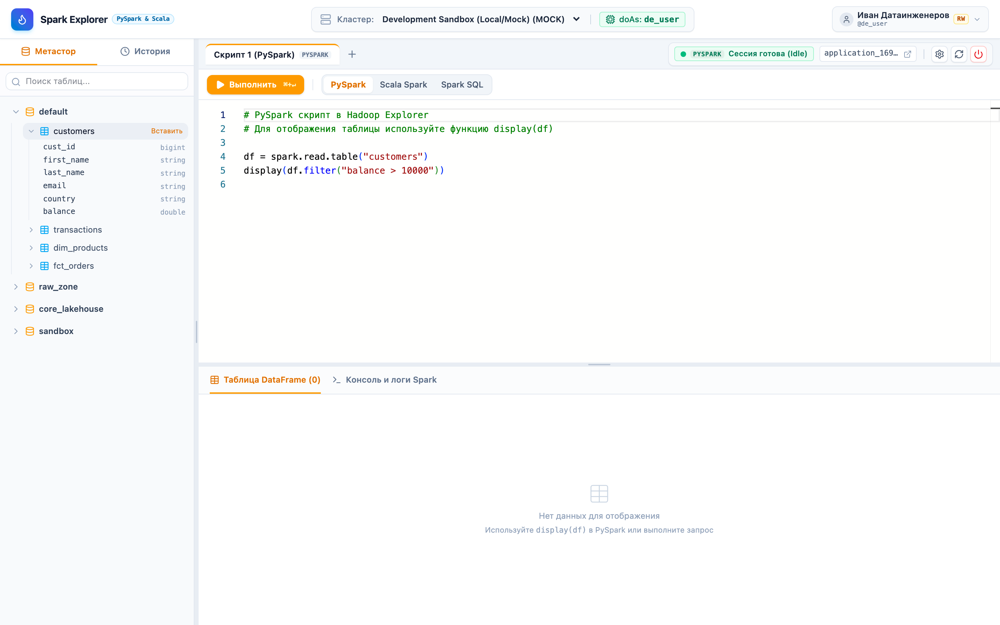
  <p><em>Рисунок 3: Дерево каталога метаданных и инспекция структуры таблицы customers</em></p>
</div>

### Работа с каталогом

- Базы данных (`default`, `raw_zone`, `core_lakehouse`, `sandbox`) раскрываются щелчком.
- Щелчок по таблице (например, `customers`) показывает список колонок с типами данных (`bigint`, `string`, `double`, `timestamp`).
- При наведении на имя таблицы появляется кнопка **«Вставить»**. Она вставляет в редактор код чтения таблицы для выбранного языка:
  - Для PySpark: `df = spark.read.table("default.customers")`
  - Для Scala Spark: `val df = spark.read.table("default.customers")`
  - Для Spark SQL: `SELECT * FROM default.customers LIMIT 50;`

---

## 6. Разработка и выполнение кода

### 6.1. Поддержка языков: PySpark, Scala Spark и Spark SQL

Iskra поддерживает три языка. Язык переключается на панели инструментов:

```
[ PySpark ]  [ Scala Spark ]  [ Spark SQL ]
```

- PySpark: data science, ML-пайплайны, Pandas API on Spark.
- Scala Spark: нативный API Spark, типизированный Dataset API.
- Spark SQL: ANSI SQL-запросы, агрегации, оконные функции; план запроса строит оптимизатор Catalyst.

### 6.2. Независимые буферы кода и кэширование результатов

Код и результаты хранятся в отдельных буферах для каждого языка:
- Каждая вкладка сохраняет независимый текст кода для PySpark, Scala и SQL.
- Результаты выполнения (таблицы DataFrame и логи) кэшируются раздельно для каждого языка. При переключении с PySpark на Scala или SQL результаты предыдущего вычисления не сбрасываются.

### 6.3. Табличный предпросмотр DataFrame и экспорт CSV

После выполнения кода результат отображается в виде таблицы:

<div align="center">
  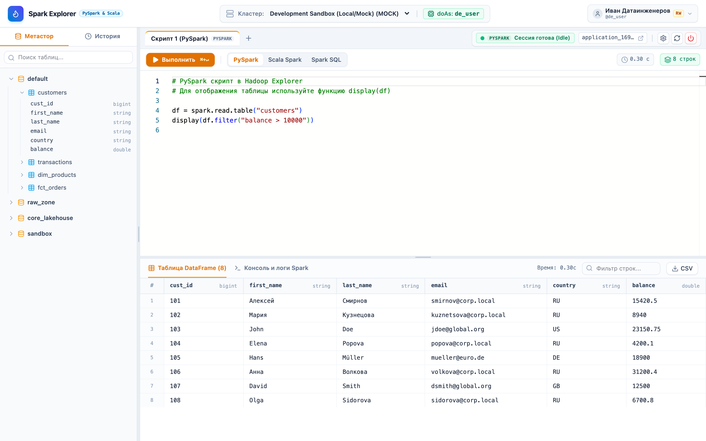
  <p><em>Рисунок 4: Таблица DataFrame с результатами выполнения PySpark-скрипта</em></p>
</div>

- Таблица показывает имена колонок, типы данных и строки выборки.
- Поле **«Фильтр строк...»** фильтрует видимые строки в браузере, без повторного обращения к кластеру.
- Кнопка **«Экспорт CSV»** выгружает CSV-файл. Значения, начинающиеся с `=`, `+`, `-`, `@`, экранируются, чтобы Excel не выполнил их как формулы.

### 6.4. Консоль вывода, логирование стадий и Execution Plan

Вкладка **«Консоль и логи Spark»** показывает ход выполнения задачи:

<div align="center">
  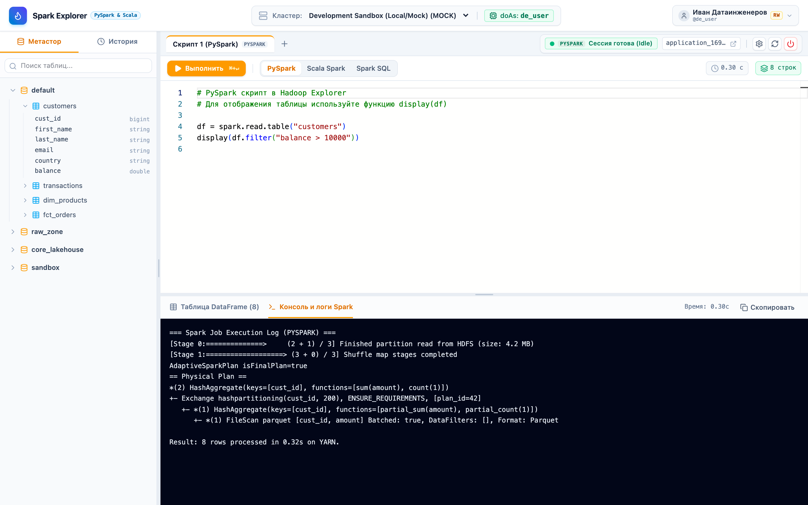
  <p><em>Рисунок 5: Консоль выполнения, сборщик логов и физический план выполнения Catalyst</em></p>
</div>

- Стадии (Stages): прогресс по партициям в формате `(X + Y) / Z`, обновляется во время выполнения.
- Physical Execution Plan: физический план Catalyst (HashAggregate, Exchange hashpartitioning, FileScan parquet).
- Ошибки: стек-трейс JVM и Python (`Py4JJavaError`, `AnalysisException`) с указанием строк кода.
- Кнопка **«Скопировать»** копирует полный лог в буфер обмена, например для баг-репорта.

### Примеры скриптов

#### Scala Spark
<div align="center">
  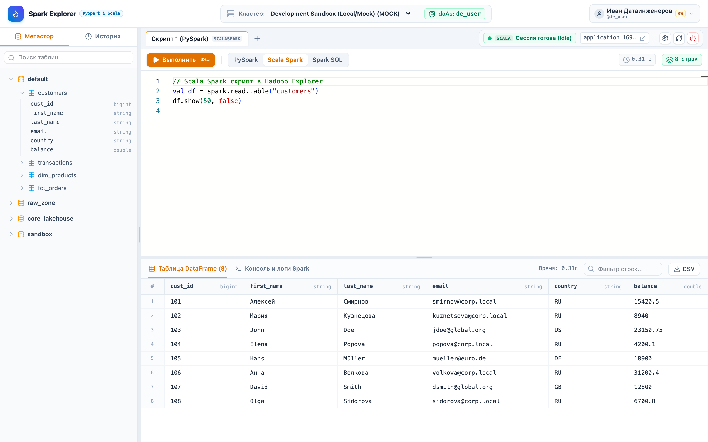
  <p><em>Рисунок 6: Разработка и отладка аналитического скрипта на Scala Spark</em></p>
</div>

```scala
// Scala Spark аналитический скрипт
val df = spark.read.table("customers")
val res = df.filter($"balance" > 10000)
res.show(50, false)
```

#### Spark SQL
<div align="center">
  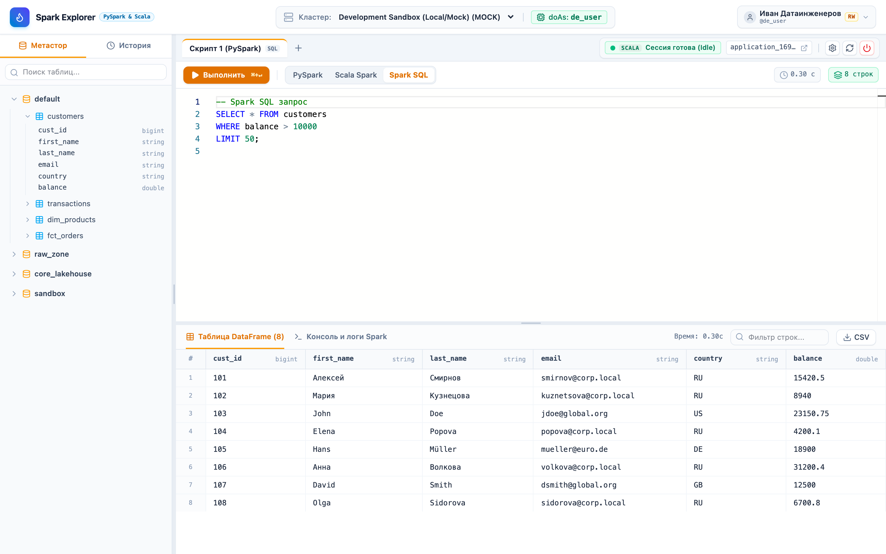
  <p><em>Рисунок 7: Выполнение интерактивного запроса Spark SQL</em></p>
</div>

```sql
-- Spark SQL интерактивный запрос
SELECT cust_id, first_name, last_name, balance
FROM customers
WHERE balance > 10000
ORDER BY balance DESC
LIMIT 50;
```

---

## 7. Управление сессиями Spark и интеграция с YARN

Параметры сессии Livy задаются в модальном окне **«Параметры сессии Spark»**.

<div align="center">
  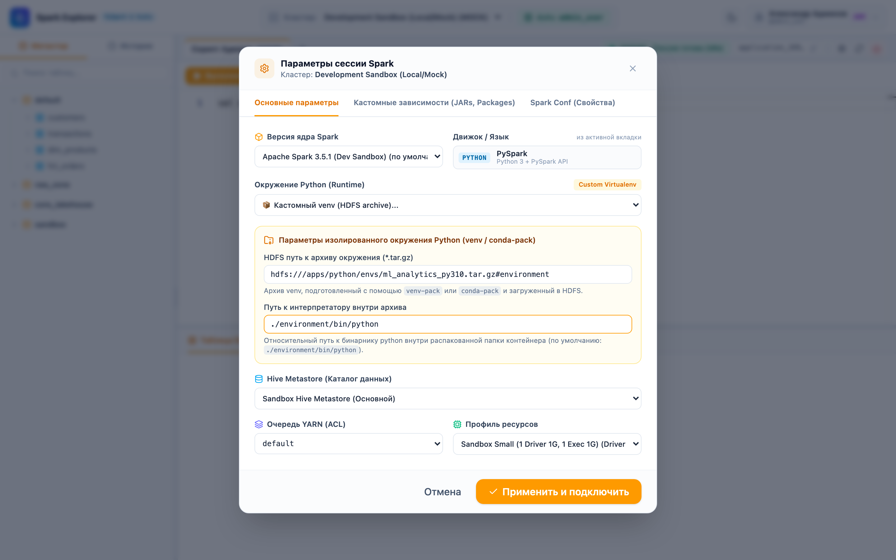
  <p><em>Рисунок 8: Конфигурация параметров сессии Spark, профилей ресурсов и очередей YARN</em></p>
</div>

### 7.1. Параметры сессии и профили ресурсов

На вкладке **«Основные параметры»** выберите профиль ресурсов:

| Профиль ресурсов | Память Driver | Ядра Driver | Память Executor | Ядра Executor | Кол-во Executor | Назначение |
| :--- | :--- | :--- | :--- | :--- | :--- | :--- |
| Small (Sandbox) | 1 GB | 1 core | 1 GB | 1 core | 1-2 | Отладка синтаксиса, быстрые выборки |
| Medium (Standard) | 4 GB | 2 cores | 8 GB | 2 cores | 4 | Регулярная аналитика, агрегации |
| Large (Production) | 8 GB | 4 cores | 16 GB | 4 cores | 8+ | Тяжелые JOIN-запросы, ML-обучение, большие витрины |

### 7.2. Матрица версий Spark и виртуальные окружения Python

- Версия Spark: Apache Spark 3.5.1, Spark 3.2.4 или Spark 2.4.8 для устаревших кластеров.
- Python Runtime (виртуальные окружения):
  - Предустановленные окружения: Conda/venv, распространяемые через архивы в HDFS (`spark.yarn.dist.archives`). Есть базовая среда с минимальным набором библиотек (`py310-default`) и ML-среда (`py310-ml` с PyTorch, Pandas, Scikit-Learn).
  - Собственный venv из HDFS: сессия запускается с вашим виртуальным окружением.

#### Подготовка и подключение собственного Python venv

1. Создайте и упакуйте окружение на хосте подготовки.
   Обычный `virtualenv` содержит абсолютные пути хоста, поэтому для узлов YARN его нужно упаковать с помощью [`venv-pack`](https://jcristharif.com/venv-pack/):
   ```bash
   # 1. Создание стандартного venv и установка зависимостей
   python3 -m venv my_project_env
   source my_project_env/bin/activate
   pip install pandas scikit-learn catboost venv-pack

   # 2. Упаковка в переносимый gzip-архив
   venv-pack -o my_project_env.tar.gz
   ```

2. Загрузите архив в HDFS:
   ```bash
   hdfs dfs -mkdir -p /apps/python/envs/
   hdfs dfs -put my_project_env.tar.gz /apps/python/envs/
   # или в домашний каталог пользователя:
   hdfs dfs -put my_project_env.tar.gz /user/$USER/envs/
   ```

3. Подключите окружение в интерфейсе Iskra:
   - Нажмите значок шестерёнки **«Параметры сессии Spark»** в верхней панели.
   - В выпадающем списке **«Окружение Python (Runtime)»** выберите пункт **«Кастомный venv (HDFS archive)...»**.
   - В появившемся блоке укажите:
     - HDFS-путь к архиву: `hdfs:///apps/python/envs/my_project_env.tar.gz#environment` (если суффикс `#environment` не указан, он добавляется автоматически).
     - Путь к интерпретатору: `./environment/bin/python`.
   - Нажмите **«Сохранить и перезапустить»** для старта сессии с кастомными библиотеками.

### 7.3. Внешние библиотеки: Maven Packages, JAR и Py-Files

На вкладке **«Кастомные зависимости»** подключаются внешние модули без пересборки кластера:
- Maven Packages: координаты артефактов (например, `org.apache.spark:spark-sql-kafka-0-10_2.12:3.5.1`).
- JAR-архивы: пути в HDFS или локальной ФС к собственным UDF и коннекторам.
- Python Files (`py-files`): дополнительные модули `.py` и `.zip`.

### 7.4. Очереди YARN и разграничение прав доступа (Queue ACL)

Выпадающий список очередей динамически фильтруется на бэкенде в соответствии с группами текущего пользователя. При попытке выбора недоступной очереди шлюз возвращает ошибку валидации до аллокации ресурсов.

---

## 8. Вкладки и сохранение рабочего пространства

Каждый скрипт открывается в отдельной вкладке:

<div align="center">
  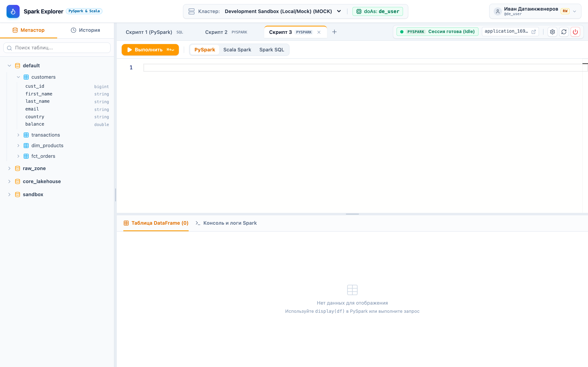
  <p><em>Рисунок 9: Многовкладочный режим со смешанными языковыми сессиями</em></p>
</div>

- Кнопка **`+`** (подсказка `title="Новый скрипт"`) на панели вкладок создаёт новую вкладку редактора.
- На каждой вкладке отображается бейдж активного языка (`PYSPARK`, `SCALA`, `SQL`).
- Изменения (создание вкладок, правка кода, переключение языка, ширина панелей) сохраняются в базе данных через `PUT /api/v1/workspace`. После закрытия браузера или входа с другого компьютера рабочее пространство восстанавливается вместе с текстом скриптов.

---

## 9. Горячие клавиши

Сочетания клавиш редактора Monaco:

| Сочетание клавиш (macOS) | Сочетание клавиш (Windows / Linux) | Действие |
| :--- | :--- | :--- |
| <kbd>Cmd</kbd> + <kbd>Enter</kbd> | <kbd>Ctrl</kbd> + <kbd>Enter</kbd> | Выполнить скрипт (или выделенный фрагмент кода) |
| <kbd>Ctrl</kbd> + <kbd>Space</kbd> | <kbd>Ctrl</kbd> + <kbd>Space</kbd> | Принудительный вызов контекстного автодополнения Monaco |
| <kbd>Cmd</kbd> + <kbd>F</kbd> | <kbd>Ctrl</kbd> + <kbd>F</kbd> | Поиск и замена в тексте скрипта |
| <kbd>Cmd</kbd> + <kbd>/</kbd> | <kbd>Ctrl</kbd> + <kbd>/</kbd> | Закомментировать / раскомментировать строку |
| <kbd>Option</kbd> + <kbd>Shift</kbd> + <kbd>F</kbd> | <kbd>Shift</kbd> + <kbd>Alt</kbd> + <kbd>F</kbd> | Автоматическое форматирование кода |
| <kbd>Esc</kbd> | <kbd>Esc</kbd> | Закрыть модальное окно настроек сессии |

---

## 10. Диагностика ошибок и частые вопросы

### В: Как вывести DataFrame в таблицу результатов?
> О: В PySpark используйте стандартный вызов `df.show()` или специальную функцию `display(df)`. В Scala Spark поддерживается `df.show(50, false)`, а в Spark SQL — стандартная выборка `SELECT ...`.

---

### В: Что делать, если сессия перешла в статус `dead` или завершилась по таймауту?
> О: Iskra раз в минуту переводит в статус `killed` сессии, которые находятся в статусе `idle` дольше `iskra.session-ttl-minutes` (по умолчанию 120 минут, задает администратор). Чтобы продолжить работу, нажмите **«Выполнить»**: шлюз создаст новую сессию в YARN с сохранёнными параметрами.

---

### В: Как подключить библиотеку, которой нет на кластере?
> О: Нажмите значок шестерёнки (**«Параметры сессии Spark»**), перейдите на вкладку **«Кастомные зависимости»** и укажите координаты Maven-пакета в поле **Packages** (например, `com.crealytics:spark-excel_2.12:3.5.0_0.20.3`). Перезапустите сессию для применения изменений.

---

### В: Почему выполнение прерывается с ошибкой OutOfMemoryError (OOM)?
> О: При агрегации больших объёмов данных или вызове `collect()` драйверу (Driver) может не хватить памяти. Что сделать:
> 1. Откройте параметры сессии и переключите профиль ресурсов на Medium или Large.
> 2. Не вызывайте полный `df.collect()` в PySpark: используйте `df.limit(100).toPandas()` или встроенный табличный вывод.
> 3. Фильтруйте по партициям (`partition pruning`) до группировки.

---

<div align="center">
  <sub>Pristan</sub>
</div>
