<div align="center">


# Руководство пользователя: Parom

<p>Межкластерная репликация HDFS через WAN с ограничением полосы (Hierarchical Token Bucket), Kerberos-изоляцией и планировщиком</p>

</div>

---

Parom — сервис Pristan для репликации данных HDFS между кластерами в разных ЦОД (DC1 ➔ DC2 ➔ DC3) через WAN-каналы. Руководство описывает архитектуру, ролевую модель, режимы синхронизации и работу в веб-интерфейсе; оно рассчитано на операторов, инженеров данных и администраторов платформы.

Полосу WAN ограничивает трехуровневый Hierarchical Token Bucket, поэтому репликация не занимает канал сверх заданных квот. Перед коммитом файла приемник сверяет SHA-256 и только затем атомарно переименовывает staging-файл в целевой. Задачи запускаются вручную или по расписанию (Cron Scheduler), в том числе от сервисной учетной записи.

---

## Содержание

1. [Архитектура и потоки данных](#1-архитектура-и-потоки-данных)
2. [Топология ЦОД и кластеров HDFS](#2-топология-цод-и-кластеров-hdfs)
3. [Многоуровневый контроль полосы (Hierarchical Token Bucket)](#3-многоуровневый-контроль-полосы-hierarchical-token-bucket)
4. [Аутентификация и ролевая модель доступа (RBAC)](#4-аутентификация-и-ролевая-модель-доступа-rbac)
   - [Роль администратора (ADMIN / admin_user / ADM)](#41-роль-администратора-admin--admin_user--adm)
   - [Роль инженера данных (WRITER / writer_user / RW)](#42-роль-инженера-данных-writer--writer_user-de_user--rw)
   - [Роль наблюдателя и аналитика (READER / reader_user / RO)](#43-роль-наблюдателя-и-аналитика-reader--reader_user-analyst_user--ro)
   - [Вход через Kerberos SPNEGO SSO и LDAP](#44-вход-через-kerberos-spnego-sso-и-ldap)
   - [Темы оформления (Light / Dark Mode)](#45-темы-оформления-light--dark-mode)
5. [Запуск от сервисной учетной записи и изоляция Kerberos](#5-запуск-от-сервисной-учетной-записи-и-изоляция-kerberos)
6. [Планировщик периодических задач (Cron Scheduler)](#6-планировщик-периодических-задач-cron-scheduler)
7. [Режимы синхронизации каталогов: In-Memory Manifest Diff и HDFS Snapshot Diff](#7-режимы-синхронизации-каталогов-in-memory-manifest-diff-и-hdfs-snapshot-diff)
   - [Рекурсивная инкрементальная синхронизация (по умолчанию)](#71-рекурсивная-инкрементальная-синхронизация-каталогов-по-умолчанию-без-снэпшотов)
   - [Дифференциальная синхронизация Snapshot Diff](#72-дифференциальная-синхронизация-snapshot-diff-для-snapshottable-директорий)
   - [Распределенный пул задач (Distributed Task Queue)](#73-распределенный-пул-задач-distributed-task-queue)
   - [Фильтрация временных и служебных файлов и каталогов](#74-фильтрация-временных-и-служебных-файлов-и-каталогов)
   - [Батчинг мелких файлов (Tar-Streaming) и Zero-Staging](#75-батчинг-мелких-файлов-small-files-bundling--tar-streaming-и-zero-staging-в-hdfs)
   - [Очистка временных staging-файлов на HDFS](#76-очистка-временных-staging-файлов-на-hdfs)
8. [Веб-интерфейс оператора](#8-веб-интерфейс-оператора)
   - [Управление задачами репликации](#81-управление-задачами-репликации)
   - [Фильтрация и поиск задач](#82-фильтрация-и-поиск-задач-по-статусам-и-авторам)
   - [Создание задачи репликации](#83-создание-задачи-репликации)
   - [Управление топологией и лимитами в рантайме](#84-управление-топологией-и-лимитами-в-рантайме)
   - [История запусков задачи и статистика](#85-история-запусков-задачи-и-статистика-job-runs-history--retention)
   - [Репликация Hive Metastore (раздел «HMS Replication»)](#86-репликация-hive-metastore-раздел-hms-replication)
   - [Консоль аварийного переключения (Disaster Recovery & Failover Hub)](#87-консоль-аварийного-переключения-disaster-recovery--failover-hub)
   - [Репликация Kafka (раздел «Kafka Replication»)](#88-репликация-kafka-раздел-kafka-replication)
9. [Мониторинг и метрики Prometheus](#9-мониторинг-и-метрики-prometheus)
   - [Дашборды Grafana](#91-дашборды-grafana)
10. [Диагностика неполадок](#10-диагностика-неполадок)

---

## 1. Архитектура и потоки данных

Parom состоит из трех компонентов:

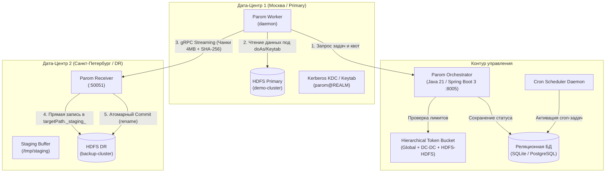

### Передача данных

1. Потоковый gRPC-транспорт. Данные идут непрерывным потоком чанков фиксированного размера (по умолчанию 4 МБ) по мультиплексированному HTTP/2-соединению.
2. Атомарный коммит (Atomic Commit и Zero-Staging). Приемник (`Receiver`) пишет чанки прямо в целевой каталог HDFS под временным именем (`targetPath + "._staging_" + jobId`), минуя локальный диск агента. После проверки SHA-256 всего файла приемник переименовывает объект (`fs.rename()`) в целевой файл HDFS.
3. Прерывание и возобновление. При обрыве соединения незавершенные временные файлы удаляет механизм `cleanup()` и сборщик мусора, поэтому в целевом кластере не остаются частично записанные файлы.

---

## 2. Топология ЦОД и кластеров HDFS

Физическая топология задается в конфигурационном файле сервиса:
- ЦОД — площадки размещения оборудования (например, `dc1` — Москва, `dc2` — Санкт-Петербург, `dc3` — Новосибирск).
- Кластеры HDFS — каждый кластер привязан к одному ЦОД через `dc_id`.

### Пример топологии в конфигурации

```yaml
topology:
  datacenters:
    - id: "dc1"
      name: "ЦОД 1 (Москва / Primary)"
      location: "Moscow, DC-1"
    - id: "dc2"
      name: "ЦОД 2 (Санкт-Петербург / DR)"
      location: "Saint-Petersburg, DC-2"

  clusters:
    # В ЦОД 1 — два кластера HDFS:
    - id: "demo-cluster"
      name: "HDFS Primary (Prod DataLake)"
      dc_id: "dc1"
      default_path: "/data/production"
    - id: "analytics-cluster"
      name: "HDFS Analytics (Secondary DataLake)"
      dc_id: "dc1"
      default_path: "/data/analytics"

    # В ЦОД 2 — один кластер HDFS:
    - id: "backup-cluster"
      name: "HDFS DR (Backup DataLake)"
      dc_id: "dc2"
      default_path: "/backup/mirror"
```

При создании задачи репликатор определяет ЦОД выбранных кластеров по `dc_id` и по этой паре выбирает правила шейпинга.

---

## 3. Многоуровневый контроль полосы (Hierarchical Token Bucket)

Чтобы репликация не забивала каналы связи, репликатор использует трехуровневую иерархию корзин токенов:

```
[Глобальный пул WAN: 120 МБ/с]
         │
         └──► [Магистраль DC1 ➔ DC2: 100 МБ/с]
                      │
                      ├──► [Квота Prod ➔ Backup: 60 МБ/с]
                      └──► [Квота Analytics ➔ Backup: 40 МБ/с]

[Локальный обмен в DC1]
         └──► [Квота Prod ➔ Analytics: 80 МБ/с]
```

### Алгоритм работы шейпера

Перед отправкой каждого чанка размером $B$ байт воркер запрашивает разрешение у оркестратора:
1. Оркестратор находит применимые корзины токенов:
   - глобальную корзину $K_{\text{global}}$;
   - корзину ЦОД $K_{\text{dc-dc}}$ для пары `(DC_src, DC_dst)`;
   - корзину кластеров $K_{\text{hdfs-hdfs}}$ для пары `(Cluster_src, Cluster_dst)`.
2. Для каждой корзины вычисляется задержка $T_i$ при дефиците токенов:
   $$T_i = \max\left(0, \frac{B - \text{tokens}_i}{\text{rate}_i}\right)$$
3. Итоговое время ожидания воркера определяет самое узкое место:
   $$T_{\text{wait}} = \max(T_{\text{global}}, T_{\text{dc-dc}}, T_{\text{hdfs-hdfs}})$$
4. Токены списываются со всех применимых корзин: $\text{tokens}_i \leftarrow \text{tokens}_i - B$.
5. Если $T_{\text{wait}} > 0$, воркер делает асинхронную паузу (`sleep`) перед отправкой чанка в gRPC-канал.
6. Снятие ограничения канала (Unlimited). Если администратор снимает галочку лимита канала в интерфейсе (устанавливается значение `0 МБ/с`), соответствующая корзина отключается (`rate = 0` ➔ $T_i = 0$), и канал передает данные со скоростью физической сети.

---

## 4. Аутентификация и ролевая модель доступа (RBAC)

Интерфейс и API сервиса используют ролевую модель безопасности платформы.

### 4.1 Роль администратора (`ADMIN` / `admin_user` / `ADM`)

- Видит в таблице задач все задачи всех пользователей организации.
- Меняет в рантайме сетевые лимиты DC-DC, HDFS-HDFS и глобальный лимит WAN.
- Только администратор управляет Disaster Recovery: аварийный останов (Kill-Switch), обратная репликация площадок (`Reverse Replication`), точечный разворот маршрутов и отзыв зеркал.
- Только администратор задает произвольного пользователя или принципала имперсонации (`execution_principal`, doAs) при создании и редактировании задач в разделе **HDFS Replication** и при создании задач синхронизации метаданных в разделе **HMS Replication**.
- В шапке отображается фиолетовый бейдж `ADM`, над таблицей — сообщение:
  > Режим Администратора платформы: Вам доступны для просмотра и управления все задачи репликации всех пользователей организации.

### 4.2 Роль инженера данных (`WRITER` / `writer_user`, `de_user` / `RW`)

- Видит свои задачи, задачи инженерного пула (`writer_user`, `de_user`, `data_engineer`), общие задачи администратора и системные процессы по расписанию.
- Создает задачи репликации, запускает, останавливает, редактирует и удаляет задачи пула инженеров.
- Не может менять пользователя имперсонации: поле заблокировано (`disabled`) и показывает автора задачи (`user.username`). Бэкенд проверяет запрос и фиксирует контекст исполнения за сессией инженера, поэтому в Ranger Audit операции записываются от его имени.
- В шапке отображается янтарный бейдж `RW`.
- Не может менять сетевые лимиты топологии и управлять Disaster Recovery:
  - вкладка «Топология ЦОД и Полоса» и консоль «Disaster Recovery» открываются только для просмотра, с бейджем `READ ONLY`;
  - управляющие кнопки (Kill-Switch, мастер разворота, точечный разворот маршрута и отзыв зеркал) скрыты;
  - прямые вызовы управляющих эндпоинтов (`POST /api/v1/limits/*`, `POST /api/v1/dr/*`) бэкенд отклоняет с кодом `HTTP 403 Forbidden` (*"Управление разделом Disaster Recovery доступно только Администратору платформы (ADMIN)"*).

### 4.3 Роль наблюдателя и аналитика (`READER` / `reader_user`, `analyst_user` / `RO`)

- Видит задачи платформы только для мониторинга: статусы репликации WAN, прогресс передачи и журналы ошибок.
- В шапке отображается серый бейдж `RO`.
- Все кнопки управления в строках задач (запуск, остановка, редактирование, удаление) отключены (`disabled`) с подсказкой «Режим только чтения: управление недоступно».
- Кнопка создания задачи скрыта, прямые API-запросы на изменение данных (`POST /api/v1/jobs`, `PUT`, `DELETE`) бэкенд отклоняет с кодом `HTTP 403 Forbidden`.
- Сетевые лимиты топологии и раздел Disaster Recovery доступны только для просмотра.

### 4.4 Вход через Kerberos SPNEGO SSO и LDAP

- Kerberos SSO (SPNEGO) — вход по билету Kerberos без ввода пароля.
- LDAP / Active Directory — вход по корпоративному логину и паролю.
- Демо-профили — кнопки быстрого входа под `admin_user` (ADM), `writer_user` (RW) и `reader_user` (RO) и вкладки фильтрации профилей по сервисам платформы («Универсальные», «HDFS», «YARN», «Репликация», «SQL», «Spark») для проверки разграничения ролей.

<div align="center">
  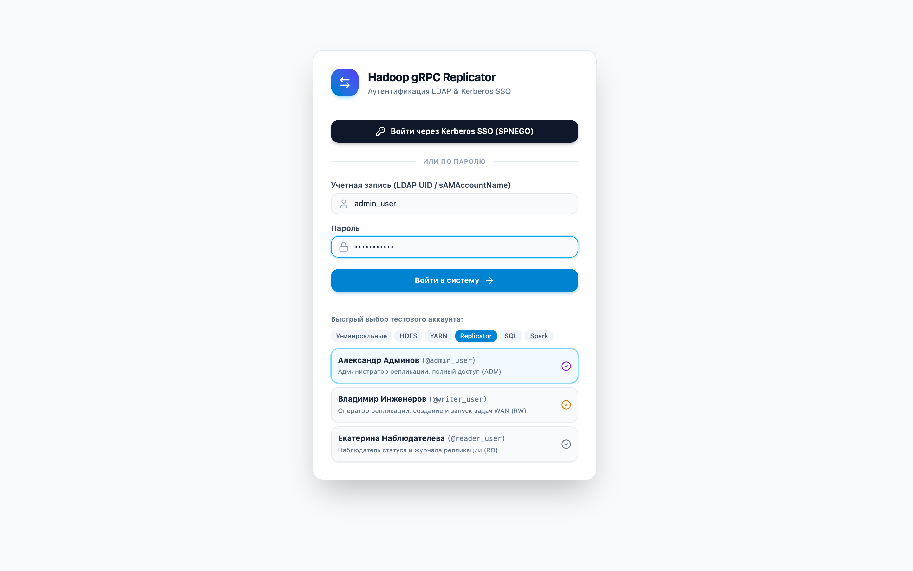
  <p><em>Рисунок 1: Экран аутентификации LDAP & Kerberos Single Sign-On (SPNEGO) с профилями быстрого переключения ролей</em></p>
</div>

### 4.5 Темы оформления (Light / Dark Mode)

Интерфейс оркестратора использует дизайн-систему Sklad (`Header.svelte`, `theme.css`):
- Переключатель тем (Sun / Moon) расположен в шапке справа, перед блоком профиля пользователя.
- Светлая тема — палитра `slate-50` / `white` / `slate-200`.
- Темная тема — палитра `slate-950` / `slate-900` / `slate-800`.
- Выбранная тема сохраняется в `localStorage` под общим для платформы ключом `hadoop_theme`; без сохраненного выбора применяется настройка ОС (`prefers-color-scheme`).
- Prometheus собирает метрики напрямую с эндпоинта `/metrics`; кнопка перехода к метрикам в навигации пользователя скрыта.

---

## 5. Запуск от сервисной учетной записи и изоляция Kerberos

Задача, запущенная от сервисной учетной записи, не прерывается, когда у пользователя истекает билет Kerberos или он закрывает браузер.

При создании задачи доступна опция **«Запускать от сервисной учетной записи»** (`run_as_service_account=True`):
1. Принципал по умолчанию — `parom@REALM.LOCAL`, задается переменной `PAROM_SERVICE_PRINCIPAL`.
2. Вход по keytab и имперсонация (`KerberosUgiProvider` агента):
   - при старте агент один раз выполняет `UserGroupInformation.loginUserFromKeytab(<principal>, <keytab>)`; путь к keytab берется из `PAROM_KEYTAB_PATH`, если она не задана — из `KRB5_KEYTAB`;
   - с `run_as_service_account=True` операции HDFS выполняются в `doAs` от UGI сервисной учетной записи;
   - без этой опции агент создает proxy-UGI пользователя-автора задачи (`UserGroupInformation.createProxyUser`) поверх UGI сервисной учетной записи. Proxy-UGI кэшируется по имени пользователя и сбрасывается при перелогине сервисной учетной записи. Для имперсонации на NameNode должны быть настроены `hadoop.proxyuser.<service_user>.hosts` и `hadoop.proxyuser.<service_user>.groups`, где `<service_user>` — короткое имя сервисного принципала;
   - билет пользователя агент не использует, поэтому параллельные задачи разных пользователей работают в общем Kerberos-контексте агента и не зависят от билетов друг друга.

---

## 6. Планировщик периодических задач (Cron Scheduler)

Планировщик запускает регулярную синхронизацию каталогов, например ежечасную репликацию логов или ежедневный ночной бэкап.

### Форматы расписания

| Выражение | Когда запускается |
|---|---|
| `@every_<N>s`, `@every_<N>m`, `@every_<N>h` (UI: `@every_5m`, `@every_15m`) | Через N секунд/минут/часов после предыдущего запуска; меньше 5 секунд поднимается до 5 |
| `every_<N>s` | Устаревшая форма `@every_<N>s` |
| `@minutely` | В начале каждой минуты |
| `@hourly` | В `hh:00` |
| `@daily`, `@midnight` | В 00:00 |
| `@weekly` | В воскресенье в 00:00 |
| `@monthly` | 1-го числа в 00:00 |
| `@yearly`, `@annually` | 1 января в 00:00 |
| 5 полей: `минута час день-месяца месяц день-недели` | По календарю: `0 0 * * *` — в 00:00, `*/10 * * * *` — в 00, 10, 20… минут, `30 2 * * 1-5` — в 02:30 по будням |

Время — в часовом поясе оркестратора `parom.scheduler.time-zone`, по умолчанию UTC.

### Жизненный цикл запланированной задачи

1. Периодическая задача (`is_scheduled=true`) при создании получает статус `SCHEDULED` и `next_run_at` — ближайшее срабатывание выражения (задача `@daily`, созданная в 14:00, первый раз запустится в 00:00). Запустить сразу — кнопка «Запустить задачу» (`POST /api/v1/jobs/{id}/start`). Некорректное или пустое выражение отклоняется: HTTP 400, `{"status": 400, "detail": "Некорректное cron-выражение '<выражение>': <причина>"}`; то же при правке задачи (`PUT /api/v1/jobs/{id}`). Смена выражения пересчитывает `next_run_at`.
2. Фоновый демон планировщика опрашивает базу данных каждые 5 секунд.
3. Пока `now < next_run_at`, задача остается в статусе `SCHEDULED` (индиго-бейдж в веб-интерфейсе).
4. Когда наступает `now >= next_run_at`:
   - в истории запусков создается запись `JobRun` с типом триггера `SCHEDULED` и порядковым номером (`#1`, `#2`, ...);
   - задача переходит в статус `QUEUED`, связывается с `active_run_id`, и ее забирает свободный воркер (`RUNNING`);
   - фиксируется `last_run_at` и вычисляется следующее `next_run_at`;
   - запускается очистка записей истории сверх лимита глубины хранения (`prune_job_runs`).
5. По завершении цикла передачи (`COMPLETED` или `FAILED`):
   - статистика запуска (длительность, переданные байты, средняя скорость в МБ/с, причина ошибки) сохраняется в `JobRun`;
   - периодическая задача возвращается в статус `SCHEDULED` до следующего запуска.

### Глубина истории запусков (History Retention)

При частых запусках (например, каждые 5 минут) таблица истории растет без ограничения, поэтому ее глубина ограничена:
- Поле `history_retention_runs` задается при создании или редактировании задачи: по умолчанию 20 запусков, допустимый диапазон 1–500.
- При превышении лимита старые завершенные запуски удаляются из таблицы `replication_job_runs`.
- Лимит можно изменить в модальном окне истории запусков кнопкой **«Применить лимит»**.

---

## 7. Режимы синхронизации каталогов: In-Memory Manifest Diff и HDFS Snapshot Diff

### 7.1 Рекурсивная инкрементальная синхронизация каталогов (по умолчанию, без снэпшотов)

Основной режим не требует включения снэпшотов в HDFS и прав суперпользователя NameNode:
1. Изоляция ЦОД (DC1 ↔ DC2):
   - Оркестратор (`parom-orchestrator`) не подключается к HDFS и не пропускает данные через себя. Он работает только как Control Plane: шейпер квот Token Bucket, реестр агентов, планировщик.
   - С HDFS и локальной ФС работают агенты (`parom-agent`) внутри своего ЦОД. Межкластерный обмен идет только между агентами по gRPC-каналу (`:50051`).
2. Пакетный манифест целевого каталога (Batch Manifest RPC `GetDirectoryManifest`):
   - Агент-источник (Sender) делает один gRPC-вызов `GetDirectoryManifest` к агенту-приемнику (Receiver) вместо пофайловых запросов через WAN.
   - Агент-приемник опрашивает свой целевой HDFS или ФС и возвращает плоский манифест всех файлов целевого каталога (`relativePath`, `size`, `modificationTime`).
3. Diff дерева в памяти (In-Memory Diff):
   - Агент-источник сравнивает дерево исходного каталога с полученным манифестом в оперативной памяти (поиск в hash map, O(N)).
   - Результат — дельта: какие файлы отсутствуют на приемнике, какие изменились по размеру или mtime, какие совпадают.
4. Пропуск неизмененных файлов:
   - Файлы, которые есть на приемнике с тем же размером, помечаются синхронизированными и не передаются (0 байт трафика WAN).
5. Передача дельты:
   - Новые и измененные файлы передаются потоком чанков с ограничением полосы (Hierarchical Token Bucket) и атомарно коммитятся в целевой HDFS.
6. Отчет:
   - Прогресс показывает число переданных и пропущенных файлов (`Синхронизация каталога завершена: передано X, пропущено Y (всего Z файлов)`).

### 7.2 Дифференциальная синхронизация Snapshot Diff (для snapshottable директорий)

При создании задачи репликации каталога ничего включать не нужно: инкрементальная передача работает по алгоритму [7.1 In-Memory Manifest Diff](#71-рекурсивная-инкрементальная-синхронизация-каталогов-по-умолчанию-без-снэпшотов), а потоковые изменения в реальном времени передаются через HDFS Inotify CDC.

Описанный ниже Snapshot Diff — низкоуровневый API: методы создания и удаления снимков (`createSnapshot` / `deleteSnapshot`) реализованы в [`HadoopFsManager`](../backend/parom/agent/src/main/java/io/github/balookrd/pristan/parom/fs/HadoopFsManager.java). Он предназначен для каталогов с десятками миллионов файлов, где администратор кластера заранее разрешил снимки (`hdfs dfsadmin -allowSnapshot`).

Как работает Snapshot Diff:
1. Управление снимками агентом Parom:
   - Создание снимка на источнике: агент выполняет `HadoopFsManager.createSnapshot(dir, snapName)` под сервисной или прокси-учетной записью.
   - Вычисление разницы между снимками: агент запрашивает у NameNode `dfs.getSnapshotDiffReport(dir, snap1, snap2)`.
2. Типы операций в Snapshot Diff:
   - `+` (создание, ADD) — передача нового файла в целевой кластер;
   - `M` (модификация, MODIFY) — повторная передача измененного файла;
   - `-` (удаление, DELETE) — удаление соответствующего файла на целевой стороне;
   - `R` (переименование, RENAME) — переименование файла или подкаталога на целевой стороне через `dfs.rename` без передачи данных по сети.
3. Фиксация и retention:
   - После синхронизации дельты на приемнике создается снимок с тем же именем.
   - Устаревшие снимки агент удаляет согласно политике retention (`HadoopFsManager.deleteSnapshot(dir, snapName)`).

### 7.3 Распределенный пул задач (Distributed Task Queue)

При объемах в сотни терабайт и больше (1 PB+) один агент упирается в пропускную способность своей сети и процессора. Поэтому передача разделена на две фазы: анализ на одном агенте и параллельную передачу на всех доступных агентах.

```
┌────────────────────────────────────────────────────────────────────────────────────────┐
│ 1. ФАЗА АНАЛИЗА (Analyzer Phase)                                                       │
│ Агент-анализатор (или первый свободный агент кластера-источника DC1)                   │
│  - Обходит дерево каталогов HDFS-1                                                     │
│  - Запрашивает манифест HDFS-2 через gRPC GetDirectoryManifest (1 сетевой вызов)       │
│  - Выполняет in-memory diff                                                            │
│  - Регистрирует пул пофайловых задач в Оркестраторе (POST /api/v1/jobs/{id}/tasks/batch│
│    * Файлы с совпадающим размером -> SKIPPED (0 байт сетевого трафика)                 │
│    * Новые и измененные файлы -> QUEUED в пуле задач                                  │
└───────────────────────────────────────────┬────────────────────────────────────────────┘
                                            │
                                            ▼
┌────────────────────────────────────────────────────────────────────────────────────────┐
│ 2. ФАЗА РАСПРЕДЕЛЕННОЙ ПЕРЕДАЧИ (Distributed Parallel Workers Phase)                   │
│ Все доступные агенты кластера DC1 параллельно забирают задачи из пула:                │
│                                                                                        │
│   ┌────────────────────┐   claimTasks (N=5)   ┌────────────────────────────────────┐   │
│   │ Agent Worker DC1-1 │ ◄─────────────────── │                                    │   │
│   └─────────┬──────────┘                      │                                    │   │
│             │                                 │      Оркестратор Parom        │   │
│   ┌─────────▼──────────┐   claimTasks (N=5)   │      Distributed Task Queue        │   │
│   │ Agent Worker DC1-2 │ ◄─────────────────── │      (/api/v1/tasks/claim)         │   │
│   └─────────┬──────────┘                      │                                    │   │
│             │                                 │   - Атомарное назначение агенту    │   │
│   ┌─────────▼──────────┐   claimTasks (N=5)   │   - Балансировка приемников DC2    │   │
│   │ Agent Worker DC1-N │ ◄─────────────────── │   - Агрегация суммарных copiedBytes│   │
│   └─────────┬──────────┘                      └────────────────────────────────────┘   │
└─────────────┼──────────────────────────────────────────────────────────────────────────┘
              │
              │  Параллельный gRPC стриминг на наименее загруженные узлы DC2
              ▼
┌────────────────────────────────────────────────────────────────────────────────────────┐
│ 3. ПРИЕМ И АТОМАРНЫЙ КОММИТ В ЦОД 2                                                    │
│   - Поток файлов распределяется между всеми онлайн-приемниками DC2 (Least Loaded)      │
│   - Каждый воркер подтверждает завершение файла: POST /api/v1/tasks/{taskId}/complete  │
│   - При сбое передачи файла воркер отправляет: POST /api/v1/tasks/{taskId}/fail        │
│   - Родительская задача переходит в терминальный статус (COMPLETED или FAILED)         │
│     СТРОГО после того, как завершены ВСЕ подзадачи в пуле.                             │
└────────────────────────────────────────────────────────────────────────────────────────┘
```

#### Подзадачи, failover и отображение для клиента

- Родительская задача (`Job`). В веб-клиенте и REST API подзадачи скрыты внутри основной задачи: клиент не отслеживает пофайловые таски, это внутренние единицы работы пула воркеров.
- Репликация удалений (флаг **«Реплицировать удаления»**) — флаг потокового задания. Если он включен, удаление файла или каталога на источнике становится задачей типа `DELETE`, и воркер удаляет соответствующий путь на приемнике. Без флага приемник хранит удаленные на источнике данные, и состояния ЦОД расходятся. По умолчанию флаг выключен, потому что удаление на приемнике необратимо. Отказ приемника удалить путь (защита системных путей, песочница) считается неуспехом задачи.
  - Задачи одного задания исполняются параллельно и без порядка, поэтому задача `DELETE` приводит приемник к текущему состоянию источника, а не повторяет событие. Перед удалением воркер проверяет путь на источнике:

    | Путь на источнике в момент исполнения | Действие на приемнике |
    |---|---|
    | отсутствует | путь удаляется рекурсивно |
    | снова файл (удален и записан заново) | ничего не удаляется; содержимое переносит задача передачи этого файла |
    | снова каталог (`INSERT OVERWRITE`, вынос в `.Trash` и новая запись) | удаляются только файлы, которых в каталоге источника нет |
    | проверить не удалось (NameNode недоступен) | ничего не удаляется, задача завершается ошибкой и повторяется |

  - Удаление пути, которого на приемнике уже нет, считается успехом: повтор задачи после сбоя не приводит к `FAILED`.
  - Переименование внутри каталога задания переносит новый путь и при включенном флаге удаляет старый на приемнике. Без флага старый путь остается на приемнике.
  - Сверка пересозданного каталога читает список файлов приемника одним ответом gRPC (дедлайн 60 с). Если приемник не отдал список, задача завершается ошибкой без удаления.
- Повторная постановка подзадачи при сбое воркера (Self-Healing & Re-queue). Если при передаче файла происходит сетевой сбой (`failTask`, разрыв gRPC, сбой сокета) или агент аварийно завершается (узел переходит в `OFFLINE`), подзадача не переходит сразу в `FAILED`. Оркестратор увеличивает счетчик `retry_count`, возвращает подзадачу в очередь `QUEUED` и назначает ее другому доступному агенту кластера. Родительская задача остается в статусе `RUNNING`, оператору вмешиваться не нужно.
- Отложенное терминальное закрытие. Подзадача окончательно переходит в `FAILED`, только когда исчерпан лимит попыток (`retry_count >= max_retries`). Родительская задача при этом остается в `RUNNING`, пока остальные воркеры передают оставшиеся файлы. Когда все подзадачи завершены (`activeRemaining == 0`), задача переходит в `FAILED` с журналом причин, если была хотя бы одна неустранимая ошибка, иначе — в `COMPLETED`.
- Счетчики объектов и скорость в основной задаче:
  - `total_objects` — общее число обнаруженных файлов и объектов;
  - `transferred_objects` — успешно переданные файлы;
  - `skipped_objects` — пропущенные файлы (совпали по размеру);
  - `failed_objects` — файлы, завершившиеся ошибкой после всех попыток;
  - `total_bytes` / `copied_bytes` — общий и переданный объем данных;
  - `average_speed_mb_s` — средняя скорость передачи в МБ/с.

- Просмотр подзадач с пагинацией и проверкой доступа (API Pagination & BOLA/IDOR Guard):
  - Эндпоинт `GET /api/v1/jobs/{jobId}/tasks` всегда возвращает данные постранично.
    - Параметры: `page` (номер страницы, начиная с `0`), `size` (размер страницы, по умолчанию `100`, максимум `1000`), `status` (необязательный фильтр: `QUEUED`, `RUNNING`, `COMPLETED`, `FAILED`, `SKIPPED`).
    - Ответ — объект Spring Data `Page<TaskDto>` с метаданными (`totalElements`, `totalPages`, `number`, `size`).
    - Доступ проверяет `checkJobReadAccess(jobId, auth)`: подзадачи чужих заданий пользователю не показываются.
- Аттестация подзадач (HMAC-SHA256 Task Attestation):
  - При выдаче воркеру каждая подзадача получает токен `task_token`, подписанный секретным ключом платформы.
  - Приемник в целевом ЦОД проверяет HMAC до создания целевого файла, поэтому скомпрометированный воркер не может записать файл, на который ему не выдана подзадача.
- Буферизация прогресса в памяти (debounce):
  - Обновления статусов и прогресса накапливаются в буфере `JobProgressBuffer` и сбрасываются в СУБД раз в 500 мс, а не на каждый файл. Это сокращает число записей в СУБД при параллельной репликации сотен тысяч мелких файлов.

#### Роли агентов (`AGENT_MODE`)

| Значение | Что делает агент |
|---|---|
| `all` (по умолчанию) | Берет задачи на анализ (если задание в очереди `QUEUED`), забирает пофайловые задачи из пула как воркер (`claimTasks`) и принимает входящие потоки как приемник (`receiver`) |
| `analyzer` | Опрашивает HDFS, вычисляет diff деревьев и формирует пул подзадач в оркестраторе; файлы не передает |
| `worker` (или `sender`) | Разворачивается на каждой DataNode кластера, параллельно забирает файлы из пула и передает их на приемники |
| `receiver` | Принимает файлы в целевом кластере (DC2) |

### 7.4 Фильтрация временных и служебных файлов и каталогов

Движки Apache Spark, MapReduce и Hive Tez, стриминговые коннекторы (Spark Streaming, Kafka Connect, Flume) и системные утилиты создают в HDFS временные служебные файлы и каталоги. Если их реплицировать, на приемник попадают незавершенные коммиты: таблицы повреждаются, записи дублируются, а WAN-канал занят лишними данными.

Фильтр реализован в `HadoopFsManager` и `ReplicationSender` и применяется на обеих сторонах.

#### Фильтрация каталогов (Directory Filtering)

При рекурсивном обходе агент не спускается (`SKIP_SUBTREE`) в следующие каталоги:
* Staging-каталоги Hive, Tez и Spark:
  - каталоги, которые Apache Hive создает при `INSERT OVERWRITE` / `LOAD DATA`: `.hive-staging*`, `_hive_staging*`, `hive-staging*` (включая каталоги вида `.hive-staging_hive_YYYY-MM-DD_...`);
  - служебные подкаталоги внешних задач MapReduce/Tez для Hive: `-ext-10000`, `-ext-*`, `_ext-*`;
  - каталоги сессий и staging Apache Tez и Spark: `.tez-staging*`, `tez-staging*`, `_tez_session_dir*`, `.spark-staging-*`, `spark-staging-*`.
* Каталоги коммиттеров с префиксом `_`: `_temporary`, `_staging`, `_distcp`, `_tmp` и любые другие каталоги, начинающиеся с `_`, кроме транзакционного лога Delta Lake `_delta_log`.
* Скрытые каталоги с префиксом `.`: `.staging`, `.tmp`, `.Trash` (корзина HDFS), `.git`, `.idea`.
* Системные каталоги ОС и HDFS: `lost+found`.
* Каталоги с временными суффиксами: `*.tmp`, `*.temp`, `*.staging`.

#### Фильтрация файлов (File Filtering)

Исключаются файлы:
* скрытые — имя начинается с `.` (`.DS_Store`, `.*.crc`, скрытые файлы окружения);
* временные файлы Hive, Tez и Spark — имя содержит `hive-staging`, `hive_staging`, `spark-staging`, `tez-staging`;
* файлы незавершенной записи — суффиксы и расширения `*.tmp`, `*.temp`, `*.inprogress` (активная запись стриминга), `*.staging`, `*.pending`, `*.copying`, `*.part`, `*.partial`, `*.swp`, `*.swo`, `*~` (резервные копии редакторов);
* маркеры промежуточного копирования — имя содержит `_copying_` (их создают Hadoop FsShell и DistCp до завершения передачи);
* временные файлы коммиттеров — имя начинается с `_temporary*`, `_tmp*`;
* системные файлы ОС — `Thumbs.db`, `desktop.ini`, `.DS_Store`.

#### Файлы, которые фильтр не исключает

Маркеры завершения ETL-пайплайнов, сводные метаданные Parquet и транзакционные каталоги реплицируются в целевой кластер, если лежат вне временных каталогов коммиттеров:
- `_SUCCESS` и `_SUCCESS.crc`;
- `_metadata` и `_common_metadata`;
- транзакционный лог `_delta_log` (Delta Lake).

#### Фильтр на источнике и приемнике

* Источник (Sender / Analyzer) исключает временные файлы из пула задач и из передачи. Если задача указывает на одиночный временный файл или каталог, она сразу помечается завершенной без сетевых операций.
* Приемник (Receiver) применяет тот же фильтр при формировании манифеста в `GetDirectoryManifest`, поэтому in-memory diff не находит ложных расхождений.

### 7.5 Батчинг мелких файлов (Small Files Bundling / Tar-Streaming) и Zero-Staging в HDFS

Каталоги стриминговых источников (Kafka Connect, Flume, Spark Streaming, CDC-таблицы, лог-файлы) часто содержат миллионы файлов размером от нескольких килобайт до 1 МБ. При пофайловой репликации на каждый такой файл приходится создание задачи в очереди, RPC к NameNode и локальный дисковый I/O.

#### Как работает батчинг

1. Батчинг при анализе:
   - Агент отбирает файлы меньше порога `smallFileThresholdBytes` (по умолчанию 1 МБ).
   - Эти файлы объединяются в виртуальные пакеты `BUNDLE_TAR` размером до 16 МБ и не более 500 файлов в одном пакете.
   - В интерфейсе статистика задания показывает общее число перенесенных файлов (`transferred_objects`) и переданный объем (`copied_bytes`), пакеты отдельно не отображаются.

2. Zero-Staging (без локального диска):
   - Агент не сохраняет промежуточный tar-архив на локальный диск (`/tmp`): архив упаковывается в памяти потоком (`TarArchiveOutputStream`) и сразу передается в gRPC-канал через метод `TransferTarStream`.
   - Принимающий агент читает байты из сетевого потока через `TarArchiveInputStream` и записывает файлы в целевой HDFS пулом из 8 потоков (`bundleCommitConcurrency`), сохраняя права доступа и Kerberos UGI `doAs`.
   - Для крупных одиночных файлов (`FILE`) локальный staging тоже не используется: временный файл создается прямо в целевом HDFS (`targetPath + "._staging_" + jobId`) и затем атомарно переименовывается (`fs.rename()`).

3. Эффект:
   - вместо отдельной задачи и отдельного gRPC-вызова на каждый файл передается один поток `TransferTarStream` на пакет до 500 файлов;
   - локальный диск хостов агентов в передаче не участвует.

### 7.6 Очистка временных staging-файлов на HDFS

При обрыве TCP-соединения, таймауте или аварийной перезагрузке агента на целевом HDFS остаются незавершенные staging-файлы. Их удаляют четыре механизма:

1. Немедленная очистка. При сбое передачи файла или пакета принимающий агент сразу удаляет незавершенный временный файл (`._staging_*`) с целевого HDFS.
2. Очистка перед запуском. При повторном запуске задачи (после ошибки или ручного перезапуска) агент удаляет оставшиеся staging-файлы предыдущего запуска в целевом каталоге до начала передачи.
3. Сборщик мусора по расписанию. Если процесс агента был завершен на уровне ОС (`kill -9`), фоновый сборщик мусора периодически сканирует известные целевые каталоги и удаляет staging-файлы старше 30 минут.
4. Исключение из манифестов. Staging-файлы не попадают в манифесты каталогов и не показываются как расхождения при сверке данных.

---

## 8. Веб-интерфейс оператора

Веб-консоль репликатора доступна по адресу `http://<host>:8005`, где `<host>` — хост оркестратора. Это SPA-приложение (`frontend/apps/parom`) на Svelte 5, использующее общие компоненты платформы [`Header.svelte`](../frontend/common/components/Header.svelte) и [`LoginModal.svelte`](../frontend/common/components/LoginModal.svelte) из `@pristan/common`.

В верхней панели навигации четыре раздела:
1. **«HMS Replication»** (открывается по умолчанию) — мониторинг CDC-потоков Hive Metastore, репликация схем, отставание событий (Event Lag) и вложенные задачи синхронизации метаданных.
2. **«HDFS Replication»** — регламентные задачи копирования файлов и каталогов HDFS между кластерами и ЦОД.
3. **«Топология ЦОД и Полоса»** — схема ЦОД, распределение агентов и рантайм-лимиты пропускной способности WAN-каналов.
4. **«Disaster Recovery»** — пульт аварийного переключения (Failover Hub) со схемой маршрутов DC1 ⇄ DC2 и кнопкой экстренной остановки (Kill-Switch).

<div align="center">
  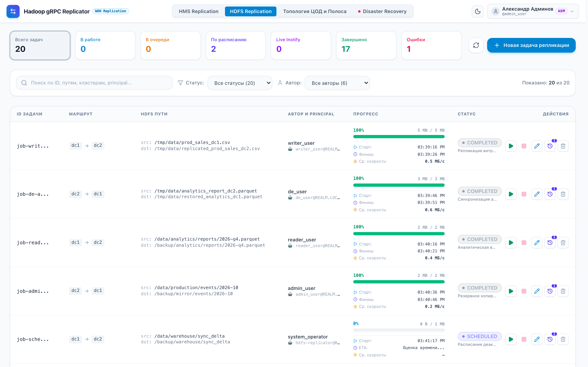
  <p><em>Рисунок 2: Главная панель HDFS Replication со счетчиками статусов, поиском и таблицей задач</em></p>
</div>

### 8.1 Управление задачами репликации

- Список задач занимает всю ширину экрана и показывает статус, кластеры с указанием ЦОД, исходный и целевой пути, автора задачи, учетную запись исполнения и прогресс в реальном времени.
- Прогресс репликации:
  - процент выполнения и переданный объем (`copied_bytes / total_bytes`);
  - **Время старта** — момент, когда воркер начал выполнять задачу;
  - **Примерное время окончания (ETA / Финиш)** — расчет по текущей скорости и оставшемуся объему; для завершенных задач — фактическое время завершения;
  - **Средняя скорость репликации** в МБ/с, рассчитанная за время передачи.
- Статусы:

  | Статус | Цвет | Значение |
  |---|---|---|
  | `SCHEDULED` | индиго | Периодическая задача ждет следующего запуска (`next_run_at`) |
  | `QUEUED` | желтый | Ждет свободного воркера |
  | `RUNNING` | синий, пульсирующий | Идет передача данных |
  | `COMPLETED` | зеленый | Передача завершена, контрольная сумма совпала |
  | `FAILED` | красный | Ошибка передачи или сбой NameNode |
  | `CANCELLED` | серый | Задача остановлена оператором |

- Кнопки в колонке **«ДЕЙСТВИЯ»**:
  - **Старт / Запуск (▶)** — запускает или перезапускает задачу: сбрасывает прогресс и переводит ее в `QUEUED`. Доступна для задач в статусах `SCHEDULED`, `COMPLETED`, `FAILED`, `CANCELLED`.
  - **Стоп / Остановка (■)** — прерывает выполнение и переводит задачу в `CANCELLED`. Доступна только для задач в статусах `RUNNING` и `QUEUED`.
  - **Редактировать** (значок карандаша) — открывает окно редактирования параметров задачи: исходный и целевой кластер, пути в HDFS, параметры сервисной учетной записи, cron-расписание, глубина истории. Доступна только для неактивной задачи.
  - **История** (значок свитка, History) — открывает окно истории запусков со статистикой и настройкой глубины хранения. На кнопке фиолетовый бейдж с числом сохраненных запусков (`runs_count`).
  - **Удалить** (значок корзины) — после подтверждения удаляет задачу, ее историю запусков и подзадачи из базы данных без возможности восстановления. Доступна только для неактивной задачи: активную сначала остановите кнопкой **«Стоп»**.

### 8.2 Фильтрация и поиск задач (по статусам и авторам)

- Карточки статистики:
  - Карточки над таблицей («Всего задач», «В работе», «В очереди», «По расписанию», «Завершено», «Ошибки») работают как кнопки фильтра.
  - Клик по карточке включает фильтр по ее статусу и подсвечивает карточку контуром. Повторный клик снимает фильтр.
- Панель фильтров над таблицей:
  - **Поиск (Search)** — фильтрация на клиенте по фрагменту ID задачи, исходному или целевому пути в HDFS, имени кластера, Kerberos principal или имени автора.
  - **Статус (Status Filter)** — выбор из статусов `ALL`, `RUNNING`, `QUEUED`, `SCHEDULED`, `COMPLETED`, `FAILED`, `CANCELLED` с числом задач в каждом.
  - **Автор (Author Filter)** — выбор из списка авторов задач (например, `admin_user`, `de_user`, `analyst_user`, `system_operator`) с числом задач каждого.
  - Счетчик «Показано: X из Y задач» и кнопка **«Сбросить»**, если активен хотя бы один фильтр.
  - Если ничего не найдено, выводится сообщение с предложением сбросить фильтры.
- REST API: `GET /api/v1/jobs?status=SCHEDULED&author=admin_user` фильтрует на сервере по параметрам `status` и `author` с учетом ролевых ограничений (RBAC).

### 8.3 Создание задачи репликации

1. Нажмите кнопку **«Новая задача репликации»** в правом верхнем углу.
2. В открывшемся окне:
   - Выберите **Исходный кластер (Source)** и **Целевой кластер (Target)** из выпадающих списков; рядом с кластером указан его ЦОД.
   - Укажите **Исходный путь в HDFS** (например, `/data/production/events/2026-10`).
   - Укажите **Целевой путь в HDFS** (например, `/backup/mirror/events/2026-10`).
   - Укажите **Пользователя имперсонации (doAs)**:
     - для роли администратора поле редактируемое (бейдж `admin`): можно указать любого системного пользователя или Kerberos principal (`username@REALM.LOCAL`);
     - для остальных ролей поле заблокировано (`disabled`) и содержит имя текущего пользователя (бейдж `doAs`);
     - в окне **«Редактировать задачу»** администратор тоже может изменить пользователя имперсонации.
   - При необходимости включите **«Запускать от сервисной учетной записи»** и укажите принципал.
   - Выберите **Режим синхронизации**:
     - **«Ручной запуск»** (`MANUAL`) — однократный запуск кнопкой Play;
     - **«По расписанию»** (`SCHEDULED`) — запуск по cron-расписанию оркестратора;
     - **«Live Inotify»** (`STREAMING_INOTIFY`) — потоковая репликация изменений из EditLog NameNode в реальном времени (Near-0 RPO).

       Переключатель **Live Inotify** заблокирован (`disabled`), если на исходном кластере нет зарегистрированного активного Inotify-агента (`mode=streamer`). Если запущенная потоковая задача теряет связь со стримером, в таблице задач статус показывается как `STREAMING (НЕТ АГЕНТА)`, а в колонке прогресса — предупреждение `Inotify оффлайн`.
   - Задайте **Глубину истории запусков** (по умолчанию 20, диапазон 1–500) — сколько отчетов о запусках хранить.
3. Нажмите **«Создать задачу»**. Задача появится в таблице: периодическая — в статусе `SCHEDULED` (индиго), разовая — в статусе `QUEUED`. В колонке создателя отображается бейдж фактического UGI doAs (`user [doAs]`).

<div align="center">
  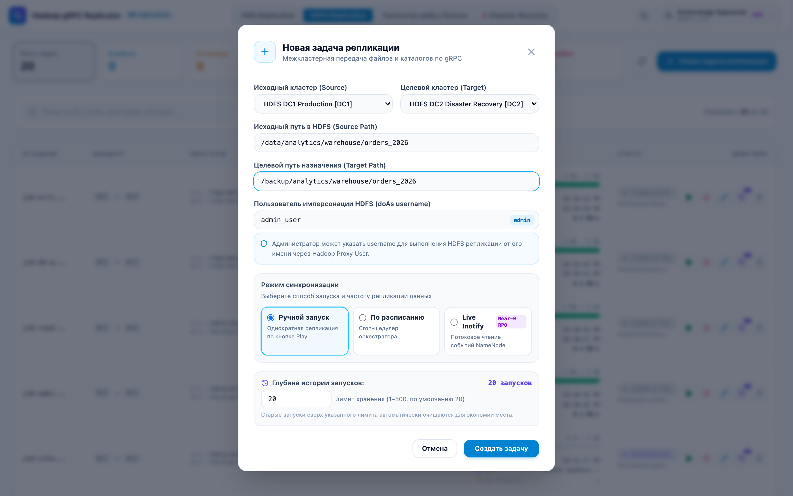
  <p><em>Рисунок 3: Модальное окно создания новой задачи репликации HDFS с выбором кластеров, путей, планировщика и Kerberos doAs</em></p>
</div>

### 8.4 Управление топологией и лимитами в рантайме

1. Откройте вкладку **«Топология ЦОД и Полоса»**. На ней показана схема ЦОД и привязанных к ним кластеров.
2. Чтобы изменить полосу канала (DC-DC или HDFS-HDFS), введите новое значение в МБ/с в поле ввода и нажмите **«Сохранить»**. Новый лимит применяется ко всем воркерам в течение 1 секунды.

<div align="center">
  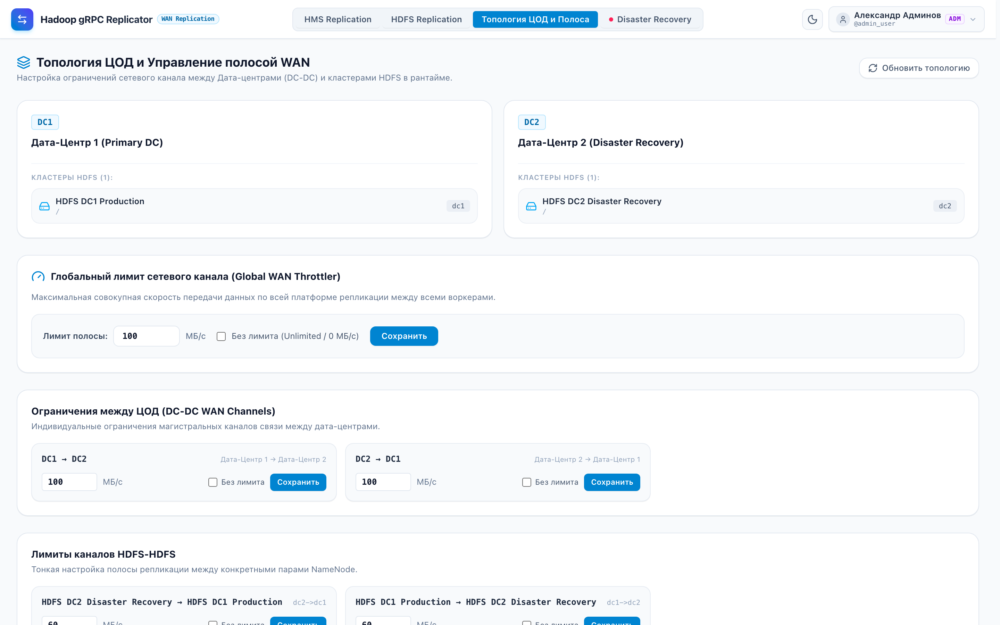
  <p><em>Рисунок 4: Раздел «Топология ЦОД и Полоса» с иерархическим шейпером Token Bucket (DC-DC, HDFS-HDFS, Global)</em></p>
</div>

### 8.5 История запусков задачи и статистика (Job Runs History & Retention)

История запусков доступна в отдельном окне (`GET /api/v1/jobs/{id}/runs`):
1. Нажмите кнопку истории (значок свитка) в строке задачи.
2. В окне отображаются:
   - сводные метрики: число запусков в истории, число успешных, число сбоев и общий объем переданных данных в байтах;
   - управление глубиной истории (retention): поле лимита хранения и кнопка **«Применить лимит»**. Новый лимит сразу удаляет лишние записи в базе данных через `PUT /api/v1/jobs/{id}`;
   - журнал выполнений — список запусков в хронологическом порядке:
     - порядковый номер запуска (`#1`, `#2`, ...);
     - источник запуска: `Шедулер` (по расписанию) или `Вручную` (оператором);
     - статус запуска с цветовым бейджем;
     - время старта и завершения;
     - длительность (в секундах или минутах);
     - переданный объем (`copied_bytes / total_bytes`);
     - средняя скорость в МБ/с;
     - текст ошибки или автор запуска.
3. Чтобы обновить историю, нажмите кнопку синхронизации.

<div align="center">
  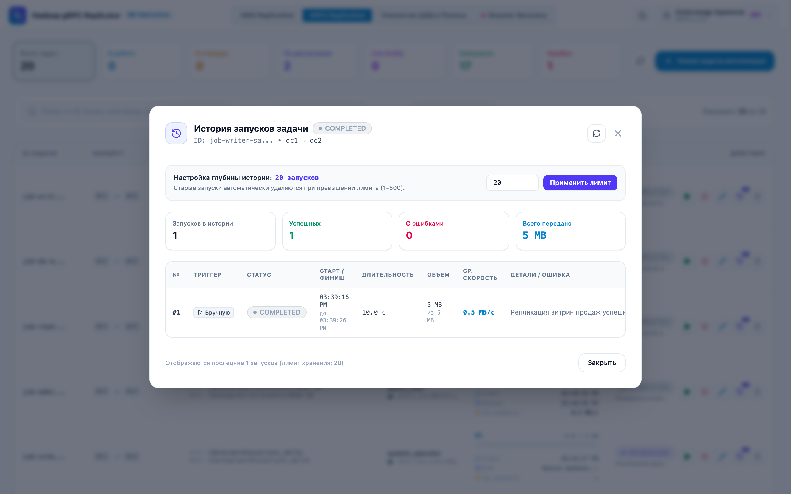
  <p><em>Рисунок 5: Модальное окно детальной истории запусков задачи (Job Runs History, Retention, средняя скорость)</em></p>
</div>

### 8.6 Репликация Hive Metastore (раздел «HMS Replication»)

Раздел **«HMS Replication»** синхронизирует метаданные баз данных и таблиц Hive между кластерами (например, HDP 3.1 ➔ Apache Hive 3.1.3).

<div align="center">
  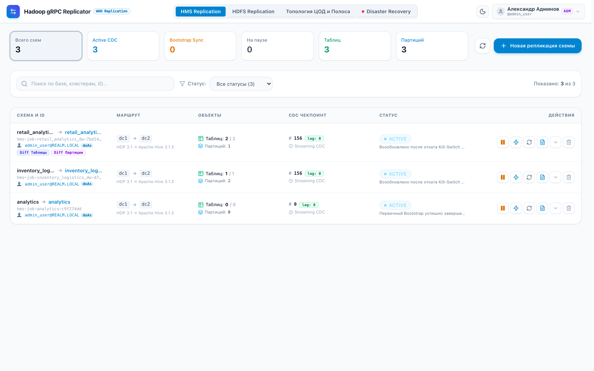
  <p><em>Рисунок 6: Раздел «HMS Replication» (статус распределенного лизинга Inotify/CDC стримеров, Event Lag и таблица схем)</em></p>
</div>

1. Изоляция HDFS-подзадач:
   - Подзадачи репликации файлов партиций (`job_type = 'HMS_SUBJOB'`) не отображаются в разделе «HDFS Replication».
   - Они привязаны к родительской задаче метаданных и показываются в ее карточке на вкладке **«Вложенные задачи переноса HDFS»**.
   - Данные передает тот же распределенный пул воркеров gRPC с соблюдением WAN-квот Hierarchical Token Bucket.
2. Поддерживаемые типы таблиц (Non-ACID Gate):
   - External-таблицы (Parquet, ORC, Avro, Text, Iceberg).
   - Managed Non-Transactional таблицы (`MANAGED_TABLE` с `transactional != true`).
   - Transactional ACID-таблицы пропускаются со статусом `SKIPPED_ACID` и не блокируют очередь.
3. HDFS Federation:
   - Если партиции таблицы размещены в разных NameService федерации (например, `hdfs://ns-cold/...` и `hdfs://ns-hot/...`), репликатор определяет исходный NameService и переписывает URI на целевой NameService по правилам `federation-mappings`.
   - Если правила перезаписи заданы, а локация таблицы или партиции под них не попадает, объект не переносится: в журнале событий задачи появляется запись `FAILED` с указанием локации, задача получает статус `ERROR`. Иначе таблица создалась бы в целевом метасторе с путем кластера-источника, и запросы читали бы данные чужого кластера.
4. Первичная синхронизация (Bootstrap) и ее метрики:
   - При создании задачи репликации базы фиксируется `high_water_mark_event_id` и выполняется полный экспорт всех существующих таблиц и партиций (статус `BOOTSTRAPPING`).
   - Во время первичной синхронизации система агрегирует данные по всем HDFS-подзадачам (`HMS_SUBJOB`) и показывает:
     - **Общую скорость репликации** — переданный объем, деленный на прошедшее время (`copied_bytes / elapsed_sec`), либо среднюю скорость активных потоков воркеров (МБ/с);
     - **Стартовое время** — запуск первой подзадачи или создание задачи первичной синхронизации;
     - **Расчетное время окончания (ETA)** — прогноз по оставшемуся объему и средней скорости (`(total_bytes - copied_bytes) / avg_speed`): время по часам и число оставшихся минут;
     - **Прогресс объема данных** — прогресс-бар и счетчик переданных байтов (например, `8.0 GB / 20.0 GB (40%)`).
   - Эти метрики показываются в колонке «Статус» таблицы задач, в раскрывающейся строке и на вкладке подзадач окна деталей схемы.
   - После Bootstrap задача переходит в статус `ACTIVE` (потоковый опрос `NOTIFICATION_LOG`).
5. Удаление без потери файлов (`deleteData = false`):
   - При обработке событий `DROP_TABLE` и `DROP_PARTITION` метаданные удаляются из целевого HMS с флагом `deleteData = false`; файлы в HDFS сохраняются.
6. Создание задачи репликации базы:
   1. Нажмите **«Новая репликация базы»**.
   2. Выберите **Исходный кластер (Source)** и **Целевой кластер (Target)** из выпадающих списков (например, `HDFS DC1 Production [DC1] — HDP 3.1` и `HDFS DC2 Disaster Recovery [DC2] — Apache Hive 3.1.3`). Списки заполняются из текущей конфигурации топологии так же, как в разделе HDFS Replication.
   3. Укажите имя исходной базы (`Source Database`, например `analytics`).
   4. Укажите имя целевой базы (`Target Database`); оставьте поле пустым, чтобы имя совпадало с исходным.
   5. Укажите **Пользователя имперсонации (doAs)**:
      - для роли администратора поле редактируемое (бейдж `admin`): в нем задается пользователь или принципал, от имени которого создаются HDFS-подзадачи переноса файлов партиций (`HMS_SUBJOB`);
      - для остальных ролей поле заблокировано (`disabled`) и заполнено именем текущего пользователя (бейдж `doAs`); REST API бэкенда проверяет авторство.
   6. При необходимости укажите фильтр таблиц (`Include Pattern`, по умолчанию `*`).
   7. Настройте двусторонний diff (Reconciliation):
      - **«Удалять лишние таблицы на приемнике»** (`drop_extraneous_tables`) — удаляет из целевой базы таблицы, которых нет в источнике (с флагом `deleteData = false`, файлы данных остаются);
      - **«Удалять лишние партиции на приемнике»** (`drop_extraneous_partitions`) — удаляет на приемнике партиции, которых нет в источнике (`deleteData = false`).
   8. Настройте фоновый HDFS Inotify-стриминг (Companion Streaming):
      - Опция **«Автоматический фоновый HDFS Inotify-стриминг (Companion Streaming)»** (`enable_hdfs_streaming`, включена по умолчанию) определяет корневой путь warehouse базы через Thrift RPC (`db.getLocationUri()`) и регистрирует связанный Inotify-стример (`HMS_COMPANION_STREAMING`).
      - Стример реплицирует непартиционированные таблицы и дозапись файлов в существующие партиции в реальном времени. Изменения он читает из EditLog, поэтому рекурсивного сканирования каталогов на NameNode нет.
      - Поведение без стримера:
        - При создании задачи: если на исходном кластере нет зарегистрированного активного Inotify-агента (`mode=streamer`), опция блокируется (`disabled`) и снимается. Запрос на создание задачи с `enable_hdfs_streaming = true` без агента оркестратор отклоняет (HTTP 400 Bad Request). Чтобы создать репликацию схемы без стриминга данных, снимите эту опцию.
        - В работающей задаче: если Inotify-стример отключается или падает, репликация метаданных продолжается. CDC-цикл читает события `NOTIFICATION_LOG`, переносит DDL и создает обычные HDFS-подзадачи для новых таблиц и партиций. В таблице задач появляется статус `HDFS Inotify (Оффлайн: активен fallback на CDC)`.
        - Возврат к стримеру (Reconnect & Catch-up): после перезапуска или восстановления связи Inotify-агент регистрируется в оркестраторе, продлевает лизинг в `StreamingLeaseCoordinator` и получает сохраненную контрольную точку `lastCommittedTxid`. Стример открывает поток EditLog NameNode со смещения `lastCommittedTxid + 1`, догоняет накопившиеся изменения и возвращается в режим Near-Zero RPO; индикатор снова показывает `+ HDFS Inotify`.
      - Жизненный цикл связанного стримера следует за задачей HMS: пауза, возобновление и каскадное удаление. В интерфейсе отображается индикатор `+ HDFS Inotify`.

<div align="center">
  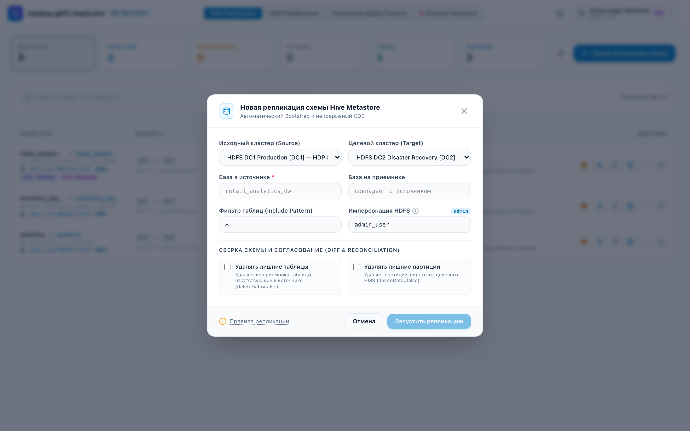
  <p><em>Рисунок 7: Модальное окно настройки непрерывной потоковой CDC-репликации схемы Hive Metastore</em></p>
</div>

7. Пауза, возобновление и изменения за время паузы:
   - **Остановка (Pause)** переводит задачу в статус `PAUSED`. Опрос `NOTIFICATION_LOG` приостанавливается, текущий чекпоинт `last_processed_event_id` сохраняется.
   - Изменения за время паузы: все DDL-операции в исходном Hive записываются в `NOTIFICATION_LOG` с монотонно возрастающим ID (`NL_ID`). При возобновлении (`Resume`) опрос начинается с `last_processed_event_id + 1`, и все изменения за время простоя (создание и изменение таблиц, добавление партиций) читаются пачками (replay CDC-лога) и реплицируются по порядку.
   - Разрыв журнала (кнопка **«Re-bootstrap»** с подтверждением): если задача стояла на паузе дольше срока хранения событий Hive (`hive.metastore.event.expiry.duration`), оператор запускает **Re-bootstrap** из таблицы или из окна деталей схемы. Операция тяжелая, поэтому запуск требует подтверждения в отдельном окне. Репликатор заново снимает полный срез таблиц и партиций без удаления целевых данных (`deleteData = false`) и фиксирует новый High Water Mark.
8. Удаление задачи репликации схемы:
   - Задача удаляется кнопкой корзины в списке схем или на панели управления после подтверждения в модальном окне.
   - Вместе с задачей удаляются ее метаданные, дочерние подзадачи репликации файлов партиций HDFS и журнал аудита DDL-событий.
9. Состав экрана HMS Replication (повторяет раздел HDFS Replication):
   - верхний ряд: 6 карточек статистики с фильтрацией по статусу и кнопки **«Обновить»** и **«Новая репликация схемы»** справа в той же строке;
   - панель поиска по схемам и кластерам, фильтры и счетчик «Показано X из Y»;
   - таблица схем на всю ширину с колонками `Схема и ID`, `Маршрут / Кластеры`, `Объекты`, `CDC Чекпоинт`, `Статус`, `Действия`, включая пользователя имперсонации `user [doAs]`;
   - ряд кнопок действий в каждой строке: Пауза/Пуск, Опрос CDC, Re-bootstrap, Журнал DDL, Быстрый просмотр, Удаление;
   - окно деталей схемы с вкладками журнала DDL и вложенных HDFS-подзадач (с пользователем каждой подзадачи).
10. Smoke-тесты в Docker (`run-smoke-tests.sh`):
   - Стенд проверяет репликацию между двумя ЦОД целиком:
     - создание БД и таблицы с данными в DC1;
     - первичную синхронизацию (Bootstrap) в DC2;
     - создание новой таблицы в DC1 и ее потоковую синхронизацию через CDC;
     - перенос схемы и файлов данных в DC2 (`./demo/parom/run-smoke-tests.sh`).

### 8.7 Консоль аварийного переключения (Disaster Recovery & Failover Hub)

Панель **Disaster Recovery** в верхнем меню используется при аварии основного ЦОД: она останавливает репликацию из него, чтобы не допустить Split-Brain, и запускает обратную синхронизацию накопленных изменений.

1. Мониторинг площадок и потока данных (Data Flow Canvas):
   - карточки площадок **DC1** и **DC2** показывают статус (`ONLINE`, `DEGRADED`, `OFFLINE`), число активных агентов Full-Duplex и текущие лимиты пропускной способности;
   - центральный блок WAN-канала показывает направление потока данных: `DC1 ➔ DC2` в штатном режиме или `DC2 ➔ DC1` после аварийного переключения;
   - суммарное отставание (Lag): объем непереданных данных HDFS в байтах и число неотправленных DDL/DML-событий Hive Metastore CDC.

<div align="center">
  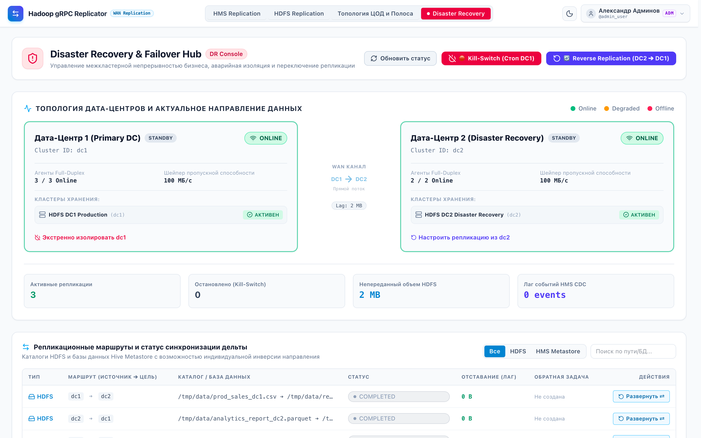
  <p><em>Рисунок 8: Консоль Disaster Recovery & Failover Hub (Data Flow Canvas, сетевой поток, таблица маршрутов)</em></p>
</div>

2. Аварийный останов (Kill-Switch):
   - Кнопка **Kill-Switch (Стоп DC1)** открывает окно аварийного останова, в котором указывается причина для аудита.

<div align="center">
  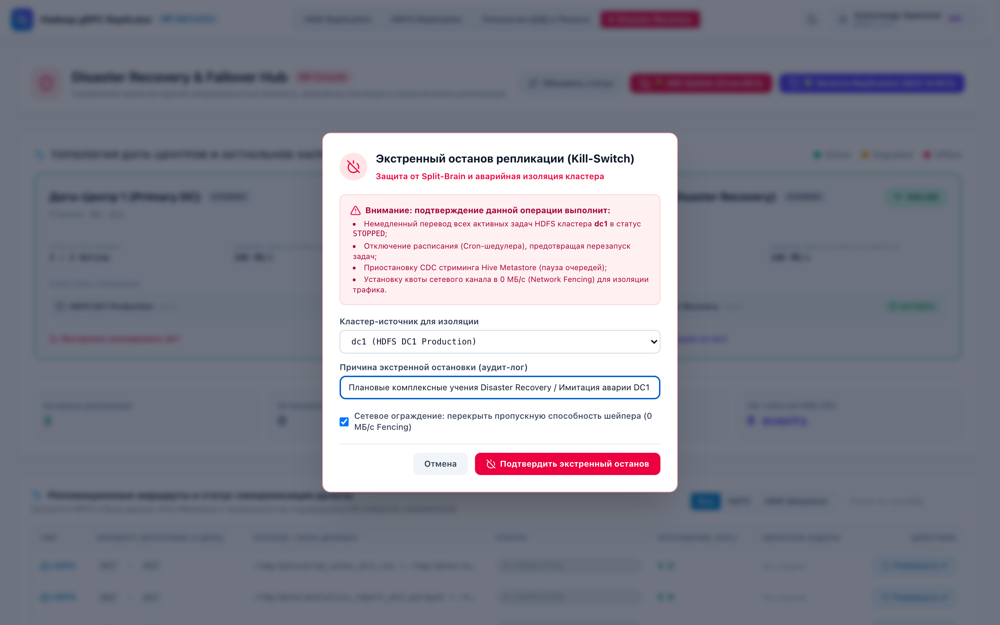
  <p><em>Рисунок 9: Модальное окно экстренного останова (Kill-Switch) с сетевым ограждением Fencing (0 МБ/с)</em></p>
</div>

   - После подтверждения система:
     - переводит все активные задачи HDFS с источником DC1 в статус `STOPPED`;
     - снимает признак запуска по расписанию (`isScheduled = false`), чтобы планировщик не запустил их снова;
     - приостанавливает потоковую репликацию CDC Hive Metastore (`PAUSED`);
     - включает сетевое ограждение (Network Fencing): лимит канала 0 МБ/с;
     - окрашивает панель изолированного кластера в красный цвет с пульсирующим бейджем `ПОДАВЛЕН (FENCED)`, а для каждого привязанного HDFS-кластера выводит индикатор `ПОДАВЛЕН`.

<div align="center">
  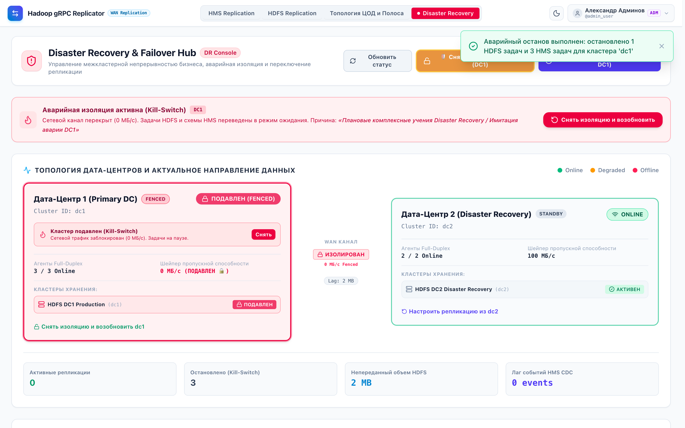
  <p><em>Рисунок 10: Индикация подавленного кластера при активном Kill-Switch (статус ПОДАВЛЕН и тревожный баннер)</em></p>
</div>

   - Снятие изоляции (Rollback / Unfence):
     - кнопка **Kill-Switch** заменяется янтарной кнопкой **«Снять изоляцию / Откат ({CLUSTER})»**;
     - в окне отката есть выпадающий список кластеров, изолированный кластер помечен `[ПОДАВЛЕН]`;
     - на панели подавленного кластера и в тревожном баннере есть кнопка **«Снять»**;
     - защита от Split-Brain: окно предупреждает, что старые задачи нельзя запускать, если во время аварии данные писались в DC2. Опции возобновления прямых задач по умолчанию выключены. Подтверждение снимает сетевое ограждение (канал снова 100 МБ/с для управления и приема дельты), а старые задачи остаются остановленными;
     - порядок действий описан в [руководстве по Disaster Recovery](parom-disaster-recovery-guide.md).

<div align="center">
  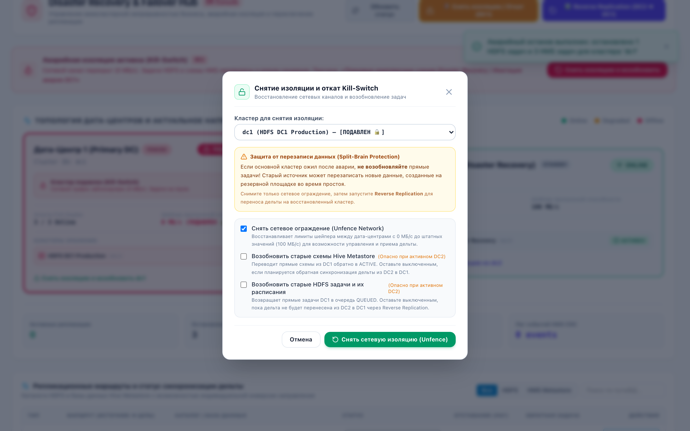
  <p><em>Рисунок 11: Модальное окно безопасного снятия изоляции (Unfence) с защитой от Split-Brain и перезаписи данных</em></p>
</div>

3. Мастер обратной репликации (Reverse Replication, `DC2 ➔ DC1`):
   - Кнопка **Reverse Replication (DC2 ➔ DC1)** запускает мастер разворота потока данных после восстановления основного ЦОД.
   - Для подтверждения в окне нужно ввести слово `REVERSE`.
   - Система создает обратные задачи для всех каталогов HDFS и баз HMS: меняются местами кластеры (`from_cluster_id ➔ to_cluster_id`) и пути HDFS (`sourcePath = direct.getTargetPath()`, `targetPath = direct.getSourcePath()`), поэтому накопленная в резервном хранилище дельта переносится обратно в основной кластер. Воркеры DC2 переводятся в режим отправителей, лимит канала возвращается к штатным 100 МБ/с.

<div align="center">
  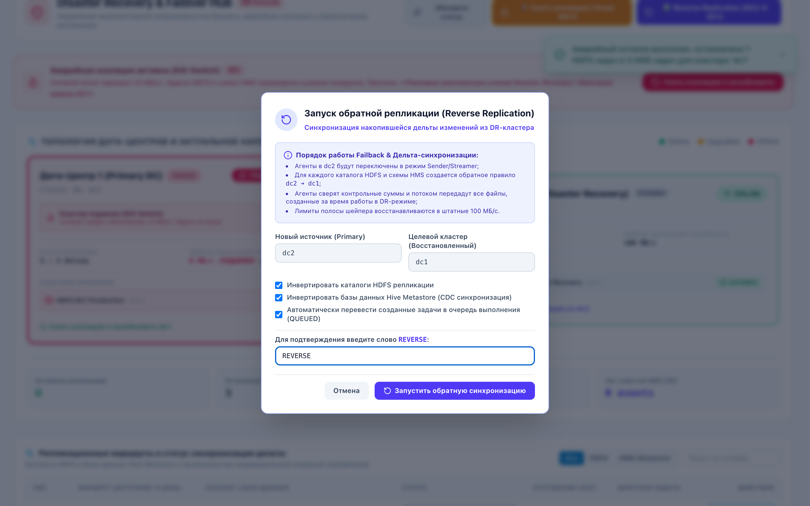
  <p><em>Рисунок 12: Мастер запуска обратной репликации дельты изменений (Reverse Replication DC2 ➔ DC1)</em></p>
</div>

4. Разворот отдельного маршрута и управление зеркалами (Reverse & Undo Failback):
   - В таблице маршрутов у каталогов HDFS есть кнопка **«Развернуть ⇄»**:
     - она создает встречную задачу (`dc2 ➔ dc1`, префикс `rev-...`) с переставленными кластерами и путями. Задача показывается отдельной строкой с фиолетовым бейджем **`Зеркало ⇄`**;
     - у исходной прямой задачи выставляется `has_reverse_job: true`, повторно зеркало для нее не создается;
     - у исходной задачи появляется янтарная кнопка **«Отозвать ↩»**, у зеркала — кнопка **«Удалить зеркало ✕»**;
     - **«Отозвать ↩»** удаляет зеркальную задачу, снимает блокировку прямого маршрута и возвращает кнопку **«Развернуть ⇄»**;
     - при ошибке передачи (например, NameNode `dc1` временно недоступен) рядом со статусом `FAILED` выводится подсказка с текстом ошибки агента.

### 8.8 Репликация Kafka (раздел «Kafka Replication»)

Раздел **Kafka Replication** реплицирует топики Apache Kafka между ЦОД через gRPC WAN-канал с ограничением полосы (Hierarchical Token Bucket).

1. Двунаправленная репликация (Active-Active) с одинаковыми именами топиков:
   - Запись в топик с одним и тем же именем (например, `orders-v1`) возможна одновременно в обоих ЦОД.
   - Бесконечные циклы («эхо») отсекает фильтр `LoopPreventionFilter` по заголовкам `X-Repl-Origin` и `X-Repl-Hop`.
2. Синхронизация смещений Consumer Groups:
   - Смещения сопоставляются по временным меткам сообщений (`offsetsForTimes`).
   - Если консьюмер-группа активна в целевом ЦОД (`state == STABLE`), коммит смещений для нее блокируется, чтобы не перезаписать ее текущий прогресс.
3. Синхронизация и трансляция Schema Registry:
   - Схемы синхронизируются, если реестры двух ЦОД не связаны на уровне инфраструктуры.
   - Перекодирование на уровне wire-формата без десериализации (Zero-Copy Wire Transcoding):
     - Confluent $\longleftrightarrow$ Confluent: замена 4-байтного Schema ID на месте, если локальные реестры не совпадают;
     - Hortonworks $\longleftrightarrow$ Confluent: преобразование заголовка 9 байт $\longleftrightarrow$ 5 байт без десериализации Avro payload;
     - Hortonworks $\longleftrightarrow$ Hortonworks: замена 8-байтного Version ID на месте.
4. Топики без Schema Registry (Passthrough / Auto-detect):
   - Топики без реестра схем (JSON, Plain Text, Protobuf без реестра, raw bytes) передаются байт в байт без обращения к реестрам.
   - Tombstone-сообщения (`null payload`) в `compact`-топиках передаются как есть.
5. Отдельный демон `parom-kafka-agent`:
   - Запускается отдельным процессом или контейнером, чтобы streaming-нагрузка Kafka не конкурировала с пакетной репликацией HDFS.
6. Керберизованная Kafka (Kerberos SASL GSSAPI):
   - Аутентификация через `SASL_PLAINTEXT` и `SASL_SSL` с обновлением билетов Kerberos по keytab.
   - JAAS-контекст задается свойством `sasl.jaas.config` на базе `com.sun.security.auth.module.Krb5LoginModule`; глобальный файл `jaas.conf` не нужен.
   - Можно задать свой Principal (`parom-kafka@REALM`) и Kerberos Service Name (`kafka`).
7. Керберизованный Schema Registry (Kerberos SPNEGO / HTTP Negotiate):
   - REST-клиенты обращаются к Schema Registry (Confluent и Hortonworks / Cloudera) по RFC 4559 Negotiate.
   - GSS-API-токены генерируются для Service Principal вида `HTTP/<registry-host>@REALM`, где `<registry-host>` — хост реестра; сессия обновляется по keytab.
   - Заголовок `Authorization: Negotiate <token>` отправляется сразу; на ответ 401 клиент заново генерирует билет и повторяет запрос.
   - SPNEGO включается в веб-интерфейсе создания задачи и параметрами CLI демона (`--sr-kerberos-enabled`, `--sr-service-name`).
8. Неблокирующая запись в целевой брокер (Non-blocking Async Ingestion):
   - В `KafkaBatchProducer` и `KafkaDataTransferServiceImpl` фиксация пакетов в целевом брокере выполняется через `CompletableFuture` и асинхронные callback'и `producer.send(...)`; потоки Netty не блокируются синхронным ожиданием.
   - Поэтому задержка ответа брокера целевого кластера не останавливает сетевой gRPC-поток Netty и не вызывает каскадный backpressure.
9. Многопоточный пул консьюмеров (Multi-threaded Consumer Pool):
   - `KafkaBatchConsumerPool` запускает $N$ параллельных потоков (`consumerThreads`, по умолчанию 8, до 64) с общим `group.id`.
   - Координатор Consumer Group брокера Kafka распределяет партиции между потоками (например, 128 партиций — по 8–16 на поток), и чтение не упирается в одно ядро CPU.
   - Размер пакета (`batchSize`) настраивается в диапазоне 500–10 000 сообщений (по умолчанию 2 000).
10. Роли демона и сайзинг для 1M msg/s (`parom-kafka-agent`):
   - Роль демона задается в CLI: `--role=receiver` (gRPC-сервер приема и продюсер), `--role=sender` (пул консьюмеров и потоковый gRPC-клиент), `--role=dual` (двунаправленный узел).
   - Для очередей от 128 партиций и до 1 000 000 msg/s рекомендуется запускать 4–8 инстансов демона с пулом 8–16 потоков консьюмеров на инстанс и выделять полосу WAN 2,5–5 Гбит/с.
11. Распределение трафика по нескольким агентам и автоматическое обнаружение пула (Auto Multi-Agent Ingress/Egress):
   - Масштабирование на источнике (Sender Fleet): процессы-отправители с одинаковым `group.id` (`parom-kafka-{jobId}`) делят партиции топиков через координатор Consumer Group Kafka. Нагрузка распределяется по физическим узлам, поэтому не упирается в CPU и сетевую карту одного хоста.
   - Масштабирование на приемнике (Receiver Fleet): агенты-приемники в целевом ЦОД держат независимые gRPC-сокеты Data Plane и параллельно пишут данные в целевую Kafka асинхронными батч-продюсерами.
   - Автоматическое наполнение пулов (Zero-Touch Discovery): при включенной опции распределения по агентам оркестратор опрашивает `AgentRegistry` и связывает задачу с доступными отправителями (`getLiveKafkaSendersForCluster`) и приемниками (`getLiveKafkaReceiversForCluster`). Адреса вручную не вводятся; веб-интерфейс показывает онлайн-статус агентов.
   - Обновление эндпоинтов без перезапуска: демоны-отправители в фоновом цикле `pollActiveJobs` отслеживают изменения пула приемников и обновляют список соединений через `KafkaReplicationClient.updateEndpoints()`.
   - Порядок внутри партиции (Partition-Pinned Routing): батчи группируются по `TopicPartition`, а приемник выбирается детерминированно: `targetIndex = abs(partition) % activeReceivers.size()`. Все батчи одной партиции идут на один и тот же узел, поэтому сетевой джиттер не меняет порядок записей.
   - Failover и карантин: при сетевом сбое или падении целевого узла `KafkaTargetBalancer` выводит его в карантин (по умолчанию на 10 секунд), а его партиции перераспределяются по оставшимся узлам без остановки репликации. После восстановления узел возвращается в ротацию.
   - Кластеры источника и назначения выбираются только из зарегистрированных в топологии кластеров с настроенными Kerberos Principals, сетевыми маршрутами и активными демонами. Произвольный кластер указать нельзя: для него не было бы аутентификации и маршрутизации.
12. gRPC TLS и защита смещений консьюмер-групп:
   - Шифрование gRPC Data Plane: TLS/mTLS между агентами-отправителями и приемниками включается параметрами `--tls-enabled`, `--tls-cert-chain`, `--tls-private-key` и `--tls-trust-cert`.
   - Перенос смещений (Lag Safety Gate) выполняется периодически и включается интервалом `--offset-sync-interval-sec`; по умолчанию выключен. Приемник пропускает группу, активную на целевом кластере, и не переводит вперед группу, отстающую от границы репликации, — иначе часть сообщений была бы пропущена потребителем. Смещения сопоставляются с подтвержденным прогрессом репликации, а не с концом топика.
13. Обнаружение топиков и групп (Live Discovery) и телеметрия:
   - При выборе кластера список топиков и консьюмер-групп запрашивается у Kafka-брокера через `AdminClient` (`listTopics()`, `listConsumerGroups()`). Если брокер недоступен или кластера нет в топологии, возвращается пустой список `[]`, демонстрационные заглушки не подставляются.
   - Воркеры агента-отправителя считают подтвержденные приемником сообщения (`messagesReplicated`), переданные байты полезной нагрузки (`bytesReplicated`) и текущий лаг чтения (`currentLagMs`). Эти метрики передаются в Orchestrator Control Plane через gRPC Heartbeat и отображаются в интерфейсе мониторинга задач.
14. Двухконтурное управление полосой и автонастройка параметров для каналов 40G / 100G / 200G / 400G+ (Two-Tier QoS & High-Bandwidth Tuning):
   - Двухконтурный шлюз QoS (Two-Tier Governor):
     - Контур 1 (квота WAN HTB): если при создании задачи лимит полосы (`bandwidth_limit_mb`) не задан, оркестратор берет 40% явно заданного лимита канала между ЦОД, без верхней отсечки на 40G; на каналах 100G, 200G, 400G+ это квоты 5 000–20 000+ МБ/с. Квота считается один раз и записывается в лимит задачи. Через токен-бакет `TokenBucketThrottler` трафик Kafka не идет: он ограничивает только HDFS-репликацию, и HDFS получает не больше 60% канала даже тогда, когда Kafka канал не использует (руководство администратора, раздел 8.4).
     - Контур 2 (локальные лимиты агентов, задаются DevOps при старте): оркестратор не опирается на параметры сетевых интерфейсов хостов (как и в HDFS-репликаторе). Каждый демон-отправитель запускается с флагом `--max-bandwidth-mb-s` (или переменной `AGENT_MAX_BANDWIDTH_MB_S`); этим значением DevOps-инженер ограничивает долю полосы хоста под репликацию, оставляя остальное другим сервисам.
     - Контур учитывается, только если задан явно: лимит канала между ЦОД — в топологии, лимит агента — флагом `--max-bandwidth-mb-s` у каждого отправителя. Канал без настройки (оркестратор показывает для него 100 МБ/с по умолчанию) и агенты без флага задачу не ограничивают. Раньше из этих значений по умолчанию получалось 40 МБ/с на всю задачу или 100 МБ/с на агента.
     - Итоговое ограничение: оркестратор вычисляет скорость задачи как
       $$\text{effectiveBandwidth} = \min\left(\text{WAN HTB Quota}, \sum_{a \in \text{senders}} a.\text{maxBandwidthMbS}\right)$$
       Веб-интерфейс показывает, что именно ограничивает задачу: «Ограничено лимитами агентов» или «Ограничено WAN HTB (40%)».
   - Шейпинг на демоне-отправителе: в `KafkaBatchConsumerPool` работает локальный ограничитель `LocalBandwidthLimiter`. Перед отправкой сериализованного пакета Protobuf в gRPC-поток (`targetStream.onNext`) агент притормаживает отправку так, чтобы не превысить локальный лимит хоста.
   - Автонастройка параметров (Auto-Tuning Profile для 40G/100G/200G/400G+):
     - Полоса задачи: $\min(\text{WAN Quota}, \sum \text{Agent Bandwidth})$.
     - Потоки чтения на агент (шардинг пула): целевое число потоков растет с полосой — от 8 потоков на малых скоростях до $\max(64, \lceil \text{Bandwidth} / 30.0 \rceil)$ при скоростях выше 2 000 МБ/с (например, 167 потоков для 100G, 333 для 200G, 667 для 400G+). На узел: $\text{threadsPerAgent} = \min\left(32, \max\left(1, \lceil \text{targetThreads} / \text{sendersCount} \rceil\right)\right)$; потолок 32 потока на одну JVM ограничивает переключения контекста CPU и нагрузку на Netty. Дальнейшее масштабирование — добавлением агентов на других брокерах кластера.
     - Размер микробатча: от 1 000 записей (при $\le 20$ МБ/с) до 20 000 (при $\le 3 000$ МБ/с), 35 000 (при $\le 6 000$ МБ/с) и 50 000 записей (при $> 6 000$ МБ/с), чтобы на высоких скоростях заполнить BDP (Bandwidth-Delay Product) канала.
     - Интервал синхронизации оффсетов уменьшается до 1–2 с при высоких скоростях ($\ge 500$ МБ/с и $\ge 1 500$ МБ/с); отставание оффсетов групп от реплицированных данных сокращается до этого интервала.
   - Ручная настройка (Manual Override): если снять галочку **«Авто-выделение HTB и тюнинг параметров»**, все поля переходят в ручной ввод с диапазонами до 100 000 МБ/с и до 100 000 записей в пачке.
15. Телеметрия переданных данных и лага репликации:
   - Демоны-консьюмеры `KafkaBatchConsumerPool` накапливают подтвержденные приемником счетчики (`totalMessagesReplicated`, `totalBytesReplicated`) и текущую задержку чтения (`currentLagMs`).
   - В фоновом цикле gRPC keepalive (`heartbeat`) агент передает счетчики в оркестратор (`OrchestratorControlPlaneService`).
   - Оркестратор агрегирует показатели активных задач и выводит их в панели репликации в реальном времени (`messagesReplicated`, `bytesReplicated`, `currentLagMs`).
16. Smoke-тесты двунаправленной (Active-Active) репликации:
   - Интеграционный Java E2E smoke-тест `KafkaActiveActiveReplicationSmokeTest`:
     - проверяет одновременную встречную передачу потоков (DC1 $\longleftrightarrow$ DC2) через in-process gRPC-каналы;
     - проверяет, что `LoopPreventionFilter` отсекает циклическое размножение (0% эха) по меткам `X-Repl-Origin` и инкременту счетчика `X-Repl-Hop`;
     - проверяет доставку Tombstone-сообщений (`null payload`) в обоих направлениях;
     - проверяет барьер против зацикливания в кольцевой топологии (Max Hops Barrier);
     - проверяет блокировку коммита смещений Consumer Groups в режиме Active-Active (`SafetyCommitManager.applyOffsetsSafely`).
   - Сквозной демо-скрипт `run-kafka-smoke-tests.sh` (`make demo-kafka-smoke`):
     - выполняет 13 шагов проверки на кластере с Kerberos SASL и SPNEGO:
       - шаги 1–7: однонаправленная репликация, Schema Registry SPNEGO, Tombstone-сообщения, блокировка коммита смещений при failover;
       - шаги 8–12: создание Active-Active топика (`e2e-smoke-<RUN_ID>-active-orders`), регистрация задачи `BIDIRECTIONAL`, встречная параллельная публикация сообщений в DC1 и DC2, проверка доставки всех записей в обоих направлениях и отсутствия эха (по 6 записей в каждом кластере);
       - шаг 13: удаление задач и топиков прогона.
     - Каждый прогон работает со своими топиками `e2e-smoke-<RUN_ID>-*`, поэтому скрипт можно запускать повторно на том же стенде. Задачи и топики прерванных прогонов удаляются в начале следующего, `KEEP_SMOKE_TOPICS=1` оставляет их для разбора.

---

## 9. Мониторинг и метрики Prometheus

Сервис отдает метрики на эндпоинте `/metrics` (порт 8005). Анонимный доступ к нему закрыт: по метрикам видны топология ЦОД и объемы передач, поэтому сборщику нужны учетные данные: пользователь платформы или HTTP Basic `prometheus:<token>`, где `<token>` — значение `PAROM_METRICS_SCRAPE_TOKEN` (`parom.metrics-scrape-token`) оркестратора. Если переменная пуста, Basic-доступ выключен.

| Метрика | Тип | Описание |
|---|---|---|
| `parom_bytes_total{status}` | Counter | Общий объем переданных байт данных (`COMPLETED`, `IN_PROGRESS`, `FAILED`) |
| `parom_jobs_total{status, mode}` | Gauge | Количество задач репликации по статусам и типу запуска (`manual`, `scheduled`) |
| `parom_tasks_total{status}` | Gauge | Распределенный пул пофайловых задач (`QUEUED`, `RUNNING`, `COMPLETED`, `FAILED`) |
| `parom_active_workers` | Gauge | Количество зарегистрированных воркеров в пуле |
| `parom_active_agents{status}` | Gauge | Число доступных gRPC-агентов (`online`, `total`) |
| `parom_file_size_bytes` | Histogram | Распределение размеров реплицируемых файлов |
| `parom_throttling_delay_seconds_total` | Counter | Суммарная задержка воркеров из-за иерархического Token Bucket шейпера |
| `parom_throttling_delay_seconds` | Gauge | Текущее накопленное время ожидания токенов шейпера полосы пропускания |
| `parom_throttling_global_limit_bytes_per_sec` | Gauge | Глобальный лимит пропускной способности WAN-канала в байтах/сек |
| `parom_hms_jobs_total{status}` | Gauge | Задачи репликации Hive Metastore (`QUEUED`, `BOOTSTRAPPING`, `ACTIVE`, `PAUSED`, `ERROR`, `WAITING_FOR_AGENTS`, `STOPPED`, `FAILED`) |
| `parom_hms_tables_total{type}` | Gauge | Количество таблиц HMS (`total`, `replicated`) |
| `parom_hms_partitions_total{type}` | Gauge | Количество партиций таблиц HMS (`total`, `replicated`) |
| `parom_hms_speed_bytes_per_second` | Gauge | Текущая скорость передачи данных HMS-репликации (байт/сек) |
| `parom_dr_cluster_fenced{cluster_id}` | Gauge | Статус изоляции кластера (Fencing / Kill-Switch: `0` = Active, `1` = Fenced/RO) |
| `parom_dr_reverse_jobs_total{status}` | Gauge | Количество задач обратной синхронизации (Reverse Sync / Failback) |
| `parom_agent_status{agent_id, cluster_id, mode, status}` | Gauge | Доступность узла агента (`1` при совпадении статуса, `0` иначе) |
| `parom_agent_active_transfers{agent_id, cluster_id, mode}` | Gauge | Число активных параллельных потоков передачи файлов на агенте |
| `parom_agent_transferred_bytes_total{agent_id, cluster_id}` | Counter | Объем байт данных, фактически переданных агентом |
| `parom_agent_errors_total{agent_id, cluster_id}` | Counter | Количество ошибок передачи файлов на стороне агента |
| `parom_agent_heartbeat_age_seconds{agent_id, cluster_id}` | Gauge | Задержка в секундах с момента последнего keepalive от агента |
| `parom_agent_max_bandwidth_mb_s{agent_id, cluster_id}` | Gauge | Локальный лимит полосы пропускания HTB агента (МБ/с) |

### 9.1 Дашборды Grafana

В репозитории есть три дашборда:
1. [Parom — Overview](../monitoring/grafana/dashboards/parom_overview.json):
   - общая сводка и Golden Signals межкластерного обмена;
   - текущая и средняя скорость WAN, накопленный объем трафика;
   - очереди пофайловых задач HDFS и статусы репликации HMS;
   - задержки иерархического шейпера Token Bucket Throttler;
   - индикаторы сетевого ограждения Disaster Recovery.
2. [Parom — Agents Fleet](../monitoring/grafana/dashboards/parom_agents.json):
   - статус каждого gRPC-агента в ЦОД (Online/Offline);
   - распределение параллельных потоков передачи файлов (`active_threads`);
   - скорость и объемы в разрезе агентов;
   - задержки heartbeat и динамика сетевых ошибок передачи.
3. [Parom — HMS Replication & Disaster Recovery](../monitoring/grafana/dashboards/parom_hms_dr.json):
   - фоновая и потоковая репликация метаданных Hive Metastore (CDC);
   - статус Kill-Switch и сетевого ограждения (Fencing) при инцидентах;
   - жизненный цикл схем и таблиц;
   - таблицы аудита и переключений площадок DR.

---

## 10. Диагностика неполадок

### Задача зависла в статусе QUEUED

- Причина: не запущен воркер репликации (`worker daemon`) или заняты все слоты передачи.
- Решение: проверьте логи контейнеров агентов. На демо-стенде `demo/parom/docker-compose.yml`: `docker logs parom-agent-dc1` и `docker logs parom-agent-dc2`.

### Скорость репликации ниже ожидаемой

- Причина: срабатывает одно из звеньев иерархического шейпера (лимит DC-DC, лимит HDFS-HDFS или глобальный пул).
- Решение: проверьте счетчик `parom_throttling_delay_seconds_total` в `/metrics` и при необходимости увеличьте лимит на вкладке **«Топология ЦОД и Полоса»**.

### Ошибка аутентификации Kerberos (GSSException)

- Причина: истек или не найден keytab системного принципала.
- Решение: убедитесь, что файл keytab смонтирован в контейнер воркера и доступен по пути из переменной `PAROM_KEYTAB_PATH` (если она не задана, агент читает `KRB5_KEYTAB`).
