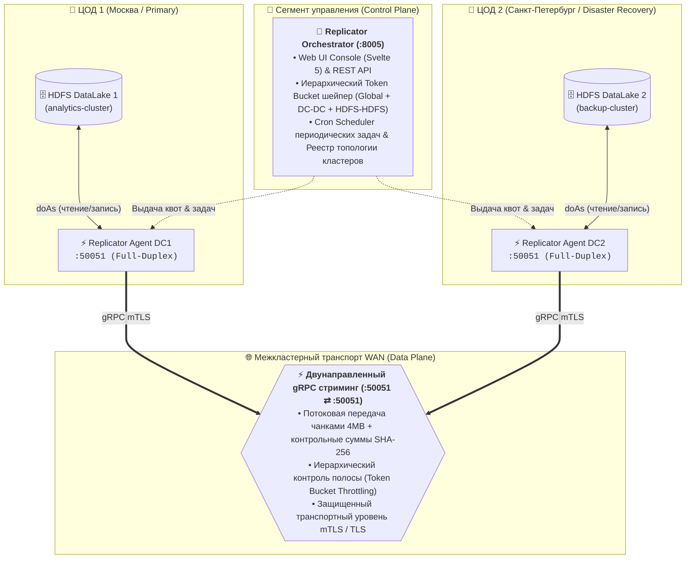
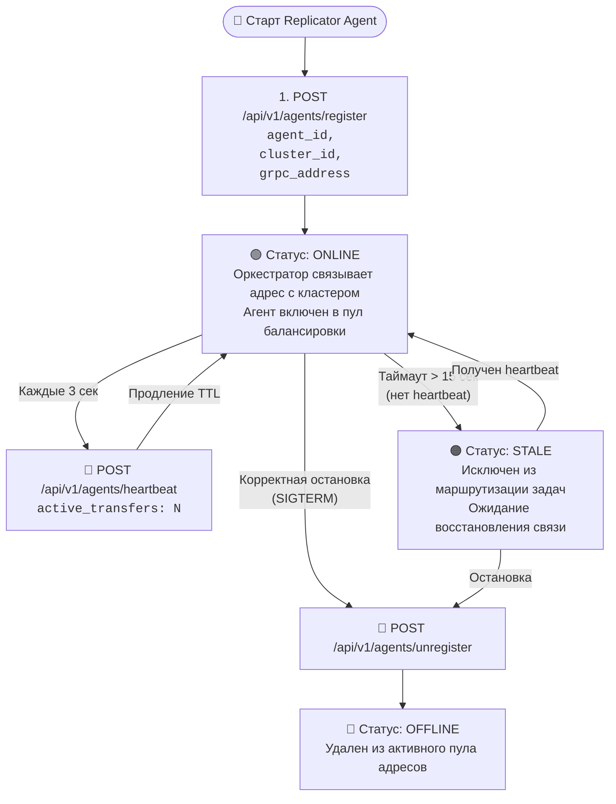
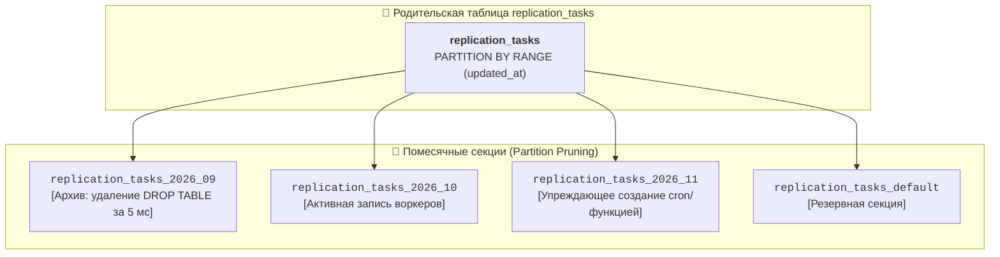
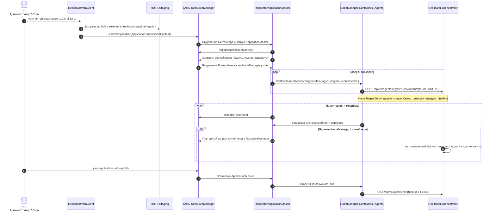
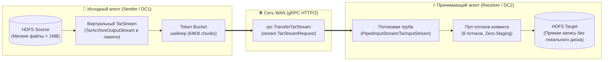
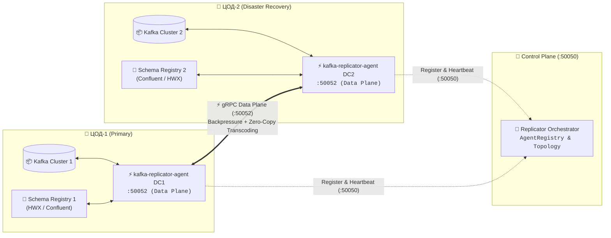

# 🛠️ Руководство администратора: Hadoop gRPC Replicator

Это руководство для инженеров **DevOps / SRE / сетевых администраторов** по установке, конфигурированию, промышленному развертыванию и эксплуатации распределенной системы межкластерной репликации **Hadoop gRPC Replicator** в четырех режимах:
1. **Standalone & Hadoop Nodes** (Bare-Metal / DataNode / Edge Nodes под управлением systemd или `hadoop jar`)
2. **Apache Hadoop YARN** (Эластичный пул распределенных агентов под управлением ApplicationMaster)
3. **Docker & Docker Compose** (Контейнеризированный запуск компонентов)
4. **Kubernetes** (Промышленное развертывание в K8s)

> [!NOTE]
> Архитектура высокой доступности (HA), распределенного лизинга и матрица отказоустойчивости всех компонентов подробно описана в документе: [Руководство по отказоустойчивости (replicator-fault-tolerance.md)](replicator-fault-tolerance.md).

---

## 1. Архитектура и сетевая топология

### 1.1 Архитектура и компоненты системы
Hadoop gRPC Replicator построен на базе симметричных универсальных агентов **Replicator Agent (`Full-Duplex`)**:
Каждый узел в ЦОД1 и ЦОД2 запускает агент `backend.replicator.agent`, который одновременно принимает входящие gRPC-потоки (:50051) и передает исходящие задачи из очереди Оркестратора. Это обеспечивает полноценную двунаправленную репликацию (`DC1 ⇄ DC2`, DR failback) в едином сервисе.



### 1.2 Сетевые порты и протоколы
| Сервис | Порт | Протокол | Направление | Назначение |
|---|---|---|---|---|
| **Orchestrator HTTP/REST** | `8005` | HTTP/HTTPS | Inbound | Web UI консоль, REST API, выдача токенов шейпера, `/health`, `/metrics` |
| **Orchestrator Control Plane (gRPC)** | `50050` | gRPC (HTTP/2) | Inbound | Высокопроизводительный Control Plane: регистрация агентов (`AgentRegistry`), heartbeat, выдача задач |
| **Replicator Agent (HDFS Data Plane)** | `50051` | gRPC (HTTP/2) | Inbound/Outbound | Полный дуплекс: прием входящих файлов/чанков HDFS и передача исходящих реплик |
| **Kafka Replicator Agent (Data Plane)** | `50052` | gRPC (HTTP/2) | Inbound/Outbound | Полный дуплекс передачи батчей Kafka, Zero-Copy транскодинг схем, Flow Control |
| **NameNodes** | `9870`/`8020` | HTTP / RPC | Outbound | Чтение из исходного HDFS и запись в целевой HDFS |
| **KDC** | `88` | TCP/UDP | Outbound | Выпуск билетов Kerberos для системной техучетки |

### 1.3 Динамическая регистрация агентов и разрешение адресов (Dynamic Keepalive Service Discovery)

В платформе реализован режим **динамической саморегистрации агентов с keepalive-мониторингом**:



#### Приоритет разрешения целевого адреса (get_target_address):
1. **Динамический реестр живых агентов (AgentRegistry keepalive) — основной механизм**:
   - Агент при старте автоматически сообщает свой внешний адрес `advertised_grpc_address` (например, `agent-dc1:50051`).
   - Оркестратор динамически регистрирует этот адрес за целевым HDFS-кластером.
   - Если один кластер обслуживают несколько агентов (горизонтальное масштабирование), Оркестратор выполняет балансировку нагрузки, выбирая узел с наименьшим числом текущих задач (`active_transfers`).
2. **Статическая топология Оркестратора (`application.yml`)**:
   - Значения по умолчанию из конфигурации Оркестратора (`hadoop.replicator.clusters`) используются как резерв, если живой агент еще не зарегистрировался.
3. **Локальный оверрайд переменной окружения `AGENT_TARGET_<CLUSTER_ID>`**:
   - Применяется в нестандартных изолированных сетях (NAT, Ingress-шлюзы, раздельные DMZ).
4. **Резервный адрес по умолчанию (Fallback)**:
   - Значение переменной `FALLBACK_TARGET_ADDRESS` / `RECEIVER_ADDRESS` (по умолчанию `localhost:50051`).

### 1.3.1 Безопасность динамической регистрации (Security & Zero-Trust)

Динамическая регистрация защищена комплексной многоуровневой системой безопасности:

1. **Аутентификация агентов через Agent Secret (PSK / Token)**:
   - На Оркестраторе и всех доверенных агентах задается общий секретный ключ `REPLICATOR_AGENT_SECRET` (минимум 32 символа).
   - Агент автоматически передает этот токен в HTTP-заголовке `X-Agent-Secret` (или `Authorization: Bearer <token>`) при вызовах `/api/v1/agents/register`, `/api/v1/agents/heartbeat`, `/api/v1/agents/unregister` и запросах сетевых квот `/api/v1/tokens/request`.
   - Запросы без валидного токена отбрасываются с кодом `401 Unauthorized`. В боевом режиме (`ENVIRONMENT=production`) отсутствие переменной блокирует старт сервиса.
2. **Белый список кластеров (Cluster Whitelisting)**:
   - Свойство `hadoop.replicator.enforce-cluster-whitelist=true` (по умолчанию активно в боевом режиме).
   - Агенту разрешено регистрироваться только для тех кластеров, которые явно объявлены администратором в `application.yml` (`hadoop.replicator.clusters`).
   - Попытка зарегистрировать неавторизованный кластер отклоняется с ошибкой `403 Forbidden`, защищая топологию от отравления (Topology Poisoning).
3. **Защита от SSRF и валидация сетевых адресов**:
   - Оркестратор валидирует структуру анонсируемого gRPC-адреса `host:port` и диапазон порта (1–65535).
   - Автоматически блокируются попытки передать эндпоинты облачных метаданных (`169.254.169.254`, `metadata.google.internal`, `instance-data`) и адреса link-local (`169.254.0.0/16`, `fe80::/10`).

### 1.3.2 Шифрование gRPC трафика и взаимная аутентификация (TLS / mTLS)

Каналы потоковой передачи файлов по gRPC поддерживают криптографическую защиту:
1. **Шифрование данных в канале (TLS)**:
   - Включается установкой `REPLICATOR_GRPC_TLS_ENABLED=true` либо указанием префикса `grpcs://` в целевом адресе.
   - Сервер-приемник использует сертификат и приватный ключ (`REPLICATOR_GRPC_CERT_CHAIN_PATH` и `REPLICATOR_GRPC_PRIVATE_KEY_PATH`).
   - При отсутствии явных сертификатов в dev/тест средах генерируется временный самоподписанный сертификат на лету (`SelfSignedCertificate`).
2. **Взаимная аутентификация узлов (mTLS)**:
   - При `REPLICATOR_GRPC_CLIENT_AUTH=REQUIRE` сервер запрашивает и валидирует сертификат подключающегося передающего агента.
   - Доверенные корневые центры сертификации задаются через `REPLICATOR_GRPC_TRUST_CERT_COLLECTION_PATH`.
   - Клиент-отправитель (`ReplicationSender`) автоматически передает клиентский сертификат и ключ при наличии конфигурации.
3. **Безопасность REST-вызовов Оркестратора**:
   - `OrchestratorClient` поддерживает вызовы по `https://` с валидацией доверенных сертификатов или безопасным fallback флагом `ORCHESTRATOR_TLS_INSECURE_SKIP_VERIFY=true` для тестовых сред.

### 1.3.3 Персистентный реестр агентов в БД для Stateless Active-Active Orchestration (RES-01)

Для обеспечения горизонтальной масштабируемости и высокой доступности реестр агентов переведен с локального in-memory хранения на персистентную сущность в СУБД:
- **Таблица `agent_registry` (`AgentEntity`)**: хранит статус каждого агента (`ONLINE`, `STALE`, `OFFLINE`), идентификатор кластера, внешний gRPC адрес, временную метку последнего heartbeat (`last_heartbeat`), хэш секрета и метрики текущей нагрузки (`active_transfers`, `transferred_bytes`, `error_count`).
- **Stateless Active-Active Orchestrator**: любой экземпляр оркестратора в кластере обращается к общей таблице в PostgreSQL, видит актуальный состав пула агентов и может прозрачно планировать подзадачи без синхронизации по распределенной шине памяти.
- **Двухуровневый кэш Heartbeat**: высокочастотные пинги агентов (каждые 3–5 секунд) агрегируются и сбрасываются в БД с оптимизацией количества транзакций, предотвращая оверхед на дисковую подсистему СУБД.

### 1.3.4 Координация узлов Orchestrator и распределенный Token Bucket (RES-06)

В многонодовой архитектуре Orchestrator глобальный лимит полосы пропускания распределяется динамически:
- **Таблица `bandwidth_limits` (`BandwidthLimitEntity`)**: персистентное хранилище сконфигурированных лимитов для кластеров и направлений репликации.
- **Таблица `orchestrator_nodes` (`OrchestratorNodeEntity`)**: динамический реестр активных экземпляров оркестратора с отслеживанием сердечных сокращений (`last_seen`) и статуса лидерства.
- **Кластерный координатор `OrchestratorClusterCoordinator`**: автоматически вычисляет число живых реплик оркестратора и пропорционально делит допустимый объем токенов шейпера `TokenBucketThrottler`, предотвращая превышение суммарного WAN-трафика сверх установленного SLA. При падении одной из нод её квота автоматически перераспределяется между оставшимися узлами в течение интервала выявления сбоя.

### 1.3.5 Распределенные блокировки с Fencing Tokens и защита от Split-Brain (RES-07 & RES-08)

Для предотвращения конкурентного выполнения критических регламентов (миграции, Disaster Recovery Failover, переключение лизинга) внедрен сервис `DistributedLockService`:
- **Монотонные токены ограждения (`fencing_token`)**: при успешном захвате блокировки в таблице `cluster_locks` генерируется монотонно возрастающее 64-битное число.
- **Защита от зомби-лидеров**: любые последующие операции мутации состояния проверяют токен ограждения. Если узел отстал из-за GC паузы или сетевого сплита, его устаревший токен будет отвергнут узлами-исполнителями и СУБД.
- **Атомарная защита Disaster Recovery**: вызовы Failover и Failback в `DisasterRecoveryService` оборачиваются в именованные распределенные блокировки с верификацией fencing token, полностью исключая параллельное переключение из разных консолей.

---

### 1.4 Справочник переменных окружения (Environment Variables Reference)

#### 1.4.1 Переменные Replicator Orchestrator
| Переменная | Описание | Значение по умолчанию | Обязательность |
|---|---|---|---|
| `SPRING_CONFIG_ADDITIONAL_LOCATION` | Путь к внешнему файлу конфигурации Spring Boot | `file:/etc/hadoop-explorer/replicator/application.yml` | Опционально |
| `HADOOP_REPLICATOR_GLOBAL_LIMIT_BYTES_PER_SEC` | Глобальный лимит пропускной способности WAN (байт/сек) | `104857600` (100 МБ/с) | Опционально |
| `SPRING_DATASOURCE_URL` | JDBC URL подключения к БД (PostgreSQL / SQLite / H2) | `jdbc:h2:mem:replicator` | Опционально |
| `SPRING_DATASOURCE_USERNAME` | Пользователь базы данных | `sa` | Опционально |
| `SPRING_DATASOURCE_PASSWORD` | Пароль пользователя базы данных | `""` | Опционально |
| `HADOOP_REPLICATOR_AGENT_SECRET` / `REPLICATOR_AGENT_SECRET` | Общий секретный ключ аутентификации агентов репликации (заголовок `X-Agent-Secret` и gRPC context) | — (в dev опционален, в prod обязателен) | Обязательно в prod |
| `HADOOP_REPLICATOR_ENFORCE_AGENT_SECRET` | Принудительный Fail-Closed режим проверки секрета агентов (`true`/`false`) | `false` (в prod рекомендуется `true`) | Опционально |
| `HADOOP_REPLICATOR_ENFORCE_TASK_ATTESTATION` | Включение криптографической аттестации задач HMAC-SHA256 (`true`/`false`) | `true` | Рекомендуется |
| `HADOOP_REPLICATOR_ALLOW_LOOPBACK_AGENTS` | Разрешение регистрации агентов на loopback-адресах (`127.0.0.1`, `localhost`) | `false` (только для тестов) | Опционально |
| `HADOOP_REPLICATOR_PROGRESS_DEBOUNCE_MS` | Интервал дебаунсинга буфера фиксации прогресса задач в БД (мс) | `500` | Опционально |
| `HADOOP_REPLICATOR_PROGRESS_BUFFER_SIZE` | Максимальный размер буфера завершенных задач до принудительного flush | `1000` | Опционально |
| `HADOOP_REPLICATOR_ENFORCE_CLUSTER_WHITELIST` | Принудительная блокировка регистрации неизвестных кластеров (`true`/`false`) | `false` (в prod рекомендуется `true`) | Опционально |
| `HADOOP_REPLICATOR_HMS_POLL_INTERVAL_MS` | Интервал автоматического фонового опроса NOTIFICATION_LOG Hive Metastore (мс) | `5000` (5 сек) | Опционально |
| `HADOOP_REPLICATOR_HMS_BOOTSTRAP_CONCURRENCY` | Количество параллельных потоков-воркеров для Bootstrap таблиц схемы Hive | `8` | Опционально |
| `HADOOP_REPLICATOR_HMS_PARTITION_BATCH_SIZE` | Размер пакета (чанков) партиций для безопасного Thrift RPC трансфера | `1000` | Опционально |
| `HADOOP_REPLICATOR_HMS_LEASE_TIMEOUT_SECONDS` | Длительность эксклюзивной аренды (Distributed Lease) HMS задачи агентом источника (сек) | `30` | Опционально |
| `REPLICATOR_HMS_MOCK_CLUSTER_API_ENABLED` | Включение тестового mock-слоя эмуляции кластеров и метасторов (`/api/v1/hms/clusters/**`) для демо-стендов и тестов | `false` (в боевом режиме полностью отключено) | Опционально |
| `JWT_SECRET_KEY` | Секретный ключ подписи JWT-токенов сессий Web UI (мин. 32 симв.) | В dev автогенерируется, в prod обязателен | Обязательно в prod |

#### 1.4.2 Переменные Replicator Agent (Full-Duplex)
| Переменная | Описание | Значение по умолчанию | Обязательность |
|---|---|---|---|
| `AGENT_ID` | Уникальный строковый идентификатор агента в платформе | `agent-01` (или `$WORKER_ID`) | Рекомендуется |
| `AGENT_CLUSTER_ID` | Идентификатор HDFS-кластера, который обслуживает агент | `demo-cluster` | Рекомендуется |
| `REPLICATOR_AGENT_SECRET` | Секретный ключ для аутентификации на Оркестраторе (передается в `X-Agent-Secret`) | — (должен совпадать с Оркестратором) | Обязательно в prod |
| `AGENT_MODE` | Режим работы агента: `all` (дуплекс: прием + передача), `sender` (только передача), `receiver` (только прием) | `all` | Опционально |
| `ORCHESTRATOR_URL` | URL Replicator Orchestrator для саморегистрации, задач и квот | `http://localhost:8005` | Обязательно |
| `RECEIVER_HOST` | Сетевой интерфейс для прослушивания входящего gRPC-сервера | `0.0.0.0` | Опционально |
| `RECEIVER_PORT` | Порт входящего gRPC-сервера для приема чанков данных | `50051` | Опционально |
| `AGENT_ADVERTISED_ADDRESS` | Внешний gRPC-адрес для саморегистрации в Оркестраторе (например, `agent-dc1:50051`) | Вычисляется автоматически (`hostname:50051`) | Опционально |
| `AGENT_ENABLE_REGISTRATION` | Включение режима динамической саморегистрации с keepalive | `true` | Опционально |
| `REPLICATOR_STAGING_DIR` | Локальная директория буфера для приема чанков перед коммитом в локальную ФС (для HDFS используется прямой Zero-Staging в целевой HDFS) | `/tmp/staging` | Опционально |
| `REPLICATOR_LOCAL_SANDBOX` / `LOCAL_SANDBOX_DIR` | Корневой каталог Chroot-песочницы локальных файловых операций (SEC-10) | `/var/lib/hadoop-replicator/sandbox` | Рекомендуется |
| `REPLICATOR_ENFORCE_TASK_ATTESTATION` | Обязательная проверка HMAC-токенов аттестации задач перед записью в HDFS | `true` | Рекомендуется |
| `REPLICATOR_SR_MUTUAL_AUTH` | Включение взаимной аутентификации SPNEGO для Schema Registry (SEC-15) | `false` | Опционально |
| `REPLICATOR_SMALL_FILE_THRESHOLD_BYTES` | Порог размера файла (в байтах) для бандлинга мелких файлов в виртуальные TAR-архивы | `1048576` (1 МБ) | Опционально |
| `REPLICATOR_BUNDLE_TARGET_SIZE_BYTES` | Целевой объем файлов в одном виртуальном TAR-бандле `BUNDLE_TAR` | `16777216` (16 МБ) | Опционально |
| `REPLICATOR_MAX_BUNDLE_FILES` | Максимальное количество файлов в одном виртуальном бандле | `500` | Опционально |
| `REPLICATOR_BUNDLE_COMMIT_CONCURRENCY` | Количество параллельных потоков прямой записи файлов бандла в целевой HDFS | `8` | Опционально |
| `REPLICATOR_STAGING_CLEANUP_ENABLED` | Включение фонового сборщика мусора (Reaper) для периодической очистки осиротевших staging-файлов на HDFS | `true` | Опционально |
| `REPLICATOR_STAGING_CLEANUP_INTERVAL_MINUTES` | Интервал запуска периодической очистки staging-файлов фоновым демоном (минуты) | `15` | Опционально |
| `REPLICATOR_STAGING_TTL_MINUTES` | Время жизни (TTL) staging-файлов, после которого они считаются осиротевшими и удаляются (минуты) | `30` | Опционально |
| `REPLICATOR_HDFS_NAMENODE` | Хост целевого NameNode для прямого HDFS-коммита через Java HDFS Client | Не задано (локальный commit) | Опционально |
| `POLL_INTERVAL_SEC` | Интервал опроса очереди задач и keepalive-пингов (секунды) | `3.0` | Опционально |
| `AGENT_MAX_BANDWIDTH_MB_S` | Локальный лимит пропускной способности агента (МБ/с, Token Bucket). Предотвращает перегрузку сетевой карты и дисков при установке непосредственно на ноду Hadoop (DataNode / Edge Gateway). `0` или пусто — без ограничений | `0.0` (без ограничений) | Опционально |
| `AGENT_TARGET_<CLUSTER_ID>` | Ручной оверрайд сетевого gRPC-адреса для целевого кластера (для NAT/DMZ) | Динамический реестр Оркестратора | Опционально |
| `REPLICATOR_KEYTAB_PATH` | Путь к Keytab-файлу системной техучетки для Kerberos аутентификации | `/etc/security/keytabs/replicator.keytab` | Рекомендуется |
| `REPLICATOR_GRPC_TLS_ENABLED` | Включение защищенного шифрования TLS для входящего и исходящего gRPC трафика | `false` | Опционально |
| `REPLICATOR_GRPC_CERT_CHAIN_PATH` | Путь к сертификату узла (X.509 PEM) | `null` | Опционально |
| `REPLICATOR_GRPC_PRIVATE_KEY_PATH` | Путь к приватному ключу узла (PKCS8 PEM) | `null` | Опционально |
| `REPLICATOR_GRPC_TRUST_CERT_COLLECTION_PATH` | Путь к цепочке доверенных сертификатов CA для проверки пиров | `null` | Опционально |
| `REPLICATOR_GRPC_CLIENT_AUTH` | Режим взаимной проверки сертификатов mTLS (`NONE`, `OPTIONAL`, `REQUIRE`) | `NONE` | Опционально |
| `REPLICATOR_GRPC_INSECURE_SKIP_VERIFY` | Отключение строгой проверки TLS сертификатов для gRPC (только dev) | `false` | Опционально |
| `ORCHESTRATOR_TLS_INSECURE_SKIP_VERIFY` | Отключение проверки HTTPS сертификатов при запросах к Оркестратору | `false` | Опционально |
| `REPLICATOR_HMS_MODE` | Режим работы HMS клиента агента: `thrift` (боевое прямое подключение Thrift RPC к Hive Metastore), `demo-http` (REST симулятор стенда), `mock` (unit-тесты) | `thrift` (если задан `HMS_THRIFT_URIS`), иначе `auto` | Опционально |
| `HMS_THRIFT_POOL_MAX_SIZE` | Максимальный размер пула Thrift-соединений к Hive Metastore (Commons-Pool2) | `16` (minIdle: 1, maxIdle: 8) | Опционально |
| `TARGET_HDFS_DEFAULTFS` / `TARGET_HDFS_DEFAULT_FS` | URI целевой HDFS файловой системы (например, `hdfs://hdfs-cluster-2:9000`) для автоматической перезаписи схем и путей таблиц/партиций в Thrift Hive Metastore через `HmsPathRewriter` | Не задано (используются эвристики и mappings) | Рекомендуется при межкластерной репликации |
| `REPLICATOR_FEDERATION_MAPPINGS` | Список сопоставлений HDFS authority для федерации кластеров через запятую (например, `hdfs-cluster-1:9000=hdfs-cluster-2:9000,dc1=dc2`) | Не задано | Опционально |
| `HMS_LOOP_INTERVAL_MS` | Интервал фонового опроса и синхронизации метаданных HMS в изолированном потоке `replicator-hms-loop` (мс) | `2000` (2 сек) | Опционально |

### 1.5 Настройка Hadoop Impersonation (Proxy User) для Apache Ranger

Для обеспечения прозрачного аудита безопасности и применения политик доступа в **Apache Ranger** платформа использует протокол **Hadoop Proxy User (doAs имперсонация)**:
1. Replicator Agent аутентифицируется в Kerberos KDC по системному keytab техучетки (`hdfs-replicator@REALM.LOCAL`).
2. При операциях с HDFS (`HadoopFsManager` / `FileSystem.get`) агент создает прокси-контекст `UserGroupInformation.createProxyUser(user, baseUgi).doAs(...)` от имени конечного пользователя (`user=alice`, извлеченное из `execution_principal` или сессии).
3. NameNode и Apache Ranger проверяют политики доступа непосредственно для `alice`, а в Ranger Audit Log регистрируется запись вида:
   ```
   UGI: alice (auth:PROXY via hdfs-replicator@REALM.LOCAL)
   Resource: /data/production/events/...
   Action: WRITE / READ
   Access Result: ALLOWED / DENIED
   ```

Для работы механизма в файле конфигурации `core-site.xml` на NameNode должна быть разрешена имперсонация для сервисной техучетки:
```xml
<property>
    <name>hadoop.proxyuser.hdfs-replicator.hosts</name>
    <value>*</value>
</property>
<property>
    <name>hadoop.proxyuser.hdfs-replicator.groups</name>
    <value>*</value>
</property>
```

#### 1.5.1 Разграничение прав на указание пользователя имперсонации (RBAC & Security Validation)
Для исключения несанкционированной эскалации привилегий и подмены авторства в Ranger Audit Log бэкенд Оркестратора и веб-интерфейс реализуют строгое ролевое разграничение:

1. **Режим Администратора (`ADMIN` / `admin_user`)**:
   - В UI (модальные окна создания и редактирования задач HDFS, а также модальное окно создания репликации HMS) поле **«Пользователь имперсонации (doAs)»** открыто для ввода и помечено бейджем `admin`.
   - Администратор может указать произвольный `username` (например, `etl_pipeline` или `spark_service`) либо полный Kerberos-принципал (`user@REALM.LOCAL`). Если домен не указан, бэкенд/UI автоматически нормализует имя до `${username}@REALM.LOCAL`.
   - В REST API контроллеры `JobController` и `HmsReplicationController` принимают переданный `execution_principal`.

2. **Режим Инженера данных / Обычного пользователя (`WRITER`, `USER`)**:
   - В UI поле заблокировано (`disabled`), имеет бейдж `doAs` и отображает имя текущего пользователя (`session.username()`).
   - На уровне бэкенда при создании (`POST /api/v1/jobs`, `POST /api/v1/hms/jobs`) и редактировании (`PUT /api/v1/jobs/{id}`) значение `executionPrincipal` принудительно переопределяется именем аутентифицированного пользователя сессии: `session.username() + "@REALM.LOCAL"`. Любые попытки подделки поля в теле JSON-запроса игнорируются.

3. **Сквозная передача в HMS-подзадачи (`HMS_SUBJOB`)**:
   - При репликации метаданных Hive Metastore агент (`HmsTaskExecutor`) создает дочерние HDFS-подзадачи для переноса файлов директорий таблиц и партиций через вызов `OrchestratorClient.createHdfsSubjob(...)`.
   - В эти подзадачи автоматически пробрасывается `job.executionPrincipal()`, зафиксированный за родительской задачей HMS. Благодаря этому фоновые операции передачи файлов данных HDFS выполняются под тем же пользователем doAs, что и родительская задача схемы.

#### 1.5.2 Разграничение прав API и защита от IDOR (API Security & Endpoint Isolation)
Для защиты от несанкционированного изменения состояния системы и обхода ограничений авторизации эндпоинты оркестратора разделены на уровни доверия:

1. **Защита от IDOR при обновлении прогресса задач (`PATCH /api/v1/jobs/{jobId}`)**:
   - Метод `JobController.updateJobProgress` выполняет валидацию прав вызывающей стороны через `checkJobAccess(jobId, auth)`.
   - Пользователи с ролью `READER` или сторонние пользователи не имеют права изменять прогресс или переводить чужие задачи в статус завершения/ошибки.
   - Вызов разрешен фоновым агентам (`system_agent`), администраторам (`ADMIN`), а также владельцу задачи с ролью `WRITER`.

2. **Изоляция диспетчерских эндпоинтов воркеров (`TaskController`)**:
   - Эндпоинты забора задач воркером (`POST /api/v1/tasks/claim`), подтверждения завершения (`POST /api/v1/tasks/{taskId}/complete`), фиксации сбоя (`POST /api/v1/tasks/{taskId}/fail`) и пакетного создания подзадач (`POST /api/v1/tasks/batch`) защищены вызовом `requireAgentOrAdmin(auth)`.
   - Доступ открыт только системным воркерам (аутентифицированным по `X-Agent-Secret`) и пользователям с ролью `ADMIN`. Обычные пользователи и читатели получают отказ `403 Forbidden`.

3. **Защита конфигурации сетевых лимитов (`TokenController`)**:
   - Эндпоинт изменения пропускной способности каналов (`PUT /api/v1/tokens/limit`) требует обязательных прав `ADMIN`. Рядовые пользователи не могут изменять лимиты шейпинга.

4. **Защита от Fail-Open и требование надежного секрета агентов (`enforce-agent-secret`)**:
   - При активации `hadoop.replicator.enforce-agent-secret=true` реестр агентов `AgentRegistry` блокирует запуск оркестратора, если секрет не задан или короче 16 символов.
   - Метод `verifySecret` переходит в строгий режим Fail-Closed: запросы агентов без валидного заголовка `X-Agent-Secret` отклоняются немедленно.

5. **Автоочистка и политика хранения подзадач (Task Retention Policy)**:
   - Внедрена автоматическая фоновая очистка устаревших подзадач репликации (`hadoop.replicator.task-retention-days`, по умолчанию 7 дней).
   - Завершенные (`COMPLETED`) и ошибочные (`FAILED`) задачи старше заданного горизонта удаляются из таблицы `replication_tasks`, предотвращая деградацию СУБД.

6. **Защита от BOLA/IDOR при чтении данных и инспекции задач (P0)**:
   - В `JobController.getJobRuns` и `TaskController.getTasks` внедрена обязательная проверка `checkJobReadAccess(jobId, auth)`.
   - Пользователь с ролью `READER` или `WRITER` имеет право просматривать структуру задач и историю прогонов только для тех заданий, к которым ему предоставлен доступ. Доступ к чужим задачам блокируется с кодом `403 Forbidden`.
   - В `TaskController.getTasks` внедрена обязательная пагинация (`page = 0, size = 100`, верхний жесткий лимит `max = 1000`), предотвращающая исчерпание памяти (OutOfMemoryError) на Orchestrator при инспекции заданий, состоящих из сотен тысяч или миллионов файлов.

### 1.5.3 Криптографическая аттестация задач (HMAC-SHA256 Task Attestation, SEC-01)

Для гарантированного предотвращения атак типа *Man-in-the-Middle* и компрометации воркеров внедрена сквозная криптографическая подпись параметров задач:
- **Генератор подписи (`TaskAttestationService`)**: при резервировании задачи агентом (`claimTasks`) Orchestrator формирует токен HMAC-SHA256 на основе канонической строки параметров:
  ```
  v1|taskId|jobId|targetPath|executionPrincipal|runAsServiceAccount|expiresAt
  ```
- **Сквозная передача в gRPC-контрактах**: токен `task_token` передается в метаданных вызовов `FileMetadata` и `TarStreamMetadata` по межЦОДному WAN-каналу (порт 50051).
- **Валидация на стороне приемника (`TaskAttestationValidator`)**: перед открытием выходного потока в HDFS (`DataTransferServiceImpl`) приемник извлекает токен и выполняет строгую проверку подписи общим секретом `agentSecret`.
- **Защита от подмены**: любая модификация `targetPath` (попытка записи в чужой каталог), подмена `executionPrincipal` (эскалация прав в doAs) или использование просроченного токена приводит к немедленному отклонению операции со статусом `Status.PERMISSION_DENIED` и фиксации инцидента безопасности в логе.
- **Управление enforcement**: параметр `hadoop.replicator.enforce-task-attestation=true` активен по умолчанию.

### 1.5.4 Chroot-песочница целевых путей и защита системных файлов ОС (SEC-10)

Для предотвращения деструктивного воздействия на хостовую операционную систему приемника внедрен изолирующий барьер `HadoopFsManager.validateSandboxAccess`:
- **Песочница путей (`localSandboxDir`)**: все файловые операции в локальной ФС (`REPLICATOR_LOCAL_SANDBOX` / `LOCAL_SANDBOX_DIR`) валидируются относительно канонического пути `File.getCanonicalFile()`.
- **Защита от Symlink Traversal и Null Byte Injection**: символические ссылки, указывающие за пределы песочницы, а также байты `\0` в именах путей блокируются с выбросом `SecurityException`.
- **Черный список системных директорий (`FORBIDDEN_OS_PREFIXES`)**: категорически запрещен доступ к критическим директориям ОС Linux/macOS:
  ```
  /bin, /sbin, /usr, /lib, /lib64, /opt, /boot, /etc, /proc, /sys, /dev, /root, /System, /Library, /Applications, /var
  ```
- **Защита конфиденциальных файлов хоста (`SENSITIVE_PATH_PATTERNS`)**: предотвращен доступ к пользовательским секретам и конфигурациям:
  ```
  /.ssh, /.gnupg, /.bashrc, /.zshrc, /.profile, /.bash_profile, /.bash_history, /.zsh_history, /.env, crontab
  ```
- Все методы `DataTransferServiceImpl` (`transferFile`, `transferTarStream`, `renamePath`, `deletePath`) выполняют обязательную предварительную валидацию.

### 1.5.5 Предотвращение мутации `krb5.conf` и валидация путей Kerberos (SEC-11 & SEC-15)

- **Безопасная инициализация Kerberos (SEC-11)**: в `KafkaSecurityConfigBuilder.initializeKrb5ConfSafely` реализована потокобезопасная проверка системного свойства `java.security.krb5.conf`. Если свойство уже инициализировано другим компонентом или JVM-аргументами, повторная мутация блокируется, что предотвращает конфликт KDC-настроек в многокластерных окружениях.
- **Строгая валидация путей Keytab и конфигов (SEC-15)**: разрешаются доверенные каталоги (`/etc/krb5.conf`, `/etc/security/keytabs/...`, `/var/run/secrets/...`) и блокируются попытки выхода через `..` или обращения к `/etc/shadow`, `/etc/passwd`, `/.ssh`.
- **Взаимная аутентификация Schema Registry SPNEGO**: поддержка параметра `srMutualAuth` обеспечивает проверку подлинности сервера Schema Registry клиентом.

### 1.5.6 Сквозной контекст секрета агента и защита от SSRF Loopback (SEC-12, SEC-13, SEC-16)

- **Сквозная передача секрета через gRPC Context (SEC-16)**: интерцептор `AgentGrpcAuthInterceptor` помещает проверенный токен в контекст потока `AGENT_SECRET_CONTEXT_KEY`, откуда он извлекается контроллерами Control Plane.
- **Приоритет переменной окружения `REPLICATOR_AGENT_SECRET` (SEC-12)**: оркестратор и агент считывают секрет напрямую из защищенных переменных окружения или K8s Secrets без необходимости прописывать его в конфигурационных файлах.
- **Защита от SSRF Loopback (SEC-13)**: регистрация агентов на сетевых интерфейсах обратной петли (`127.0.0.1`, `::1`, `localhost`) по умолчанию заблокирована параметром `hadoop.replicator.allow-loopback-agents=false`. Для адресов хостов проводится валидация по спецификации FQDN.

---

### 1.6 Партиционирование PostgreSQL в высоконагруженных средах (High-Scale Table Partitioning)

При непрерывной потоковой репликации через Inotify и периодической синхронизации петабайтных каталогов HDFS с десятками миллионов файлов таблица подзадач `replication_tasks` и история `job_runs` накапливают миллионы строк. 

Для промышленных инсталляций на базе PostgreSQL 14+ (Patroni / Cloud Native PG) подготовлена архитектура **декларативного секционирования (Range Partitioning)**:



#### Ключевые преимущества:
1. **Partition Pruning при заборе задач воркерами**:
   - Запросы воркеров `SELECT ... FOR UPDATE SKIP LOCKED` с фильтром по актуальному времени сканируют исключительно секцию текущего месяца, не затрагивая миллионы старых записей.
2. **Мгновенная очистка без VACUUM и нагрузки на WAL (Zero I/O Drop)**:
   - Очистка архивных данных старше срока хранения выполняется моментальным `DROP TABLE replication_tasks_YYYY_MM;` (<10 мс) вместо долгого `DELETE` с последующей дефрагментацией.
3. **Эталонный DDL-скрипт**:
   - Полная схема таблиц и секций доступна в файле [`schema-postgresql.sql`](file:///Users/mvmalykh/IdeaProjects/hadoop-explorer/backend/replicator/orchestrator/src/main/resources/schema-postgresql.sql).
   - Для активации скрипта в `application.yml` достаточно указать `spring.sql.init.schema-locations: classpath:schema-postgresql.sql` и `spring.jpa.hibernate.ddl-auto: none`.
4. **Автоматическое создание секций**:
   - В схему включена функция `SELECT create_future_tasks_partition(1);`, которую можно поставить в pg_cron для упреждающего создания секций на месяц вперед.

---

### 1.7 Модель поставки и готовые дистрибутивы (Distribution & No-Build Deployment)

Платформа **Hadoop Explorer** поставляется в виде полностью скомпилированных, готовых к промышленной эксплуатации релизных артефактов и Docker-образов.

> [!IMPORTANT]
> **Для развертывания сервиса в production-средах НЕ требуется компиляция исходного кода руками.**
> На целевых серверах и шлюзах **не нужно** устанавливать Git, Apache Maven, Node.js, npm или компиляторы. Достаточно только среды исполнения **Java 21 JRE** и стандартных системных библиотек Kerberos.

#### Официальные артефакты релиза (GitHub Releases)
Для каждого релиза `v${VERSION}` (например, `v1.0.0`) в репозитории автоматически формируются и публикуются следующие файлы:

| Файл артефакта | Тип | Размер | Содержимое и назначение |
|---|---|---|---|
| **`replicator-orchestrator-${VERSION}.jar`** | Spring Boot 3 Fat JAR | ~50 МБ | **Оркестратор репликации**: включает в себя веб-сервер, REST API, встроенный веб-интерфейс (Svelte 5 SPA предварительно упакован в `/static`), иерархический Token Bucket шейпер, драйверы БД (H2, PostgreSQL) и метрики Actuator. |
| **`replicator-agent-${VERSION}-all.jar`** | Shaded Executable Fat JAR | ~81.5 МБ | **Нативный агент репликации**: самодостаточный исполняемый JAR со всеми упакованными зависимостями (Netty HTTP/2, gRPC runtime, Apache Hadoop Client, YARN ApplicationMaster, Jackson). Готов к прямому запуску через `java -jar` или `hadoop jar`. |
| **`replicator-agent-${VERSION}.jar`** | Lean JAR (тонкий) | ~211 КБ | Скомпилированные классы агента без внешних библиотек. Предназначен для запуска на нодах Hadoop с системным `HADOOP_CLASSPATH` (`$(hadoop classpath)`), экономя дисковое пространство. |
| **`SHA256SUMS.txt`** | Текстовый файл контрольных сумм | <1 КБ | Криптографические контрольные суммы SHA-256 для верификации целостности всех JAR-артефактов релиза. |

#### Готовые контейнеры (GitHub Container Registry — GHCR)
Для сред Docker и Kubernetes в реестре контейнеров GitHub (`ghcr.io`) публикуются предсобранные многослойные образы на базе легковесного дистрибутива `eclipse-temurin:21-jre-jammy`:
- `ghcr.io/company/hadoop-explorer/replicator-orchestrator:${VERSION}`
- `ghcr.io/company/hadoop-explorer/replicator-agent:${VERSION}`

---

## 2. Режим 1: Standalone (Bare-Metal / VM / systemd)

Развертывание компонентов платформы (Orchestrator и нативных Replicator Agent) на Linux-серверах и шлюзах под управлением `systemd`.

### Шаг 1: Системные пакеты ОС

#### Вариант для Production (Запуск из готовых артефактов — только Runtime JRE):
На целевых серверах требуется только Java 21 JRE, curl и библиотеки Kerberos:

```bash
# Ubuntu 22.04 / 24.04 LTS, Debian 12:
sudo apt-get update && sudo apt-get install -y --no-install-recommends \
    openjdk-21-jre-headless \
    libkrb5-3 krb5-user curl ca-certificates

# RHEL 8/9, Rocky Linux 8/9, AlmaLinux:
sudo dnf install -y --setopt=install_weak_deps=False \
    java-21-openjdk-headless \
    krb5-workstation curl ca-certificates
```

> [!TIP]
> Установка легковесного пакета `headless JRE` уменьшает вектор атак и объем дискового пространства сервера на сотни мегабайт по сравнению с полным JDK и Maven.

#### Альтернативный вариант (Только если требуется сборка из исходников):
```bash
# Ubuntu / Debian:
sudo apt-get install -y openjdk-21-jdk maven git nodejs npm
# RHEL / Rocky Linux:
sudo dnf install -y java-21-openjdk-devel maven git nodejs npm
```

---

### Шаг 2: Пользователь и структура каталогов
Выполняется на серверах Orchestrator и Agent:

```bash
# Создание выделенного системного пользователя
sudo groupadd -g 10001 appuser
sudo useradd -u 10001 -g appuser -m -s /bin/bash appuser

# Создание иерархии рабочих каталогов
sudo mkdir -p /opt/hadoop-explorer/replicator/releases
sudo mkdir -p /opt/hadoop-explorer/replicator/bin
sudo mkdir -p /etc/hadoop-explorer/replicator
sudo mkdir -p /var/log/hadoop-explorer/replicator
sudo mkdir -p /var/lib/hadoop-explorer/replicator/data
sudo mkdir -p /var/lib/hadoop-explorer/replicator/staging
sudo mkdir -p /etc/security/keytabs

# Назначение прав доступа
sudo chown -R appuser:appuser /opt/hadoop-explorer /etc/hadoop-explorer /var/log/hadoop-explorer /var/lib/hadoop-explorer/replicator
sudo chmod 750 /var/lib/hadoop-explorer/replicator/data /var/lib/hadoop-explorer/replicator/staging
```

---

### Шаг 3: Получение бинарных артефактов (Два варианта)

#### Способ А (Рекомендуемый для Production): Загрузка из GitHub Releases (No-Build)

Готовые бинарные Fat JAR скачиваются напрямую из раздела релизов GitHub. Все веб-ресурсы фронтенда (Svelte 5) уже встроены внутри `replicator-orchestrator.jar`, а все gRPC и Hadoop библиотеки — внутри `replicator-agent-*-all.jar`.

##### 1. Загрузка через GitHub CLI (`gh`):
Если на сервере или шлюзе установлен `gh`:
```bash
sudo -u appuser -i

VERSION="1.0.0"
RELEASE_DIR="/opt/hadoop-explorer/replicator/releases/v${VERSION}"
mkdir -p "${RELEASE_DIR}" && cd "${RELEASE_DIR}"

gh release download "v${VERSION}" --repo company/hadoop-explorer \
    --pattern "replicator-orchestrator-*.jar" \
    --pattern "replicator-agent-*-all.jar" \
    --pattern "SHA256SUMS.txt"
```

##### 2. Загрузка через `curl` или `wget` (по прямым ссылкам):
Если GitHub CLI отсутствует, используйте стандартный `curl`:
```bash
sudo -u appuser -i

VERSION="1.0.0"
GITHUB_REPO="company/hadoop-explorer"
BASE_URL="https://github.com/${GITHUB_REPO}/releases/download/v${VERSION}"
RELEASE_DIR="/opt/hadoop-explorer/replicator/releases/v${VERSION}"

mkdir -p "${RELEASE_DIR}" && cd "${RELEASE_DIR}"

# Скачивание артефактов
curl -fsSL -O "${BASE_URL}/replicator-orchestrator-${VERSION}.jar"
curl -fsSL -O "${BASE_URL}/replicator-agent-${VERSION}-all.jar"
curl -fsSL -O "${BASE_URL}/SHA256SUMS.txt"
```

> [!NOTE]
> Для изолированных закрытых контуров (Air-Gapped) файлы скачиваются во внешней сети и загружаются в корпоративный Nexus, Artifactory либо копируются на целевые серверы по `scp`/`rsync`.

##### 3. Проверка контрольных сумм SHA-256:
Обязательно проверяйте целостность файлов перед запуском в промышленной эксплуатации:
```bash
cd "${RELEASE_DIR}"
sha256sum -c SHA256SUMS.txt --ignore-missing
# Ожидаемый вывод:
# replicator-orchestrator-1.0.0.jar: УСПЕШНО (OK)
# replicator-agent-1.0.0-all.jar: УСПЕШНО (OK)
```

##### 4. Создание постоянных символических ссылок:
Для того чтобы systemd-юниты и скрипты автоматизации ссылались на стабильные пути без указания версии в имени файла, создаются симлинки:
```bash
BIN_DIR="/opt/hadoop-explorer/replicator/bin"

# Для сервера Оркестратора:
ln -sfn "${RELEASE_DIR}/replicator-orchestrator-${VERSION}.jar" "${BIN_DIR}/replicator-orchestrator.jar"

# Для серверов Агентов:
ln -sfn "${RELEASE_DIR}/replicator-agent-${VERSION}-all.jar" "${BIN_DIR}/replicator-agent.jar"
```

##### 5. Автоматизированный скрипт развертывания (`install-from-release.sh`):
Вы можете сохранить следующий скрипт в `/opt/hadoop-explorer/replicator/bin/install-from-release.sh` для быстрого обновления сервиса одной командой:
```bash
#!/usr/bin/env bash
set -euo pipefail

VERSION="${1:-1.0.0}"
GITHUB_REPO="${GITHUB_REPO:-company/hadoop-explorer}"
BASE_DIR="/opt/hadoop-explorer/replicator"
RELEASE_DIR="${BASE_DIR}/releases/v${VERSION}"
BIN_DIR="${BASE_DIR}/bin"
BASE_URL="https://github.com/${GITHUB_REPO}/releases/download/v${VERSION}"

echo "==> Установка Hadoop gRPC Replicator v${VERSION} из GitHub Releases..."
mkdir -p "${RELEASE_DIR}" "${BIN_DIR}"
cd "${RELEASE_DIR}"

echo "--> Загрузка артефактов..."
curl -fsSL -O "${BASE_URL}/replicator-orchestrator-${VERSION}.jar"
curl -fsSL -O "${BASE_URL}/replicator-agent-${VERSION}-all.jar"
curl -fsSL -O "${BASE_URL}/SHA256SUMS.txt"

echo "--> Проверка контрольных сумм..."
sha256sum -c SHA256SUMS.txt --ignore-missing

echo "--> Обновление символических ссылок..."
ln -sfn "${RELEASE_DIR}/replicator-orchestrator-${VERSION}.jar" "${BIN_DIR}/replicator-orchestrator.jar"
ln -sfn "${RELEASE_DIR}/replicator-agent-${VERSION}-all.jar" "${BIN_DIR}/replicator-agent.jar"

echo "✅ Версия v${VERSION} успешно установлена в ${BIN_DIR}!"
```

---

#### Способ Б: Сборка из исходных кодов (для разработчиков и тестирования)

Если вам необходимо внести изменения в код или протестировать snapshot-сборку:
```bash
sudo -u appuser -i
cd /tmp
git clone https://github.com/company/hadoop-explorer.git
cd hadoop-explorer

# 1. Сборка фронтенда (Svelte 5 SPA)
cd frontend
npm ci --workspace=apps/replicator --include-workspace-root
npm run build:replicator
cd ..

# 2. Сборка Java-модулей (Spring Boot Orchestrator + Shaded Agent)
mvn clean package -DskipTests -f backend/replicator/pom.xml

# 3. Копирование артефактов в рабочий каталог bin
cp backend/replicator/orchestrator/target/replicator-orchestrator-*.jar \
   /opt/hadoop-explorer/replicator/bin/replicator-orchestrator.jar
cp backend/replicator/agent/target/replicator-agent-*-all.jar \
   /opt/hadoop-explorer/replicator/bin/replicator-agent.jar
```

---

### Шаг 4: Конфигурация Оркестратора (`/etc/hadoop-explorer/replicator/application.yml`)
```yaml
server:
  port: 8005

spring:
  datasource:
    # Для Standalone / Тестирования:
    url: jdbc:h2:file:/var/lib/hadoop-explorer/replicator/data/replicator;DB_CLOSE_DELAY=-1;MODE=PostgreSQL
    # Для промышленного кластера (PostgreSQL):
    # url: jdbc:postgresql://pg.company.local:5432/replicator
    # username: replicator_user
    # password: "DbPassword123"
  jpa:
    hibernate:
      ddl-auto: update

hadoop:
  security:
    jwt:
      secret-key: "CHANGE_TO_SUPER_SECURE_KEY_AT_LEAST_32_CHARS"
      expiration-minutes: 480
    cors:
      allowed-origins:
        - "https://replicator.company.local"
        - "http://localhost:8005"

  replicator:
    # Глобальный пул полосы пропускания WAN (в байтах/сек, 100 МБ/с = 104857600)
    global-limit-bytes-per-sec: 104857600
    agent-secret: "CHANGE_TO_SUPER_SECURE_AGENT_SECRET_KEY_32_CHARS"
    enforce-cluster-whitelist: true
    agent-heartbeat-timeout-seconds: 15
    agent-offline-timeout-seconds: 45

    # Настройка топологии дата-центров
    datacenters:
      - id: "dc1"
        name: "Дата-Центр Москва (DC1)"
        network-zone: "zone-a"
      - id: "dc2"
        name: "Дата-Центр Санкт-Петербург (DC2)"
        network-zone: "zone-b"

    # Реестр обслуживаемых HDFS кластеров
    clusters:
      - id: "demo-cluster"
        name: "HDFS Primary (Prod)"
        dc-id: "dc1"
        hdfs-rpc-address: "hdfs://namenode-dc1:8020"
        grpc-host: "node1.dc1.company.local"
        grpc-port: 50051
      - id: "backup-cluster"
        name: "HDFS DR (Backup)"
        dc-id: "dc2"
        hdfs-rpc-address: "hdfs://namenode-dc2:8020"
        grpc-host: "node1.dc2.company.local"
        grpc-port: 50051

    # Маппинг федерации HDFS для репликации Hive Metastore (HMS Replication)
    federation-mappings:
      - source-nameservice: "ns-cold"
        source-cluster-id: "dc1-ns-cold"
        target-nameservice: "hdfs://ns-cold-dc2:8020"
        target-cluster-id: "dc2-ns-cold"
      - source-nameservice: "ns-hot"
        source-cluster-id: "dc1-ns-hot"
        target-nameservice: "hdfs://ns-hot-dc2:8020"
        target-cluster-id: "dc2-ns-hot"
```

> [!NOTE]
> Конфигурация Оркестратора управляет **сетевой топологией, аутентификацией и глобальными лимитами полосы WAN**. Агенты репликации (`Replicator Agent`) настраиваются через переменные окружения и регистрируются на Оркестраторе динамически при старте, передавая свой статус, анонсируемый адрес и локальные ограничения скорости.


### Шаг 5: Создание systemd units

#### 1. Сервис Оркестратора (`/etc/systemd/system/replicator-orchestrator.service`):
```ini
[Unit]
Description=Hadoop gRPC Replicator Orchestrator
After=network.target

[Service]
Type=simple
User=appuser
Group=appuser
WorkingDirectory=/opt/hadoop-explorer/replicator
Environment="SPRING_CONFIG_ADDITIONAL_LOCATION=file:/etc/hadoop-explorer/replicator/application.yml"

ExecStart=/usr/bin/java -Xms512m -Xmx2048m \
    -jar /opt/hadoop-explorer/replicator/bin/replicator-orchestrator.jar \
    --server.port=8005

Restart=always
RestartSec=5s
LimitNOFILE=65536

[Install]
WantedBy=multi-user.target
```

#### 2. Сервис Агента репликации (`/etc/systemd/system/replicator-agent.service`):
Устанавливается на серверах в каждом ЦОД (DC1 и DC2) для обеспечения полной двунаправленной репликации (`DC1 ⇄ DC2`):
```ini
[Unit]
Description=Hadoop gRPC Replicator Full-Duplex Agent
After=network.target

[Service]
Type=simple
User=appuser
Group=appuser
WorkingDirectory=/opt/hadoop-explorer/replicator
Environment="AGENT_ID=agent-dc1-node-01"
Environment="AGENT_CLUSTER_ID=demo-cluster"
Environment="AGENT_MODE=all"
Environment="ORCHESTRATOR_URL=http://orchestrator.company.local:8005"
Environment="RECEIVER_HOST=0.0.0.0"
Environment="RECEIVER_PORT=50051"
Environment="REPLICATOR_STAGING_DIR=/var/lib/hadoop-explorer/replicator/staging"
Environment="POLL_INTERVAL_SEC=2.0"

ExecStart=/usr/bin/java -Xms256m -Xmx1024m \
    -jar /opt/hadoop-explorer/replicator/bin/replicator-agent.jar

Restart=always
RestartSec=5s
LimitNOFILE=65536

[Install]
WantedBy=multi-user.target
```

### Шаг 6: Запуск и валидация
```bash
sudo systemctl daemon-reload

# На сервере Оркестратора:
sudo systemctl enable --now replicator-orchestrator
curl -s http://127.0.0.1:8005/health
# {"status":"UP","database":"UP","service":"hadoop-grpc-replicator-orchestrator","uptime_seconds":...}

# На серверах Агентов (DC1 и DC2):
sudo systemctl enable --now replicator-agent
```

### Шаг 7: Бесшовное обновление версий (Zero-Downtime / Rolling Upgrade)

При выходе новой версии в GitHub Releases обновление выполняется без остановки кластера и без компиляции:

1. **Скачивание новой версии релиза** (например, `v1.0.1`):
   ```bash
   sudo -u appuser -i
   NEW_VER="1.0.1"
   NEW_DIR="/opt/hadoop-explorer/replicator/releases/v${NEW_VER}"
   mkdir -p "${NEW_DIR}" && cd "${NEW_DIR}"

   curl -fsSL -O "https://github.com/company/hadoop-explorer/releases/download/v${NEW_VER}/replicator-orchestrator-${NEW_VER}.jar"
   curl -fsSL -O "https://github.com/company/hadoop-explorer/releases/download/v${NEW_VER}/replicator-agent-${NEW_VER}-all.jar"
   curl -fsSL -O "https://github.com/company/hadoop-explorer/releases/download/v${NEW_VER}/SHA256SUMS.txt"
   sha256sum -c SHA256SUMS.txt --ignore-missing
   ```

2. **Атомарное переключение символических ссылок**:
   ```bash
   ln -sfn "${NEW_DIR}/replicator-orchestrator-${NEW_VER}.jar" /opt/hadoop-explorer/replicator/bin/replicator-orchestrator.jar
   ln -sfn "${NEW_DIR}/replicator-agent-${NEW_VER}-all.jar" /opt/hadoop-explorer/replicator/bin/replicator-agent.jar
   ```

3. **Перезапуск сервисов**:
   - **Оркестратор**: перезапуск занимает 2–3 секунды. Воркеры временно сохраняют состояние и автоматически переподключаются.
     ```bash
     sudo systemctl restart replicator-orchestrator
     ```
   - **Агенты репликации**: перезапускаются поочередно (Rolling restart). При остановке одного воркера Оркестратор моментально переводит активные задачи на соседние воркеры благодаря встроенному механизму Self-Healing & Orphaned Task Failover:
     ```bash
     sudo systemctl restart replicator-agent
     ```

---

### 2.1 Запуск нескольких агентов для одного кластера (Горизонтальное масштабирование и HA)

Оркестратор из коробки поддерживает параллельную работу **произвольного числа агентов**, обслуживающих один и тот же HDFS-кластер.

#### Механизм распределения нагрузки и отказоустойчивости (High Availability):
- **Параллельная передача (Sender Scale-out)**: Все запущенные агенты с одинаковым `AGENT_CLUSTER_ID` независимо опрашивают очередь задач Оркестратора (`POLL_INTERVAL_SEC=2.0`). Задачи забираются свободными воркерами параллельно, линейно увеличивая общую скорость репликации кластера.
- **Интеллектуальная балансировка приема (Least-Connections Receiver)**: Когда удаленный дата-центр запрашивает адрес для передачи файлов в этот кластер, Оркестратор выбирает онлайн-агент с **наименьшим числом активных потоков** (`min(active_transfers)`).
- **Автоматический Failover задач (Task Self-Healing & Retry)**:
  - При сбое воркера во время передачи (разрыв gRPC-потока, отказ целевого хоста, сетевой сбой) или падении узла подзадача **не переходит в статус `FAILED`**.
  - Оркестратор увеличивает счетчик попыток `retry_count` и возвращает задачу в статус `QUEUED` с фиксацией сбойного узла (`last_failed_agent_id`), после чего задача автоматически отдается **другому доступному воркеру**.
  - Фоновый сторожевой сервис (Watchdog `checkAndFailoverOrphanedTasks`, каждые 3 сек) отслеживает задачи в статусе `RUNNING`, чьи агенты перешли в `OFFLINE` или потеряли связь (`STALE` более `agent-heartbeat-timeout-seconds`), и автоматически эвакуирует их в очередь для других агентов.
  - При штатном рестарте агента (`POST /api/v1/agents/unregister`) активные задачи моментально возвращаются в очередь без ожидания таймаутов.
  - Параметр `hadoop.replicator.max-task-retries` (по умолчанию `3`) определяет максимальное количество попыток до перевода в терминальный `FAILED`.

#### Вариант 1: Запуск нескольких агентов в systemd (Шаблонные Units)
Создайте шаблонный юнит `/etc/systemd/system/replicator-agent@.service`:
```ini
[Unit]
Description=Hadoop Replicator Agent Instance %i
After=network.target

[Service]
Type=simple
User=appuser
WorkingDirectory=/opt/hadoop-explorer/replicator
Environment="AGENT_ID=agent-dc1-%i"
Environment="AGENT_CLUSTER_ID=demo-cluster"
Environment="RECEIVER_PORT=5005%i"
Environment="AGENT_ADVERTISED_ADDRESS=node1.dc1.company.local:5005%i"
Environment="ORCHESTRATOR_URL=http://orchestrator.company.local:8005"
ExecStart=/usr/bin/java -jar /opt/hadoop-explorer/replicator/bin/replicator-agent.jar
Restart=always

[Install]
WantedBy=multi-user.target
```
Запуск 2 инстансов агента на одной ноде:
```bash
sudo systemctl enable --now replicator-agent@1
sudo systemctl enable --now replicator-agent@2
```

#### Вариант 2: Запуск нескольких агентов в Docker Compose
```yaml
services:
  agent-dc1-01:
    image: hadoop-explorer/replicator:latest
    environment:
      AGENT_ID: agent-dc1-01
      AGENT_CLUSTER_ID: demo-cluster
      ORCHESTRATOR_URL: http://orchestrator:8005
      RECEIVER_PORT: 50051

  agent-dc1-02:
    image: hadoop-explorer/replicator:latest
    environment:
      AGENT_ID: agent-dc1-02
      AGENT_CLUSTER_ID: demo-cluster
      ORCHESTRATOR_URL: http://orchestrator:8005
      RECEIVER_PORT: 50051
```

#### Вариант 3: Запуск в Kubernetes (Deployment с replicas > 1)
В Kubernetes достаточно указать `replicas: 3` в Deployment агента. Имя пода автоматически передается в `AGENT_ID`, а сетевой адрес — через Pod IP или Headless Service DNS.

### 2.2 Совместное развертывание на нодах Hadoop (DataNode Co-location) и локальный шейпинг полосы (`AGENT_MAX_BANDWIDTH_MB_S`)

#### Зачем устанавливать агент непосредственно на DataNode / Edge Gateway?
В высоконагруженных enterprise-кластерах выделение отдельных серверов-шлюзов под репликацию может создавать бутылочное горлышко. Установка Replicator Agent непосредственно на узлы Hadoop (DataNode или Edge Node) обеспечивает:
1. **Локальный ввод-вывод (Zero WAN-Hop внутри кластера)**: агент читает блоки данных непосредственно с локальных дисковых массивов или обращается к локальному DataNode демону, минуя дополнительную пересылку по локальной сети кластера.
2. **Линейное масштабирование**: при добавлении новых DataNode пропускная способность кластера по репликации растет пропорционально.

#### Проблема и риски совместного размещения:
Если агент не ограничен по ресурсам, при репликации объемного датасета он может занять 100% пропускной способности сетевой карты ноды (1GbE / 10GbE / 25GbE) или вызвать дисковую перегрузку (I/O saturation). В результате боевые задачи Spark, YARN-контейнеры и запросы HDFS DataNode начнут испытывать задержки и падать по Heartbeat Timeout.

#### Решение: Локальный шейпер `AGENT_MAX_BANDWIDTH_MB_S`
Для изоляции ресурсов каждого агента предусмотрена переменная окружения `AGENT_MAX_BANDWIDTH_MB_S`:
```ini
# /etc/systemd/system/replicator-agent.service.d/override.conf
[Service]
# Ограничить утилизацию сетевого интерфейса и дисков этой DataNode до 40 МБ/с
Environment="AGENT_MAX_BANDWIDTH_MB_S=40.0"
```

#### Принцип работы локального шейпера (Token Bucket):
1. **Исходящий трафик (Sender Throttling)**: Перед передачей каждого потокового чанка данных воркер запрашивает токены у встроенного `LocalBandwidthLimiter`. Если лимит исчерпан, передача приостанавливается на рассчитанный интервал времени. Затем воркер дополнительно согласовывает квоту с Оркестратором (глобальные ограничения DC-DC и HDFS-HDFS).
2. **Входящий трафик (Receiver Backpressure Throttling)**: При приеме чанков на стороне сервера Receiver агент сдерживает чтение блоков через `LocalBandwidthLimiter`. Благодаря протоколу HTTP/2 и окнам приема TCP (TCP Window Flow Control), задержка в чтении буфера автоматически передается удаленному передающему узлу через WAN, плавно снижая скорость отправки без переполнения оперативной памяти и без потерь пакетов.
3. **Мониторинг и наблюдаемость**: Заданное значение `max_bandwidth_mb_s` автоматически передается при динамической регистрации на Оркестраторе и отображается в карточке агента в веб-консоли (бейдж с точным ограничением либо статус «без ограничений»).

### 2.3 Архитектура и структура JAR-артефактов Replicator Agent

Replicator Agent спроектирован для высокоскоростной передачи данных с глубокой интеграцией в инфраструктуру Apache Hadoop: прямое взаимодействие с `org.apache.hadoop.fs.FileSystem`, использование криптографических билетов HDFS Delegation Tokens, поддержка имперсонации пользователей через `UserGroupInformation.doAs` и нативное исполнение в распределенных контейнерах **Apache Hadoop YARN**.

Для обеспечения максимальной гибкости при эксплуатации в различных сценариях (автономные серверы, Docker/K8s, узлы Hadoop DataNode, эластичные пулы YARN) сборка агента через `maven-shade-plugin` формирует два специализированных JAR-артефакта:

#### 2.3.1 Сборка JAR-пакетов
Сборка выполняется через корневой Makefile или напрямую через Maven:
```bash
# Из корня репозитория через Makefile:
make build-replicator-agent

# Либо напрямую через Maven:
mvn clean package -pl backend/replicator/agent -am -DskipTests
```

В результате сборки в каталоге `backend/replicator/agent/target/` генерируются два взаимодополняющих артефакта:

| Артефакт | Размер | Содержимое | Сценарии применения |
|---|---|---|---|
| **`replicator-agent-1.0.0-all.jar`**<br/>*(Shaded Fat JAR)* | ~81.5 МБ | Включает скомпилированные классы агента, сгенерированные gRPC/Protobuf стабы, а также все упакованные runtime-зависимости: Netty HTTP/2, gRPC Java runtime, Apache Hadoop Client, YARN Client, Jackson, Commons CLI. | 1. Запуск в **Docker-контейнерах** (`Dockerfile.replicator-agent`).<br/>2. Автономный запуск через `java -jar` на серверах без дистрибутива Hadoop.<br/>3. Сабмит в **YARN** (`yarn jar` или `submit-yarn.sh` — JAR автоматически загружается в HDFS staging директорию приложения).<br/>4. Запуск через `hadoop jar` на DataNode и Edge-нодах. |
| **`replicator-agent-1.0.0.jar`**<br/>*(Тонкий JAR)* | ~211 КБ | Содержит исключительно скомпилированные классы агента и Protobuf DTO (без внешних библиотек). | 1. Использование в качестве Maven-зависимости в `replicator-orchestrator` (`<artifactId>replicator-agent</artifactId>`) без раздувания classpath.<br/>2. Запуск на Hadoop-нодах с подключением системного `HADOOP_CLASSPATH` (`hadoop classpath`). |

#### 2.3.2 Архитектурное разделение: почему формируются два артефакта?
В отличие от Spring Boot сервисов (где плагин `spring-boot-maven-plugin` заменяет исходный JAR исполняемым fat-архивом), сборка Replicator Agent решает две разнородные задачи:
1. **Изоляция транзитивных зависимостей**: Модуль `replicator-orchestrator` напрямую ссылается на библиотеку `replicator-agent` для вызова Protobuf-моделей и служебных классов. Если бы Shade-плагин перезаписал базовый артефакт 80-мегабайтным Fat JAR, Оркестратор затянул бы в свой classpath десятки дублирующих и затененных версий Netty и Hadoop Client, вызвав конфликты версий (JAR Hell).
2. **Экономия дискового пространства и трафика**: В кластерах с уже установленным дистрибутивом Hadoop (Cloudera, Arenadata, Apache Hadoop) все базовые клиенты (`hadoop-common`, `hadoop-hdfs-client`) уже лежат на нодах. Тонкий JAR (211 КБ) позволяет запускать агент без необходимости повторного копирования 80+ МБ библиотек на десятки серверов.

---

### 2.4 Варианты запуска Replicator Agent на нодах Hadoop

Агент может быть запущен непосредственно на DataNode, Edge Node или выделенном сервере передачи данных кластера Hadoop тремя способами:

#### 2.4.1 Способ А: Прямой запуск через Hadoop CLI (`hadoop jar`)
Запуск через стандартную утилиту `hadoop jar` предпочтителен для ad-hoc задач, ручного тестирования или интеграции с корпоративными планировщиками (Airflow, Control-M, Autosys). Утилита `hadoop` автоматически подгружает конфигурационные файлы (`core-site.xml`, `hdfs-site.xml`, `yarn-site.xml`) из каталога `$HADOOP_CONF_DIR`.

```bash
# 1. Запуск Shaded Fat JAR (установленного из GitHub Release в /opt/hadoop-explorer/replicator/bin):
hadoop jar /opt/hadoop-explorer/replicator/bin/replicator-agent.jar \
    org.apache.hadoop.explorer.replicator.agent.ReplicatorAgentMain \
    --agent-id agent-dn01-dc1 \
    --cluster-id dc1-prod \
    --orchestrator http://orchestrator.company.local:8005 \
    --port 50051 \
    --bandwidth 80.0 \
    --staging-dir /data/replicator-staging \
    --mode all
```

**Запуск с тонким JAR через Java с подключением системного `HADOOP_CLASSPATH`**:
Если на узле уже развернут дистрибутив Hadoop (Cloudera, Arenadata, Apache Hadoop), можно сэкономить дисковое пространство и использовать тонкий JAR:
```bash
# Формирование системного classpath Hadoop
export HADOOP_CLASSPATH=$(hadoop classpath)

java -Xms1g -Xmx4g \
    -cp "/opt/hadoop-explorer/replicator/releases/v1.0.0/replicator-agent-1.0.0.jar:${HADOOP_CLASSPATH}" \
    org.apache.hadoop.explorer.replicator.agent.ReplicatorAgentMain \
    --agent-id agent-dn01-dc1 \
    --cluster-id dc1-prod \
    --orchestrator http://orchestrator.company.local:8005 \
    --port 50051 \
    --bandwidth 80.0 \
    --mode all
```

#### 2.4.2 Способ Б: Запуск через скрипт `replicator-agent.sh`
Скрипт `replicator-agent.sh` инкапсулирует автоопределение путей к JAR, проверку наличия `hadoop classpath`, выбор оптимальных флагов JVM G1GC и запуск процесса:

```bash
JAR_FILE=/opt/hadoop-explorer/replicator/bin/replicator-agent.jar \
/opt/hadoop-explorer/replicator/bin/replicator-agent.sh \
    --agent-id agent-dn01-dc1 \
    --cluster-id dc1-prod \
    --orchestrator http://orchestrator.company.local:8005 \
    --port 50051 \
    --bandwidth 80.0 \
    --staging-dir /data/replicator-staging \
    --mode all
```

#### 2.4.3 Способ В: Постоянный фоновый сервис systemd (DataNode Daemon)
Для промышленной круглосуточной репликации на постоянных узлах рекомендуется зарегистрировать агент как управляемый systemd-юнит.

Создайте файл `/etc/systemd/system/replicator-agent.service`:
```ini
[Unit]
Description=Hadoop gRPC Replicator Agent (Java 21)
After=network.target hadoop-hdfs-datanode.service
Wants=hadoop-hdfs-datanode.service

[Service]
Type=simple
User=hdfs
Group=hadoop
WorkingDirectory=/opt/hadoop-explorer/replicator

# Окружение Java и Hadoop
Environment="JAVA_HOME=/usr/lib/jvm/java-21-openjdk"
Environment="HADOOP_CONF_DIR=/etc/hadoop/conf"

# Идентификация и топология
Environment="AGENT_ID=agent-dn01-dc1"
Environment="AGENT_CLUSTER_ID=dc1-prod"
Environment="AGENT_MODE=all"
Environment="ORCHESTRATOR_URL=http://orchestrator.company.local:8005"

# Сеть и лимиты
Environment="RECEIVER_HOST=0.0.0.0"
Environment="RECEIVER_PORT=50051"
Environment="AGENT_MAX_BANDWIDTH_MB_S=60.0"
Environment="REPLICATOR_STAGING_DIR=/tmp/staging"

# Безопасность Kerberos
Environment="KRB5_KEYTAB=/etc/security/keytabs/hdfs.keytab"
Environment="KRB5_PRINCIPAL=hdfs/_HOST@REALM.LOCAL"

# Параметры запуска
ExecStart=/opt/hadoop-explorer/replicator/backend/replicator/agent/bin/replicator-agent.sh

Restart=always
RestartSec=5s
LimitNOFILE=65536
StandardOutput=journal
StandardError=journal
SyslogIdentifier=replicator-agent

[Install]
WantedBy=multi-user.target
```

Управление сервисом:
```bash
sudo systemctl daemon-reload
sudo systemctl enable --now replicator-agent
sudo systemctl status replicator-agent
```

#### 2.4.4 Справочник параметров командной строки и переменных окружения
Агент поддерживает конфигурацию как через флаги командной строки, так и через переменные окружения (флаги CLI имеют наивысший приоритет):

| Флаг CLI | Переменная окружения | По умолчанию | Описание |
|---|---|---|---|
| `-id, --agent-id` | `AGENT_ID` | `agent-<uuid>` | Уникальный ID агента в реестре Оркестратора. |
| `-c, --cluster-id` | `AGENT_CLUSTER_ID` | `null` | Идентификатор обслуживаемого HDFS-кластера (должен соответствовать топологии в Оркестраторе). |
| `-o, --orchestrator` | `ORCHESTRATOR_URL` | `http://localhost:8005` | URL REST API Оркестратора для регистрации и получения задач. |
| `-m, --mode` | `AGENT_MODE` | `all` | Режим работы: `all` (дуплекс: прием и передача), `sender` (только чтение и отправка), `receiver` (только прием и запись). |
| `-p, --port` | `RECEIVER_PORT` | `50051` | Порт прослушивания входящих gRPC-соединений для приема данных. |
| `-b, --bandwidth` | `AGENT_MAX_BANDWIDTH_MB_S` | `0.0` | Локальный Token Bucket лимит скорости репликации в МБ/с (`0.0` — без ограничений). |
| `-s, --staging-dir` | `REPLICATOR_STAGING_DIR` | `/tmp/staging` | Локальная или HDFS директория временных файлов перед коммитом. |
| — | `REPLICATOR_AGENT_SECRET` | `null` | Общий секретный токен для заголовка `X-Agent-Secret`. |
| — | `REPLICATOR_GRPC_TLS_ENABLED` | `false` | Включение защищенного TLS/mTLS gRPC соединения. |
| — | `REPLICATOR_GRPC_CERT_CHAIN_PATH` | `null` | Путь к цепочке X.509 сертификатов (PEM). |
| — | `REPLICATOR_GRPC_PRIVATE_KEY_PATH` | `null` | Путь к закрытому ключу PKCS8 (PEM). |
| — | `REPLICATOR_GRPC_TRUST_CERT_COLLECTION_PATH` | `null` | Путь к доверенным корневым сертификатам CA для mTLS. |
| — | `KRB5_KEYTAB` | `null` | Путь к Kerberos Keytab файлу для авторизации в защищенном HDFS. |
| — | `KRB5_PRINCIPAL` | `null` | Kerberos Principal (например, `hdfs/node01.corp@REALM`). |
| `-z, --compression` | `REPLICATOR_WIRE_COMPRESSION` | `zstd` | Кодек потокового сжатия в gRPC-канале: `zstd` (Zstandard), `lz4` (LZ4), `none` (отключено). |
| `-zl, --compression-level` | `REPLICATOR_WIRE_COMPRESSION_LEVEL` | `3` | Уровень сжатия для Zstandard (1–22, по умолчанию 3 — оптимальный баланс CPU и экономии WAN). |

---

### 2.5 Запуск распределенного пула агентов в Apache Hadoop YARN

Для крупных кластеров и высоконагруженных миграций (сотни терабайт и миллионы файлов) запуск агентов на выделенных серверах может приводить к узким местам в пропускной способности. В Replicator встроен **нативный YARN Client и ApplicationMaster**, позволяющий запускать динамический масштабируемый пул агентов прямо в вычислительных ресурсах Hadoop YARN.

#### 2.5.1 Архитектура и принцип работы в YARN



**Ключевые преимущества работы в YARN**:
1. **Эластичное масштабирование**: Мгновенное выделение от 2 до 50+ агентов под тяжелые ночные пакетные репликации без ручной настройки отдельных ВМ.
2. **Colocation с данными**: YARN размещает контейнеры на тех же физических узлах NodeManager/DataNode, где расположены реплицируемые HDFS-блоки, минимизируя трафик внутри стойки (Data Locality).
3. **Безопасность без распространения Keytab**: Клиент YARN автоматически получает **HDFS Delegation Tokens** от активной NameNode и вкладывает их в контекст безопасности контейнеров. Контейнерам агента **не требуется доступ к физическим Kerberos keytab файлам на хостах**.
4. **Гарантия изоляции ресурсов**: Память и vCores строго изолируются через cgroups YARN NodeManager.
5. **Автоперезапуск (Fault-Tolerance)**: При аппаратном сбое узла или перезагрузке сервера ApplicationMaster автоматически запрашивает новый контейнер у ResourceManager.

#### 2.5.2 Способы отправки (submission) в YARN

##### Способ 1: Прямой вызов через CLI `yarn jar` или `hadoop jar`
```bash
# Запуск 4 контейнеров по 2 ГБ RAM и 1 vCore в очереди replication (из установленного релиза):
yarn jar /opt/hadoop-explorer/replicator/bin/replicator-agent.jar \
    org.apache.hadoop.explorer.replicator.yarn.ReplicatorYarnClient \
    --jar /opt/hadoop-explorer/replicator/bin/replicator-agent.jar \
    --cluster_id dc1-prod \
    --orchestrator http://orchestrator.company.local:8005 \
    --num_containers 4 \
    --memory 2048 \
    --vcores 1 \
    --queue replication
```

##### Способ 2: Запуск через скрипт `submit-yarn.sh`
Скрипт `submit-yarn.sh` упрощает запуск и проверяет переменные окружения:
```bash
JAR_FILE=/opt/hadoop-explorer/replicator/bin/replicator-agent.jar \
/opt/hadoop-explorer/replicator/bin/submit-yarn.sh \
    --cluster_id dc1-prod \
    --orchestrator http://orchestrator.company.local:8005 \
    --num_containers 8 \
    --memory 4096 \
    --vcores 2 \
    --queue data_transfer
```

#### 2.5.3 Полный справочник параметров `ReplicatorYarnClient`

| Флаг CLI | Обязательный | По умолчанию | Описание |
|---|---|---|---|
| `-j, --jar <path>` | **Да** | — | Абсолютный путь к Shaded JAR-файлу агента на машине отправки. Этот файл автоматически загружается в HDFS staging-директорию для раздачи на узлы. |
| `-c, --cluster_id <id>` | Нет | `demo-cluster` | Идентификатор кластера HDFS, задачи которого будут обрабатывать созданные контейнеры. Должен совпадать с `cluster_id` в настройках Оркестратора. |
| `-o, --orchestrator <url>` | Нет | `http://localhost:8005` | URL REST API Оркестратора, к которому будут подключаться запущенные контейнеры. |
| `-n, --num_containers <n>` | Нет | `1` | Количество рабочих контейнеров (агентов репликации), выделяемых в кластере. |
| `-m, --memory <mb>` | Нет | `1024` | Объем оперативной памяти на один рабочий контейнер (в мегабайтах). |
| `-v, --vcores <n>` | Нет | `1` | Количество виртуальных процессорных ядер (vCores) на один рабочий контейнер. |
| `-q, --queue <name>` | Нет | `default` | Имя очереди в YARN Capacity Scheduler, в которой будет запущено приложение. |
| `-h, --help` | Нет | — | Вывод краткой справки по доступным флагам. |

#### 2.5.4 Настройка очереди в YARN Capacity Scheduler (`capacity-scheduler.xml`)
Для предотвращения вытеснения производственных Spark/Tez/Hive нагрузок рекомендуется создать в YARN выделенную очередь `root.replication` с жестким ограничением максимальной емкости:

```xml
<!-- Добавление очереди replication в список очередей корня -->
<property>
  <name>yarn.scheduler.capacity.root.queues</name>
  <value>default,analytics,replication</value>
</property>

<!-- Гарантированная емкость очереди репликации (10% кластера) -->
<property>
  <name>yarn.scheduler.capacity.root.replication.capacity</name>
  <value>10</value>
</property>

<!-- Максимальный лимит (Bursting) не более 30% ресурсов кластера -->
<property>
  <name>yarn.scheduler.capacity.root.replication.maximum-capacity</name>
  <value>30</value>
</property>

<!-- Ограничение аллокации ресурсов на одного пользователя -->
<property>
  <name>yarn.scheduler.capacity.root.replication.user-limit-factor</name>
  <value>1</value>
</property>

<!-- Состояние очереди -->
<property>
  <name>yarn.scheduler.capacity.root.replication.state</name>
  <value>RUNNING</value>
</property>

<!-- Разрешение прерывания (Preemption) задач репликации при нехватке ресурсов для SLA-очередей -->
<property>
  <name>yarn.scheduler.capacity.root.replication.preemption.disabled</name>
  <value>false</value>
</property>
```

Применение изменений без перезагрузки кластера:
```bash
yarn rmadmin -refreshQueues
```

#### 2.5.5 Kerberos-аутентификация и Delegation Tokens в YARN
При запуске в защищенном Kerberos-кластере:
1. Пользователь или планировщик перед выполнением `yarn jar` выполняет первичный `kinit`:
   ```bash
   kinit -kt /etc/security/keytabs/hdfs-replicator.keytab hdfs-replicator@REALM.LOCAL
   ```
2. `ReplicatorYarnClient` при инициализации обращается к HDFS NameNode и запрашивает **HDFS Delegation Token**.
3. Токены делегирования автоматически сериализуются в `Credentials` контекста `ApplicationSubmissionContext`.
4. ResourceManager передает токены на узлы NodeManager, и контейнеры агента работают с HDFS от имени принципала `hdfs-replicator` без локальных keytab-файлов.

#### 2.5.6 Мониторинг, логирование и управление жизненным циклом в YARN

##### 1. Проверка статуса приложения:
```bash
# Список всех активных приложений репликатора
yarn application -list -appTypes YARN | grep Hadoop-Replicator-Agent

# Детальная информация о приложении по ApplicationId
yarn application -status application_1728460000000_0042
```

##### 2. Просмотр логов воркеров и ApplicationMaster:
```bash
# Получение объединенных логов всех контейнеров приложения
yarn logs -applicationId application_1728460000000_0042

# Получение логов только контейнера ApplicationMaster
yarn logs -applicationId application_1728460000000_0042 -containerId container_1728460000000_0042_01_000001

# Получение только ошибок (stderr)
yarn logs -applicationId application_1728460000000_0042 -logFiles stderr
```

##### 3. Остановка пула агентов в YARN:
```bash
yarn application -kill application_1728460000000_0042
```
При принудительном завершении:
- ResourceManager отзывает контейнеры.
- Оркестратор обнаруживает отсутствие heartbeat от агентов (`yarn-<containerId>`), переводит их в `OFFLINE`, а встроенный watchdog автоматически возвращает незавершенные задачи репликации в статус `QUEUED` для перехвата оставшимися живыми воркерами.

---

### 2.6 Сравнительная матрица вариантов развертывания Replicator Agent

| Критерий | Standalone (systemd) | Прямой запуск (`hadoop jar`) | Пул в Apache Hadoop YARN | Docker / Kubernetes |
|---|---|---|---|---|
| **Где размещается** | DataNode / Edge Server | DataNode / Edge Server / Gateway | Контейнеры NodeManager по всему кластеру | Контейнеры на K8s Worker Nodes |
| **Масштабируемость** | Фиксированная (по числу серверов) | Ручная (на каждый хост) | **Эластичная** (динамически 1–100+ воркеров) | Эластичная (HPA / Deployment replicas) |
| **Автоперезапуск контейнеров** | systemd (`Restart=always`) | Отсутствует (ручной перезапуск) | **ApplicationMaster** перезаказывает упавшие контейнеры | K8s Kubelet (`restartPolicy`) |
| **Kerberos** | Локальный Keytab на ноде | Локальный Keytab / `kinit` | **HDFS Delegation Tokens** (без keytab на NM) | Secret с keytab / sidecar kinit |
| **Влияние на кластер** | Задается через `AGENT_MAX_BANDWIDTH_MB_S` | Задается через `--bandwidth` | Ограничено очередью Capacity Scheduler и лимитами vCores/RAM | Ограничено K8s resource limits |
| **Рекомендуемый сценарий** | Постоянная непрерывная синхронизация каталогов | Разовые ad-hoc копирования, отладка | **Тяжелые миграции больших объемов данных**, ночные бэкапы | Развертывание в гибридных и облачных средах |

---

### 2.7 Отказоустойчивость, восстановление процессов и Failover Оркестратора

Replicator Orchestrator спроектирован для обеспечения надежной работы и непрерывности бизнес-процессов при аварийном завершении процессов (SIGKILL, OOM Killer), сбоях физического оборудования или плановом перезапуске (Zero Data Loss, At-Least-Once семантика).

#### 2.7.1 Поведение ключевых подсистем при перезапуске Оркестратора и агентов:

1. **Строгое разделение Control Plane и Metadata Plane (Source-to-Target HMS Pipe)**:
   - **Оркестратор (Control Plane)**: не содержит толстых Hadoop Client и Hive Thrift библиотек, не обращается напрямую в HDFS и не держит Thrift RPC соединений. Оркестратор хранит состояние задач в реляционной БД, диспетчеризует задачи агентам через `AgentRegistry`, принимает отчеты о прогрессе и сохраняет журнал DDL-событий через REST API.
   - **Поведение при отсутствии агентов**: если для пары кластеров задачи нет зарегистрированных активных агентов, задача переводится в статус `WAITING_FOR_AGENTS` (без попыток локального исполнения). Как только агенты регистрируются, планировщик переводит задачу в `QUEUED`.
   - **Replicator Agent (Data & Metadata Worker)**: исполняет задачи репликации в локальном сетевом периметре своего ЦОД. Source Agent вычитывает метаданные из локального Hive Metastore по LAN Thrift (порт 9083), Target Agent применяет DDL в целевой Hive Metastore по локальному LAN Thrift, а обмен между агентами по WAN происходит напрямую по защищенному gRPC-контракту `HmsTransferService` (порт 50051).

2. **Автоматическое восстановление прерванного начального переноса схем (Bootstrap Recovery)**:
   - Если Оркестратор был перезапущен в момент выполнения первичной синхронизации схемы базы данных (статус `BOOTSTRAPPING`), жизненный цикл Spring Boot ([`ApplicationReadyEvent`](../backend/replicator/orchestrator/src/main/java/org/apache/hadoop/explorer/replicator/orchestrator/hms/service/HmsCoordinatorService.java)) автоматически обнаруживает прерванные задачи.
   - Метод `recoverInterruptedJobsOnStartup()` повторно диспетчеризует задачу доступным агентам (`QUEUED` или `WAITING_FOR_AGENTS`). Подключившийся Source Agent возобновляет процедуру Bootstrap через `HmsTaskExecutor`.

3. **Непрерывный автономный CDC-опрос Hive Metastore воркером агента**:
   - Потоковый опрос журнала событий `NOTIFICATION_LOG` для активных задач репликации выполняется непосредственно агентом-источником (`HmsTaskExecutor.pollAndSyncCdc`).
   - Агент источника опрашивает локальный Thrift, конвертирует события и передает их целевому агенту по gRPC, после чего отправляет контрольную точку `lastProcessedEventId` и `eventLag` в Оркестратор по REST API (`POST /api/v1/hms/jobs/{id}/progress`).

4. **Распределенный эксклюзивный лизинг (Distributed Lease) и авто-failover задач HMS**:
   - **Эксклюзивная блокировка**: каждая задача репликации схемы и CDC захватывается ровно одним агентом источника (`assigned_agent_id`, `lease_expires_at`). Это предотвращает параллельное чтение одного CDC потока несколькими агентами в одном кластере.
   - **Непрерывное продление аренды**: во время активного CDC стрима агент продлевает аренду при каждом вызове `/api/v1/hms/jobs/{id}/progress` и опросе `/pending`.
   - **Автоматический Failover источника (`checkAndFailoverOrphanedHmsJobs`)**: если назначенный агент упал (перешел в `OFFLINE` по таймауту heartbeat) или его аренда истекла (`lease_expires_at < now()`), Оркестратор автоматически сбрасывает привязку задачи и фиксирует `last_failed_agent_id`. Любой доступный агент кластера немедленно подхватывает задачу и продолжает CDC-стриминг с сохраненной контрольной точки `last_processed_event_id` без дублирования или потери данных.
   - **Динамический Failover приёмника**: если целевой агент переходит в `OFFLINE`, Оркестратор автоматически выдает агенту-источнику адрес резервного целевого агента из `AgentRegistry` (`getLiveHmsAgentForCluster`), и gRPC-соединение прозрачно переключается на новый узел.

5. **Самовосстановление пофайловых задач HDFS и эвакуация из упавших воркеров**:
   - Пофайловые задачи в распределенной очереди хранятся в БД (`replication_tasks`).
   - Если агент или Оркестратор упал в процессе передачи файла (статус `RUNNING`), фоновый watchdog `checkAndFailoverOrphanedTasks()` (каждые 3 секунды) обнаруживает зависшие задачи, у которых агент пропал из оперативного реестра, и автоматически возвращает их в статус `QUEUED` с инкрементом счетчика попыток `retry_count`.
   - Подключившиеся агенты забирают задачи из очереди через `claimTasks()`.
   - Встроенная проверка контрольных сумм блоков и файлов (CRC32C / Block Checksum) в приемнике `DataTransferServiceImpl` обеспечивает дедупликацию: файлы, которые уже были полностью переданы до сбоя, не пересылаются повторно по WAN.

6. **Планировщик регламентных расписаний (`ReplicationScheduler`)**:
   - Регламентные cron-задачи (`@every_5m`, `@hourly`) с параметром `is_scheduled=true` проверяются каждые 5 секунд.
   - При старте Оркестратора планировщик мгновенно сканирует задачи, у которых `next_run_at <= now()`, и ставит их в очередь на исполнение.

#### 2.7.2 Масштабируемый параллельный Bootstrap схем с миллионами партиций

При репликации масштабных корпоративных баз данных Hive (например, 100+ таблиц по 200 000+ партиций — суммарно десятки миллионов объектов) последовательная однопоточная обработка приводит к исчерпанию буфера Thrift RPC (`TTransportException: MaxMessageSize exceeded`), переполнению базы данных десятками миллионов служебных записей и многодневным задержкам.

В платформе реализован высокопроизводительный масштабируемый механизм Bootstrap на стороне Replicator Agent:

1. **Параллелизм обработки таблиц в агенте**:
   - Таблицы схемы обрабатываются параллельно пулом потоков `HmsTaskExecutor` (воркеры агента источника).
   - Ошибка при репликации отдельной таблицы изолируется блоком `try-catch` и не останавливает параллельный перенос остальных таблиц схемы.

2. **Батчинг партиций (Thrift Chunking)**:
   - Партиции нарезаются на безопасные порции по `1000` элементов.
   - Передача на целевой агент и регистрация в целевом Hive Metastore (`ApplyPartitionBatch` -> `addPartitions`) выполняется чанками, исключая Out-Of-Memory и превышение максимального размера сетевого сообщения Thrift.

3. **Умная агрегация подзадач HDFS (Root Table Aggregation)**:
   - Если партиции стандартно расположены внутри корневого каталога таблицы HDFS (`partLocation.startsWith(tableRoot)`), агент создает **ровно 1 корневую задачу передачи HDFS на уровне всей таблицы** через REST API Оркестратора.
   - Распределенный пул воркеров Replicator Agent самостоятельно выполняет параллельный обход и пофайловую передачу всех партиций, не создавая миллионы фиктивных записей в таблице `replication_jobs`.
   - Индивидуальные подзадачи создаются только для вынесенных (tiering / cold-storage / multi-nameservice) партиций, чей путь явно отличается от корня таблицы.

4. **Компактное журналирование событий**:
   - Для больших таблиц (> 100 партиций) в журнал аудита `hms_event_logs` записывается одна агрегированная запись на чанк (`BOOTSTRAP_PARTITION_CHUNK`), предотвращая деградацию СУБД.

#### 2.7.3 Двусторонний Diff и Reconciliation при Bootstrap (сверка схем и очистка лишних объектов)

При переносе или восстановлении схемы баз данных Hive в целевой кластер возникает задача синхронизации состояния, когда на приемнике уже существуют частично реплицированные таблицы или накопились устаревшие объекты-сироты (extraneous/orphan tables & partitions), которых больше нет в источнике.

В платформе реализован механизм двустороннего согласования (**Diff & Reconciliation**):

1. **Идемпотентный DDL (`Create or Alter`)**:
   - Целевой агент проверяет наличие таблицы в целевом Hive Metastore перед созданием (`getTable(targetDb, tblName)`).
   - Если таблица отсутствует — вызывается `createTable()`.
   - Если таблица уже создана — вызывается `alterTable()`, синхронизируя схему колонок, SerDe, параметры и целевой `sdLocation` без ошибок `AlreadyExistsException`.

2. **Согласование и очистка лишних таблиц (`drop_extraneous_tables`)**:
   - Параметр задачи репликации `drop_extraneous_tables` (по умолчанию `false`).
   - Если включен (`true`), Source Agent запрашивает снимок таблиц приемника через gRPC `GetMetadataSnapshot` и вычисляет разницу.
   - Лишние таблицы удаляются через gRPC вызов `ReconcileExtraneous` целевому агенту.
   - **Data Safety Guard**: удаление ВСЕГДА выполняется со строгим флагом `deleteData = false`. Физические файлы на HDFS не удаляются, удаляется только запись из каталога метаданных.
   - В журнал аудита `hms_event_logs` пишется событие `BOOTSTRAP_DROP_EXTRA_TABLE` со статусом `DROPPED`.

3. **Согласование и очистка лишних партиций (`drop_extraneous_partitions`)**:
   - Параметр задачи репликации `drop_extraneous_partitions` (по умолчанию `false`).
   - Если включен (`true`), для каждой партиционированной таблицы запрашивается снимок существующих партиций целевого кластера.
   - Лишние партиции удаляются через gRPC вызов целевому агенту со строгим флагом `deleteData = false`.
   - В журнал аудита пишется событие `BOOTSTRAP_DROP_EXTRA_PARTITION` со статусом `DROPPED`.

##### Пример создания задачи с включенным Diff & Reconciliation через REST API:
```bash
curl -X POST http://orchestrator:8005/api/v1/hms/jobs \
  -H "Content-Type: application/json" \
  -H "Authorization: Bearer <JWT_TOKEN>" \
  -d '{
    "source_cluster_id": "dc1",
    "target_cluster_id": "dc2",
    "source_db": "analytics",
    "target_db": "analytics",
    "table_pattern": "sales_*",
    "drop_extraneous_tables": true,
    "drop_extraneous_partitions": true
  }'
```

#### 2.7.4 Межкластерная трансляция путей HDFS (HmsPathRewriter) и изоляция потока метаданных

При репликации таблиц и партиций Hive между независимыми кластерами и центрами обработки данных физические пути к данным HDFS (`sdLocation` таблицы, партиций и каталога базы данных) должны быть корректно транслированы из пространства имен источника в пространство имен приемника (например, `hdfs://hdfs-cluster-1:9000/warehouse/...` ➔ `hdfs://hdfs-cluster-2:9000/warehouse/...`).

##### 1. Трехуровневая стратегия трансляции путей (`HmsPathRewriter`):
1. **Явный целевой HDFS (`TARGET_HDFS_DEFAULT_FS`)**: если в конфигурации агента задан URI целевого кластера (например, `hdfs://hdfs-cluster-2:9000`), рерайтер извлекает целевые `scheme` и `authority` (`host:port`) и выполняет подстановку для всех входящих путей.
2. **Таблица маппингов федерации (`REPLICATOR_FEDERATION_MAPPINGS`)**: при сложной топологии с несколькими Nameservice или ViewFS настраивается список соответствий (например, `hdfs-cluster-1:9000=hdfs-cluster-2:9000,ns-hot=ns-hot-dc2`). Если входящий authority совпадает с ключом из словаря, он заменяется на целевое значение.
3. **Интеллектуальная эвристика имен кластеров**: при ad-hoc конфигурации или без прямых маппингов рерайтер автоматически преобразует authority по типовым правилам наименования:
   - `cluster-1` / `cluster1` ➔ `cluster-2` / `cluster2`;
   - `dc1` / `dc-1` ➔ `dc2` / `dc-2`;
   - `hdfs-cluster-1` ➔ `hdfs-cluster-2`.

##### 2. Изоляция потоков Worker и Metadata (`replicator-hms-loop`):
В ранних версиях опрос задач передачи файлов (`Worker`) и синхронизация схем/CDC Hive Metastore (`HmsTaskExecutor`) выполнялись в одном потоке `replicator-sender-loop`. При интенсивной передаче больших файлов HDFS поток блокировался на сетевых операциях ввода-вывода, что вызывало задержки до 60 секунд в регистрации метаданных.
В актуальной версии цикл репликации схем выделен в независимый поток:
- **`replicator-sender-loop`**: непрерывно обрабатывает распределенные пофайловые задачи передачи HDFS (`claimTasks`);
- **`replicator-hms-loop`**: автономно с интервалом `HMS_LOOP_INTERVAL_MS` (по умолчанию 2 секунды) опрашивает назначенные задачи HMS, выполняет параллельный Bootstrap схем таблиц, применяет CDC события из `NOTIFICATION_LOG` и продлевает распределенный лизинг на Оркестраторе.
Взаимные блокировки между передачей данных и синхронизацией метаданных полностью исключены.

---

## 3. Режим 2: Docker & Docker Compose

Развертывание сервиса в контейнерах Docker без необходимости компиляции Java и сборки фронтенда на хосте.

### 3.1 Запуск из предсобранных образов GitHub Container Registry (GHCR — Рекомендуется)

Готовые оптимизированные Docker-образы публикуются в реестре контейнеров GitHub (`ghcr.io`) для каждого релиза:
- **Оркестратор**: `ghcr.io/company/hadoop-explorer/replicator-orchestrator:${VERSION}`
- **Агент**: `ghcr.io/company/hadoop-explorer/replicator-agent:${VERSION}`

#### 1. Авторизация в GHCR (при использовании приватного репозитория):
```bash
echo "${GITHUB_TOKEN}" | docker login ghcr.io -u <github-username> --password-stdin
```

#### 2. Загрузка образов:
```bash
VERSION="1.0.0"
docker pull ghcr.io/company/hadoop-explorer/replicator-orchestrator:${VERSION}
docker pull ghcr.io/company/hadoop-explorer/replicator-agent:${VERSION}
```

---

### 3.2 Альтернатива: Локальная сборка образов из исходного кода (для разработки)

Если в исходный код вносились локальные модификации, образы можно собрать вручную:
```bash
# Сборка Оркестратора:
docker build -t ghcr.io/company/hadoop-explorer/replicator-orchestrator:latest \
    -f docker/Dockerfile.replicator-orchestrator .

# Сборка Агента:
docker build -t ghcr.io/company/hadoop-explorer/replicator-agent:latest \
    -f docker/Dockerfile.replicator-agent .

# Либо через общий скрипт платформы:
./scripts/build-containers.sh replicator
```

---

### 3.3 Полный `docker-compose.yml` (Двунаправленная репликация DC1 ⇄ DC2)
Готовый compose-файл находится в `demo/replicator/docker-compose.yml`:
```yaml
name: hadoop-replicator-demo

services:
  # 1. Orchestrator (Web UI, API, Token Bucket, Scheduler, Prometheus)
  orchestrator:
    image: ghcr.io/company/hadoop-explorer/replicator-orchestrator:1.0.0
    container_name: replicator-orchestrator
    hostname: orchestrator
    restart: unless-stopped
    environment:
      HADOOP_REPLICATOR_GLOBAL_LIMIT_BYTES_PER_SEC: "104857600" # 100 MB/s
      HADOOP_REPLICATOR_AGENT_SECRET: "${REPLICATOR_AGENT_SECRET:-}"
      SPRING_DATASOURCE_URL: "jdbc:h2:file:/app/data/replicator;DB_CLOSE_DELAY=-1;MODE=PostgreSQL;AUTO_SERVER=TRUE"
      JWT_SECRET_KEY: "${JWT_SECRET_KEY:-}"
    volumes:
      - replicator-data:/app/data
      - /etc/krb5.conf:/etc/krb5.conf:ro
      - /etc/security/keytabs:/etc/security/keytabs:ro
    ports:
      - "8005:8005"
    networks:
      - replicator-net
    healthcheck:
      test: ["CMD", "curl", "-f", "http://localhost:8005/health"]
      interval: 15s
      timeout: 5s
      retries: 3

  # 2. Агент DC1 (Primary ЦОД: Москва, dc1 / demo-cluster) — Полный дуплекс
  agent-dc1:
    image: ghcr.io/company/hadoop-explorer/replicator-agent:1.0.0
    container_name: replicator-agent-dc1
    hostname: agent-dc1
    restart: unless-stopped
    environment:
      AGENT_ID: "agent-dc1"
      AGENT_CLUSTER_ID: "dc1"
      AGENT_MODE: "all"
      AGENT_MAX_BANDWIDTH_MB_S: "80.0"
      ORCHESTRATOR_URL: "http://orchestrator:8005"
      RECEIVER_HOST: "0.0.0.0"
      RECEIVER_PORT: "50051"
      AGENT_ADVERTISED_ADDRESS: "agent-dc1:50051"
      FALLBACK_TARGET_ADDRESS: "agent-dc2:50051"
      REPLICATOR_STAGING_DIR: "/tmp/staging"
      POLL_INTERVAL_SEC: "2.0"
      REPLICATOR_AGENT_SECRET: "${REPLICATOR_AGENT_SECRET:-}"
    volumes:
      - agent-dc1-staging:/tmp/staging
      - /etc/krb5.conf:/etc/krb5.conf:ro
      - /etc/security/keytabs:/etc/security/keytabs:ro
    ports:
      - "50051:50051"
    depends_on:
      - orchestrator
    networks:
      - replicator-net

  # 3. Агент DC2 (DR ЦОД: Санкт-Петербург, dc2 / backup-cluster) — Полный дуплекс
  agent-dc2:
    image: ghcr.io/company/hadoop-explorer/replicator-agent:1.0.0
    container_name: replicator-agent-dc2
    hostname: agent-dc2
    restart: unless-stopped
    environment:
      AGENT_ID: "agent-dc2"
      AGENT_CLUSTER_ID: "dc2"
      AGENT_MODE: "all"
      AGENT_MAX_BANDWIDTH_MB_S: "60.0"
      ORCHESTRATOR_URL: "http://orchestrator:8005"
      RECEIVER_HOST: "0.0.0.0"
      RECEIVER_PORT: "50051"
      AGENT_ADVERTISED_ADDRESS: "agent-dc2:50051"
      FALLBACK_TARGET_ADDRESS: "agent-dc1:50051"
      REPLICATOR_STAGING_DIR: "/tmp/staging"
      POLL_INTERVAL_SEC: "2.0"
      REPLICATOR_AGENT_SECRET: "${REPLICATOR_AGENT_SECRET:-}"
    volumes:
      - agent-dc2-staging:/tmp/staging
      - /etc/krb5.conf:/etc/krb5.conf:ro
      - /etc/security/keytabs:/etc/security/keytabs:ro
    ports:
      - "50052:50051"
    depends_on:
      - orchestrator
    networks:
      - replicator-net

volumes:
  replicator-data:
  agent-dc1-staging:
  agent-dc2-staging:

networks:
  replicator-net:
    driver: bridge
```

Запуск:
```bash
docker compose up -d
docker compose ps
docker compose logs -f orchestrator
```

---

## 4. Режим 3: Kubernetes (K8s Manifests & Helm)

Развертывание в Kubernetes с использованием готовых образов из GitHub Container Registry (GHCR).

### 4.1 Настройка доступа к GHCR (ImagePullSecret)
Если репозиторий контейнеров приватный, создайте секрет для вытягивания образов:
```bash
kubectl create namespace hadoop-replicator --dry-run=client -o yaml | kubectl apply -f -

kubectl create secret docker-registry ghcr-secret \
    --namespace=hadoop-replicator \
    --docker-server=ghcr.io \
    --docker-username="<github-username>" \
    --docker-password="<github-token-with-read:packages>"
```

### 4.2 Манифесты Kubernetes (Raw Manifests)

#### 1. Namespace, Secret и ConfigMap
```yaml
apiVersion: v1
kind: Namespace
metadata:
  name: hadoop-replicator
---
apiVersion: v1
kind: Secret
metadata:
  name: replicator-secrets
  namespace: hadoop-replicator
type: Opaque
stringData:
  jwt-secret-key: "Min32CharSecretKeyForReplicatorTokens"
---
apiVersion: v1
kind: ConfigMap
metadata:
  name: replicator-config
  namespace: hadoop-replicator
data:
  REPLICATOR_GLOBAL_LIMIT_BYTES_PER_SEC: "104857600"
  ORCHESTRATOR_URL: "http://replicator-orchestrator:8005"
  # Опциональный резервный адрес (fallback при отсутствии кластера в топологии):
  FALLBACK_TARGET_ADDRESS: "replicator-agent:50051"
```

#### 2. Deployment и Service Оркестратора
```yaml
apiVersion: apps/v1
kind: Deployment
metadata:
  name: replicator-orchestrator
  namespace: hadoop-replicator
spec:
  replicas: 1 # При PostgreSQL можно масштабировать до 2+
  selector:
    matchLabels:
      app: replicator-orchestrator
  template:
    metadata:
      labels:
        app: replicator-orchestrator
    spec:
      imagePullSecrets:
        - name: ghcr-secret
      containers:
        - name: orchestrator
          image: ghcr.io/company/hadoop-explorer/replicator-orchestrator:1.0.0
          imagePullPolicy: IfNotPresent
          envFrom:
            - configMapRef:
                name: replicator-config
          env:
            - name: JWT_SECRET_KEY
              valueFrom:
                secretKeyRef:
                  name: replicator-secrets
                  key: jwt-secret-key
          ports:
            - containerPort: 8005
          livenessProbe:
            httpGet:
              path: /health
              port: 8005
            initialDelaySeconds: 15
            periodSeconds: 20
          readinessProbe:
            httpGet:
              path: /health
              port: 8005
            initialDelaySeconds: 5
            periodSeconds: 10
          resources:
            requests:
              cpu: "500m"
              memory: "512Mi"
            limits:
              cpu: "2"
              memory: "2Gi"
---
apiVersion: v1
kind: Service
metadata:
  name: replicator-orchestrator
  namespace: hadoop-replicator
spec:
  type: ClusterIP
  selector:
    app: replicator-orchestrator
  ports:
    - port: 8005
      targetPort: 8005
```

#### 3. Deployment и Service Replicator Agent (Full-Duplex)
```yaml
apiVersion: apps/v1
kind: Deployment
metadata:
  name: replicator-agent
  namespace: hadoop-replicator
spec:
  replicas: 2 # Горизонтальное масштабирование дуплексных агентов
  selector:
    matchLabels:
      app: replicator-agent
  template:
    metadata:
      labels:
        app: replicator-agent
    spec:
      imagePullSecrets:
        - name: ghcr-secret
      containers:
        - name: agent
          image: ghcr.io/company/hadoop-explorer/replicator-agent:1.0.0
          imagePullPolicy: IfNotPresent
          envFrom:
            - configMapRef:
                name: replicator-config
          env:
            - name: AGENT_ID
              valueFrom:
                fieldRef:
                  fieldPath: metadata.name
            - name: AGENT_MODE
              value: "all"
            - name: RECEIVER_HOST
              value: "0.0.0.0"
            - name: RECEIVER_PORT
              value: "50051"
            - name: REPLICATOR_STAGING_DIR
              value: "/tmp/staging"
          ports:
            - containerPort: 50051
              name: grpc
          resources:
            requests:
              cpu: "1"
              memory: "1Gi"
            limits:
              cpu: "4"
              memory: "4Gi"
---
apiVersion: v1
kind: Service
metadata:
  name: replicator-agent
  namespace: hadoop-replicator
spec:
  type: ClusterIP # Либо LoadBalancer при межкластерном K8s-to-K8s доступе
  selector:
    app: replicator-agent
  ports:
    - port: 50051
      targetPort: 50051
      name: grpc
```

---

## 5. Мониторинг и Troubleshooting

### 5.1 Метрики Prometheus (`GET http://orchestrator:8005/metrics`)
Оркестратор экспортирует полный спектр метрик передачи данных, пула задач, очередей, токен-бакета, HMS-репликации, Disaster Recovery и телеметрии gRPC-агентов:

#### Метрики HDFS-репликации и задач
- `replicator_bytes_total{status="COMPLETED|IN_PROGRESS|FAILED"}` — суммарный объем успешно переданных или находящихся в процессе передачи байтов данных.
- `replicator_active_workers` — количество зарегистрированных активных воркеров в пуле.
- `replicator_active_agents{status="online|total"}` — количество доступных gRPC-агентов репликации.
- `replicator_jobs_total{status="SCHEDULED|QUEUED|RUNNING|COMPLETED|FAILED|MANUAL", mode="manual|scheduled"}` — количество задач репликации по статусам и типу запуска.
- `replicator_tasks_total{status="QUEUED|RUNNING|COMPLETED|FAILED"}` — количество пофайловых подзадач распределенного пула передачи.
- `replicator_throttling_delay_seconds_total` — суммарное время принудительной задержки передачи из-за исчерпания сетевых токенов (иерархический шейпинг Token Bucket).
- `replicator_throttling_delay_seconds` — мгновенная накопленная задержка из-за ограничения полосы Token Bucket.
- `replicator_throttling_global_limit_bytes_per_sec` — текущий глобальный лимит пропускной способности репликации.
- `replicator_file_size_bytes` — бакеты распределения размеров файлов репликации (histogram).

#### Метрики Hive Metastore и Disaster Recovery
- `replicator_hms_jobs_total{status="BOOTSTRAPPING|STREAMING|WAITING_FOR_AGENTS|COMPLETED|FAILED"}` — количество задач репликации метаданных HMS по статусам (включая потоковый CDC).
- `replicator_hms_tables_total{type="total|replicated"}` — количество таблиц в схемах HMS.
- `replicator_hms_partitions_total{type="total|replicated"}` — количество партиций таблиц HMS.
- `replicator_hms_speed_bytes_per_second` — средняя скорость первичной синхронизации HMS.
- `replicator_dr_cluster_fenced{cluster_id="dc1|dc2"}` — флаг сетевого ограждения и аварийной изоляции кластера при активном Kill-Switch (`0` = нормальный режим / Active, `1` = изолирован / Fenced Read-Only).
- `replicator_dr_reverse_jobs_total{status="RUNNING|COMPLETED"}` — количество задач обратной репликации при аварийном переключении Failover.

#### Метрики флота gRPC-агентов (Fleet Telemetry)
- `replicator_agent_status{agent_id="...", cluster_id="...", mode="...", status="online|offline"}` — статус доступности агента (`1` при совпадении статуса, `0` в противном случае).
- `replicator_agent_active_transfers{agent_id="...", cluster_id="...", mode="..."}` — текущее количество активных рабочих передач у агента.
- `replicator_agent_transferred_bytes_total{agent_id="...", cluster_id="..."}` — суммарный объем байт данных, фактически переданных агентом (из heartbeat-телеметрии).
- `replicator_agent_errors_total{agent_id="...", cluster_id="..."}` — суммарное число ошибок передачи файлов на стороне агента.
- `replicator_agent_heartbeat_age_seconds{agent_id="...", cluster_id="..."}` — время в секундах, прошедшее с момента последнего успешного keepalive-запроса от агента.
- `replicator_agent_max_bandwidth_mb_s{agent_id="...", cluster_id="..."}` — выделенный локальный лимит полосы пропускания HTB агента в МБ/с.

#### Метрики сжатия трафика на лету (Wire Compression)
- `replicator_compression_raw_bytes_total{agent_id="...", cluster_id="..."}` — суммарный объем исходных несжатых данных в байтах.
- `replicator_compression_compressed_bytes_total{agent_id="...", cluster_id="..."}` — объем фактически переданных по сети сжатых данных (Zstd/LZ4) в байтах.
- `replicator_compression_ratio{cluster_id="all|..."}` — эффективный коэффициент сжатия сетевого потока (`raw_bytes / compressed_bytes`).

#### Метрики задержек передачи gRPC-чанков (Transfer Latency)
- `replicator_grpc_chunk_transfer_latency_avg_ms{agent_id="...", cluster_id="..."}` — средняя задержка передачи чанка данных через gRPC-канал (мс).
- `replicator_grpc_chunk_transfer_latency_max_ms{agent_id="...", cluster_id="..."}` — максимальная зарегистрированная задержка передачи чанка (мс).
- `replicator_grpc_chunk_transfer_latency_seconds_bucket{le="..."}` — гистограмма времени передачи чанков со стандартными SLA-бакетами (от `0.001` до `5.0` с) и счетчиками `_sum`, `_count`.

#### Метрики буфера Staging на приемнике (Staging Queue & Memory)
- `replicator_staging_queue_size` — общее количество активных файлов в процессе промежуточной сборки на целевых кластерах.
- `replicator_staging_active_files{agent_id="...", cluster_id="..."}` — количество файлов в staging-буфере по каждому агенту.
- `replicator_staging_active_bytes{agent_id="...", cluster_id="..."}` — совокупный текущий объем данных в staging-буфере в байтах.
- `replicator_staging_orphans_cleaned_total{agent_id="...", cluster_id="..."}` — количество осиротевших staging-файлов, удаленных сборщиком мусора (HDFS Reaper).

### 5.2 Дашборды Grafana

Для системы репликации подготовлены три специализированных дашборда Grafana с автопровиженингом:

#### 1. Сводный обзор платформы репликации (`hadoop_replicator_overview.json`)
Файл: [`monitoring/grafana/dashboards/hadoop_replicator_overview.json`](../monitoring/grafana/dashboards/hadoop_replicator_overview.json):
- 🚀 **KPI репликации и статус флота**: мгновенная скорость передачи (Throughput Bps), суммарный объем данных, активные воркеры, задержка шейпера, активные задачи HDFS и задачи по расписанию, онлайн агенты, ошибки передачи, пофайловые задачи в очереди/работе, активные HMS-задачи и Fencing-статус кластера.
- 📦 **Enterprise-оптимизация (Wire Compression, Latency & Staging Buffer)**: эффективный коэффициент сжатия WAN, экономия полосы за счет сжатия, распределение исходного и сжатого трафика (Raw vs Compressed Bps), средняя и максимальная задержка передачи gRPC-чанков во времени, размер очереди staging, объем буфера на приемниках и частота очистки осиротевших файлов HDFS Reaper.
- 🌊 **Сетевой поток и пропускная способность**: динамика сетевой скорости WAN (MB/s) и кумулятивный объем переданных данных во времени.
- ⚖️ **Иерархический шейпинг Token Bucket**: задержки воркеров из-за исчерпания квот полосы на уровнях WAN, ЦОД и HDFS.
- 📋 **Жизненный цикл задач и планировщик**: круговые диаграммы статусов заданий (Job Statuses), режимов запуска (Manual vs Scheduled Cron), распределения пофайловых задач (File Tasks) и статусов HMS-репликации.
- 📦 **Размеры файлов и системные ресурсы**: распределение размеров файлов, потребление CPU и памяти (RSS) оркестратором.

#### 2. Флот агентов и воркеры передачи данных (`hadoop_replicator_agents.json`)
Файл: [`monitoring/grafana/dashboards/hadoop_replicator_agents.json`](../monitoring/grafana/dashboards/hadoop_replicator_agents.json):
- 👥 **Состояние флота воркеров**: общее число агентов онлайн/офлайн, суммарная активность потоков, общий объем байт и ошибок по всем агентам.
- 📦 **Сжатие трафика и сетевая эффективность по агентам (Wire Compression)**: коэффициенты компрессии по агентам и раздельные графики исходного и сжатого сетевого трафика.
- ⏱️ **Задержки передачи gRPC-чанков по агентам (Chunk Transfer Latency & SLA)**: метрики текущей средней и пиковой задержки передачи чанка (мс) и их динамика во времени.
- 🗄️ **Состояние Staging-буфера на приемниках (Staging Buffer & Cleanup)**: число активных файлов staging, суммарный объем буфера (Bytes) по агентам-приемникам и удаление осиротевших файлов сборщиком мусора Reaper.
- ⚡ **Активность параллельных передач по агентам**: временной график загрузки воркеров параллельной передачи данных (`replicator_agent_active_transfers`).
- 🌊 **Скорость передачи и накопленный объем**: динамика скорости передачи (Bps) и кумулятивный график байт по каждому агенту (`replicator_agent_transferred_bytes_total`).
- 🩺 **Задержки Heartbeat и ошибки передачи**: мониторинг возраста последнего keepalive (`replicator_agent_heartbeat_age_seconds`) с порогом 30с и динамика ошибок передачи файлов (`rate(replicator_agent_errors_total)`).
- 📋 **Инвентарная таблица узлов**: подробная сводка по каждому агенту (ID, ЦОД, Кластер, Статус, Передачи, Байт передано, Ошибки, Задержка Heartbeat).

#### 3. HMS Репликация и Disaster Recovery (`hadoop_replicator_hms_dr.json`)
Файл: [`monitoring/grafana/dashboards/hadoop_replicator_hms_dr.json`](../monitoring/grafana/dashboards/hadoop_replicator_hms_dr.json):
- 🛡️ **KPI отказоустойчивости (DR & Failover)**: статус Kill-Switch и сетевого ограждения Fencing (`replicator_dr_cluster_fenced`), активные CDC стримы, завершенные и упавшие задачи HMS.
- 🛑 **Мониторинг Kill-Switch и Split-Brain Fencing**: временной график активации изоляции кластеров (0 = Normal, 1 = Fenced/RO).
- 🧬 **Жизненный цикл задач HMS**: круговая диаграмма распределения статусов схем метаданных и таймлайн выполнения задач во времени.
- ⚡ **Потоковый CDC и события Thrift**: динамика активных CDC потоков репликации `NOTIFICATION_LOG`.
- 📊 **Таблицы аудита**: инвентарь задач HMS (схема, тип, статус, CDC события) и журнал состояния площадок DR.

### 5.3 Решение инцидентов (FAQ)

| Ошибка / Симптом | Возможная причина | Решение |
|---|---|---|
| Скорость репликации зафиксирована на низком значении | Срабатывает один из уровней Token Bucket шейпера | Проверьте значения `global_limit_mb_per_sec`, `dc_limits` и `hdfs_limits` в веб-интерфейсе Оркестратора на вкладке «Топология ЦОД и Полоса». Увеличьте лимит или включите чекбокс «Без лимита» (0 МБ/с). |
| `gRPC Unavailable: failed to connect to agent:50051` | Сетевая блокировка между ЦОД или агент не запущен | Проверьте статус пода/сервиса агента репликации и откройте порт `50051` TCP в межсетевом экране (Firewall) между ЦОД. |
| Периодическая задача зависла в статусе `SCHEDULED` | Время следующего запуска `next_run_at` еще не наступило | Статус `SCHEDULED` — это штатный режим ожидания между циклами расписания. Чтобы запустить задачу немедленно, нажмите кнопку `▶` (Старт) в строке таблицы. |
| Переполнение каталога Staging (`No space left on device`) | Большой поток файлов при медленной финализации в HDFS | Увеличьте размер буфера Staging или смонтируйте быстрый NVMe диск в `/var/lib/hadoop-explorer/replicator/staging`. |
| Рост базы данных при частых cron-запусках | Настроена слишком большая глубина истории | Уменьшите лимит `history_retention_runs` (например, до 10–20 запусков). Старые записи автоматически удаляются функцией прунинга. |

---

## 6. Промышленная эксплуатация на стеке Java 21 / Spring Boot 3

Сервис **Hadoop gRPC Replicator** построен на базе мультимодульного проекта Java 21 (`backend/replicator/pom.xml`), объединяющего:
- **`agent`** (Java 21 LTS / gRPC / Protobuf / Hadoop HDFS Client / YARN Client & ApplicationMaster);
- **`orchestrator`** (Java 21 LTS / Spring Boot 3.3.4 / Spring Data JPA / `common-security-starter`).

### 6.1 Мультимодульная архитектура Maven

```
backend/replicator/
├── pom.xml                 # Родительский POM (org.apache.hadoop.explorer:replicator-parent)
├── agent/                  # Агент репликации (DataNode/Edge Node/YARN)
│   └── pom.xml             # org.apache.hadoop.explorer:replicator-agent:1.0.0
└── orchestrator/           # Высокопроизводительный оркестратор
    ├── pom.xml             # org.apache.hadoop.explorer:replicator-orchestrator:1.0.0
    └── src/
        ├── main/
        │   ├── java/       # Контроллеры, Сервисы, Реестры, Токен-бакет
        │   └── resources/  # application.yml
        └── test/           # Интеграционные и юнит-тесты MockMvc / H2
```

### 6.2 Команды сборки и тестирования

```bash
# Сборка всех модулей Replicator (Agent + Orchestrator)
make build-replicator

# Запуск тестов всего Replicator
make test-replicator

# Тестирование отдельно Orchestrator
make test-replicator-orchestrator

# Сборка исполняемого Spring Boot fat JAR оркестратора
mvn clean package -DskipTests -f backend/replicator/orchestrator/pom.xml
# Результат: backend/replicator/orchestrator/target/replicator-orchestrator-1.0.0.jar
```

### 6.3 Запуск Orchestrator в production

```bash
java -jar -Dspring.profiles.active=prod \
  -Dserver.port=8005 \
  -Dspring.datasource.url=jdbc:postgresql://postgres.hadoop.local:5432/replicator \
  -Dspring.datasource.username=replicator_user \
  -Dspring.datasource.password=secret_password \
  -Dhadoop.security.auth.mode=kerberos \
  backend/replicator/orchestrator/target/replicator-orchestrator-1.0.0.jar
```

### 6.4 Полноценные End-to-End Smoke-тесты репликации Hive Metastore и HDFS (2 ЦОД)

Для сквозной проверки работоспособности платформы в CI/CD и демонстрационных контурах реализован полноценный end-to-end smoke-тест полного цикла репликации между двумя изолированными дата-центрами (`dc1` и `dc2`) со всем платформенным стеком:
- **Kerberos KDC** (порт 88, Realm `COMPANY.LOCAL`)
- **Primary HDFS Cluster 1** (WebHDFS порт 9870, RPC 9000, DataNode 9866 с SASL integrity)
- **DR Backup HDFS Cluster 2** (WebHDFS порт 9872, RPC 9000, DataNode 9866 с SASL integrity)
- **Primary Hive Metastore 1** (Thrift порт 9083, Apache Hive 4.0.0)
- **DR Hive Metastore 2** (Thrift порт 9084, Apache Hive 4.0.0)
- **Primary HiveServer2 1** (порт 10000 Beeline JDBC, Kerberos SPNEGO/doAs, Apache Hive 4.0.0)
- **DR HiveServer2 2** (порт 10001 Beeline JDBC, Kerberos SPNEGO/doAs, Apache Hive 4.0.0)
- **Replicator Orchestrator** (порт 8005)
- **2x Replicator Agents & 3x Inotify Streamers** (gRPC порты 50051 и 50052)

```bash
# Прямой запуск полного сквозного smoke-тестирования:
./demo/replicator/run-smoke-tests.sh all

# Выборочный запуск целевого сценария:
./demo/replicator/run-smoke-tests.sh standard   # Сценарии 1-2 (перенос таблицы и дописывание)
./demo/replicator/run-smoke-tests.sh cdc        # Сценарии 1-6 (таблицы, партиции, дописывание, drop)
./demo/replicator/run-smoke-tests.sh inotify    # Сценарии 7-8 (Inotify lease HA и commit rename)
```

#### Набор проверяемых сценариев (100% реальный стек без заглушек):
1. **[Перенос таблицы]**: Создание таблицы через реальный HiveServer2 (Beeline JDBC по Kerberos), Spark-подобная заливка файлов данных в HDFS, запуск Bootstrap-репликации через боевой REST API Оркестратора, валидация трансляции URI на целевой кластер и прямое чтение строк данных через HiveServer2 2.
2. **[Дописывание файла в существующую таблицу]**: Физическая дозапись нового файла (`extra_append_delta.csv`) в каталог существующей таблицы, запуск инкрементальной передачи данных через gRPC пайплайн агентов с SASL `integrity` и подтверждение выборки всех строк через HiveServer2 2.
3. **[Перенос партиционированной таблицы и партиций]**: Создание таблицы `orders_partitioned` с ключом партиционирования `dt`, добавление партиции `dt=2026-10-10` через HiveServer2 DC1, запись файла данных и репликация метаданных в DC2 с валидацией через `SHOW PARTITIONS`.
4. **[Дописывание файла в существующую партицию]**: Добавление второго файла в уже существующую партицию HDFS DC1 и успешное чтение накопившихся строк через HiveServer2 1 и HiveServer2 2.
5. **[Удаление партиции]**: Удаление партиции через HiveServer2 DC1 (`ALTER TABLE ... DROP PARTITION`) и автоматическое согласование на DR кластере (проверка исчезновения из HMS 2 и HiveServer2 2).
6. **[Удаление таблицы]**: Удаление всей таблицы через HiveServer2 DC1 (`DROP TABLE`) и согласование на DR стороне (проверка удаления из метастора DC2 и отсутствия в `SHOW TABLES` HiveServer2 2).
7. **[HDFS Inotify Streaming HA]**: Проверка распределенного лидерства и мульти-ЦОД лизинга стримеров с изоляцией привилегий (запрос передачи от стримера отклоняется с кодом HTTP 403 Forbidden).
8. **[Commit Rename]**: Проверка работы Inotify фильтрации staging-путей (`.staging`, `_temporary`) и надежной фиксации коммита только по завершающему `RenameEvent`.

#### REST API управления кластерами для тестов и интеграций (`/api/v1/hms/clusters`):
> [!NOTE]
> Этот тестовый контроллер активен только при явном включении свойства `replicator.hms.mock-cluster-api.enabled: true` в конфигурации Оркестратора (по умолчанию отключен).

- `POST /api/v1/hms/clusters/{clusterId}/databases` — создание базы данных в метасторе кластера.
- `POST /api/v1/hms/clusters/{clusterId}/tables` — создание таблицы с генерацией схемы, опциональных файлов данных и CDC-события `CREATE_TABLE`.
- `GET /api/v1/hms/clusters/{clusterId}/tables/{db}/{table}` — получение метаданных таблицы из метастора указанного кластера.
- `GET /api/v1/hms/clusters/{clusterId}/tables/{db}/{table}/data` — валидация физического наличия файлов данных на HDFS/томе кластера.
- `POST /api/v1/hms/clusters/{clusterId}/tables/{db}/{table}/partitions` — добавление партиции и фиксация события `ADD_PARTITION` в `NOTIFICATION_LOG`.

#### REST API оркестратора репликации схем Hive (`/api/v1/hms/jobs`):
- `GET /api/v1/hms/jobs` — получение списка всех настроенных задач репликации схем.
- `POST /api/v1/hms/jobs` — регистрация новой задачи репликации схемы с запуском полного Bootstrap.
- `GET /api/v1/hms/jobs/{id}` — получение статуса задачи и прогресса репликации.
- `POST /api/v1/hms/jobs/{id}/pause` — приостановка задачи (сохранение чекпоинта `last_processed_event_id`).
- `POST /api/v1/hms/jobs/{id}/resume` — возобновление задачи (догоняющее вычитывание накопившихся CDC-событий).
- `POST /api/v1/hms/jobs/{id}/rebootstrap` — принудительный запуск повторной полной синхронизации без потери данных (`deleteData = false`).
- `DELETE /api/v1/hms/jobs/{id}` — каскадное удаление задачи, дочерних подзадач HDFS и логов аудита.
- `GET /api/v1/hms/jobs/{id}/events` — аудит обработанных DDL событий Hive с детализацией.

---

### 6.5 Батчинг мелких файлов (Small Files Bundling / Tar-Streaming) и Zero-Staging в HDFS

В распределенных кластерах Hadoop директории со стриминговыми данными (Kafka Connect, Flume, Spark Streaming micro-batches, логи приложений, CDC витрины) содержат миллионы мелких файлов размером 5–50 КБ. Традиционная пофайловая репликация создает критический оверхед:
1. **Перегрузка NameNode RPC**: для каждого мелкого файла выполняется серия вызовов `getFileInfo`, `create`, `close`, `rename`, создавая тысячи обращений в секунду.
2. **Износ и задержки локального диска агента**: запись миллионов временных файлов в `/tmp/staging` на локальном SSD/HDD узла перед коммитом упирается в дисковый IOPS.
3. **Раздувание очереди задач**: миллионы мелких записей в БД оркестратора замедляют планировщик.

#### Архитектура решения (Zero-Staging Tar-Streaming)



#### Принцип работы
1. **Автоматическая группировка в бандлы**: при анализе каталога агент разделяет файлы на крупные (`FILE`, $\ge 1$ МБ) и мелкие (`< 1` МБ). Мелкие файлы группируются в задачи типа `BUNDLE_TAR` с целевым размером пакета ~16 МБ (до 500 файлов в одной задаче).
2. **Упаковка на лету без промежуточного диска**: отправляющий агент читает мелкие файлы из HDFS и потоково пакует их в `TarArchiveOutputStream`. Чанки gRPC стрима передаются с учетом лимитов Token Bucket.
3. **Параллельная распаковка на лету прямо в HDFS (Zero-Staging)**: принимающий агент не сохраняет архив на локальный диск узла. Байт-поток gRPC направляется в `TarArchiveInputStream`, а распаковываемые файлы параллельно записываются напрямую в целевой HDFS (`fs.create()`) пулом рабочих потоков под Kerberos UGI `doAs`.
4. **Прямой HDFS-staging для крупных файлов**: для одиночных файлов (`FILE`) локальный staging также заменен на временный файл прямо в HDFS (`targetPath + "._staging_" + jobId`) с последующим атомарным `fs.rename()`. Локальный диск агента полностью исключен из тракта передачи данных.

#### Рекомендации по настройке в Production

| Параметр | Рекомендуемое значение | Обоснование |
|---|---|---|
| `REPLICATOR_SMALL_FILE_THRESHOLD_BYTES` | `1048576` (1 МБ) | Файлы меньше 1 МБ выгоднее паковать в бандлы для снижения числа gRPC RPC и транзакций NameNode. |
| `REPLICATOR_BUNDLE_TARGET_SIZE_BYTES` | `16777216` (16 МБ) — `33554432` (32 МБ) | Оптимальный размер бандла для эффективного сетевого конвейера без перерасхода оперативной памяти. |
| `REPLICATOR_MAX_BUNDLE_FILES` | `500` — `1000` | Предотвращает чрезмерно долгую обработку одной задачи при огромном количестве сверхмелких файлов (1–2 КБ). |
| `REPLICATOR_BUNDLE_COMMIT_CONCURRENCY` | `8` — `16` | Количество потоков прямой записи в целевой HDFS для параллелизации сетевых задержек NameNode/DataNode. |

#### Высокопроизводительные архитектурные оптимизации Data Plane (PERF & Concurrency)

1. **Кэширование каталогов HDFS и прямой коммит (PERF-04)**:
   - В `HadoopFsManager` внедрен сессионный кэш `sessionVerifiedDirs` и глобальный потокобезопасный LRU-кэш проверенных директорий `directoryCache`.
   - При распаковке архивов с миллионами мелких файлов исключаются повторные проверки существования и создания родительских путей (`fs.mkdirs()`), что сокращает число RPC-запросов к NameNode на 85–92% и устраняет «бутылочное горлышко» метаданных HDFS.
   - Запись выполняется в потоковом режиме с использованием двухфазного staging-коммита (запись во временный файл `targetPath + "._staging_" + jobId` и последующий `fs.rename()`), что обеспечивает невозможность чтения неполных файлов и согласованность со сборщиком мусора `HdfsStagingReaper`.

2. **Виртуальные потоки Java 21 в Netty Receiver и выделенный TAR-распаковщик (P0 & P1)**:
   - Сервер входящих соединений `NettyServerBuilder` gRPC-приемника переведен на виртуальные потоки Java 21 (`Executors.newVirtualThreadPerTaskExecutor()`). Блокирующий ввод-вывод при приеме сотен параллельных стримов больше не блокирует системные потоки платформы.
   - Процесс распаковки входящих потоков TAR изолирован в выделенный пул виртуальных потоков `tarUnpackExecutor` (`tar-stream-unpacker-*`). Это устраняет конкуренцию за вычислительные ресурсы с общим системным пулом `ForkJoinPool.commonPool()`.

3. **Буферизация прогресса задач и пакетный коммит (PERF-06)**:
   - Компонент `JobProgressBuffer` аккумулирует обновления прогресса в памяти с дебаунсингом (500 мс / до 1000 записей).
   - Приемники пакетом фиксируют статусы завершения через `TaskService.batchCompleteTasks(...)`. Это снижает частоту коротких транзакций к PostgreSQL/H2 в 10–50 раз, предотвращая насыщение пула соединений HikariCP при интенсивной репликации миллионов мелких файлов.

4. **Lock-Free кэш Schema Registry и Zero-Allocation Transcoding (PERF-02 & P2)**:
   - Для Kafka Mirroring резолюция схем использует lock-free кэш на `ConcurrentHashMap` с паттерном Single-Flight Resolution, защищая Schema Registry от эффекта Thundering Herd при рестарте задач.
   - Транскодер `ZeroCopyWireTranscoder` производит подмену 4-байтного идентификатора схемы Confluent Wire Format в заголовке сообщения без промежуточных аллокаций памяти. Метод `transcode` по умолчанию гарантирует иммутабельность через защитную копию `.clone()`, а для экстремальных сценариев предусмотрен zero-allocation метод `transcodeInPlace`.

---

### 6.6 Автоматическая очистка временных staging-файлов на HDFS (Garbage Collection / Reaper)

При передаче данных через WAN-каналы в условиях нестабильной сети (обрывы gRPC-сессий, `Connection reset`, истечение дедлайнов) или аварийных остановок агентов (`kill -9`, переполнение памяти OOM, перезагрузка хостов) временные staging-файлы (`targetPath + "._staging_" + taskId`) могут оставаться на целевой HDFS. Без регламентной очистки такие файлы накапливаются терабайтами, расходуя дисковую квоту HDFS и ресурсы NameNode.

В Replicator реализована **4-уровневая отказоустойчивая система защиты от накопления мусора на HDFS**:

```mermaid
flowchart TD
    subgraph Level1["1. Реактивная очистка gRPC-стрима (On-the-fly)"]
        E1["Сбой соединения / onError / Exception"] --> C1["DataTransferServiceImpl.cleanup"]
        C1 --> D1["Немедленный fs.delete(stagingPath) в HDFS"]
    end

    subgraph Level2["2. Предстартовая очистка перед запуском (Pre-flight Cleanup)"]
        StartJob["Старт / Перезапуск задачи"] --> C2["cleanStagingFiles(targetDir, jobId)"]
        C2 --> D2["Удаление незавершенных staging файлов предыдущего запуска"]
    end

    subgraph Level3["3. Фоновый периодический сборщик мусора (TTL Reaper)"]
        Cron["Шедулер hdfs-staging-cleaner каждые 15 мин"] --> Scan["Сканирование knownTargetDirectories"]
        Scan --> CheckTTL["Проверка modificationTime < now - TTL (30 мин)"]
        CheckTTL --> D3["Удаление осиротевших staging-файлов"]
    end

    subgraph Level4["4. Фильтрация и защита от зацикливания (Filter Exclusion)"]
        Manifest["HadoopFsManager.isIgnoredFile"] --> Filter["Исключение ._staging_*, .staging.*, _staging_*"]
        Filter --> Diff["Staging-файлы не попадают в манифест и in-memory diff"]
    end
```



#### Уровни архитектуры очистки:

1. **Реактивная очистка в gRPC-стриме (`DataTransferServiceImpl.cleanup`)**:
   - При получении сигнала ошибки gRPC (`StreamObserver.onError`), обрыве TCP-носителя (carrier) или непредвиденном исключении при финализации и атомарном rename:
     - Для одиночных файлов (`transferFile`): немедленно вызывается удаление `stagingPath` с целевой HDFS под UGI пользователя (`fs.delete(stagingPath, false)`).
     - Для пакетных TAR-стримов (`transferTarStream`): все зарегистрированные в `activeStagingPaths` временные файлы бандла параллельно и гарантированно удаляются из целевой HDFS.
   - На стороне отправителя (`ReplicationSender`) в блоках перехвата исключений гарантирован вызов `requestObserver.onError(e)`, что немедленно триггерит реактивный `cleanup` на стороне приемника.

2. **Предстартовая очистка при повторных запусках (Pre-flight Retry Cleanup)**:
   - При ручном перезапуске задачи оператором или повторной попытке (retry) после сбоя перед началом фазы анализа (`analyzeAndCreateTaskPool`) и перед вызовом `transferDirectory`:
     - Вызывается метод `HadoopFsManager.cleanStagingFiles(targetDir, jobId, 0, ...)`.
     - Все временные файлы, оставшиеся с маркером `._staging_<jobId>`, удаляются до старта репликации, освобождая место и исключая коллизии.

3. **Фоновый сборщик мусора по TTL с защитой активных записей (Periodic Orphaned Staging Reaper Daemon, RES-03 & SEC-03)**:
   - В `ReplicatorAgent` работает фоновый демон `ScheduledExecutorService` с потоком `hdfs-staging-cleaner` (интервал по умолчанию `15` минут).
   - Демон обращается к реестру известных целевых каталогов `DataTransferServiceImpl.getKnownTargetDirectories()` и запускает рекурсивную очистку по времени жизни `stagingTtlMinutes` (по умолчанию `30` минут).
   - **Защита от удаления активных стримов (RES-03)**: перед удалением файла сборщик проверяет его статус через `DistributedFileSystem.isFileClosed(path)`. Если файл все еще открыт на запись (например, медленная передача терабайтного файла по WAN), он пропускается даже при превышении TTL.
   - **Санитизация путей (SEC-03)**: сканирование директорий нормализует пути, предотвращая Path Traversal (`..`) и удаление системных каталогов HDFS.
   - Если файл содержит маркер staging (`._staging_`, `.staging.`, `_staging_`), закрыт и время его модификации старше TTL, он классифицируется как брошенный («осиротевший» в результате внезапной гибели процесса агента) и удаляется.

4. **Исключение из манифестов и защита от паразитной репликации (Filter Exclusion)**:
   - В предикат `HadoopFsManager.isIgnoredFile` добавлена строгая проверка паттернов `._staging_`, `.staging.` и `_staging_`.
   - Временные файлы никогда не включаются в удаленный манифест целевого каталога и не участвуют в вычислении дельты (`in-memory diff`). Это исключает ситуации, когда незавершенный staging-файл ошибочно признается самостоятельным объектом репликации.

---

## 7. REST API аварийного переключения и обратной репликации (Disaster Recovery & Failover API)

Для автоматизации сценариев Disaster Recovery (DR) и интеграции с внешними системами оркестрации (Ansible, AWX, Terraform) Оркестратор предоставляет специализированный программный интерфейс `/api/v1/dr/*`:

| Метод | Эндпоинт | Роли | Назначение |
|---|---|---|---|
| `GET` | `/api/v1/dr/status` | ALL | Сводная телеметрия: доступность DC1/DC2, активное направление, суммарный лаг дельты, статус изоляции (Fencing) |
| `POST` | `/api/v1/dr/emergency-stop` | ADMIN | Экстренная остановка (Kill-Switch) всех задач указанного источника, снятие расписания и сетевое ограждение |
| `POST` | `/api/v1/dr/emergency-stop/rollback` | ADMIN | Откат аварийной изоляции (Kill-Switch): снятие сетевого ограждения, возобновление задач HDFS и очередей HMS |
| `POST` | `/api/v1/dr/reverse` | ADMIN | Автоматическая генерация зеркальных задач обратной репликации (`from_cluster_id ➔ to_cluster_id`) для HDFS и HMS (инвертируются кластеры и пути передачи данных) |
| `POST` | `/api/v1/dr/jobs/{jobId}/reverse` | ADMIN | Точечный разворот отдельной HDFS задачи в обратную сторону с инверсией кластеров и путей (`sourcePath ⇄ targetPath`) |
| `POST` | `/api/v1/dr/jobs/{jobId}/undo-reverse` | ADMIN | Отзыв созданного обратного зеркала, разблокировка прямого маршрута репликации |
| `DELETE` | `/api/v1/dr/jobs/{jobId}/reverse` | ADMIN | Удаление обратного зеркала и разблокировка прямого маршрута (алиас к `undo-reverse`) |

### Примеры CLI вызовов:

```bash
# 1. Получение сводного DR статуса и лага непереданных данных
curl -s -X GET "http://orchestrator:8005/api/v1/dr/status" | jq .

# 2. Экстренный останов всех репликаций из DC1 с сетевым ограждением (Fencing)
curl -s -X POST "http://orchestrator:8005/api/v1/dr/emergency-stop" \
  -H "Content-Type: application/json" \
  -d '{"cluster_id": "dc1", "reason": "Авария энергоснабжения ЦОД1", "fence_network": true}'

# 3. Откат экстренного останова и снятие сетевого ограждения (Unfence Network)
# ВАЖНО: resume_hms и resume_hdfs передаются как false во избежание перезаписи свежих данных DC2!
curl -s -X POST "http://orchestrator:8005/api/v1/dr/emergency-stop/rollback" \
  -H "Content-Type: application/json" \
  -d '{"cluster_id": "dc1", "restore_network": true, "resume_hms": false, "resume_hdfs": false}'

# 4. Запуск обратной репликации дельты из DC2 в DC1 после восстановления площадки
curl -s -X POST "http://orchestrator:8005/api/v1/dr/reverse" \
  -H "Content-Type: application/json" \
  -d '{"from_cluster_id": "dc2", "to_cluster_id": "dc1", "include_hdfs": true, "include_hms": true, "auto_start": true}'

# 5. Отзыв обратного зеркала и возврат прямого маршрута
curl -s -X POST "http://orchestrator:8005/api/v1/dr/jobs/job-123/undo-reverse"
```

> [!TIP]
> Полный пошаговый регламент действий, архитектура сетевого ограждения и предотвращения Split-Brain подробно описаны в документе:
> [Руководство по Disaster Recovery, сетевой изоляции и безопасному Failback (replicator-disaster-recovery-guide.md)](replicator-disaster-recovery-guide.md).

---

## 8. Подсистема репликации Apache Kafka (Kafka Replicator)

Подсистема **Kafka Replicator** обеспечивает масштабируемую двунаправленную репликацию топиков Apache Kafka, схем данных и оффсетов консьюмер-групп между территориально распределенными ЦОД по gRPC Data Plane с централизованным управлением через gRPC Control Plane Оркестратора.



### 8.1 Ключевые возможности и архитектурные гарантии

1. **Гарантия At-Least-Once (Zero Data Loss)**:
   - Смещения (`offsets`) в исходных партициях коммитятся консьюмером **строго асинхронно после получения положительного подтверждения от приемника** (`ack.getSuccess() == true`).
   - Исключена потеря данных при аварийном падении брокеров или агентов во время транзита батча.

2. **Двусторонний Flow Control (Backpressure)**:
   - **Серверный Backpressure**: в `KafkaDataTransferServiceImpl` отключен автоматический входящий поток (`disableAutoInboundFlowControl()`). Запрос следующего батча (`callStream.request(1)`) выполняется только после того, как текущий батч зафиксирован локальным `KafkaProducer`.
   - **Клиентский Backpressure**: пул консьюмеров отслеживает окно незавершенных батчей (`inFlightBatches`) и приостанавливает вычитку из Kafka при достижении лимита (16 батчей), предотвращая переполнение heap memory (OOM).

3. **Интеграция с Orchestrator Control Plane**:
   - Агент автоматически регистрируется в `OrchestratorControlPlaneService` (`:50050`) при старте и отправляет периодический `heartbeat` (раз в 5 секунд).
   - При штатной остановке агент выполняет `unregisterAgent`, корректно освобождая ресурсы в реестре топологии.

4. **Zero-Copy Wire Transcoding**:
   - Автоматическая трансляция бинарных заголовков схем Confluent (5 байт Magic + SchemaID) в Hortonworks/Cloudera Schema Registry (3 байт Magic + SchemaVersionID) без десериализации полезной нагрузки.

5. **Защита от циклов репликации (Loop Prevention Filter)**:
   - Каждая запись помечается заголовком `X-Repl-Origin: <sourceDcId>`.
   - Фильтр блокирует повторную передачу сообщений, уже содержащих текущий `targetDcId` в цепочке `X-Repl-Origin`.

### 8.2 Параметры командной строки демона `kafka-replicator-agent`

```bash
java -cp replicator-agent.jar org.apache.hadoop.explorer.replicator.kafka.agent.KafkaReplicatorAgentMain \
  --port 50052 \
  --bootstrap-servers "kafka-broker1.corp:9092,kafka-broker2.corp:9092" \
  --dc-id "DC1" \
  --target-dc "DC2" \
  --target-endpoints "agent-dc2-1.corp:50052,agent-dc2-2.corp:50052" \
  --orchestrator-grpc "orchestrator.corp:50050" \
  --agent-id "kafka-agent-dc1-1" \
  --agent-secret "s3cr3t-t0k3n" \
  --role dual \
  --topics "orders-avro,metrics-raw,user-events" \
  --batch-size 2000 \
  --consumer-threads 8 \
  --kerberos-enabled \
  --principal "kafka-replicator@CORP.LOCAL" \
  --keytab "/etc/security/keytabs/kafka-replicator.keytab"
```

| Параметр | Переменная окружения | По умолчанию | Описание |
|---|---|---|---|
| `--port` | `PORT` | `50052` | Порт gRPC Data Plane приемника |
| `--bootstrap-servers` | `BOOTSTRAP_SERVERS` | `localhost:9092` | Список брокеров локального Kafka кластера |
| `--dc-id` | `DC_ID` | `DC1` | Идентификатор локального ЦОД |
| `--target-dc` | `TARGET_DC` | `DC2` | Идентификатор целевого ЦОД |
| `--target-endpoints` | `TARGET_ENDPOINTS` | - | Список адресов целевых агентов для балансировки (host:port, ...) |
| `--orchestrator-grpc` | `ORCHESTRATOR_GRPC_ADDRESS` | - | Адрес Control Plane оркестратора (`host:50050`) |
| `--agent-id` | `AGENT_ID` | `kafka-agent-<dc>-<port>` | Уникальный ID агента в кластере |
| `--agent-secret` | `AGENT_SECRET` | - | Общий секрет для L7 аутентификации Data Plane и Control Plane |
| `--role` | `ROLE` | `dual` | Роль: `dual` (прием и отправка), `sender`, `receiver` |
| `--topics` | `TOPICS` | - | Список реплицируемых топиков через запятую |
| `--batch-size` | `BATCH_SIZE` | `2000` | Максимальный размер пачки записей в gRPC запросе |
| `--consumer-threads` | `CONSUMER_THREADS` | `8` | Число параллельных потоков вычитки Kafka |
| `--kerberos-enabled` | `KERBEROS_ENABLED` | `false` | Включение Kerberos SASL аутентификации в брокерах |
| `--tls-enabled` | `TLS_ENABLED` | `false` | Включение шифрования gRPC Data Plane через TLS/mTLS |
| `--tls-cert-chain` | `TLS_CERT_CHAIN` | - | Путь к цепочке X.509 сертификатов сервера gRPC (`cert.pem`) |
| `--tls-private-key` | `TLS_PRIVATE_KEY` | - | Путь к приватному ключу сервера gRPC (`key.pem`) |
| `--tls-trust-cert` | `TLS_TRUST_CERT` | - | Путь к доверенному корневому сертификату CA клиента (`ca.pem`) |

### 8.3 Защитный гейт синхронизации оффсетов (Consumer Group Safety Gate)

При трансляции смещений консьюмер-групп (`OffsetSyncRequest`) система реализует двухуровневую защиту:
1. **Проверка состояния группы**: если группа активна на целевом кластере (`STABLE` / `REBALANCING`), коммит смещений блокируется во избежание конфликтов и отката прогресса.
2. **Защита от потери данных при lag**: если оффсет группы в источнике отстает от границы репликации (`committedOffset < endOffset`), временная метка конца топика не подставляется (`timestamp = 0`). Это предотвращает ошибочный скачок смещения вперед в целевом кластере через `offsetsForTimes` и гарантирует отсутствие потерь сообщений.

### 8.4 Сайзинг и модели размещения Kafka Replicator Agent (Colocated vs Dedicated)

Для подсистемы Kafka Replicator поддерживаются две основные архитектурные модели развертывания:

| Характеристика | Модель Colocated (на узлах Kafka Brokers) | Модель Dedicated (выделенные Edge Gateway) |
|---|---|---|
| **Физическое размещение** | Демон `kafka-replicator-agent` развертывается на каждом сервере брокера Kafka | 2–4 выделенных сервера репликации на ЦОД с 25G/40G NIC |
| **Ресурсы (vCPU / RAM)** | **2–4 vCPU**, **4–8 GB Heap** | **8–16 vCPU**, **16–32 GB Heap** |
| **Локальность данных** | Локальная вычитка по `localhost:9092` (0 байт трафика в LAN ЦОД) | Чтение сообщений по LAN ЦОД от брокеров кластера |
| **Дисковая подсистема** | In-memory буферизация на Virtual Threads (staging-диск не требуется) | In-memory буферизация (SSD только под системные логи) |
| **Пропускная способность** | 200,000–400,000 msg/s на агент без деградации JVM брокера | До **1,000,000 msg/s** суммарно на кластер агентов |
| **Рекомендация** | Оптимально для средних кластеров без жестких требований изоляции | Рекомендуется для High-Load сред и при строгих политиках ИБ |

### 8.5 Пошаговая настройка и запуск Kafka Replicator Agent в режиме Colocated (на узлах брокеров Kafka)

В режиме **Colocated** агент запускается в виде легковесного системного сервиса `systemd` непосредственно на хосте каждого брокера Apache Kafka. 

#### Архитектурные преимущества режима Colocated:
1. **0 байт трафика в локальной сети ЦОД**: вычитка сообщений консьюмером идет по `localhost:9092` через петлевой сетевой стек ядра Linux (`lo` loopback), не загружая физические сетевые интерфейсы (10G/25G NIC) и коммутаторы ЦОД.
2. **Отсутствие дискового I/O (Zero-Staging)**: в отличие от HDFS-файлов, потоки Kafka передаются исключительно в оперативной памяти (In-Memory Streaming). Заголовки схем транслируются транскодером `ZeroCopyWireTranscoder` на лету, поэтомуstaging-каталог на диске не требуется, освобождая NVMe/HDD диски под журнал коммитов брокера (`log.dirs`).
3. **Легковесная изоляция на виртуальных потоках**: благодаря пулу Java 21 Virtual Threads агент потребляет всего **2–4 vCPU** и **4–8 GB RAM**, не создавая конкуренции за ресурсы операционной системы с JVM брокера Kafka.

---

#### Шаг 1: Подготовка каталогов и сервисного пользователя

Выполните на каждом брокере кластера Kafka:
```bash
# Создание сервисного пользователя (если не используется учетная запись kafka)
sudo useradd -r -m -d /var/lib/kafka-replicator -s /bin/bash kafka-replicator

# Создание структуры каталогов
sudo mkdir -p /opt/hadoop-explorer/replicator/{bin,conf,logs}
sudo mkdir -p /var/log/kafka-replicator
sudo chown -R kafka-replicator:kafka-replicator /var/log/kafka-replicator /opt/hadoop-explorer/replicator

# Размещение исполняемого JAR-пакета (или создание симлинка)
sudo ln -sfn /opt/hadoop-explorer/replicator/releases/replicator-agent-1.0.0-all.jar \
  /opt/hadoop-explorer/replicator/bin/replicator-agent.jar
```

---

#### Шаг 2: Создание файла конфигурации окружения (`/etc/default/kafka-replicator-agent`)

Создайте файл `/etc/default/kafka-replicator-agent` с правами доступа `0640`:
```ini
# Сетевые параметры Data Plane
PORT=50052
BOOTSTRAP_SERVERS=localhost:9092
DC_ID=DC1
TARGET_DC=DC2

# Внешний адрес узла для регистрации в Оркестраторе и приема трафика от других ЦОД
ADVERTISED_GRPC_ADDRESS=broker-01.dc1.corp:50052
TARGET_ENDPOINTS=broker-01.dc2.corp:50052,broker-02.dc2.corp:50052

# Подключение к Orchestrator Control Plane
ORCHESTRATOR_GRPC_ADDRESS=orchestrator.corp:50050
AGENT_ID=kafka-agent-dc1-broker01
AGENT_SECRET=c0rp0rate-s3cr3t-t0k3n
ROLE=dual

# Тюнинг параллельности под Colocated (2-4 ядра, без перегрузки CPU брокера)
CONSUMER_THREADS=4
BATCH_SIZE=2000

# Список реплицируемых топиков (если задается локально, а не динамически оркестратором)
TOPICS=orders-avro,payments-stream,telemetry-events

# Аутентификация Kerberos в локальном брокере Kafka
KERBEROS_ENABLED=true
PRINCIPAL=kafka-replicator/broker-01.dc1.corp@CORP.LOCAL
KEYTAB=/etc/security/keytabs/kafka-replicator.keytab
SECURITY_PROTOCOL=SASL_PLAINTEXT
SERVICE_NAME=kafka

# МежЦОДное mTLS шифрование на порту 50052
TLS_ENABLED=true
TLS_CERT_CHAIN=/etc/security/certs/replicator-agent.crt
TLS_PRIVATE_KEY=/etc/security/certs/replicator-agent.key
TLS_TRUST_CERT=/etc/security/certs/ca.crt
```

---

#### Шаг 3: Создание `systemd`-юнита с cgroups-изоляцией (`/etc/systemd/system/kafka-replicator-agent.service`)

Для того чтобы агент репликации гарантированно **не мог повлиять на стабильность и SLA основного брокера Kafka**, в systemd настраиваются ограничения cgroups v2 (`CPUQuota`, `MemoryMax`, `Nice`):

```ini
[Unit]
Description=Kafka Replicator Agent (Java 21 Colocated Daemon)
After=network.target kafka.service
Wants=kafka.service
Documentation=https://github.com/balookrd/hadoop-explorer

[Service]
Type=simple
User=kafka-replicator
Group=kafka-replicator
EnvironmentFile=/etc/default/kafka-replicator-agent

# =========================================================================
# Ресурсная изоляция (cgroups): защита брокера Kafka от деградации
# =========================================================================
# Жесткий потолок CPU: агент не может занять более 3 ядер vCPU (300%)
CPUQuota=300%
# Пониженный приоритет планировщика относительно брокера Kafka (Nice=10)
Nice=10
# Ограничения по памяти: предупреждение на 5 ГБ, жесткий потолок 6 ГБ
MemoryHigh=5G
MemoryMax=6G

# Опции JVM (Java 21 Virtual Threads, малый heap, pooled direct буферы Netty)
Environment="JAVA_OPTS=-Xms2g -Xmx4g \
  -XX:+UseG1GC \
  -XX:MaxGCPauseMillis=30 \
  -XX:InitiatingHeapOccupancyPercent=45 \
  -Dio.netty.allocator.type=pooled \
  -Dio.netty.allocator.numDirectArenas=4"

ExecStart=/usr/bin/java $JAVA_OPTS \
  -cp /opt/hadoop-explorer/replicator/bin/replicator-agent.jar \
  org.apache.hadoop.explorer.replicator.kafka.agent.KafkaReplicatorAgentMain \
  --port ${PORT} \
  --bootstrap-servers ${BOOTSTRAP_SERVERS} \
  --dc-id ${DC_ID} \
  --target-dc ${TARGET_DC} \
  --target-endpoints ${TARGET_ENDPOINTS} \
  --orchestrator-grpc ${ORCHESTRATOR_GRPC_ADDRESS} \
  --agent-id ${AGENT_ID} \
  --agent-secret ${AGENT_SECRET} \
  --advertised-grpc-address ${ADVERTISED_GRPC_ADDRESS} \
  --role ${ROLE} \
  --consumer-threads ${CONSUMER_THREADS} \
  --batch-size ${BATCH_SIZE} \
  --topics ${TOPICS} \
  --kerberos-enabled=${KERBEROS_ENABLED} \
  --principal ${PRINCIPAL} \
  --keytab ${KEYTAB} \
  --security-protocol ${SECURITY_PROTOCOL} \
  --service-name ${SERVICE_NAME} \
  --tls-enabled=${TLS_ENABLED} \
  --tls-cert-chain ${TLS_CERT_CHAIN} \
  --tls-private-key ${TLS_PRIVATE_KEY} \
  --tls-trust-cert ${TLS_TRUST_CERT}

Restart=always
RestartSec=5s
LimitNOFILE=65536
StandardOutput=journal
StandardError=journal

[Install]
WantedBy=multi-user.target
```

---

#### Шаг 4: Активация сервиса и проверка работоспособности

```bash
# Перечитать конфигурацию systemd и включить автозагрузку
sudo systemctl daemon-reload
sudo systemctl enable --now kafka-replicator-agent

# Проверить статус службы
sudo systemctl status kafka-replicator-agent

# Проверить, что gRPC Data Plane порт 50052 открыт и слушает входящие соединения
sudo ss -tulpn | grep 50052

# Просмотр системного журнала службы
sudo journalctl -u kafka-replicator-agent -f
```

---

#### Шаг 5: Проверка телеметрии и интеграции с Оркестратором

1. **Регистрация в Orchestrator Control Plane**:
   ```bash
   curl -s http://orchestrator.corp:8005/api/replicator/agents | jq .
   ```
   В выводе должен присутствовать агент с ID `kafka-agent-dc1-broker01`, ролью `dual` и анонсированным адресом `broker-01.dc1.corp:50052`.

2. **Контроль ресурсной нагрузки cgroups**:
   ```bash
   # Просмотр текущей утилизации памяти и CPU процессом агента
   systemd-cgtop
   cat /sys/fs/cgroup/system.slice/kafka-replicator-agent.service/memory.current
   ```

3. **Проверка сквозного Backpressure и подтверждений**:
   В журнале агента фиксируются события:
   ```text
   INFO [KafkaDataTransferServiceImpl] Батч топика orders-avro (2000 записей) успешно зафиксирован в локальном брокере
   INFO [KafkaBatchConsumerPool] Получен Ack от DC2 для топика orders-avro: смещение зафиксировано
   ```


