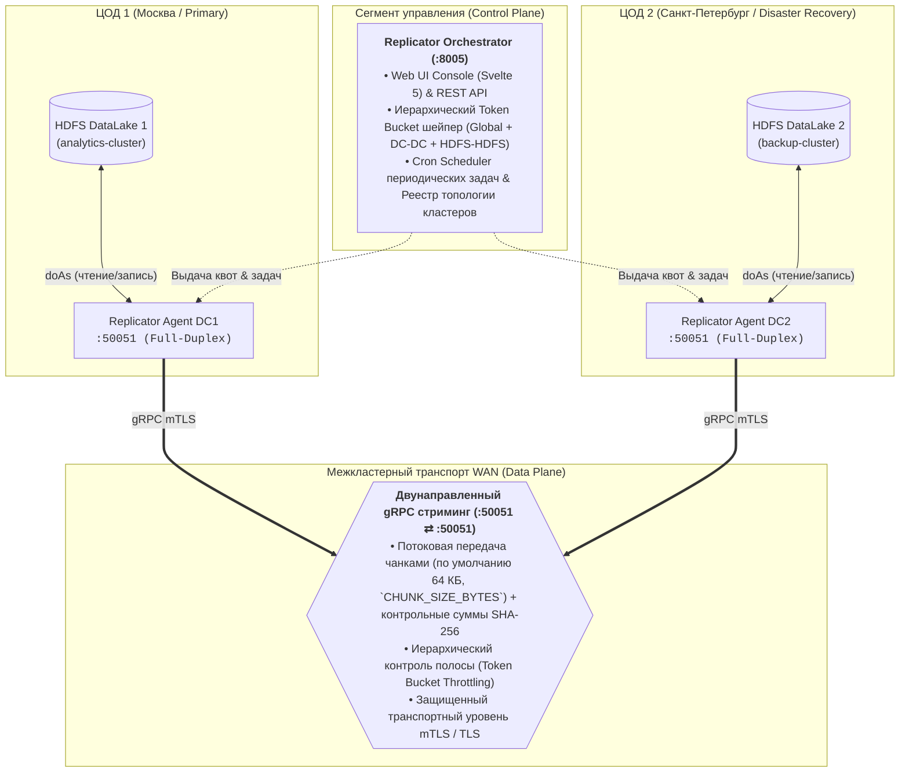
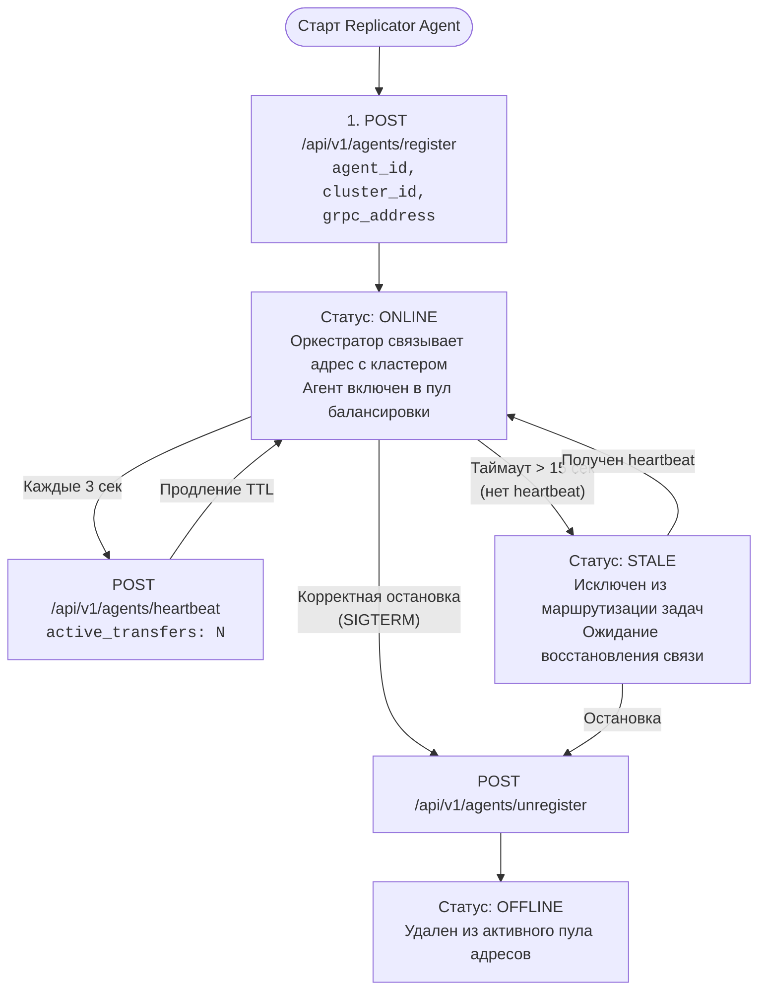
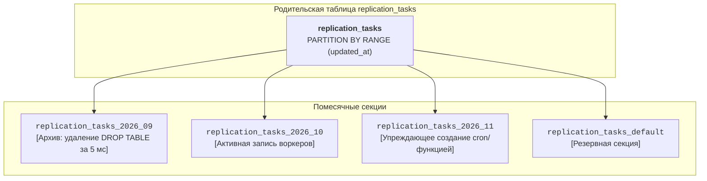
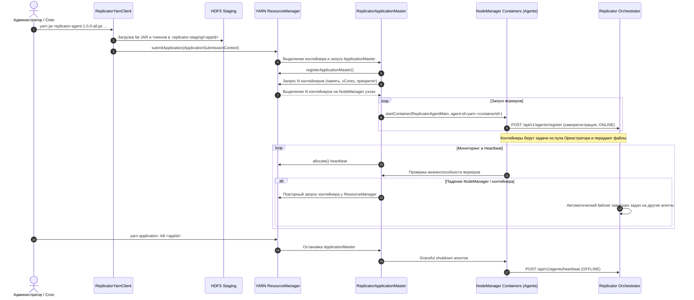
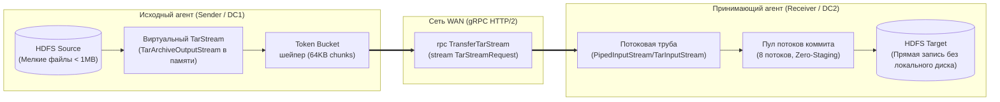
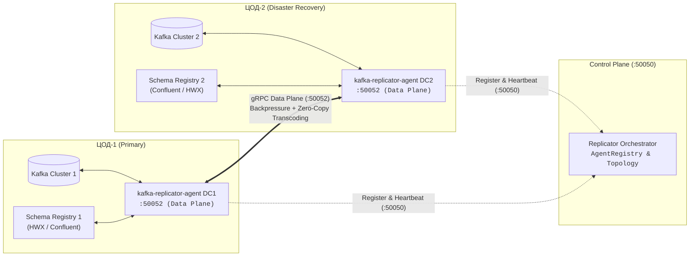

# Руководство администратора: Hadoop gRPC Replicator

Руководство для инженеров DevOps, SRE и сетевых администраторов: установка, настройка, развертывание и эксплуатация системы межкластерной репликации Hadoop gRPC Replicator в трех режимах:
1. Standalone и узлы Hadoop (раздел 2) — bare-metal, VM, DataNode и edge-узлы под управлением systemd или `hadoop jar`, включая пул агентов в Apache Hadoop YARN (2.6).
2. Docker и Docker Compose (раздел 3) — запуск компонентов в контейнерах.
3. Kubernetes (раздел 4).

Подсистема репликации Apache Kafka вынесена в отдельный раздел 8: у нее свой демон, свой порт Data Plane и своя модель размещения.

> [!NOTE]
> Архитектура высокой доступности (HA), распределенного лизинга и матрица отказоустойчивости компонентов описаны в документе: [Руководство по отказоустойчивости (replicator-fault-tolerance.md)](replicator-fault-tolerance.md).

---

## Содержание

- [1. Архитектура, безопасность и справочник конфигурации](#1-архитектура-безопасность-и-справочник-конфигурации)
   - [1.1 Архитектура и компоненты системы](#11-архитектура-и-компоненты-системы)
   - [1.2 Сетевые порты и протоколы](#12-сетевые-порты-и-протоколы)
   - [1.3 Динамическая регистрация агентов и разрешение адресов (Dynamic Keepalive Service Discovery)](#13-динамическая-регистрация-агентов-и-разрешение-адресов-dynamic-keepalive-service-discovery)
   - [1.4 Справочник переменных окружения (Environment Variables Reference)](#14-справочник-переменных-окружения-environment-variables-reference)
   - [1.5 Настройка Hadoop Impersonation (Proxy User) для Apache Ranger](#15-настройка-hadoop-impersonation-proxy-user-для-apache-ranger)
   - [1.6 База данных: миграции, удержание истории и секционирование](#16-база-данных-миграции-удержание-истории-и-секционирование)
   - [1.7 Модель поставки и готовые дистрибутивы (distribution & no-build deployment)](#17-модель-поставки-и-готовые-дистрибутивы-distribution--no-build-deployment)
- [2. Режим 1: Standalone и узлы Hadoop (systemd, `hadoop jar`, YARN)](#2-режим-1-standalone-и-узлы-hadoop-systemd-hadoop-jar-yarn)
   - [2.1 Пошаговая установка](#21-пошаговая-установка)
   - [2.2 Запуск нескольких агентов для одного кластера (горизонтальное масштабирование и HA)](#22-запуск-нескольких-агентов-для-одного-кластера-горизонтальное-масштабирование-и-ha)
   - [2.3 Совместное развертывание на узлах Hadoop (DataNode co-location) и локальный шейпинг полосы (`AGENT_MAX_BANDWIDTH_MB_S`)](#23-совместное-развертывание-на-узлах-hadoop-datanode-co-location-и-локальный-шейпинг-полосы-agent_max_bandwidth_mb_s)
   - [2.4 Архитектура и структура JAR-артефактов Replicator Agent](#24-архитектура-и-структура-jar-артефактов-replicator-agent)
   - [2.5 Варианты запуска Replicator Agent на узлах Hadoop](#25-варианты-запуска-replicator-agent-на-узлах-hadoop)
   - [2.6 Запуск распределенного пула агентов в Apache Hadoop YARN](#26-запуск-распределенного-пула-агентов-в-apache-hadoop-yarn)
   - [2.7 Сравнительная матрица вариантов развертывания Replicator Agent](#27-сравнительная-матрица-вариантов-развертывания-replicator-agent)
   - [2.8 Отказоустойчивость, восстановление процессов и Failover Оркестратора](#28-отказоустойчивость-восстановление-процессов-и-failover-оркестратора)
- [3. Режим 2: Docker & Docker Compose](#3-режим-2-docker--docker-compose)
   - [3.1 Запуск из предсобранных образов GitHub Container Registry (GHCR — рекомендуется)](#31-запуск-из-предсобранных-образов-github-container-registry-ghcr--рекомендуется)
   - [3.2 Альтернатива: локальная сборка образов из исходного кода (для разработки)](#32-альтернатива-локальная-сборка-образов-из-исходного-кода-для-разработки)
   - [3.3 Полный `docker-compose.yml` (двунаправленная репликация DC1 ⇄ DC2)](#33-полный-docker-composeyml-двунаправленная-репликация-dc1--dc2)
- [4. Режим 3: Kubernetes (манифесты K8s)](#4-режим-3-kubernetes-манифесты-k8s)
   - [4.1 Настройка доступа к GHCR (ImagePullSecret)](#41-настройка-доступа-к-ghcr-imagepullsecret)
   - [4.2 Манифесты Kubernetes (Raw Manifests)](#42-манифесты-kubernetes-raw-manifests)
- [5. Мониторинг и Troubleshooting](#5-мониторинг-и-troubleshooting)
   - [5.1 Метрики Prometheus (`GET http://orchestrator:8005/metrics`)](#51-метрики-prometheus-get-httporchestrator8005metrics)
   - [5.2 Дашборды Grafana](#52-дашборды-grafana)
   - [5.3 Трассировка и health-пробы](#53-трассировка-и-health-пробы)
   - [5.4 Решение инцидентов (FAQ)](#54-решение-инцидентов-faq)
- [6. Сборка, проверка и поведение подсистемы передачи данных](#6-сборка-проверка-и-поведение-подсистемы-передачи-данных)
   - [6.1 Мультимодульная архитектура Maven](#61-мультимодульная-архитектура-maven)
   - [6.2 Команды сборки и тестирования](#62-команды-сборки-и-тестирования)
   - [6.3 Запуск Orchestrator в production](#63-запуск-orchestrator-в-production)
   - [6.4 End-to-end smoke-тесты репликации Hive Metastore и HDFS (2 ЦОД)](#64-end-to-end-smoke-тесты-репликации-hive-metastore-и-hdfs-2-цод)
   - [6.5 Батчинг мелких файлов (Small Files Bundling / Tar-Streaming) и Zero-Staging в HDFS](#65-батчинг-мелких-файлов-small-files-bundling--tar-streaming-и-zero-staging-в-hdfs)
   - [6.6 Автоматическая очистка временных staging-файлов на HDFS (Garbage Collection / Reaper)](#66-автоматическая-очистка-временных-staging-файлов-на-hdfs-garbage-collection--reaper)
- [7. REST API аварийного переключения и обратной репликации (Disaster Recovery & Failover API)](#7-rest-api-аварийного-переключения-и-обратной-репликации-disaster-recovery--failover-api)
   - [7.1 Примеры вызовов через CLI](#71-примеры-вызовов-через-cli)
- [8. Подсистема репликации Apache Kafka (Kafka Replicator)](#8-подсистема-репликации-apache-kafka-kafka-replicator)
   - [8.1 Гарантии доставки, flow control и транскодинг схем](#81-гарантии-доставки-flow-control-и-транскодинг-схем)
   - [8.2 Параметры командной строки демона `kafka-replicator-agent`](#82-параметры-командной-строки-демона-kafka-replicator-agent)
   - [8.3 Защитный гейт синхронизации оффсетов (Consumer Group Safety Gate)](#83-защитный-гейт-синхронизации-оффсетов-consumer-group-safety-gate)
   - [8.4 Иерархический шейпинг полосы WAN (Hierarchical Token Bucket QoS) и совместная работа с HDFS](#84-иерархический-шейпинг-полосы-wan-hierarchical-token-bucket-qos-и-совместная-работа-с-hdfs)
   - [8.5 Сайзинг и модели размещения Kafka Replicator Agent (Colocated vs Dedicated)](#85-сайзинг-и-модели-размещения-kafka-replicator-agent-colocated-vs-dedicated)
   - [8.6 Пошаговая настройка и запуск Kafka Replicator Agent в режиме Colocated (на узлах брокеров Kafka)](#86-пошаговая-настройка-и-запуск-kafka-replicator-agent-в-режиме-colocated-на-узлах-брокеров-kafka)

---

## 1. Архитектура, безопасность и справочник конфигурации

### 1.1 Архитектура и компоненты системы
Hadoop gRPC Replicator построен на симметричных агентах Replicator Agent (`Full-Duplex`). Каждый узел в ЦОД1 и ЦОД2 запускает агент `backend.replicator.agent`, который одновременно принимает входящие gRPC-потоки (:50051) и передает исходящие задачи из очереди Оркестратора. Поэтому двунаправленная репликация (`DC1 ⇄ DC2`, DR failback) работает в одном сервисе.



### 1.2 Сетевые порты и протоколы
| Сервис | Порт | Протокол | Направление | Назначение |
|---|---|---|---|---|
| Orchestrator HTTP/REST | `8005` | HTTP/HTTPS | Inbound | Web UI консоль, REST API, выдача токенов шейпера, `/health`, `/metrics` |
| Orchestrator Control Plane (gRPC) | `50050` | gRPC (HTTP/2) | Inbound | Control Plane: регистрация агентов (`AgentRegistry`), heartbeat, выдача задач |
| Replicator Agent (HDFS Data Plane) | `50051` | gRPC (HTTP/2) | Inbound/Outbound | Полный дуплекс: прием входящих файлов/чанков HDFS и передача исходящих реплик |
| Kafka Replicator Agent (Data Plane) | `50052` | gRPC (HTTP/2) | Inbound/Outbound | Полный дуплекс передачи батчей Kafka, Zero-Copy транскодинг схем, Flow Control |
| NameNodes | `9870`/`8020` | HTTP / RPC | Outbound | Чтение из исходного HDFS и запись в целевой HDFS |
| KDC | `88` | TCP/UDP | Outbound | Выпуск билетов Kerberos для системной техучетки |

### 1.3 Динамическая регистрация агентов и разрешение адресов (Dynamic Keepalive Service Discovery)

Агенты регистрируются в Оркестраторе сами и подтверждают, что живы, heartbeat-запросами (keepalive):



#### Приоритет разрешения целевого адреса (get_target_address)
1. Динамический реестр живых агентов (AgentRegistry keepalive) — основной механизм:
   - Агент при старте сообщает свой внешний адрес `advertised_grpc_address` (например, `agent-dc1:50051`).
   - Оркестратор регистрирует этот адрес за целевым HDFS-кластером.
   - Если один кластер обслуживают несколько агентов (горизонтальное масштабирование), Оркестратор выполняет балансировку нагрузки, выбирая узел с наименьшим числом текущих задач (`active_transfers`).
2. Статическая топология Оркестратора (`application.yml`):
   - Значения по умолчанию из конфигурации Оркестратора (`hadoop.replicator.clusters`) используются как резерв, если живой агент еще не зарегистрировался.
3. Локальное переопределение переменной окружения `AGENT_TARGET_<CLUSTER_ID>`:
   - Применяется в нестандартных изолированных сетях (NAT, Ingress-шлюзы, раздельные DMZ).
4. Резервный адрес по умолчанию (fallback):
   - Значение переменной `FALLBACK_TARGET_ADDRESS` / `RECEIVER_ADDRESS` (по умолчанию `localhost:50051`).

#### 1.3.1 Безопасность динамической регистрации (security & zero-trust)

Регистрацию защищают три механизма:

1. Аутентификация агентов через Agent Secret (PSK / token):
   - На Оркестраторе и всех доверенных агентах задается общий секретный ключ `REPLICATOR_AGENT_SECRET` (минимум 32 символа).
   - Агент передает этот токен в HTTP-заголовке `X-Agent-Secret` (или `Authorization: Bearer <token>`) при вызовах `/api/v1/agents/register`, `/api/v1/agents/heartbeat`, `/api/v1/agents/unregister` и запросах сетевых квот `/api/v1/tokens/request`.
   - Запросы без валидного токена отбрасываются с кодом `401 Unauthorized`. В боевом режиме (`ENVIRONMENT=production`) отсутствие переменной блокирует старт сервиса.
2. Белый список кластеров (cluster whitelisting):
   - Свойство `hadoop.replicator.enforce-cluster-whitelist=true` (по умолчанию активно в боевом режиме).
   - Агенту разрешено регистрироваться только для тех кластеров, которые явно объявлены администратором в `application.yml` (`hadoop.replicator.clusters`).
   - Попытка зарегистрировать неавторизованный кластер отклоняется с ошибкой `403 Forbidden`: посторонний агент не может подменить адрес кластера в топологии (topology poisoning).
3. Защита от SSRF и валидация сетевых адресов:
   - Оркестратор валидирует структуру анонсируемого gRPC-адреса `host:port` и диапазон порта (1–65535).
   - Отклоняются попытки передать эндпоинты облачных метаданных (`169.254.169.254`, `metadata.google.internal`, `instance-data`) и адреса link-local (`169.254.0.0/16`, `fe80::/10`).

#### 1.3.2 Шифрование gRPC трафика и взаимная аутентификация (TLS / mTLS)

Каналы передачи файлов по gRPC поддерживают шифрование и проверку сертификатов:
1. Шифрование данных в канале (TLS):
   - Включается установкой `REPLICATOR_GRPC_TLS_ENABLED=true` либо указанием префикса `grpcs://` в целевом адресе.
   - Сервер-приемник использует сертификат и приватный ключ (`REPLICATOR_GRPC_CERT_CHAIN_PATH` и `REPLICATOR_GRPC_PRIVATE_KEY_PATH`).
   - При отсутствии явных сертификатов в dev/тест средах генерируется временный самоподписанный сертификат на лету (`SelfSignedCertificate`).
2. Взаимная аутентификация узлов (mTLS):
   - При `REPLICATOR_GRPC_CLIENT_AUTH=REQUIRE` сервер запрашивает и валидирует сертификат подключающегося передающего агента.
   - Доверенные корневые центры сертификации задаются через `REPLICATOR_GRPC_TRUST_CERT_COLLECTION_PATH`.
   - Клиент-отправитель (`ReplicationSender`) передает клиентский сертификат и ключ, если они заданы в конфигурации.
3. REST-вызовы Оркестратора:
   - `OrchestratorClient` поддерживает вызовы по `https://` с проверкой доверенных сертификатов. Флаг `ORCHESTRATOR_TLS_INSECURE_SKIP_VERIFY=true` отключает проверку сертификата; используйте его только в тестовых средах.

#### 1.3.3 Персистентный реестр агентов в БД для Stateless Active-Active Orchestration (RES-01)

Реестр агентов хранится не в памяти процесса, а в СУБД, поэтому несколько экземпляров Оркестратора видят один и тот же пул агентов:
- Таблица `replication_agents` (`AgentEntity`): хранит статус каждого агента (`ONLINE`, `STALE`, `OFFLINE`), идентификатор кластера, внешний gRPC адрес, временную метку последнего heartbeat (`last_heartbeat`), хэш секрета и метрики текущей нагрузки (`active_transfers`, `transferred_bytes`, `error_count`).
- Stateless Active-Active Orchestrator: любой экземпляр Оркестратора читает общую таблицу в PostgreSQL, видит текущий состав пула агентов и планирует подзадачи без синхронизации через распределенную шину памяти.
- Двухуровневый кэш heartbeat: heartbeat-запросы агентов (каждые 3–5 секунд) агрегируются и сбрасываются в БД пачками, а не отдельной транзакцией на каждый запрос.

#### 1.3.4 Координация узлов Orchestrator и распределенный Token Bucket (RES-06)

При нескольких экземплярах Оркестратора глобальный лимит полосы делится между ними:
- Таблица `bandwidth_limits` (`BandwidthLimitEntity`): заданные лимиты для кластеров и направлений репликации.
- Таблица `orchestrator_nodes` (`OrchestratorNodeEntity`): реестр активных экземпляров Оркестратора с отметкой последнего heartbeat (`last_seen`) и статусом лидерства.
- Координатор `OrchestratorClusterCoordinator`: считает число живых экземпляров Оркестратора и делит между ними объем токенов шейпера `TokenBucketThrottler` поровну, чтобы суммарный WAN-трафик не превысил заданный лимит. Если экземпляр падает, его квота переходит к оставшимся после истечения интервала обнаружения сбоя.

#### 1.3.5 Распределенные блокировки с Fencing Tokens и защита от Split-Brain (RES-07 & RES-08)

Чтобы миграции, Disaster Recovery Failover и переключение лизинга не выполнялись одновременно на нескольких экземплярах, используется сервис `DistributedLockService`:
- Монотонные токены ограждения (колонка `epoch` таблицы `cluster_locks`): при каждой новой аренде выдается строго большее 64-битное число. Продление своей же аренды токен сохраняет, смена владельца — инкрементирует.
- Снятие аренды не удаляет строку: `release` обнуляет владельца и помечает аренду истекшей, оставляя накопленную эпоху в строке. Удаление строки сбрасывало бы счетчик, и следующий захват начинался бы с единицы — тогда отставший держатель с большим токеном прошлой аренды выглядел бы новее законного владельца. Строк в таблице ровно столько, сколько имен блокировок, поэтому она не растет.
- Захват в отдельной транзакции: аренда фиксируется до начала работы под блокировкой (`REQUIRES_NEW`), а фоновое продление идет своей транзакцией. Иначе строка аренды оставалась бы невидимой другим узлам до коммита бизнес-транзакции, и соседний инстанс брался бы за ту же задачу.
- Защита от зомби-лидеров: любые последующие операции мутации состояния проверяют токен ограждения. Если узел отстал из-за GC паузы или сетевого сплита, его устаревший токен будет отвергнут узлами-исполнителями и СУБД.
- Защита Disaster Recovery: вызовы Failover и Failback в `DisasterRecoveryService` выполняются под именованными распределенными блокировками с проверкой fencing token, поэтому два переключения из разных консолей не идут параллельно.

---

### 1.4 Справочник переменных окружения (Environment Variables Reference)

#### 1.4.1 Переменные Replicator Orchestrator
| Переменная | Описание | Значение по умолчанию | Обязательность |
|---|---|---|---|
| `SPRING_CONFIG_ADDITIONAL_LOCATION` | Путь к внешнему файлу конфигурации Spring Boot | `file:/etc/hadoop-explorer/replicator/application.yml` | Опционально |
| `HADOOP_REPLICATOR_GLOBAL_LIMIT_BYTES_PER_SEC` | Глобальный лимит пропускной способности WAN (байт/сек) | `104857600` (100 МБ/с) | Опционально |
| `SPRING_DATASOURCE_URL` | JDBC URL подключения к БД (PostgreSQL / SQLite / H2) | `jdbc:h2:mem:replicator` | Опционально |
| `SPRING_DATASOURCE_USERNAME` | Пользователь базы данных | `sa` | Опционально |
| `SPRING_DATASOURCE_PASSWORD` | Пароль пользователя базы данных | `""` | Опционально |
| `HADOOP_REPLICATOR_AGENT_SECRET` / `REPLICATOR_AGENT_SECRET` | Общий секретный ключ аутентификации агентов репликации (заголовок `X-Agent-Secret` и gRPC context). Значения по умолчанию нет; при незаданном секрете оркестратор не запускается | — | Обязательно |
| `HADOOP_REPLICATOR_ENFORCE_AGENT_SECRET` | Fail-Closed проверка секрета агентов (`true`/`false`) | `true` | Опционально |
| `HADOOP_REPLICATOR_ENFORCE_TASK_ATTESTATION` | Включение криптографической аттестации задач HMAC-SHA256 (`true`/`false`) | `true` | Рекомендуется |
| `HADOOP_REPLICATOR_ALLOW_LOOPBACK_AGENTS` | Разрешение регистрации агентов на loopback-адресах (`127.0.0.1`, `localhost`) | `true` (в prod следует выставить `false`) | Опционально |
| `HADOOP_REPLICATOR_PROGRESS_DEBOUNCE_MS` | Интервал дебаунсинга буфера фиксации прогресса задач в БД (мс) | `500` | Опционально |
| `HADOOP_REPLICATOR_PROGRESS_BUFFER_SIZE` | Максимальный размер буфера завершенных задач до принудительного flush | `1000` | Опционально |
| `HADOOP_REPLICATOR_ENFORCE_CLUSTER_WHITELIST` | Блокировка регистрации кластеров, которых нет в топологии (`true`/`false`) | `true` | Опционально |
| `HADOOP_REPLICATOR_HMS_POLL_INTERVAL_MS` | Интервал фонового опроса NOTIFICATION_LOG Hive Metastore (мс) | `5000` (5 сек) | Опционально |
| `HADOOP_REPLICATOR_HMS_BOOTSTRAP_CONCURRENCY` | Количество параллельных потоков-воркеров для Bootstrap таблиц схемы Hive | `8` | Опционально |
| `HADOOP_REPLICATOR_HMS_PARTITION_BATCH_SIZE` | Число партиций в одном пакете Thrift RPC | `1000` | Опционально |
| `HADOOP_REPLICATOR_HMS_LEASE_TIMEOUT_SECONDS` | Длительность эксклюзивной аренды (Distributed Lease) HMS задачи агентом источника (сек) | `30` | Опционально |
| `HADOOP_REPLICATOR_HMS_MAX_BOOTSTRAPS_PER_AGENT` | Верхний предел bootstrap HMS-задач на одного агента кластера. Свободную задачу (bootstrap или CDC) берет только агент, у которого задач не больше, чем у самого свободного агента кластера плюс одна: задачи расходятся по агентам, а не заполняют первых опросивших до предела. CDC-задачи (ACTIVE) в предел не входят | `4` | Опционально |
| `REPLICATOR_HMS_MOCK_CLUSTER_API_ENABLED` | Включение тестового mock-слоя эмуляции кластеров и метасторов (`/api/v1/hms/clusters/**`) для демо-стендов и тестов | `false` (в боевом режиме полностью отключено) | Опционально |
| — (флаг задания `sync_deletes`) | — | Репликация удалений потокового задания: включается в интерфейсе на задание, не переменной окружения. По умолчанию выключена |
| `HADOOP_REPLICATOR_TASK_RETENTION_DAYS` | Возраст, после которого завершенная подзадача удаляется; `0` выключает очистку | `7` | Опционально |
| `HADOOP_REPLICATOR_TASK_RETENTION_BATCH_SIZE` | Размер пакета удаления при очистке истории задач | `500` | Опционально |
| `HADOOP_REPLICATOR_TASK_RETENTION_MAX_BATCHES_PER_RUN` | Сколько пакетов удаляется за один проход очистки | `20` | Опционально |
| `HADOOP_REPLICATOR_TASK_CLEANUP_INTERVAL_MS` | Интервал запуска очистки истории задач (мс) | `3600000` (1 ч) | Опционально |
| `MANAGEMENT_OTLP_TRACING_ENDPOINT` | Адрес OTLP-коллектора для экспорта трасс. Не задан — экспорта нет, но `trace_id` в логах и `traceparent` в вызовах gRPC работают | — | Опционально |
| `TRACING_SAMPLING_PROBABILITY` | Доля трассируемых запросов | `1.0` (в профиле `prod` — `0.1`) | Опционально |
| `SPRING_PROFILES_ACTIVE` | Профиль конфигурации. `prod` включает PostgreSQL, Kerberos-аутентификацию, обязательный TLS для gRPC и закрытые детали health | — (dev-профиль) | Обязательно в prod |
| `JWT_SECRET_KEY` | Секретный ключ подписи JWT-токенов сессий Web UI (мин. 32 симв.) | В dev автогенерируется, в prod обязателен | Обязательно в prod |

#### 1.4.2 Переменные Replicator Agent (Full-Duplex)
| Переменная | Описание | Значение по умолчанию | Обязательность |
|---|---|---|---|
| `AGENT_ID` | Уникальный строковый идентификатор агента в платформе | `agent-01` (или `$WORKER_ID`) | Рекомендуется |
| `AGENT_CLUSTER_ID` | Идентификатор HDFS-кластера, который обслуживает агент | `demo-cluster` | Рекомендуется |
| `REPLICATOR_AGENT_SECRET` | Секретный ключ для аутентификации на Оркестраторе (передается в `X-Agent-Secret`). Значения по умолчанию нет: без него gRPC-серверы агента работают в режиме Fail-Closed и отклоняют все вызовы | — (должен совпадать с Оркестратором) | Обязательно |
| `AGENT_MODE` | Режим работы агента: `all` (дуплекс: прием + передача), `sender` (только передача), `receiver` (только прием) | `all` | Опционально |
| `ORCHESTRATOR_URL` | URL Replicator Orchestrator для саморегистрации, задач и квот | `http://localhost:8005` | Обязательно |
| `RECEIVER_HOST` | Сетевой интерфейс для прослушивания входящего gRPC-сервера | `0.0.0.0` | Опционально |
| `RECEIVER_PORT` | Порт входящего gRPC-сервера для приема чанков данных | `50051` | Опционально |
| `CHUNK_SIZE_BYTES` | Размер чанка потоковой передачи. От него считается предел распакованного чанка на приемнике (защита от decompression bomb): четыре размера чанка, но не меньше 1 МБ и не больше 64 МБ. Значение задается одинаковым на передающей и принимающей стороне | `65536` (64 КБ) | Опционально |
| `AGENT_ADVERTISED_ADDRESS` | Внешний gRPC-адрес для саморегистрации в Оркестраторе (например, `agent-dc1:50051`) | Вычисляется автоматически (`hostname:50051`) | Опционально |
| `AGENT_ENABLE_REGISTRATION` | Включение режима динамической саморегистрации с keepalive | `true` | Опционально |
| `REPLICATOR_STAGING_DIR` | Локальная директория буфера для приема чанков перед коммитом в локальную ФС (для HDFS используется прямой Zero-Staging в целевой HDFS) | `/tmp/staging` | Опционально |
| `REPLICATOR_LOCAL_SANDBOX` / `LOCAL_SANDBOX_DIR` | Корневой каталог Chroot-песочницы локальных файловых операций (SEC-10) | `/var/lib/hadoop-replicator/sandbox` | Рекомендуется |
| `REPLICATOR_ENFORCE_TASK_ATTESTATION` | Обязательная проверка HMAC-токенов аттестации задач перед записью в HDFS | `true` | Рекомендуется |
| `OTEL_EXPORTER_OTLP_ENDPOINT` | Адрес OTLP-коллектора. Не задан — трассировка выключена и ничего не стоит | — | Опционально |
| `OTEL_TRACES_SAMPLER_ARG` | Доля трассируемых вызовов агента | `0.05` | Опционально |
| `REPLICATOR_SR_MUTUAL_AUTH` | Включение взаимной аутентификации SPNEGO для Schema Registry (SEC-15) | `false` | Опционально |
| `REPLICATOR_SMALL_FILE_THRESHOLD_BYTES` | Порог размера файла (в байтах) для бандлинга мелких файлов в виртуальные TAR-архивы | `1048576` (1 МБ) | Опционально |
| `REPLICATOR_BUNDLE_TARGET_SIZE_BYTES` | Целевой объем файлов в одном виртуальном TAR-бандле `BUNDLE_TAR` | `16777216` (16 МБ) | Опционально |
| `REPLICATOR_MAX_BUNDLE_FILES` | Максимальное количество файлов в одном виртуальном бандле | `500` | Опционально |
| `REPLICATOR_BUNDLE_COMMIT_CONCURRENCY` | Количество параллельных потоков прямой записи файлов бандла в целевой HDFS | `8` | Опционально |
| `REPLICATOR_STAGING_CLEANUP_ENABLED` | Включение фонового сборщика мусора (Reaper) для периодической очистки осиротевших staging-файлов на HDFS | `true` | Опционально |
| `REPLICATOR_STAGING_CLEANUP_INTERVAL_MINUTES` | Интервал запуска периодической очистки staging-файлов фоновым демоном (минуты) | `15` | Опционально |
| `REPLICATOR_STAGING_TTL_MINUTES` | Время жизни (TTL) staging-файлов, после которого они считаются осиротевшими и удаляются (минуты) | `30` | Опционально |
| `REPLICATOR_HDFS_NAMENODE` | Хост целевого NameNode для прямого HDFS-коммита через Java HDFS Client | Не задано (локальный commit) | Опционально |
| `POLL_INTERVAL_SEC` | Интервал опроса очереди задач и keepalive-пингов (секунды) | `3.0` | Опционально |
| `AGENT_MAX_BANDWIDTH_MB_S` | Локальный лимит пропускной способности агента (МБ/с, Token Bucket). Ограничивает нагрузку агента на сетевую карту и диски, когда он установлен на узле Hadoop (DataNode / Edge Gateway). `0` или пусто — без ограничений | `0.0` (без ограничений) | Опционально |
| `AGENT_TARGET_<CLUSTER_ID>` | Ручное переопределение gRPC-адреса для целевого кластера (для NAT/DMZ) | Динамический реестр Оркестратора | Опционально |
| `REPLICATOR_KEYTAB_PATH` | Путь к Keytab-файлу системной техучетки для Kerberos аутентификации | `/etc/security/keytabs/replicator.keytab` | Рекомендуется |
| `REPLICATOR_GRPC_TLS_ENABLED` | Включение TLS для входящего и исходящего gRPC-трафика | `false` | Опционально |
| `REPLICATOR_GRPC_CERT_CHAIN_PATH` | Путь к сертификату узла (X.509 PEM) | `null` | Опционально |
| `REPLICATOR_GRPC_PRIVATE_KEY_PATH` | Путь к приватному ключу узла (PKCS8 PEM) | `null` | Опционально |
| `REPLICATOR_GRPC_TRUST_CERT_COLLECTION_PATH` | Путь к цепочке доверенных сертификатов CA для проверки пиров | `null` | Опционально |
| `REPLICATOR_GRPC_CLIENT_AUTH` | Режим взаимной проверки сертификатов mTLS (`NONE`, `OPTIONAL`, `REQUIRE`) | `NONE` | Опционально |
| `REPLICATOR_GRPC_INSECURE_SKIP_VERIFY` | Отключение строгой проверки TLS сертификатов для gRPC (только dev) | `false` | Опционально |
| `ORCHESTRATOR_TLS_INSECURE_SKIP_VERIFY` | Отключение проверки HTTPS сертификатов при запросах к Оркестратору | `false` | Опционально |
| `REPLICATOR_HMS_MODE` | Режим работы HMS клиента агента: `thrift` (боевое прямое подключение Thrift RPC к Hive Metastore), `demo-http` (REST симулятор стенда), `mock` (unit-тесты) | `thrift` (если задан `HMS_THRIFT_URIS`), иначе `auto` | Опционально |
| `HMS_THRIFT_POOL_MAX_SIZE` | Максимальный размер пула Thrift-соединений к Hive Metastore (Commons-Pool2) | `16` (minIdle: 1, maxIdle: 8) | Опционально |
| `REPLICATOR_HMS_DATA_BARRIER_ENABLED` | Барьер «данные раньше DDL»: партиции и таблицы появляются на приемнике только после успешного копирования их данных. Сбой связи с оркестратором барьер не открывает | `true` | Рекомендуется |
| `REPLICATOR_HMS_DATA_BARRIER_TIMEOUT_SEC` | Сколько ждать копирования данных одной порции партиций, прежде чем отменить DDL (секунды). Копия таблицы на терабайты идет часами | `21600` (6 ч) | Опционально |
| `REPLICATOR_HMS_BOOTSTRAP_CONCURRENCY` | Сколько таблиц агент переносит параллельно при bootstrap | `8` | Опционально |
| `REPLICATOR_HMS_PARTITION_BATCH_SIZE` | Порция партиций: столько читается из метастора, применяется на приемнике и держится в памяти агента за раз (не больше 1000) | `1000` | Опционально |
| `TARGET_HDFS_DEFAULTFS` / `TARGET_HDFS_DEFAULT_FS` | URI целевой HDFS файловой системы (например, `hdfs://hdfs-cluster-2:9000`) для перезаписи схем и путей таблиц/партиций в Thrift Hive Metastore через `HmsPathRewriter` | Не задано (используются эвристики и mappings) | Рекомендуется при межкластерной репликации |
| `REPLICATOR_FEDERATION_MAPPINGS` | Список сопоставлений HDFS authority для федерации кластеров через запятую (например, `hdfs-cluster-1:9000=hdfs-cluster-2:9000,dc1=dc2`) | Не задано | Опционально |
| `HMS_LOOP_INTERVAL_MS` | Интервал фонового опроса и синхронизации метаданных HMS в изолированном потоке `replicator-hms-loop` (мс) | `2000` (2 сек) | Опционально |

### 1.5 Настройка Hadoop Impersonation (Proxy User) для Apache Ranger

Чтобы политики Apache Ranger применялись к конечному пользователю, а в аудите стояло его имя, агент работает через Hadoop Proxy User (doAs-имперсонацию):
1. Replicator Agent аутентифицируется в Kerberos KDC по системному keytab техучетки (`hdfs-replicator@REALM.LOCAL`).
2. При операциях с HDFS (`HadoopFsManager` / `FileSystem.get`) агент создает прокси-контекст `UserGroupInformation.createProxyUser(user, baseUgi).doAs(...)` от имени конечного пользователя (`user=alice`, извлеченное из `execution_principal` или сессии).
3. NameNode и Apache Ranger проверяют политики доступа непосредственно для `alice`, а в Ranger Audit Log регистрируется запись вида:
   ```
   UGI: alice (auth:PROXY via hdfs-replicator@REALM.LOCAL)
   Resource: /data/production/events/...
   Action: WRITE / READ
   Access Result: ALLOWED / DENIED
   ```

Для работы механизма в файле конфигурации `core-site.xml` на NameNode должна быть разрешена имперсонация для сервисной техучетки:
```xml
<property>
    <name>hadoop.proxyuser.hdfs-replicator.hosts</name>
    <value>*</value>
</property>
<property>
    <name>hadoop.proxyuser.hdfs-replicator.groups</name>
    <value>*</value>
</property>
```

Для переноса схем то же самое требуется и на стороне Hive Metastore: его `core-site.xml` должен
доверять принципалу агента как proxy-пользователю, а в `hive-site.xml` быть включен
`hive.metastore.execute.setugi` (клиент агента выставляет его и со своей стороны). Без первого
метастор отвергнет подмену, без второго — выполнит операцию от имени того, кто прошел SASL, то есть
от имени агента. Соединения с метастором разделены по принципалу: SASL-аутентификация и `set_ugi` происходят в
момент установки соединения, а не на каждый вызов, поэтому операции пользователя идут по
отдельному соединению. Открыть его напрямую под пользователем нельзя — Kerberos требует его
собственный билет, — поэтому агент по своему keytab запрашивает у метастора delegation token для
пользователя и открывает соединение с ним (DIGEST-MD5). Токен запрашивается один раз на
пользователя и обновляется раз в час.

#### 1.5.1 Разграничение прав на указание пользователя имперсонации (RBAC & Security Validation)
Кто может указать пользователя имперсонации, зависит от роли. Так обычный пользователь не может выполнить операцию от чужого имени и подменить автора в Ranger Audit Log:

1. Администратор (`ADMIN` / `admin_user`):
   - В UI (модальные окна создания и редактирования задач HDFS, а также модальное окно создания репликации HMS) поле **Пользователь имперсонации (doAs)** открыто для ввода и помечено бейджем `admin`.
   - Администратор может указать произвольный `username` (например, `etl_pipeline` или `spark_service`) либо полный Kerberos-принципал (`user@REALM.LOCAL`). Если домен не указан, бэкенд/UI дополняет имя до `${username}@REALM.LOCAL`.
   - В REST API контроллеры `JobController` и `HmsReplicationController` принимают переданный `execution_principal`.

2. Инженер данных или обычный пользователь (`WRITER`, `USER`):
   - В UI поле заблокировано (`disabled`), имеет бейдж `doAs` и отображает имя текущего пользователя (`session.username()`).
   - На уровне бэкенда при создании (`POST /api/v1/jobs`, `POST /api/v1/hms/jobs`) и редактировании (`PUT /api/v1/jobs/{id}`) значение `executionPrincipal` принудительно переопределяется именем аутентифицированного пользователя сессии: `session.username() + "@REALM.LOCAL"`. Любые попытки подделки поля в теле JSON-запроса игнорируются.

3. Сквозная передача в HMS-подзадачи (`HMS_SUBJOB`):
   - При репликации метаданных Hive Metastore агент (`HmsTaskExecutor`) создает дочерние HDFS-подзадачи для переноса файлов директорий таблиц и партиций через вызов `OrchestratorClient.createHdfsSubjob(...)`.
   - В эти подзадачи передается `job.executionPrincipal()` родительской задачи HMS, поэтому файлы данных HDFS копируются под тем же пользователем doAs, что и схема.

#### 1.5.2 Разграничение прав API и защита от IDOR (API Security & Endpoint Isolation)
Эндпоинты Оркестратора разделены по уровням доверия:

1. Защита от IDOR при обновлении прогресса задач (`PATCH /api/v1/jobs/{jobId}`):
   - Метод `JobController.updateJobProgress` проверяет права вызывающей стороны через `checkJobAccess(jobId, auth)`.
   - Пользователи с ролью `READER` или сторонние пользователи не имеют права изменять прогресс или переводить чужие задачи в статус завершения/ошибки.
   - Вызов разрешен фоновым агентам (`system_agent`), администраторам (`ADMIN`), а также владельцу задачи с ролью `WRITER`.

2. Изоляция диспетчерских эндпоинтов воркеров (`TaskController`):
   - Эндпоинты забора задач воркером (`POST /api/v1/tasks/claim`), подтверждения завершения (`POST /api/v1/tasks/{taskId}/complete`), фиксации сбоя (`POST /api/v1/tasks/{taskId}/fail`) и пакетного создания подзадач (`POST /api/v1/tasks/batch`) защищены вызовом `requireAgentOrAdmin(auth)`.
   - Доступ открыт только системным воркерам (аутентифицированным по `X-Agent-Secret`) и пользователям с ролью `ADMIN`. Обычные пользователи и читатели получают отказ `403 Forbidden`.

3. Защита конфигурации сетевых лимитов (`TokenController`):
   - Эндпоинт изменения пропускной способности каналов (`PUT /api/v1/tokens/limit`) требует роли `ADMIN`. Рядовые пользователи не могут изменять лимиты шейпинга.

4. Защита от fail-open и требование к длине секрета агентов (`enforce-agent-secret`):
   - При `hadoop.replicator.enforce-agent-secret=true` реестр агентов `AgentRegistry` блокирует запуск оркестратора, если секрет не задан или короче 16 символов.
   - Метод `verifySecret` работает в режиме fail-closed: запросы агентов без валидного заголовка `X-Agent-Secret` отклоняются.

5. Автоочистка подзадач (task retention policy):
   - Фоновая задача удаляет устаревшие подзадачи репликации (`hadoop.replicator.task-retention-days`, по умолчанию 7 дней).
   - Завершенные (`COMPLETED`) и ошибочные (`FAILED`) задачи старше заданного срока удаляются из таблицы `replication_tasks`; подробности — в разделе 1.6.2.

6. Защита от BOLA/IDOR при чтении данных и инспекции задач (P0):
   - `JobController.getJobRuns` и `TaskController.getTasks` проверяют доступ через `checkJobReadAccess(jobId, auth)`.
   - Пользователь с ролью `READER` или `WRITER` имеет право просматривать структуру задач и историю прогонов только для тех заданий, к которым ему предоставлен доступ. Доступ к чужим задачам блокируется с кодом `403 Forbidden`.
   - `TaskController.getTasks` всегда отдает результат постранично (`page = 0, size = 100`, верхний лимит `max = 1000`). Без пагинации запрос по заданию из сотен тысяч или миллионов файлов приводил бы Orchestrator к OutOfMemoryError.

#### 1.5.3 Криптографическая аттестация задач (HMAC-SHA256 Task Attestation, SEC-01)

Параметры задачи подписываются HMAC, чтобы перехвативший канал (man-in-the-middle) или скомпрометированный воркер не мог изменить путь записи или пользователя:
- Генератор подписи (`TaskAttestationService`): при резервировании задачи агентом (`claimTasks`) Orchestrator формирует токен HMAC-SHA256 на основе канонической строки параметров:
  ```
  v1|taskId|jobId|targetPath|executionPrincipal|runAsServiceAccount|expiresAt
  ```
- Передача в gRPC-контрактах: токен `task_token` передается в метаданных вызовов `FileMetadata` и `TarStreamMetadata` по межЦОДному WAN-каналу (порт 50051).
- Проверка на стороне приемника (`TaskAttestationValidator`): перед открытием выходного потока в HDFS (`DataTransferServiceImpl`) приемник извлекает токен и проверяет подпись общим секретом `agentSecret`.
- Защита от подмены: изменение `targetPath` (попытка записи в чужой каталог), подмена `executionPrincipal` (эскалация прав в doAs) или просроченный токен приводят к отклонению операции со статусом `Status.PERMISSION_DENIED` и фиксации инцидента безопасности в логе.
- Включение проверки: параметр `hadoop.replicator.enforce-task-attestation=true` включен по умолчанию.

#### 1.5.4 Chroot-песочница целевых путей и защита системных файлов ОС (SEC-10)

Метод `HadoopFsManager.validateSandboxAccess` не дает операциям агента-приемника писать или удалять файлы ОС хоста за пределами песочницы:
- Песочница путей (`localSandboxDir`): все файловые операции в локальной ФС (`REPLICATOR_LOCAL_SANDBOX` / `LOCAL_SANDBOX_DIR`) валидируются относительно канонического пути `File.getCanonicalFile()`.
- Защита от symlink traversal и null byte injection: символические ссылки, указывающие за пределы песочницы, а также байты `\0` в именах путей блокируются с выбросом `SecurityException`.
- Черный список системных каталогов (`FORBIDDEN_OS_PREFIXES`): доступ к системным каталогам Linux/macOS запрещен:
  ```
  /bin, /sbin, /usr, /lib, /lib64, /opt, /boot, /etc, /proc, /sys, /dev, /root, /System, /Library, /Applications, /var
  ```
- Защита конфиденциальных файлов хоста (`SENSITIVE_PATH_PATTERNS`): доступ к пользовательским секретам и конфигурациям запрещен:
  ```
  /.ssh, /.gnupg, /.bashrc, /.zshrc, /.profile, /.bash_profile, /.bash_history, /.zsh_history, /.env, crontab
  ```
- Схема URI не обходит проверки: путь разбирается во всех формах — `scheme://host/path`, `scheme:/path` и `scheme:path`, — а точечные сегменты и сдвоенные слеши сворачиваются, поэтому `file:/etc/shadow` и `file:///./etc/shadow` отвергаются так же, как `/etc/shadow`. Явная схема `file:` означает локальную ФС независимо от `fs.defaultFS`: иначе при HDFS по умолчанию путь `file:///...` считался бы удаленным и границы песочницы не проверялись бы, хотя Hadoop открывает такой путь через `LocalFileSystem`.
- Все методы `DataTransferServiceImpl` (`transferFile`, `transferTarStream`, `renamePath`, `deletePath`) проверяют путь до начала операции.
- Read-пробы отказывают явно: `checkFile` и `getDirectoryManifest` на отвергнутом пути возвращают `PERMISSION_DENIED` и пишут отказ в лог приемника. Прежний ответ «файла нет» не отличался от пустой цели, и отправитель планировал полное копирование.

#### 1.5.5 Предотвращение мутации `krb5.conf` и валидация путей Kerberos (SEC-11 & SEC-15)

- Инициализация Kerberos (SEC-11): `KafkaSecurityConfigBuilder.initializeKrb5ConfSafely` потокобезопасно проверяет системное свойство `java.security.krb5.conf`. Если свойство уже задано другим компонентом или аргументами JVM, оно не перезаписывается: иначе в многокластерном окружении один компонент подменил бы KDC-настройки другого.
- Проверка путей keytab и конфигов (SEC-15): разрешаются доверенные каталоги (`/etc/krb5.conf`, `/etc/security/keytabs/...`, `/var/run/secrets/...`) и блокируются попытки выхода через `..` или обращения к `/etc/shadow`, `/etc/passwd`, `/.ssh`.
- Взаимная аутентификация Schema Registry по SPNEGO: при `srMutualAuth` клиент проверяет подлинность сервера Schema Registry.

#### 1.5.6 Сквозной контекст секрета агента и защита от SSRF Loopback (SEC-12, SEC-13, SEC-16)

- Передача секрета через gRPC Context (SEC-16): интерцептор `AgentGrpcAuthInterceptor` помещает проверенный токен в контекст потока `AGENT_SECRET_CONTEXT_KEY`, откуда он извлекается контроллерами Control Plane.
- Приоритет переменной окружения `REPLICATOR_AGENT_SECRET` (SEC-12): Оркестратор и агент читают секрет из переменных окружения или K8s Secrets; прописывать его в конфигурационных файлах не нужно.
- Защита от SSRF через loopback (SEC-13): регистрация агентов на сетевых интерфейсах обратной петли (`127.0.0.1`, `::1`, `localhost`) по умолчанию заблокирована параметром `hadoop.replicator.allow-loopback-agents=false`. Для адресов хостов проводится валидация по спецификации FQDN.

---

### 1.6 База данных: миграции, удержание истории и секционирование

При непрерывной потоковой репликации через Inotify и периодической синхронизации петабайтных каталогов HDFS с десятками миллионов файлов таблица подзадач `replication_tasks` и история `job_runs` накапливают миллионы строк. Ниже — как создается схема, как удерживается история и почему секционирование остается проектным решением, а не текущим состоянием.

#### 1.6.1 Схема создается миграциями Flyway

- Общие миграции: `backend/replicator/orchestrator/src/main/resources/db/migration/common`.
- Специфика вендора (частичные индексы по активным статусам, `fillfactor`, параметры autovacuum): `db/migration/postgresql`. Каталоги подключены как `spring.flyway.locations: classpath:db/migration/common,classpath:db/migration/{vendor}`.
- `spring.jpa.hibernate.ddl-auto: validate` во всех профилях: приложение схему не меняет, а сверяет с моделью и падает на старте при расхождении. Прежний `ddl-auto: update` молча подгонял базу под модель, и в каждом окружении получалась своя схема.
- Существующая база, созданная прежним `ddl-auto: update`, подхватывается через `spring.flyway.baseline-on-migrate: true`: Flyway помечает ее как baseline и применяет только последующие миграции. Индексы таблицы заданий такие базы получают отдельной идемпотентной миграцией `V3`.

> [!NOTE]
> Базовая миграция выгружена из самой модели JPA, поэтому схема и сущности совпадают колонка в колонку. Прежний эталонный скрипт `schema-postgresql.sql` не подключался ни к одному окружению (ни `spring.sql.init`, ни миграциями) и успел разойтись с моделью: таблиц журнала событий HMS и его DLQ в нем не было вовсе, снимки DR и аренда стримера назывались иначе, а блокировки кластера были описаны дважды. Скрипт удален.

#### 1.6.2 Удержание истории

Подзадачи (`replication_tasks`). Планировщик раз в час (`task-cleanup-interval-ms`) удаляет задачи в терминальных статусах (`COMPLETED`, `FAILED`, `SKIPPED`) старше `task-retention-days` (по умолчанию 7 дней). Удаление идет пакетами по `task-retention-batch-size` (500) и не больше `task-retention-max-batches-per-run` (20) пакетов за проход — до 10 000 записей за час, остаток догоняется следующими проходами. Одна транзакция на все окно удержания держала бы блокировки и раздувала WAL, а прерывание откатывало бы всю работу.

- Активные задачи (`QUEUED`, `RUNNING`) не удаляются ни при каком возрасте: задача в `RUNNING` может прямо сейчас передаваться агентом, а зависшую подберет failover.
- `task-retention-days: 0` выключает очистку совсем.
- В active-active очистку выполняет один узел под распределенной блокировкой `task_retention_lock`: удаление по одному и тому же окну с нескольких узлов приводит к взаимным блокировкам на одних и тех же страницах.

История запусков (`job_runs`). Ограничена по количеству на задание: `history_retention_runs` (по умолчанию 20 последних прогонов), лишние удаляет планировщик после каждого запуска. Отдельной очистки по возрасту здесь не нужно.

Полный перечень параметров — в разделе 7.1 `docs/CONFIGURATION.md`.

#### 1.6.3 Секционирование: проектное решение, а не текущее состояние

Секционирование `replication_tasks` и `job_runs` в миграциях не реализовано — обе таблицы создаются обычными. Описанная ниже схема сохранена как проектное решение, если нагрузка это потребует.



Что мешает включить это сейчас:

1. Составной первичный ключ. В PostgreSQL ключ секционирования обязан входить в любое ограничение уникальности, то есть PK стал бы `(id, updated_at)`. Уникальность `id` задачи сохранилась бы только внутри секции, а именно она сейчас не дает повторному пакету streaming-задач продублировать передачи через WAN. Это смена семантики модели, а не перенос схемы.
2. Нет неизменяемой колонки времени. У подзадачи есть только изменяемый и допускающий `NULL` `updated_at`: по нему строки переезжали бы между секциями на каждой смене месяца, а `NULL` попадал бы в резервную секцию. Секционирование по времени требует сначала добавить неизменяемый `created_at`.
3. Partition pruning горячим запросам не помогает. Воркеры забирают задачи фильтром по `status` (`findByStatusForUpdateSkipLocked`, `findPendingTasksForClusterSkipLocked`) и сортировкой по `updated_at`, по времени они не отсекают ничего. Прежнее утверждение, что секции ускоряют забор задач, неверно: единственной реальной выгодой было бы удержание истории через `DROP TABLE`, а оно уже решено очисткой из 1.6.2.

---

### 1.7 Модель поставки и готовые дистрибутивы (distribution & no-build deployment)

Hadoop Explorer поставляется собранными релизными артефактами и Docker-образами. Для развертывания в production собирать исходный код не нужно: на целевых серверах и шлюзах не устанавливаются Git, Apache Maven, Node.js, npm и компиляторы. Нужны Java 21 JRE и системные библиотеки Kerberos.

#### Артефакты релиза (GitHub Releases)
Для каждого релиза `v${VERSION}` (например, `v1.0.0`) в репозитории публикуются файлы:

| Файл артефакта | Тип | Размер | Содержимое и назначение |
|---|---|---|---|
| `replicator-orchestrator-${VERSION}.jar` | Spring Boot 3 Fat JAR | ~50 МБ | Оркестратор репликации: веб-сервер, REST API, встроенный веб-интерфейс (Svelte 5 SPA предварительно упакован в `/static`), иерархический Token Bucket шейпер, драйверы БД (H2, PostgreSQL) и метрики Actuator. |
| `replicator-agent-${VERSION}-all.jar` | Shaded Executable Fat JAR | ~81.5 МБ | Агент репликации: исполняемый JAR со всеми зависимостями (Netty HTTP/2, gRPC runtime, Apache Hadoop Client, YARN ApplicationMaster, Jackson). Запускается через `java -jar` или `hadoop jar`. |
| `replicator-agent-${VERSION}.jar` | Lean JAR (тонкий) | ~211 КБ | Классы агента без внешних библиотек. Запускается на узлах Hadoop с системным `HADOOP_CLASSPATH` (`$(hadoop classpath)`). |
| `SHA256SUMS.txt` | Текстовый файл контрольных сумм | <1 КБ | Контрольные суммы SHA-256 всех JAR-артефактов релиза. |

#### Готовые контейнеры (GitHub Container Registry — GHCR)
Для сред Docker и Kubernetes в реестре контейнеров GitHub (`ghcr.io`) публикуются собранные образы на базе `eclipse-temurin:21-jre-jammy`:
- `ghcr.io/company/hadoop-explorer/replicator-orchestrator:${VERSION}`
- `ghcr.io/company/hadoop-explorer/replicator-agent:${VERSION}`

> Пробы живости. Серверы gRPC отвечают по стандартному протоколу `grpc.health.v1.Health`, а проба контейнера агента выполняется тем же jar-ом, что и сам агент. Подробности и команда пробы — в разделе 5.3; настройка экспорта трасс — в разделе 7.1.2 `docs/CONFIGURATION.md`.

---

## 2. Режим 1: Standalone и узлы Hadoop (systemd, `hadoop jar`, YARN)

Развертывание Orchestrator и Replicator Agent на Linux-серверах и шлюзах под управлением `systemd`.

### 2.1 Пошаговая установка

#### Шаг 1: Системные пакеты ОС

##### Вариант для production (запуск из готовых артефактов, только JRE)
На целевых серверах нужны Java 21 JRE, curl и библиотеки Kerberos:

```bash
# Ubuntu 22.04 / 24.04 LTS, Debian 12:
sudo apt-get update && sudo apt-get install -y --no-install-recommends \
    openjdk-21-jre-headless \
    libkrb5-3 krb5-user curl ca-certificates

# RHEL 8/9, Rocky Linux 8/9, AlmaLinux:
sudo dnf install -y --setopt=install_weak_deps=False \
    java-21-openjdk-headless \
    krb5-workstation curl ca-certificates
```

> [!TIP]
> Пакет `headless JRE` занимает на сотни мегабайт меньше, чем полный JDK с Maven, и не ставит на сервер компиляторы и сборочные инструменты.

##### Вариант для сборки из исходников
```bash
# Ubuntu / Debian:
sudo apt-get install -y openjdk-21-jdk maven git nodejs npm
# RHEL / Rocky Linux:
sudo dnf install -y java-21-openjdk-devel maven git nodejs npm
```

---

#### Шаг 2: Пользователь и структура каталогов
Выполняется на серверах Orchestrator и Agent:

```bash
# Создание выделенного системного пользователя
sudo groupadd -g 10001 appuser
sudo useradd -u 10001 -g appuser -m -s /bin/bash appuser

# Создание иерархии рабочих каталогов
sudo mkdir -p /opt/hadoop-explorer/replicator/releases
sudo mkdir -p /opt/hadoop-explorer/replicator/bin
sudo mkdir -p /etc/hadoop-explorer/replicator
sudo mkdir -p /var/log/hadoop-explorer/replicator
sudo mkdir -p /var/lib/hadoop-explorer/replicator/data
sudo mkdir -p /var/lib/hadoop-explorer/replicator/staging
sudo mkdir -p /etc/security/keytabs

# Назначение прав доступа
sudo chown -R appuser:appuser /opt/hadoop-explorer /etc/hadoop-explorer /var/log/hadoop-explorer /var/lib/hadoop-explorer/replicator
sudo chmod 750 /var/lib/hadoop-explorer/replicator/data /var/lib/hadoop-explorer/replicator/staging
```

---

#### Шаг 3: Получение бинарных артефактов

##### Способ А (для production): загрузка из GitHub Releases

Fat JAR скачиваются из раздела релизов GitHub. Веб-ресурсы фронтенда (Svelte 5) встроены в `replicator-orchestrator.jar`, библиотеки gRPC и Hadoop — в `replicator-agent-*-all.jar`.

##### 1. Загрузка через GitHub CLI (`gh`)
Если на сервере или шлюзе установлен `gh`:
```bash
sudo -u appuser -i

VERSION="1.0.0"
RELEASE_DIR="/opt/hadoop-explorer/replicator/releases/v${VERSION}"
mkdir -p "${RELEASE_DIR}" && cd "${RELEASE_DIR}"

gh release download "v${VERSION}" --repo company/hadoop-explorer \
    --pattern "replicator-orchestrator-*.jar" \
    --pattern "replicator-agent-*-all.jar" \
    --pattern "SHA256SUMS.txt"
```

##### 2. Загрузка через `curl` или `wget` по прямым ссылкам
Если GitHub CLI не установлен, используйте `curl`:
```bash
sudo -u appuser -i

VERSION="1.0.0"
GITHUB_REPO="company/hadoop-explorer"
BASE_URL="https://github.com/${GITHUB_REPO}/releases/download/v${VERSION}"
RELEASE_DIR="/opt/hadoop-explorer/replicator/releases/v${VERSION}"

mkdir -p "${RELEASE_DIR}" && cd "${RELEASE_DIR}"

# Скачивание артефактов
curl -fsSL -O "${BASE_URL}/replicator-orchestrator-${VERSION}.jar"
curl -fsSL -O "${BASE_URL}/replicator-agent-${VERSION}-all.jar"
curl -fsSL -O "${BASE_URL}/SHA256SUMS.txt"
```

> [!NOTE]
> Для изолированных контуров (air-gapped) файлы скачиваются во внешней сети и загружаются в корпоративный Nexus, Artifactory либо копируются на целевые серверы по `scp`/`rsync`.

##### 3. Проверка контрольных сумм SHA-256
Проверьте контрольные суммы файлов перед запуском:
```bash
cd "${RELEASE_DIR}"
sha256sum -c SHA256SUMS.txt --ignore-missing
# Ожидаемый вывод:
# replicator-orchestrator-1.0.0.jar: УСПЕШНО (OK)
# replicator-agent-1.0.0-all.jar: УСПЕШНО (OK)
```

##### 4. Создание символических ссылок
Создайте симлинки, чтобы systemd-юниты и скрипты ссылались на пути без версии в имени файла:
```bash
BIN_DIR="/opt/hadoop-explorer/replicator/bin"

# Для сервера Оркестратора:
ln -sfn "${RELEASE_DIR}/replicator-orchestrator-${VERSION}.jar" "${BIN_DIR}/replicator-orchestrator.jar"

# Для серверов Агентов:
ln -sfn "${RELEASE_DIR}/replicator-agent-${VERSION}-all.jar" "${BIN_DIR}/replicator-agent.jar"
```

##### 5. Скрипт развертывания `install-from-release.sh`
Скрипт выполняет шаги 2–4 (загрузка через `curl`, проверка сумм, симлинки) одной командой. Сохраните его в `/opt/hadoop-explorer/replicator/bin/install-from-release.sh`:
```bash
#!/usr/bin/env bash
set -euo pipefail

VERSION="${1:-1.0.0}"
GITHUB_REPO="${GITHUB_REPO:-company/hadoop-explorer}"
BASE_DIR="/opt/hadoop-explorer/replicator"
RELEASE_DIR="${BASE_DIR}/releases/v${VERSION}"
BIN_DIR="${BASE_DIR}/bin"
BASE_URL="https://github.com/${GITHUB_REPO}/releases/download/v${VERSION}"

echo "==> Установка Hadoop gRPC Replicator v${VERSION} из GitHub Releases..."
mkdir -p "${RELEASE_DIR}" "${BIN_DIR}"
cd "${RELEASE_DIR}"

echo "--> Загрузка артефактов..."
curl -fsSL -O "${BASE_URL}/replicator-orchestrator-${VERSION}.jar"
curl -fsSL -O "${BASE_URL}/replicator-agent-${VERSION}-all.jar"
curl -fsSL -O "${BASE_URL}/SHA256SUMS.txt"

echo "--> Проверка контрольных сумм..."
sha256sum -c SHA256SUMS.txt --ignore-missing

echo "--> Обновление символических ссылок..."
ln -sfn "${RELEASE_DIR}/replicator-orchestrator-${VERSION}.jar" "${BIN_DIR}/replicator-orchestrator.jar"
ln -sfn "${RELEASE_DIR}/replicator-agent-${VERSION}-all.jar" "${BIN_DIR}/replicator-agent.jar"

echo "Версия v${VERSION} успешно установлена в ${BIN_DIR}!"
```

---

##### Способ Б: сборка из исходного кода (для разработки и тестирования)

Подходит, если нужно изменить код или проверить snapshot-сборку:
```bash
sudo -u appuser -i
cd /tmp
git clone https://github.com/company/hadoop-explorer.git
cd hadoop-explorer

# 1. Сборка фронтенда (Svelte 5 SPA)
cd frontend
npm ci --workspace=apps/replicator --include-workspace-root
# Бандл собирается сразу в backend/replicator/orchestrator/src/main/resources/static и попадает в JAR
npm run build:replicator
cd ..

# 2. Сборка Java-модулей (Spring Boot Orchestrator + Shaded Agent)
mvn clean package -DskipTests -f backend/replicator/pom.xml

# 3. Копирование артефактов в рабочий каталог bin
cp backend/replicator/orchestrator/target/replicator-orchestrator-*.jar \
   /opt/hadoop-explorer/replicator/bin/replicator-orchestrator.jar
cp backend/replicator/agent/target/replicator-agent-*-all.jar \
   /opt/hadoop-explorer/replicator/bin/replicator-agent.jar
```

---

#### Шаг 4: Конфигурация Оркестратора (`/etc/hadoop-explorer/replicator/application.yml`)
```yaml
server:
  port: 8005

spring:
  datasource:
    # Для Standalone / Тестирования:
    url: jdbc:h2:file:/var/lib/hadoop-explorer/replicator/data/replicator;DB_CLOSE_DELAY=-1;MODE=PostgreSQL
    # Для промышленного кластера (PostgreSQL):
    # url: jdbc:postgresql://pg.company.local:5432/replicator
    # username: replicator_user
    # password: "DbPassword123"
  jpa:
    hibernate:
      # Схему создают миграции Flyway; приложение ее только сверяет с моделью
      ddl-auto: validate

hadoop:
  security:
    jwt:
      secret-key: "${JWT_SECRET_KEY}"   # вывод `openssl rand -hex 32`, не короче 32 символов
      expiration-minutes: 480
    cors:
      allowed-origins:
        - "https://replicator.company.local"
        - "http://localhost:8005"

  replicator:
    # Глобальный пул полосы пропускания WAN (в байтах/сек, 100 МБ/с = 104857600)
    global-limit-bytes-per-sec: 104857600
    agent-secret: "CHANGE_TO_SUPER_SECURE_AGENT_SECRET_KEY_32_CHARS"
    enforce-cluster-whitelist: true
    agent-heartbeat-timeout-seconds: 15
    agent-offline-timeout-seconds: 45

    # Настройка топологии дата-центров
    datacenters:
      - id: "dc1"
        name: "Дата-Центр Москва (DC1)"
        network-zone: "zone-a"
      - id: "dc2"
        name: "Дата-Центр Санкт-Петербург (DC2)"
        network-zone: "zone-b"

    # Реестр обслуживаемых HDFS кластеров
    clusters:
      - id: "demo-cluster"
        name: "HDFS Primary (Prod)"
        dc-id: "dc1"
        hdfs-rpc-address: "hdfs://namenode-dc1:8020"
        grpc-host: "node1.dc1.company.local"
        grpc-port: 50051
      - id: "backup-cluster"
        name: "HDFS DR (Backup)"
        dc-id: "dc2"
        hdfs-rpc-address: "hdfs://namenode-dc2:8020"
        grpc-host: "node1.dc2.company.local"
        grpc-port: 50051

    # Маппинг федерации HDFS для репликации Hive Metastore (HMS Replication)
    federation-mappings:
      - source-nameservice: "ns-cold"
        source-cluster-id: "dc1-ns-cold"
        target-nameservice: "hdfs://ns-cold-dc2:8020"
        target-cluster-id: "dc2-ns-cold"
      - source-nameservice: "ns-hot"
        source-cluster-id: "dc1-ns-hot"
        target-nameservice: "hdfs://ns-hot-dc2:8020"
        target-cluster-id: "dc2-ns-hot"
```

> [!NOTE]
> Конфигурация Оркестратора задает сетевую топологию, аутентификацию и глобальные лимиты полосы WAN. Агенты (`Replicator Agent`) настраиваются через переменные окружения и при старте регистрируются на Оркестраторе, передавая свой статус, анонсируемый адрес и локальный лимит скорости.


#### Шаг 5: Создание systemd units

##### 1. Сервис Оркестратора (`/etc/systemd/system/replicator-orchestrator.service`)
```ini
[Unit]
Description=Hadoop gRPC Replicator Orchestrator
After=network.target

[Service]
Type=simple
User=appuser
Group=appuser
WorkingDirectory=/opt/hadoop-explorer/replicator
Environment="SPRING_CONFIG_ADDITIONAL_LOCATION=file:/etc/hadoop-explorer/replicator/application.yml"

ExecStart=/usr/bin/java -Xms512m -Xmx2048m \
    -jar /opt/hadoop-explorer/replicator/bin/replicator-orchestrator.jar \
    --server.port=8005

Restart=always
RestartSec=5s
LimitNOFILE=65536

[Install]
WantedBy=multi-user.target
```

##### 2. Сервис агента репликации (`/etc/systemd/system/replicator-agent.service`)
Устанавливается на серверах в каждом ЦОД (DC1 и DC2); для двунаправленной репликации (`DC1 ⇄ DC2`) агент нужен с обеих сторон:
```ini
[Unit]
Description=Hadoop gRPC Replicator Full-Duplex Agent
After=network.target

[Service]
Type=simple
User=appuser
Group=appuser
WorkingDirectory=/opt/hadoop-explorer/replicator
Environment="AGENT_ID=agent-dc1-node-01"
Environment="AGENT_CLUSTER_ID=demo-cluster"
Environment="AGENT_MODE=all"
Environment="ORCHESTRATOR_URL=http://orchestrator.company.local:8005"
Environment="RECEIVER_HOST=0.0.0.0"
Environment="RECEIVER_PORT=50051"
Environment="REPLICATOR_STAGING_DIR=/var/lib/hadoop-explorer/replicator/staging"
Environment="POLL_INTERVAL_SEC=2.0"

ExecStart=/usr/bin/java -Xms256m -Xmx1024m \
    -jar /opt/hadoop-explorer/replicator/bin/replicator-agent.jar

Restart=always
RestartSec=5s
LimitNOFILE=65536

[Install]
WantedBy=multi-user.target
```

#### Шаг 6: Запуск и проверка
```bash
sudo systemctl daemon-reload

# На сервере Оркестратора:
sudo systemctl enable --now replicator-orchestrator
curl -s http://127.0.0.1:8005/health
# {"status":"UP","database":"UP","service":"hadoop-grpc-replicator-orchestrator","uptime_seconds":...}

# На серверах Агентов (DC1 и DC2):
sudo systemctl enable --now replicator-agent
```

#### Шаг 7: Обновление версии без остановки (rolling upgrade)

Новая версия из GitHub Releases ставится без остановки кластера и без сборки:

1. Скачайте новую версию релиза (например, `v1.0.1`):
   ```bash
   sudo -u appuser -i
   NEW_VER="1.0.1"
   NEW_DIR="/opt/hadoop-explorer/replicator/releases/v${NEW_VER}"
   mkdir -p "${NEW_DIR}" && cd "${NEW_DIR}"

   curl -fsSL -O "https://github.com/company/hadoop-explorer/releases/download/v${NEW_VER}/replicator-orchestrator-${NEW_VER}.jar"
   curl -fsSL -O "https://github.com/company/hadoop-explorer/releases/download/v${NEW_VER}/replicator-agent-${NEW_VER}-all.jar"
   curl -fsSL -O "https://github.com/company/hadoop-explorer/releases/download/v${NEW_VER}/SHA256SUMS.txt"
   sha256sum -c SHA256SUMS.txt --ignore-missing
   ```

2. Переключите символические ссылки (`ln -sfn` заменяет ссылку атомарно):
   ```bash
   ln -sfn "${NEW_DIR}/replicator-orchestrator-${NEW_VER}.jar" /opt/hadoop-explorer/replicator/bin/replicator-orchestrator.jar
   ln -sfn "${NEW_DIR}/replicator-agent-${NEW_VER}-all.jar" /opt/hadoop-explorer/replicator/bin/replicator-agent.jar
   ```

3. Перезапустите сервисы:
   - Оркестратор: перезапуск занимает 2–3 секунды. Воркеры сохраняют состояние и переподключаются сами.
     ```bash
     sudo systemctl restart replicator-orchestrator
     ```
   - Агенты: перезапускайте по одному (rolling restart). При остановке агента Оркестратор возвращает его активные задачи в очередь, и их забирают другие агенты (failover осиротевших задач, см. 2.2):
     ```bash
     sudo systemctl restart replicator-agent
     ```

---

### 2.2 Запуск нескольких агентов для одного кластера (горизонтальное масштабирование и HA)

Один HDFS-кластер может обслуживать любое число агентов.

#### Распределение нагрузки и failover (high availability)
- Параллельная передача (sender scale-out): все агенты с одинаковым `AGENT_CLUSTER_ID` независимо опрашивают очередь задач Оркестратора (`POLL_INTERVAL_SEC=2.0`). Свободные агенты забирают задачи параллельно, поэтому скорость репликации кластера растет с числом агентов.
- Балансировка приема (least connections): когда удаленный ЦОД запрашивает адрес для передачи файлов в этот кластер, Оркестратор выбирает онлайн-агент с наименьшим числом активных потоков (`min(active_transfers)`).
- Failover задач (task self-healing & retry):
  - При сбое агента во время передачи (разрыв gRPC-потока, отказ целевого хоста, сетевой сбой) или падении узла подзадача не переходит в статус `FAILED`.
  - Оркестратор увеличивает счетчик попыток `retry_count`, запоминает сбойный узел (`last_failed_agent_id`) и возвращает задачу в статус `QUEUED`; дальше ее берет другой доступный агент.
  - Фоновый сторожевой сервис (watchdog `checkAndFailoverOrphanedTasks`, каждые 3 сек) находит задачи в статусе `RUNNING`, чьи агенты перешли в `OFFLINE` или потеряли связь (`STALE` дольше `agent-heartbeat-timeout-seconds`), и возвращает их в очередь для других агентов.
  - При штатной остановке агента (`POST /api/v1/agents/unregister`) активные задачи сразу возвращаются в очередь, без ожидания таймаутов.
  - Параметр `hadoop.replicator.max-task-retries` (по умолчанию `3`) определяет максимальное количество попыток до перевода в терминальный `FAILED`.

#### Вариант 1: Запуск нескольких агентов в systemd (шаблонные юниты)
Создайте шаблонный юнит `/etc/systemd/system/replicator-agent@.service`:
```ini
[Unit]
Description=Hadoop Replicator Agent Instance %i
After=network.target

[Service]
Type=simple
User=appuser
WorkingDirectory=/opt/hadoop-explorer/replicator
Environment="AGENT_ID=agent-dc1-%i"
Environment="AGENT_CLUSTER_ID=demo-cluster"
Environment="RECEIVER_PORT=5005%i"
Environment="AGENT_ADVERTISED_ADDRESS=node1.dc1.company.local:5005%i"
Environment="ORCHESTRATOR_URL=http://orchestrator.company.local:8005"
ExecStart=/usr/bin/java -jar /opt/hadoop-explorer/replicator/bin/replicator-agent.jar
Restart=always

[Install]
WantedBy=multi-user.target
```
Запустите два экземпляра агента на одном узле:
```bash
sudo systemctl enable --now replicator-agent@1
sudo systemctl enable --now replicator-agent@2
```

#### Вариант 2: Запуск нескольких агентов в Docker Compose
```yaml
services:
  agent-dc1-01:
    image: hadoop-explorer/replicator:latest
    environment:
      AGENT_ID: agent-dc1-01
      AGENT_CLUSTER_ID: demo-cluster
      ORCHESTRATOR_URL: http://orchestrator:8005
      RECEIVER_PORT: 50051

  agent-dc1-02:
    image: hadoop-explorer/replicator:latest
    environment:
      AGENT_ID: agent-dc1-02
      AGENT_CLUSTER_ID: demo-cluster
      ORCHESTRATOR_URL: http://orchestrator:8005
      RECEIVER_PORT: 50051
```

#### Вариант 3: Запуск в Kubernetes (Deployment с replicas > 1)
Укажите в Deployment агента `replicas: 3`. Имя пода передается в `AGENT_ID`, сетевой адрес — через Pod IP или DNS Headless Service.

### 2.3 Совместное развертывание на узлах Hadoop (DataNode co-location) и локальный шейпинг полосы (`AGENT_MAX_BANDWIDTH_MB_S`)

#### Когда ставить агент на DataNode или edge-шлюз
Отдельные серверы-шлюзы под репликацию могут стать узким местом: весь трафик кластера идет через них. Агент на узлах Hadoop (DataNode или edge-узел) дает:
1. Локальный ввод-вывод: агент читает блоки с локальных дисков или через локальный демон DataNode, без лишней пересылки по сети кластера.
2. Масштабирование вместе с кластером: каждая новая DataNode с агентом добавляет пропускную способность репликации.

#### Риски совместного размещения
Без ограничения агент при репликации большого набора данных может занять всю полосу сетевой карты узла (1GbE / 10GbE / 25GbE) или перегрузить диски (I/O saturation). Тогда задачи Spark, YARN-контейнеры и запросы к DataNode начинают тормозить и падать по heartbeat timeout.

#### Локальный шейпер `AGENT_MAX_BANDWIDTH_MB_S`
Задайте лимит полосы агента переменной окружения `AGENT_MAX_BANDWIDTH_MB_S`:
```ini
# /etc/systemd/system/replicator-agent.service.d/override.conf
[Service]
# Ограничить утилизацию сетевого интерфейса и дисков этой DataNode до 40 МБ/с
Environment="AGENT_MAX_BANDWIDTH_MB_S=40.0"
```

#### Как работает локальный шейпер (token bucket)
1. Исходящий трафик (sender throttling): перед отправкой каждого чанка агент запрашивает токены у `LocalBandwidthLimiter`. Если лимит исчерпан, передача приостанавливается на рассчитанный интервал. Затем агент согласовывает квоту с Оркестратором (глобальные ограничения DC-DC и HDFS-HDFS).
2. Входящий трафик (receiver backpressure): при приеме чанков агент сдерживает чтение через `LocalBandwidthLimiter`. Через управление потоком HTTP/2 и окно TCP задержка чтения доходит до передающего узла по WAN, и он снижает скорость отправки; память приемника не переполняется, пакеты не теряются.
3. Мониторинг: значение `max_bandwidth_mb_s` передается Оркестратору при регистрации и показывается в карточке агента в веб-консоли (бейдж с лимитом или статус «без ограничений»).

### 2.4 Архитектура и структура JAR-артефактов Replicator Agent

Replicator Agent работает с HDFS напрямую через `org.apache.hadoop.fs.FileSystem`, использует HDFS Delegation Tokens, выполняет имперсонацию через `UserGroupInformation.doAs` и может запускаться в контейнерах Apache Hadoop YARN.

Для разных сценариев запуска (автономные серверы, Docker/K8s, узлы DataNode, пулы YARN) сборка агента через `maven-shade-plugin` формирует два JAR-артефакта:

#### 2.4.1 Сборка JAR-пакетов
Сборка выполняется через корневой Makefile или напрямую через Maven:
```bash
# Из корня репозитория через Makefile:
make build-replicator-agent

# Либо напрямую через Maven:
mvn clean package -pl backend/replicator/agent -am -DskipTests
```

В каталоге `backend/replicator/agent/target/` появляются два артефакта:

| Артефакт | Размер | Содержимое | Сценарии применения |
|---|---|---|---|
| `replicator-agent-1.0.0-all.jar`<br/>(Shaded Fat JAR) | ~81.5 МБ | Классы агента, сгенерированные стабы gRPC/Protobuf и все runtime-зависимости: Netty HTTP/2, gRPC Java runtime, Apache Hadoop Client, YARN Client, Jackson, Commons CLI. | 1. Запуск в Docker-контейнерах (`Dockerfile.replicator-agent`).<br/>2. Автономный запуск через `java -jar` на серверах без дистрибутива Hadoop.<br/>3. Отправка в YARN (`yarn jar` или `submit-yarn.sh` — JAR загружается в staging-каталог приложения в HDFS).<br/>4. Запуск через `hadoop jar` на DataNode и edge-узлах. |
| `replicator-agent-1.0.0.jar`<br/>(тонкий JAR) | ~211 КБ | Только классы агента и Protobuf DTO, без внешних библиотек. | 1. Maven-зависимость в `replicator-orchestrator` (`<artifactId>replicator-agent</artifactId>`): внешние библиотеки агента не добавляются в classpath Оркестратора.<br/>2. Запуск на узлах Hadoop с подключением системного `HADOOP_CLASSPATH` (`hadoop classpath`). |

#### 2.4.2 Почему артефактов два
В Spring Boot сервисах плагин `spring-boot-maven-plugin` заменяет исходный JAR исполняемым fat-архивом. У Replicator Agent так сделать нельзя по двум причинам:
1. Транзитивные зависимости. Модуль `replicator-orchestrator` подключает библиотеку `replicator-agent` ради Protobuf-моделей и служебных классов. Если бы Shade-плагин заменил базовый артефакт 80-мегабайтным Fat JAR, в classpath Оркестратора попали бы дублирующие и затененные версии Netty и Hadoop Client, и возникли бы конфликты версий (JAR hell).
2. Размер. В кластерах с установленным дистрибутивом Hadoop (Cloudera, Arenadata, Apache Hadoop) клиенты `hadoop-common` и `hadoop-hdfs-client` уже есть на узлах. Тонкий JAR (211 КБ) запускает агент без копирования 80+ МБ библиотек на каждый сервер.

---

### 2.5 Варианты запуска Replicator Agent на узлах Hadoop

Агент запускается на DataNode, edge-узле или выделенном сервере передачи данных кластера Hadoop тремя способами.

#### 2.5.1 Способ А: прямой запуск через Hadoop CLI (`hadoop jar`)
Подходит для разовых задач, ручного тестирования и запуска из планировщиков (Airflow, Control-M, Autosys). Утилита `hadoop` сама подгружает конфигурационные файлы (`core-site.xml`, `hdfs-site.xml`, `yarn-site.xml`) из каталога `$HADOOP_CONF_DIR`.

```bash
# 1. Запуск Shaded Fat JAR (установленного из GitHub Release в /opt/hadoop-explorer/replicator/bin):
hadoop jar /opt/hadoop-explorer/replicator/bin/replicator-agent.jar \
    org.apache.hadoop.explorer.replicator.agent.ReplicatorAgentMain \
    --agent-id agent-dn01-dc1 \
    --cluster-id dc1-prod \
    --orchestrator http://orchestrator.company.local:8005 \
    --port 50051 \
    --bandwidth 80.0 \
    --staging-dir /data/replicator-staging \
    --mode all
```

Запуск тонкого JAR через Java с системным `HADOOP_CLASSPATH`. Если на узле уже установлен дистрибутив Hadoop (Cloudera, Arenadata, Apache Hadoop), можно использовать тонкий JAR:
```bash
# Формирование системного classpath Hadoop
export HADOOP_CLASSPATH=$(hadoop classpath)

java -Xms1g -Xmx4g \
    -cp "/opt/hadoop-explorer/replicator/releases/v1.0.0/replicator-agent-1.0.0.jar:${HADOOP_CLASSPATH}" \
    org.apache.hadoop.explorer.replicator.agent.ReplicatorAgentMain \
    --agent-id agent-dn01-dc1 \
    --cluster-id dc1-prod \
    --orchestrator http://orchestrator.company.local:8005 \
    --port 50051 \
    --bandwidth 80.0 \
    --mode all
```

#### 2.5.2 Способ Б: запуск через скрипт `replicator-agent.sh`
Скрипт `replicator-agent.sh` находит JAR, проверяет наличие `hadoop classpath`, задает флаги JVM для G1GC и запускает процесс:

```bash
JAR_FILE=/opt/hadoop-explorer/replicator/bin/replicator-agent.jar \
/opt/hadoop-explorer/replicator/bin/replicator-agent.sh \
    --agent-id agent-dn01-dc1 \
    --cluster-id dc1-prod \
    --orchestrator http://orchestrator.company.local:8005 \
    --port 50051 \
    --bandwidth 80.0 \
    --staging-dir /data/replicator-staging \
    --mode all
```

#### 2.5.3 Способ В: постоянный сервис systemd (DataNode daemon)
Для постоянной репликации на выделенных узлах зарегистрируйте агент как systemd-юнит.

Создайте файл `/etc/systemd/system/replicator-agent.service`:
```ini
[Unit]
Description=Hadoop gRPC Replicator Agent (Java 21)
After=network.target hadoop-hdfs-datanode.service
Wants=hadoop-hdfs-datanode.service

[Service]
Type=simple
User=hdfs
Group=hadoop
WorkingDirectory=/opt/hadoop-explorer/replicator

# Окружение Java и Hadoop
Environment="JAVA_HOME=/usr/lib/jvm/java-21-openjdk"
Environment="HADOOP_CONF_DIR=/etc/hadoop/conf"

# Идентификация и топология
Environment="AGENT_ID=agent-dn01-dc1"
Environment="AGENT_CLUSTER_ID=dc1-prod"
Environment="AGENT_MODE=all"
Environment="ORCHESTRATOR_URL=http://orchestrator.company.local:8005"

# Сеть и лимиты
Environment="RECEIVER_HOST=0.0.0.0"
Environment="RECEIVER_PORT=50051"
Environment="AGENT_MAX_BANDWIDTH_MB_S=60.0"
Environment="REPLICATOR_STAGING_DIR=/tmp/staging"

# Безопасность Kerberos
Environment="KRB5_KEYTAB=/etc/security/keytabs/hdfs.keytab"
Environment="KRB5_PRINCIPAL=hdfs/_HOST@REALM.LOCAL"

# Параметры запуска
ExecStart=/opt/hadoop-explorer/replicator/backend/replicator/agent/bin/replicator-agent.sh

Restart=always
RestartSec=5s
LimitNOFILE=65536
StandardOutput=journal
StandardError=journal
SyslogIdentifier=replicator-agent

[Install]
WantedBy=multi-user.target
```

Управление сервисом:
```bash
sudo systemctl daemon-reload
sudo systemctl enable --now replicator-agent
sudo systemctl status replicator-agent
```

#### 2.5.4 Справочник параметров командной строки и переменных окружения
Агент настраивается флагами командной строки и переменными окружения; флаги CLI имеют приоритет:

| Флаг CLI | Переменная окружения | По умолчанию | Описание |
|---|---|---|---|
| `-id, --agent-id` | `AGENT_ID` | `agent-<uuid>` | Уникальный ID агента в реестре Оркестратора. |
| `-c, --cluster-id` | `AGENT_CLUSTER_ID` | `null` | Идентификатор обслуживаемого HDFS-кластера (должен соответствовать топологии в Оркестраторе). |
| `-o, --orchestrator` | `ORCHESTRATOR_URL` | `http://localhost:8005` | URL REST API Оркестратора для регистрации и получения задач. |
| `-m, --mode` | `AGENT_MODE` | `all` | Режим работы: `all` (дуплекс: прием и передача), `sender` (только чтение и отправка), `receiver` (только прием и запись). |
| `-p, --port` | `RECEIVER_PORT` | `50051` | Порт прослушивания входящих gRPC-соединений для приема данных. |
| `-b, --bandwidth` | `AGENT_MAX_BANDWIDTH_MB_S` | `0.0` | Локальный Token Bucket лимит скорости репликации в МБ/с (`0.0` — без ограничений). |
| `-s, --staging-dir` | `REPLICATOR_STAGING_DIR` | `/tmp/staging` | Локальная или HDFS директория временных файлов перед коммитом. |
| — | `REPLICATOR_AGENT_SECRET` | `null` | Общий секретный токен для заголовка `X-Agent-Secret`. |
| — | `REPLICATOR_GRPC_TLS_ENABLED` | `false` | Включение TLS/mTLS для gRPC-соединений. |
| — | `REPLICATOR_GRPC_CERT_CHAIN_PATH` | `null` | Путь к цепочке X.509 сертификатов (PEM). |
| — | `REPLICATOR_GRPC_PRIVATE_KEY_PATH` | `null` | Путь к закрытому ключу PKCS8 (PEM). |
| — | `REPLICATOR_GRPC_TRUST_CERT_COLLECTION_PATH` | `null` | Путь к доверенным корневым сертификатам CA для mTLS. |
| — | `KRB5_KEYTAB` | `null` | Путь к Kerberos Keytab файлу для авторизации в защищенном HDFS. |
| — | `KRB5_PRINCIPAL` | `null` | Kerberos Principal (например, `hdfs/node01.corp@REALM`). |
| `-z, --compression` | `REPLICATOR_WIRE_COMPRESSION` | `zstd` | Кодек потокового сжатия в gRPC-канале: `zstd` (Zstandard), `lz4` (LZ4), `none` (отключено). |
| `-zl, --compression-level` | `REPLICATOR_WIRE_COMPRESSION_LEVEL` | `3` | Уровень сжатия для Zstandard (1–22). Выше уровень — меньше трафика WAN и больше нагрузка на CPU. |

---

### 2.6 Запуск распределенного пула агентов в Apache Hadoop YARN

При миграциях на сотни терабайт и миллионы файлов выделенные серверы с агентами могут упереться в свою пропускную способность. В агент встроены YARN Client и ApplicationMaster: пул агентов запускается в контейнерах Hadoop YARN, число контейнеров задается при отправке.

#### 2.6.1 Архитектура и принцип работы в YARN



Что дает запуск в YARN:
1. Масштабирование: под ночные пакетные репликации выделяется нужное число агентов (например, от 2 до 50+) без настройки отдельных ВМ.
2. Размещение рядом с данными: контейнеры работают на узлах NodeManager, обычно совмещенных с DataNode. ApplicationMaster не указывает узлы в запросе контейнеров (`ContainerRequest` без nodes и racks), поэтому попадание контейнера на узел с нужными блоками (data locality) не гарантируется.
3. Без раздачи keytab: клиент YARN получает HDFS Delegation Tokens от активной NameNode и передает их в контекст безопасности контейнеров. Контейнерам агента не нужен доступ к keytab-файлам на хостах.
4. Изоляция ресурсов: память и vCores ограничиваются через cgroups NodeManager.
5. Автоперезапуск: при сбое узла или перезагрузке сервера ApplicationMaster запрашивает новый контейнер у ResourceManager.

#### 2.6.2 Способы отправки (submission) в YARN

##### Способ 1: Прямой вызов через CLI `yarn jar` или `hadoop jar`
```bash
# Запуск 4 контейнеров по 2 ГБ RAM и 1 vCore в очереди replication (из установленного релиза):
yarn jar /opt/hadoop-explorer/replicator/bin/replicator-agent.jar \
    org.apache.hadoop.explorer.replicator.yarn.ReplicatorYarnClient \
    --jar /opt/hadoop-explorer/replicator/bin/replicator-agent.jar \
    --cluster_id dc1-prod \
    --orchestrator http://orchestrator.company.local:8005 \
    --num_containers 4 \
    --memory 2048 \
    --vcores 1 \
    --queue replication
```

##### Способ 2: Запуск через скрипт `submit-yarn.sh`
Скрипт `submit-yarn.sh` проверяет переменные окружения и вызывает `ReplicatorYarnClient`:
```bash
JAR_FILE=/opt/hadoop-explorer/replicator/bin/replicator-agent.jar \
/opt/hadoop-explorer/replicator/bin/submit-yarn.sh \
    --cluster_id dc1-prod \
    --orchestrator http://orchestrator.company.local:8005 \
    --num_containers 8 \
    --memory 4096 \
    --vcores 2 \
    --queue data_transfer
```

#### 2.6.3 Полный справочник параметров `ReplicatorYarnClient`

| Флаг CLI | Обязательный | По умолчанию | Описание |
|---|---|---|---|
| `-j, --jar <path>` | Да | — | Абсолютный путь к Shaded JAR-файлу агента на машине отправки. Файл загружается в staging-каталог HDFS, откуда его получают узлы. |
| `-c, --cluster_id <id>` | Нет | `demo-cluster` | Идентификатор кластера HDFS, задачи которого будут обрабатывать созданные контейнеры. Должен совпадать с `cluster_id` в настройках Оркестратора. |
| `-o, --orchestrator <url>` | Нет | `http://localhost:8005` | URL REST API Оркестратора, к которому будут подключаться запущенные контейнеры. |
| `-n, --num_containers <n>` | Нет | `1` | Количество рабочих контейнеров (агентов репликации), выделяемых в кластере. |
| `-m, --memory <mb>` | Нет | `1024` | Объем оперативной памяти на один рабочий контейнер (в мегабайтах). |
| `-v, --vcores <n>` | Нет | `1` | Количество виртуальных процессорных ядер (vCores) на один рабочий контейнер. |
| `-q, --queue <name>` | Нет | `default` | Имя очереди в YARN Capacity Scheduler, в которой будет запущено приложение. |
| `-h, --help` | Нет | — | Вывод краткой справки по доступным флагам. |

#### 2.6.4 Настройка очереди в YARN Capacity Scheduler (`capacity-scheduler.xml`)
Чтобы репликация не вытесняла рабочие нагрузки Spark/Tez/Hive, создайте в YARN отдельную очередь `root.replication` с ограничением максимальной емкости:

```xml
<!-- Добавление очереди replication в список очередей корня -->
<property>
  <name>yarn.scheduler.capacity.root.queues</name>
  <value>default,analytics,replication</value>
</property>

<!-- Гарантированная емкость очереди репликации (10% кластера) -->
<property>
  <name>yarn.scheduler.capacity.root.replication.capacity</name>
  <value>10</value>
</property>

<!-- Максимальный лимит (Bursting) не более 30% ресурсов кластера -->
<property>
  <name>yarn.scheduler.capacity.root.replication.maximum-capacity</name>
  <value>30</value>
</property>

<!-- Ограничение аллокации ресурсов на одного пользователя -->
<property>
  <name>yarn.scheduler.capacity.root.replication.user-limit-factor</name>
  <value>1</value>
</property>

<!-- Состояние очереди -->
<property>
  <name>yarn.scheduler.capacity.root.replication.state</name>
  <value>RUNNING</value>
</property>

<!-- Разрешение прерывания (Preemption) задач репликации при нехватке ресурсов для SLA-очередей -->
<property>
  <name>yarn.scheduler.capacity.root.replication.preemption.disabled</name>
  <value>false</value>
</property>
```

Примените изменения без перезапуска кластера:
```bash
yarn rmadmin -refreshQueues
```

#### 2.6.5 Kerberos-аутентификация и Delegation Tokens в YARN
При запуске в защищенном Kerberos-кластере:
1. Перед `yarn jar` пользователь или планировщик выполняет `kinit`:
   ```bash
   kinit -kt /etc/security/keytabs/hdfs-replicator.keytab hdfs-replicator@REALM.LOCAL
   ```
2. `ReplicatorYarnClient` при инициализации запрашивает у NameNode HDFS Delegation Token.
3. Токены делегирования сериализуются в `Credentials` контекста `ApplicationSubmissionContext`.
4. ResourceManager передает токены на узлы NodeManager, и контейнеры агента работают с HDFS от имени принципала `hdfs-replicator` без локальных keytab-файлов.

#### 2.6.6 Мониторинг, логирование и управление жизненным циклом в YARN

##### 1. Проверка статуса приложения
```bash
# Список всех активных приложений репликатора
yarn application -list -appTypes YARN | grep Hadoop-Replicator-Agent

# Детальная информация о приложении по ApplicationId
yarn application -status application_1728460000000_0042
```

##### 2. Просмотр логов воркеров и ApplicationMaster
```bash
# Получение объединенных логов всех контейнеров приложения
yarn logs -applicationId application_1728460000000_0042

# Получение логов только контейнера ApplicationMaster
yarn logs -applicationId application_1728460000000_0042 -containerId container_1728460000000_0042_01_000001

# Получение только ошибок (stderr)
yarn logs -applicationId application_1728460000000_0042 -logFiles stderr
```

##### 3. Остановка пула агентов в YARN
```bash
yarn application -kill application_1728460000000_0042
```
При принудительном завершении:
- ResourceManager отзывает контейнеры.
- Оркестратор перестает получать heartbeat от агентов (`yarn-<containerId>`) и переводит их в `OFFLINE`, а watchdog возвращает незавершенные задачи в статус `QUEUED`, откуда их забирают оставшиеся агенты.

---

### 2.7 Сравнительная матрица вариантов развертывания Replicator Agent

| Критерий | Standalone (systemd) | Прямой запуск (`hadoop jar`) | Пул в Apache Hadoop YARN | Docker / Kubernetes |
|---|---|---|---|---|
| Где размещается | DataNode / Edge Server | DataNode / Edge Server / Gateway | Контейнеры NodeManager по всему кластеру | Контейнеры на K8s Worker Nodes |
| Масштабируемость | Фиксированная (по числу серверов) | Ручная (на каждый хост) | Задается числом контейнеров (1–100+ воркеров) | Эластичная (HPA / Deployment replicas) |
| Автоперезапуск контейнеров | systemd (`Restart=always`) | Нет (ручной перезапуск) | ApplicationMaster перезаказывает упавшие контейнеры | K8s Kubelet (`restartPolicy`) |
| Kerberos | Локальный keytab на узле | Локальный keytab / `kinit` | HDFS Delegation Tokens (без keytab на NM) | Secret с keytab / sidecar kinit |
| Влияние на кластер | Задается через `AGENT_MAX_BANDWIDTH_MB_S` | Задается через `--bandwidth` | Ограничено очередью Capacity Scheduler и лимитами vCores/RAM | Ограничено K8s resource limits |
| Сценарий | Постоянная синхронизация каталогов | Разовые копирования, отладка | Миграции больших объемов данных, ночные бэкапы | Развертывание в гибридных и облачных средах |

---

### 2.8 Отказоустойчивость, восстановление процессов и Failover Оркестратора

Раздел описывает, что происходит с задачами при аварийном завершении процессов (SIGKILL, OOM Killer), сбое оборудования или плановом перезапуске. Передача файлов идет с семантикой at-least-once: прерванная задача повторяется, а не теряется.

#### 2.8.1 Поведение подсистем при перезапуске Оркестратора и агентов

1. Разделение Control Plane и Metadata Plane (source-to-target HMS pipe):
   - Оркестратор (Control Plane): не содержит библиотек Hadoop Client и Hive Thrift, не обращается напрямую в HDFS и не держит Thrift RPC соединений. Оркестратор хранит состояние задач в реляционной БД, диспетчеризует задачи агентам через `AgentRegistry`, принимает отчеты о прогрессе и сохраняет журнал DDL-событий через REST API.
   - Поведение при отсутствии агентов: если для пары кластеров задачи нет зарегистрированных активных агентов, задача переводится в статус `WAITING_FOR_AGENTS` (без попыток локального исполнения). Как только агенты регистрируются, планировщик переводит задачу в `QUEUED`.
   - Replicator Agent (data & metadata worker): исполняет задачи репликации в локальном сетевом периметре своего ЦОД. Source Agent вычитывает метаданные из локального Hive Metastore по LAN Thrift (порт 9083), Target Agent применяет DDL в целевой Hive Metastore по локальному LAN Thrift, а агенты обмениваются данными по WAN напрямую через gRPC-контракт `HmsTransferService` (порт 50051).

2. Восстановление прерванного начального переноса схем (bootstrap recovery):
   - Если Оркестратор перезапустился во время первичной синхронизации схемы (статус `BOOTSTRAPPING`), обработчик [`ApplicationReadyEvent`](../backend/replicator/orchestrator/src/main/java/org/apache/hadoop/explorer/replicator/orchestrator/hms/service/HmsCoordinatorService.java) при старте находит прерванные задачи.
   - Метод `recoverInterruptedJobsOnStartup()` переотдает агентам только задачи с истекшей арендой. В HA-кластере рестарт одного узла не прерывает идущий bootstrap: агент продолжает работу через соседний узел и продлевает аренду своими отчетами.

3. CDC-опрос Hive Metastore агентом:
   - Журнал событий `NOTIFICATION_LOG` для активных задач репликации опрашивает агент-источник (`HmsTaskExecutor.pollAndSyncCdc`).
   - Агент источника опрашивает локальный Thrift, конвертирует события и передает их целевому агенту по gRPC, после чего отправляет контрольную точку `lastProcessedEventId` и `eventLag` в Оркестратор по gRPC Control Plane (`ReportHmsProgress`).
   - Перед запуском на боевых кластерах пройдите [чек-лист настройки HMS-репликации](replicator-hms-production-checklist.md): имперсонация агента на HDFS и метасторах, журнал событий и срок его хранения, события DML, оркестратор на PostgreSQL.
   - Клиент метастора — Hive 3.1 (`hive-standalone-metastore` 3.1.3, Thrift 0.9.3): он работает с HMS 3.1 / HDP 3.1 и с HMS 4.x (там сохранены методы 3.x). Клиент 4.0 вызывал методы `*_req` (`create_table_req` и др.), которых у метастора 3.1 нет. Проверка совместимости — `demo/replicator/run-hms31-compat-test.sh`.
   - Какие события переносятся: `CREATE_TABLE`, `ALTER_TABLE` (включая `RENAME` — таблица на приемнике переименовывается с сохранением партиций), `DROP_TABLE`, `ADD_PARTITION`, `ALTER_PARTITION`, `DROP_PARTITION` и `INSERT`. Сообщения разбираются в форматах `json-0.2` (Hive 3 / HDP 3.1) и `gzip(json-2.0)` (Hive 4).
   - `INSERT` — дозапись в существующую таблицу или партицию без inotify: агент заводит свежую подзадачу копирования каталога (без переиспользования прошедшей копии), при `INSERT OVERWRITE` удаляет на приемнике файлы, которых в каталоге больше нет, и обновляет метаданные партиции (статистику). Событие пишется в журнал, только если на стороне, выполняющей DML, включено `hive.metastore.dml.events=true` (в HiveServer2 по умолчанию `false`). Spark событий `INSERT` не публикует: дозапись Spark в существующие партиции без inotify не переносится.
   - Обязательные настройки метастора-источника: `hive.metastore.transactional.event.listeners=org.apache.hive.hcatalog.listener.DbNotificationListener` и срок хранения событий `hive.metastore.event.db.listener.timetolive` больше самого долгого bootstrap и простоя задачи (по умолчанию 1 сутки). Если события вычищены раньше, чем агент их прочитал, задача переходит в `ERROR` с требованием повторного bootstrap — продолжить CDC через разрыв журнала нельзя.
   - Общее окно журнала событий: журнал метастора один на все базы, а фильтра по базе у `get_next_notification` в Hive 3.1 нет. Агент держит общее окно последних 20 000 событий, и задачи всех баз читают его из одного чтения; задачи, догнавшие метастор, опрашивают хвост журнала не чаще раза в секунду. Разрыв журнала окно не скрывает.
   - Барьер данных в CDC: подзадачи копирования всех партиций пачки событий (`ADD_PARTITION`, `ALTER_PARTITION`) заводятся разом и ждутся одним ожиданием; если хоть одна копия не удалась, события идут по одному, чтобы неудача досталась конкретному событию (повтор, затем DLQ).
   - Чекпоинты bootstrap: агент отправляет с heartbeat список перенесенных таблиц и имя последней примененной партиции текущей. Прерванный bootstrap (рестарт агента, пауза, failover) продолжается с этого места и с исходной позиции журнала — изменения за перерыв переигрывает CDC. Партиции обходятся в порядке имен с сортировкой в Java, а не в базе метастора. Явный повтор (`rebootstrap`) начинает с нуля.
   - Статистика: параметр `COLUMN_STATS_ACCURATE` на приемник не переносится — колоночная статистика не копируется, и флаг «статистика точна» позволил бы Hive отвечать на `count/min/max` из статистики вместо данных (`hive.compute.query.using.stats`). Статистику на приемнике пересчитывает `ANALYZE TABLE` или автосбор Hive.

4. Распределенный эксклюзивный лизинг (distributed lease) и failover задач HMS:
   - Эксклюзивная блокировка: каждую задачу репликации схемы и CDC захватывает ровно один агент источника (`assigned_agent_id`, `lease_expires_at`), поэтому один CDC-поток не читают параллельно несколько агентов кластера.
   - Продление аренды: во время активного CDC стрима агент продлевает аренду при каждом вызове `ReportHmsProgress` и опросе `GetPendingHmsJobs` по gRPC Control Plane.
   - Failover источника (`checkAndFailoverOrphanedHmsJobs`): если назначенный агент упал (перешел в `OFFLINE` по таймауту heartbeat) или его аренда истекла (`lease_expires_at < now()`), Оркестратор сбрасывает привязку задачи и записывает `last_failed_agent_id`. Задачу берет другой доступный агент кластера и продолжает CDC с сохраненной контрольной точки `last_processed_event_id`.
   - Failover приемника: если целевой агент переходит в `OFFLINE`, Оркестратор выдает агенту-источнику адрес другого живого целевого агента из `AgentRegistry` (`getLiveHmsAgentForCluster`), и gRPC-соединение переключается на него.

5. Восстановление пофайловых задач HDFS после падения агента:
   - Пофайловые задачи в распределенной очереди хранятся в БД (`replication_tasks`).
   - Если агент или Оркестратор упал в процессе передачи файла (статус `RUNNING`), фоновый watchdog `checkAndFailoverOrphanedTasks()` (каждые 3 секунды) находит зависшие задачи, у которых агент пропал из реестра, и возвращает их в статус `QUEUED` с инкрементом счетчика попыток `retry_count`.
   - Подключившиеся агенты забирают задачи из очереди через `claimTasks()`.
   - Приемник `DataTransferServiceImpl` сверяет контрольные суммы блоков и файлов (CRC32C / block checksum): файлы, полностью переданные до сбоя, повторно по WAN не пересылаются.

6. Планировщик расписаний (`ReplicationScheduler`):
   - Регламентные cron-задачи (`@every_5m`, `@hourly`) с параметром `is_scheduled=true` проверяются каждые 5 секунд.
   - При старте Оркестратора планировщик сразу находит задачи, у которых `next_run_at <= now()`, и ставит их в очередь на исполнение.

#### 2.8.2 Параллельный bootstrap схем с миллионами партиций

Для баз Hive вида «100+ таблиц по 200 000+ партиций» (десятки миллионов объектов) последовательная однопоточная обработка упирается в предел сообщения Thrift RPC (`TTransportException: MaxMessageSize exceeded`), заполняет БД десятками миллионов служебных записей и растягивается на дни. Bootstrap в Replicator Agent устроен так:

1. Параллельная обработка таблиц в агенте:
   - Таблицы схемы обрабатываются параллельно пулом потоков `HmsTaskExecutor` (воркеры агента источника).
   - Ошибка при репликации отдельной таблицы изолируется блоком `try-catch` и не останавливает параллельный перенос остальных таблиц схемы.

2. Батчинг партиций (Thrift chunking):
   - Партиции нарезаются на порции по `1000` элементов.
   - Передача на целевой агент и регистрация в целевом Hive Metastore (`ApplyPartitionBatch` -> `addPartitions`) идут порциями, поэтому агент не упирается в OutOfMemoryError и в максимальный размер сообщения Thrift.

3. Агрегация подзадач HDFS по корню таблицы (root table aggregation):
   - Если партиции лежат внутри корневого каталога таблицы в HDFS (`partLocation.startsWith(tableRoot)`), агент создает через REST API Оркестратора одну задачу передачи HDFS на всю таблицу.
   - Пул агентов сам обходит каталоги и передает файлы всех партиций, не создавая миллионы фиктивных записей в таблице `replication_jobs`.
   - Отдельные подзадачи создаются только для вынесенных (tiering / cold-storage / multi-nameservice) партиций, чей путь явно отличается от корня таблицы.

4. Сжатый журнал событий:
   - Для больших таблиц (> 100 партиций) в журнал аудита `hms_event_logs` пишется одна агрегированная запись на порцию (`BOOTSTRAP_PARTITION_CHUNK`), а не запись на каждую партицию.

#### 2.8.3 Двусторонний diff и reconciliation при bootstrap (сверка схем и очистка лишних объектов)

На приемнике к началу bootstrap могут уже быть частично реплицированные таблицы или объекты-сироты (extraneous/orphan tables & partitions), которых в источнике больше нет. Для этого случая есть двустороннее согласование (diff & reconciliation):

1. Идемпотентный DDL (`Create or Alter`):
   - Целевой агент проверяет наличие таблицы в целевом Hive Metastore перед созданием (`getTable(targetDb, tblName)`).
   - Если таблица отсутствует — вызывается `createTable()`.
   - Если таблица уже создана — вызывается `alterTable()`, синхронизируя схему колонок, SerDe, параметры и целевой `sdLocation` без ошибок `AlreadyExistsException`.

2. Согласование и очистка лишних таблиц (`drop_extraneous_tables`):
   - Параметр задачи репликации `drop_extraneous_tables` (по умолчанию `false`).
   - Если включен (`true`), Source Agent запрашивает снимок таблиц приемника через gRPC `GetMetadataSnapshot` и вычисляет разницу.
   - Лишние таблицы удаляются через gRPC вызов `ReconcileExtraneous` целевому агенту.
   - Удаление всегда выполняется с флагом `deleteData = false`. Физические файлы на HDFS не удаляются, удаляется только запись из каталога метаданных.
   - В журнал аудита `hms_event_logs` пишется событие `BOOTSTRAP_DROP_EXTRA_TABLE` со статусом `DROPPED`.

3. Согласование и очистка лишних партиций (`drop_extraneous_partitions`):
   - Параметр задачи репликации `drop_extraneous_partitions` (по умолчанию `false`).
   - Если включен (`true`), для каждой партиционированной таблицы запрашивается снимок существующих партиций целевого кластера.
   - Лишние партиции удаляются gRPC-вызовом целевому агенту с флагом `deleteData = false`.
   - В журнал аудита пишется событие `BOOTSTRAP_DROP_EXTRA_PARTITION` со статусом `DROPPED`.

##### Пример создания задачи с diff и reconciliation через REST API
```bash
curl -X POST http://orchestrator:8005/api/v1/hms/jobs \
  -H "Content-Type: application/json" \
  -H "Authorization: Bearer <JWT_TOKEN>" \
  -d '{
    "source_cluster_id": "dc1",
    "target_cluster_id": "dc2",
    "source_db": "analytics",
    "target_db": "analytics",
    "table_pattern": "sales_*",
    "drop_extraneous_tables": true,
    "drop_extraneous_partitions": true
  }'
```

#### 2.8.4 Межкластерная трансляция путей HDFS (HmsPathRewriter) и изоляция потока метаданных

При репликации таблиц и партиций Hive между кластерами пути к данным HDFS (`sdLocation` таблицы, партиций и каталога базы данных) переводятся из пространства имен источника в пространство имен приемника (например, `hdfs://hdfs-cluster-1:9000/warehouse/...` ➔ `hdfs://hdfs-cluster-2:9000/warehouse/...`).

##### 1. Трехуровневая стратегия трансляции путей (`HmsPathRewriter`)
1. Явный целевой HDFS (`TARGET_HDFS_DEFAULT_FS`): если в конфигурации агента задан URI целевого кластера (например, `hdfs://hdfs-cluster-2:9000`), рерайтер извлекает целевые `scheme` и `authority` (`host:port`) и выполняет подстановку для всех входящих путей.
2. Таблица маппингов федерации (`REPLICATOR_FEDERATION_MAPPINGS`): при сложной топологии с несколькими Nameservice или ViewFS настраивается список соответствий (например, `hdfs-cluster-1:9000=hdfs-cluster-2:9000,ns-hot=ns-hot-dc2`). Если входящий authority совпадает с ключом из словаря, он заменяется на целевое значение.
3. Подстановка идентификаторов кластеров: если ни маппинги, ни целевая ФС не подошли, рерайтер заменяет в authority вхождение идентификатора кластера-источника на идентификатор приемника по границам слова (`hdfs://hdfs-cluster-1:9000/...` ➔ `hdfs://hdfs-cluster-2:9000/...` при задаче `hdfs-cluster-1` ➔ `hdfs-cluster-2`). Если заменить нечего, путь помечается как неперезаписанный (`unmapped`).

##### 1.1. Отказ на неперезаписанной локации (fail-closed)

Неперезаписанный путь означает, что в целевой метастор ушла бы локация кластера-источника: запросы к такой таблице читали бы чужой кластер, а HDFS-подзадача копировала бы путь сам в себя.
- Правила перезаписи заданы (`REPLICATOR_FEDERATION_MAPPINGS` или целевая ФС по умолчанию): путь мимо них считается ошибкой конфигурации. Таблица или партиция не переносится, в журнале событий задачи появляется запись `FAILED` с указанием локации, итоговый статус задачи — `ERROR`. Остальные таблицы обрабатываются как обычно.
- Правила не заданы: это режим сквозного переноса для одинакового пространства имен на обеих сторонах. Путь переносится как есть, в лог агента пишется предупреждение.

##### 2. Изоляция потоков worker и metadata (`replicator-hms-loop`)
В ранних версиях опрос задач передачи файлов (`Worker`) и синхронизация схем/CDC Hive Metastore (`HmsTaskExecutor`) выполнялись в одном потоке `replicator-sender-loop`. При интенсивной передаче больших файлов HDFS поток блокировался на сетевых операциях ввода-вывода, что вызывало задержки до 60 секунд в регистрации метаданных.
Сейчас цикл репликации схем работает в отдельном потоке:
- `replicator-sender-loop` обрабатывает пофайловые задачи передачи HDFS (`claimTasks`);
- `replicator-hms-loop` с интервалом `HMS_LOOP_INTERVAL_MS` (по умолчанию 2 секунды) опрашивает назначенные задачи HMS, выполняет параллельный Bootstrap схем таблиц, применяет CDC события из `NOTIFICATION_LOG` и продлевает распределенный лизинг на Оркестраторе.

Передача больших файлов больше не задерживает синхронизацию метаданных.

---

## 3. Режим 2: Docker & Docker Compose

Развертывание в контейнерах Docker без сборки Java и фронтенда на хосте.

### 3.1 Запуск из предсобранных образов GitHub Container Registry (GHCR — рекомендуется)

Docker-образы публикуются в реестре контейнеров GitHub (`ghcr.io`) для каждого релиза:
- Оркестратор: `ghcr.io/company/hadoop-explorer/replicator-orchestrator:${VERSION}`
- Агент: `ghcr.io/company/hadoop-explorer/replicator-agent:${VERSION}`

#### 1. Авторизация в GHCR (для приватного репозитория)
```bash
echo "${GITHUB_TOKEN}" | docker login ghcr.io -u <github-username> --password-stdin
```

#### 2. Загрузка образов
```bash
VERSION="1.0.0"
docker pull ghcr.io/company/hadoop-explorer/replicator-orchestrator:${VERSION}
docker pull ghcr.io/company/hadoop-explorer/replicator-agent:${VERSION}
```

---

### 3.2 Альтернатива: локальная сборка образов из исходного кода (для разработки)

Если исходный код менялся локально, соберите образы вручную:
```bash
# Сборка Оркестратора:
docker build -t ghcr.io/company/hadoop-explorer/replicator-orchestrator:latest \
    -f docker/Dockerfile.replicator-orchestrator .

# Сборка Агента:
docker build -t ghcr.io/company/hadoop-explorer/replicator-agent:latest \
    -f docker/Dockerfile.replicator-agent .

# Либо через общий скрипт платформы:
./scripts/build-containers.sh replicator
```

---

### 3.3 Полный `docker-compose.yml` (двунаправленная репликация DC1 ⇄ DC2)
Готовый compose-файл находится в `demo/replicator/docker-compose.yml`:
```yaml
name: hadoop-replicator-demo

services:
  # 1. Orchestrator (Web UI, API, Token Bucket, Scheduler, Prometheus)
  orchestrator:
    image: ghcr.io/company/hadoop-explorer/replicator-orchestrator:1.0.0
    container_name: replicator-orchestrator
    hostname: orchestrator
    restart: unless-stopped
    environment:
      HADOOP_REPLICATOR_GLOBAL_LIMIT_BYTES_PER_SEC: "104857600" # 100 MB/s
      HADOOP_REPLICATOR_AGENT_SECRET: "${REPLICATOR_AGENT_SECRET:-}"
      SPRING_DATASOURCE_URL: "jdbc:h2:file:/app/data/replicator;DB_CLOSE_DELAY=-1;MODE=PostgreSQL;AUTO_SERVER=TRUE"
      JWT_SECRET_KEY: "${JWT_SECRET_KEY:-}"
    volumes:
      - replicator-data:/app/data
      - /etc/krb5.conf:/etc/krb5.conf:ro
      - /etc/security/keytabs:/etc/security/keytabs:ro
    ports:
      - "8005:8005"
    networks:
      - replicator-net
    healthcheck:
      test: ["CMD", "curl", "-f", "http://localhost:8005/health"]
      interval: 15s
      timeout: 5s
      retries: 3

  # 2. Агент DC1 (Primary ЦОД: Москва, dc1 / demo-cluster) — Полный дуплекс
  agent-dc1:
    image: ghcr.io/company/hadoop-explorer/replicator-agent:1.0.0
    container_name: replicator-agent-dc1
    hostname: agent-dc1
    restart: unless-stopped
    environment:
      AGENT_ID: "agent-dc1"
      AGENT_CLUSTER_ID: "dc1"
      AGENT_MODE: "all"
      AGENT_MAX_BANDWIDTH_MB_S: "80.0"
      ORCHESTRATOR_URL: "http://orchestrator:8005"
      RECEIVER_HOST: "0.0.0.0"
      RECEIVER_PORT: "50051"
      AGENT_ADVERTISED_ADDRESS: "agent-dc1:50051"
      FALLBACK_TARGET_ADDRESS: "agent-dc2:50051"
      REPLICATOR_STAGING_DIR: "/tmp/staging"
      POLL_INTERVAL_SEC: "2.0"
      REPLICATOR_AGENT_SECRET: "${REPLICATOR_AGENT_SECRET:-}"
    volumes:
      - agent-dc1-staging:/tmp/staging
      - /etc/krb5.conf:/etc/krb5.conf:ro
      - /etc/security/keytabs:/etc/security/keytabs:ro
    ports:
      - "50051:50051"
    depends_on:
      - orchestrator
    networks:
      - replicator-net

  # 3. Агент DC2 (DR ЦОД: Санкт-Петербург, dc2 / backup-cluster) — Полный дуплекс
  agent-dc2:
    image: ghcr.io/company/hadoop-explorer/replicator-agent:1.0.0
    container_name: replicator-agent-dc2
    hostname: agent-dc2
    restart: unless-stopped
    environment:
      AGENT_ID: "agent-dc2"
      AGENT_CLUSTER_ID: "dc2"
      AGENT_MODE: "all"
      AGENT_MAX_BANDWIDTH_MB_S: "60.0"
      ORCHESTRATOR_URL: "http://orchestrator:8005"
      RECEIVER_HOST: "0.0.0.0"
      RECEIVER_PORT: "50051"
      AGENT_ADVERTISED_ADDRESS: "agent-dc2:50051"
      FALLBACK_TARGET_ADDRESS: "agent-dc1:50051"
      REPLICATOR_STAGING_DIR: "/tmp/staging"
      POLL_INTERVAL_SEC: "2.0"
      REPLICATOR_AGENT_SECRET: "${REPLICATOR_AGENT_SECRET:-}"
    volumes:
      - agent-dc2-staging:/tmp/staging
      - /etc/krb5.conf:/etc/krb5.conf:ro
      - /etc/security/keytabs:/etc/security/keytabs:ro
    ports:
      - "50052:50051"
    depends_on:
      - orchestrator
    networks:
      - replicator-net

volumes:
  replicator-data:
  agent-dc1-staging:
  agent-dc2-staging:

networks:
  replicator-net:
    driver: bridge
```

Запуск:
```bash
docker compose up -d
docker compose ps
docker compose logs -f orchestrator
```

---

## 4. Режим 3: Kubernetes (манифесты K8s)

Развертывание в Kubernetes из готовых образов GitHub Container Registry (GHCR).

### 4.1 Настройка доступа к GHCR (ImagePullSecret)
Если репозиторий контейнеров приватный, создайте секрет для вытягивания образов:
```bash
kubectl create namespace hadoop-replicator --dry-run=client -o yaml | kubectl apply -f -

kubectl create secret docker-registry ghcr-secret \
    --namespace=hadoop-replicator \
    --docker-server=ghcr.io \
    --docker-username="<github-username>" \
    --docker-password="<github-token-with-read:packages>"
```

### 4.2 Манифесты Kubernetes (Raw Manifests)

#### 1. Namespace, Secret и ConfigMap
```yaml
apiVersion: v1
kind: Namespace
metadata:
  name: hadoop-replicator
---
apiVersion: v1
kind: Secret
metadata:
  name: replicator-secrets
  namespace: hadoop-replicator
type: Opaque
stringData:
  jwt-secret-key: "<jwt_secret>"   # вывод `openssl rand -hex 32`
---
apiVersion: v1
kind: ConfigMap
metadata:
  name: replicator-config
  namespace: hadoop-replicator
data:
  REPLICATOR_GLOBAL_LIMIT_BYTES_PER_SEC: "104857600"
  ORCHESTRATOR_URL: "http://replicator-orchestrator:8005"
  # Опциональный резервный адрес (fallback при отсутствии кластера в топологии):
  FALLBACK_TARGET_ADDRESS: "replicator-agent:50051"
```

#### 2. Deployment и Service Оркестратора
```yaml
apiVersion: apps/v1
kind: Deployment
metadata:
  name: replicator-orchestrator
  namespace: hadoop-replicator
spec:
  replicas: 1 # При PostgreSQL можно масштабировать до 2+
  selector:
    matchLabels:
      app: replicator-orchestrator
  template:
    metadata:
      labels:
        app: replicator-orchestrator
    spec:
      imagePullSecrets:
        - name: ghcr-secret
      containers:
        - name: orchestrator
          image: ghcr.io/company/hadoop-explorer/replicator-orchestrator:1.0.0
          imagePullPolicy: IfNotPresent
          envFrom:
            - configMapRef:
                name: replicator-config
          env:
            - name: JWT_SECRET_KEY
              valueFrom:
                secretKeyRef:
                  name: replicator-secrets
                  key: jwt-secret-key
          ports:
            - containerPort: 8005
          livenessProbe:
            httpGet:
              path: /health
              port: 8005
            initialDelaySeconds: 15
            periodSeconds: 20
          readinessProbe:
            httpGet:
              path: /health
              port: 8005
            initialDelaySeconds: 5
            periodSeconds: 10
          resources:
            requests:
              cpu: "500m"
              memory: "512Mi"
            limits:
              cpu: "2"
              memory: "2Gi"
---
apiVersion: v1
kind: Service
metadata:
  name: replicator-orchestrator
  namespace: hadoop-replicator
spec:
  type: ClusterIP
  selector:
    app: replicator-orchestrator
  ports:
    - port: 8005
      targetPort: 8005
```

#### 3. Deployment и Service Replicator Agent (Full-Duplex)
```yaml
apiVersion: apps/v1
kind: Deployment
metadata:
  name: replicator-agent
  namespace: hadoop-replicator
spec:
  replicas: 2 # Горизонтальное масштабирование дуплексных агентов
  selector:
    matchLabels:
      app: replicator-agent
  template:
    metadata:
      labels:
        app: replicator-agent
    spec:
      imagePullSecrets:
        - name: ghcr-secret
      containers:
        - name: agent
          image: ghcr.io/company/hadoop-explorer/replicator-agent:1.0.0
          imagePullPolicy: IfNotPresent
          envFrom:
            - configMapRef:
                name: replicator-config
          env:
            - name: AGENT_ID
              valueFrom:
                fieldRef:
                  fieldPath: metadata.name
            - name: AGENT_MODE
              value: "all"
            - name: RECEIVER_HOST
              value: "0.0.0.0"
            - name: RECEIVER_PORT
              value: "50051"
            - name: REPLICATOR_STAGING_DIR
              value: "/tmp/staging"
          ports:
            - containerPort: 50051
              name: grpc
          resources:
            requests:
              cpu: "1"
              memory: "1Gi"
            limits:
              cpu: "4"
              memory: "4Gi"
---
apiVersion: v1
kind: Service
metadata:
  name: replicator-agent
  namespace: hadoop-replicator
spec:
  type: ClusterIP # Либо LoadBalancer при межкластерном K8s-to-K8s доступе
  selector:
    app: replicator-agent
  ports:
    - port: 50051
      targetPort: 50051
      name: grpc
```

---

## 5. Мониторинг и Troubleshooting

### 5.1 Метрики Prometheus (`GET http://orchestrator:8005/metrics`)

> [!IMPORTANT]
> Эндпоинт требует аутентификации: анонимный доступ к `/metrics` закрыт, потому что состав
> метрик раскрывает топологию ЦОД, имена кластеров и объемы передач, а каждый опрос читает БД.
> Для Prometheus задайте оркестратору `REPLICATOR_METRICS_SCRAPE_TOKEN`
> (`hadoop.replicator.metrics-scrape-token`) и настройте в задании скрейпа HTTP Basic с
> пользователем `prometheus` и этим токеном. Учетка принимается только на `GET /metrics` и не
> дает доступа к REST API. Пока токен не задан, Basic-доступ выключен. `/actuator/prometheus`
> открыт без аутентификации, но содержит только метрики Micrometer, без `replicator_*` и `kafka_*`.

Токен сгенерируйте командой `openssl rand -hex 32` и запишите в файл, который читает Prometheus:

```yaml
  - job_name: 'hadoop-replicator'
    metrics_path: '/metrics'
    basic_auth:
      username: 'prometheus'
      password_file: '/etc/prometheus/secrets/replicator-metrics-scrape-token'
    static_configs:
      - targets: ['orchestrator:8005']
```

Проверка: `curl -s -u "prometheus:$REPLICATOR_METRICS_SCRAPE_TOKEN" http://orchestrator:8005/metrics | grep -c '^replicator_'` выводит число больше нуля; с неверным токеном `curl -s -o /dev/null -w '%{http_code}' -u prometheus:wrong http://orchestrator:8005/metrics` выводит `401`.

Оркестратор экспортирует метрики передачи данных, пула задач, очередей, token bucket, HMS-репликации, Disaster Recovery и телеметрии gRPC-агентов:

#### Метрики HDFS-репликации и задач
- `replicator_bytes_total{status="COMPLETED|IN_PROGRESS|FAILED"}` — суммарный объем успешно переданных или находящихся в процессе передачи байтов данных.
- `replicator_active_workers` — количество зарегистрированных активных воркеров в пуле.
- `replicator_active_agents{status="online|total"}` — количество доступных gRPC-агентов репликации.
- `replicator_jobs_total{status="SCHEDULED|QUEUED|RUNNING|COMPLETED|FAILED|MANUAL", mode="manual|scheduled"}` — количество задач репликации по статусам и типу запуска. Ряды `SCHEDULED` и `MANUAL` несут лейбл `mode` и пересекаются со статусами `QUEUED`–`FAILED`: распределение по статусам считайте по `replicator_jobs_total{mode=""}`, по режимам запуска — по `replicator_jobs_total{mode!=""}`. Метрика — gauge, `rate()` к ней не применяется.
- `replicator_tasks_total{status="QUEUED|RUNNING|COMPLETED|FAILED"}` — количество пофайловых подзадач распределенного пула передачи.
- `replicator_throttling_delay_seconds_total` — суммарное время принудительной задержки передачи из-за исчерпания сетевых токенов (иерархический шейпинг Token Bucket).
- `replicator_throttling_delay_seconds` — мгновенная накопленная задержка из-за ограничения полосы Token Bucket.
- `replicator_throttling_global_limit_bytes_per_sec` — текущий глобальный лимит пропускной способности репликации.
- `replicator_file_size_bytes` — бакеты распределения размеров файлов репликации (histogram).

#### Метрики Hive Metastore и Disaster Recovery
- `replicator_hms_jobs_total{status="QUEUED|BOOTSTRAPPING|ACTIVE|PAUSED|ERROR|WAITING_FOR_AGENTS|STOPPED|FAILED"}` — количество задач репликации метаданных HMS по статусам (включая потоковый CDC).
- `replicator_hms_tables_total{type="total|replicated"}` — количество таблиц в схемах HMS.
- `replicator_hms_partitions_total{type="total|replicated"}` — количество партиций таблиц HMS.
- `replicator_hms_speed_bytes_per_second` — средняя скорость первичной синхронизации HMS.
- `replicator_dr_cluster_fenced{cluster_id="dc1|dc2"}` — флаг сетевого ограждения и аварийной изоляции кластера при активном Kill-Switch (`0` = нормальный режим / Active, `1` = изолирован / Fenced Read-Only).
- `replicator_dr_reverse_jobs_total{status="RUNNING|COMPLETED"}` — количество задач обратной репликации при аварийном переключении Failover.

#### Метрики флота gRPC-агентов (Fleet Telemetry)
- `replicator_agent_status{agent_id="...", cluster_id="...", mode="...", status="online|offline|stale"}` — статус доступности агента: `1` для `online`, `0` для `offline` и `stale`. Недоступные агенты считает `count(replicator_agent_status == 0)`.
- `replicator_agent_active_transfers{agent_id="...", cluster_id="...", mode="..."}` — текущее количество активных рабочих передач у агента.
- `replicator_agent_transferred_bytes_total{agent_id="...", cluster_id="..."}` — суммарный объем байт данных, фактически переданных агентом (из heartbeat-телеметрии).
- `replicator_agent_errors_total{agent_id="...", cluster_id="..."}` — суммарное число ошибок передачи файлов на стороне агента.
- `replicator_agent_heartbeat_age_seconds{agent_id="...", cluster_id="..."}` — время в секундах, прошедшее с момента последнего успешного keepalive-запроса от агента.
- `replicator_agent_max_bandwidth_mb_s{agent_id="...", cluster_id="..."}` — выделенный локальный лимит полосы пропускания HTB агента в МБ/с.

#### Метрики сжатия трафика на лету (Wire Compression)
- `replicator_compression_raw_bytes_total{agent_id="...", cluster_id="..."}` — суммарный объем исходных несжатых данных в байтах.
- `replicator_compression_compressed_bytes_total{agent_id="...", cluster_id="..."}` — объем фактически переданных по сети сжатых данных (Zstd/LZ4) в байтах.
- `replicator_compression_ratio{cluster_id="all|..."}` — эффективный коэффициент сжатия сетевого потока (`raw_bytes / compressed_bytes`).

#### Метрики задержек передачи gRPC-чанков (Transfer Latency)
- `replicator_grpc_chunk_transfer_latency_avg_ms{agent_id="...", cluster_id="..."}` — средняя задержка передачи чанка данных через gRPC-канал (мс).
- `replicator_grpc_chunk_transfer_latency_max_ms{agent_id="...", cluster_id="..."}` — максимальная зарегистрированная задержка передачи чанка (мс).
- `replicator_grpc_chunk_transfer_latency_seconds_bucket{le="..."}` — гистограмма времени передачи чанков со стандартными SLA-бакетами (от `0.001` до `5.0` с) и счетчиками `_sum`, `_count`.

#### Метрики буфера Staging на приемнике (Staging Queue & Memory)
- `replicator_staging_queue_size` — общее количество активных файлов в процессе промежуточной сборки на целевых кластерах.
- `replicator_staging_active_files{agent_id="...", cluster_id="..."}` — количество файлов в staging-буфере по каждому агенту.
- `replicator_staging_active_bytes{agent_id="...", cluster_id="..."}` — совокупный текущий объем данных в staging-буфере в байтах.
- `replicator_staging_orphans_cleaned_total{agent_id="...", cluster_id="..."}` — количество осиротевших staging-файлов, удаленных сборщиком мусора (HDFS Reaper).

### 5.2 Дашборды Grafana

Для системы репликации есть три дашборда Grafana, они подключаются через provisioning:

#### 1. Сводный обзор платформы репликации (`hadoop_replicator_overview.json`)
Файл: [`monitoring/grafana/dashboards/hadoop_replicator_overview.json`](../monitoring/grafana/dashboards/hadoop_replicator_overview.json):
- KPI репликации и статус флота: мгновенная скорость передачи (Throughput Bps), суммарный объем данных, активные воркеры, задержка шейпера, активные задачи HDFS и задачи по расписанию, онлайн агенты, ошибки передачи, пофайловые задачи в очереди/работе, активные HMS-задачи и Fencing-статус кластера.
- Сжатие, задержки и staging-буфер (wire compression, latency & staging buffer): эффективный коэффициент сжатия WAN, экономия полосы за счет сжатия, распределение исходного и сжатого трафика (Raw vs Compressed Bps), средняя и максимальная задержка передачи gRPC-чанков во времени, размер очереди staging, объем буфера на приемниках и частота очистки осиротевших файлов HDFS Reaper.
- Сетевой поток и пропускная способность: динамика сетевой скорости WAN (MB/s) и кумулятивный объем переданных данных во времени.
- Иерархический шейпинг token bucket: задержки воркеров из-за исчерпания квот полосы на уровнях WAN, ЦОД и HDFS.
- Жизненный цикл задач и планировщик: круговые диаграммы статусов заданий (Job Statuses), режимов запуска (Manual vs Scheduled Cron), распределения пофайловых задач (File Tasks) и статусов HMS-репликации.
- Размеры файлов и системные ресурсы: распределение размеров файлов, загрузка CPU процессом оркестратора (`process_cpu_usage`) и занятая память JVM (`jvm_memory_used_bytes`, сумма по пулам; это не RSS процесса).

#### 2. Флот агентов и воркеры передачи данных (`hadoop_replicator_agents.json`)
Файл: [`monitoring/grafana/dashboards/hadoop_replicator_agents.json`](../monitoring/grafana/dashboards/hadoop_replicator_agents.json):
- Состояние флота агентов: общее число агентов онлайн/офлайн, суммарная активность потоков, общий объем байт и ошибок по всем агентам.
- Сжатие трафика по агентам (wire compression): коэффициенты компрессии по агентам и раздельные графики исходного и сжатого сетевого трафика.
- Задержки передачи gRPC-чанков по агентам (chunk transfer latency & SLA): метрики текущей средней и пиковой задержки передачи чанка (мс) и их динамика во времени.
- Состояние staging-буфера на приемниках (staging buffer & cleanup): число активных файлов staging, суммарный объем буфера (Bytes) по агентам-приемникам и удаление осиротевших файлов сборщиком мусора Reaper.
- Активность параллельных передач по агентам: временной график загрузки воркеров параллельной передачи данных (`replicator_agent_active_transfers`).
- Скорость передачи и накопленный объем: динамика скорости передачи (Bps) и кумулятивный график байт по каждому агенту (`replicator_agent_transferred_bytes_total`).
- Задержки heartbeat и ошибки передачи: мониторинг возраста последнего keepalive (`replicator_agent_heartbeat_age_seconds`) с порогом 30с и динамика ошибок передачи файлов (`rate(replicator_agent_errors_total)`).
- Инвентарная таблица агентов: сводка по каждому агенту (ID, ЦОД, Кластер, Статус, Передачи, Байт передано, Ошибки, Задержка Heartbeat).

#### 3. HMS-репликация и Disaster Recovery (`hadoop_replicator_hms_dr.json`)
Файл: [`monitoring/grafana/dashboards/hadoop_replicator_hms_dr.json`](../monitoring/grafana/dashboards/hadoop_replicator_hms_dr.json):
- KPI отказоустойчивости (DR & failover): статус Kill-Switch и сетевого ограждения Fencing (`replicator_dr_cluster_fenced`), активные CDC стримы, завершенные и упавшие задачи HMS.
- Мониторинг Kill-Switch и split-brain fencing: временной график активации изоляции кластеров (0 = Normal, 1 = Fenced/RO).
- Жизненный цикл задач HMS: круговая диаграмма распределения статусов схем метаданных и таймлайн выполнения задач во времени.
- Потоковый CDC и события Thrift: динамика активных CDC потоков репликации `NOTIFICATION_LOG`.
- Таблицы аудита: инвентарь задач HMS (схема, тип, статус, CDC события) и журнал состояния площадок DR.

### 5.3 Трассировка и health-пробы

Сквозной trace. Все вызовы gRPC проходят через перехватчики трассировки: клиент кладет в
метаданные W3C `traceparent`, сервер продолжает тот же trace и выставляет `trace_id`/`span_id` в
MDC. Поэтому одна операция собирается из логов разных процессов: забор задачи агентом у
оркестратора, передача между агентами, схемы Hive и батчи Kafka. Перехватчик на сервере стоит
первым, так что в трассу попадают и вызовы, отклоненные аутентификацией.

Экспорт спанов включается отдельно: оркестратору задается `MANAGEMENT_OTLP_TRACING_ENDPOINT`,
агенту — `OTEL_EXPORTER_OTLP_ENDPOINT`. Пока адрес не задан, трассировка работает как no-op:
накладных расходов нет, но корреляция по `trace_id` в логах сохраняется. Доля трассируемых
вызовов: `TRACING_SAMPLING_PROBABILITY` у оркестратора (в профиле `prod` — `0.1`) и
`OTEL_TRACES_SAMPLER_ARG` у агента (`0.05`), потому что на пути передачи данных вызовов на
порядки больше, чем в control plane.

Health-пробы gRPC. Control Plane оркестратора, приемник агента и приемник Kafka-батчей
отвечают по стандартному протоколу `grpc.health.v1.Health`. Статус выставляется и в целом по
серверу, и отдельно по подсистемам (`replicator.DataTransferService`,
`replicator.kafka.KafkaDataTransferService`), а при остановке переводится в терминальное
состояние до закрытия порта, чтобы балансировщик и отправители успели увести трафик.

Проба не требует `x-agent-secret`: оркестратор контейнеров и балансировщик секрета агента не
знают, а наблюдают они только `SERVING`/`NOT_SERVING`. Исключение действует строго на методы
`grpc.health.v1.Health/*`, остальные вызовы остаются закрытыми. Проверка контейнера агента
выполняется тем же jar-ом, что и сам агент:

```bash
java -cp /app/replicator-agent.jar \
    org.apache.hadoop.explorer.replicator.telemetry.GrpcHealthProbeMain 127.0.0.1:50051
# Код возврата 0 — SERVING, 1 — любое другое состояние или недоступность.
# Второй аргумент — имя подсистемы, третий — таймаут в секундах.
```

Прежняя проверка контейнера открывала TCP-соединение на порт приемника: агент с незапущенным
или уже остановленным gRPC-сервером такую проверку проходил.

### 5.4 Решение инцидентов (FAQ)

| Ошибка / Симптом | Возможная причина | Решение |
|---|---|---|
| Скорость репликации зафиксирована на низком значении | Срабатывает один из уровней Token Bucket шейпера | Проверьте значения `global_limit_mb_per_sec`, `dc_limits` и `hdfs_limits` в веб-интерфейсе Оркестратора на вкладке «Топология ЦОД и Полоса». Увеличьте лимит или включите чекбокс «Без лимита» (0 МБ/с). |
| `gRPC Unavailable: failed to connect to agent:50051` | Сетевая блокировка между ЦОД или агент не запущен | Проверьте статус пода или сервиса агента и откройте TCP-порт `50051` в межсетевом экране между ЦОД. |
| Периодическая задача зависла в статусе `SCHEDULED` | Время следующего запуска `next_run_at` еще не наступило | `SCHEDULED` — штатное ожидание между запусками по расписанию. Чтобы запустить задачу сразу, нажмите кнопку **▶ (Старт)** в строке таблицы. |
| Переполнение каталога Staging (`No space left on device`) | Большой поток файлов при медленной финализации в HDFS | Увеличьте размер буфера Staging или смонтируйте быстрый NVMe диск в `/var/lib/hadoop-explorer/replicator/staging`. |
| Рост базы данных при частых cron-запусках | Настроена слишком большая глубина истории | Уменьшите лимит `history_retention_runs` (например, до 10–20 запусков). Лишние записи планировщик удаляет после каждого запуска (см. 1.6.2). |

---

## 6. Сборка, проверка и поведение подсистемы передачи данных

Hadoop gRPC Replicator — мультимодульный проект Java 21 (`backend/replicator/pom.xml`) из модулей:
- `agent` (Java 21 LTS / gRPC / Protobuf / Hadoop HDFS Client / YARN Client & ApplicationMaster);
- `orchestrator` (Java 21 LTS / Spring Boot 3.3.4 / Spring Data JPA / `common-security-starter`).

### 6.1 Мультимодульная архитектура Maven

```
backend/replicator/
├── pom.xml                 # Родительский POM (org.apache.hadoop.explorer:replicator-parent)
├── proto/                  # Общие wire-контракты
│   ├── pom.xml             # org.apache.hadoop.explorer:replicator-proto:1.0.0
│   └── src/main/proto/     # replicator.proto, kafka_replicator.proto,
│                           # orchestrator_control_plane.proto + кодогенерация gRPC
├── model/                  # Общие DTO, HMS-модель, аттестация задач, телеметрия gRPC
│   └── pom.xml             # org.apache.hadoop.explorer:replicator-model:1.0.0
├── agent/                  # Агент репликации (DataNode/Edge Node/YARN)
│   └── pom.xml             # org.apache.hadoop.explorer:replicator-agent:1.0.0
└── orchestrator/           # Высокопроизводительный оркестратор
    ├── pom.xml             # org.apache.hadoop.explorer:replicator-orchestrator:1.0.0
    └── src/
        ├── main/
        │   ├── java/       # Контроллеры, Сервисы, Реестры, Токен-бакет
        │   └── resources/  # application.yml, db/migration (Flyway)
        └── test/           # Интеграционные и юнит-тесты MockMvc / H2
```

Оркестратор не зависит от `replicator-agent`: общее лежит в `replicator-proto` и
`replicator-model`. Запрет закреплен в сборке правилом `bannedDependencies`
(`maven-enforcer-plugin` в `orchestrator/pom.xml`) — возврат зависимости ломает сборку.
Модуль `replicator-model` держится тонким: Jackson, SLF4J, `grpc-api`, `grpc-services` и
`opentelemetry-api`, без Hadoop, Hive Thrift и Kafka-клиента.

### 6.2 Команды сборки и тестирования

```bash
# Сборка всех модулей Replicator (proto, model, agent, orchestrator)
make build-replicator

# Запуск тестов всего Replicator
make test-replicator

# Тестирование отдельно Orchestrator
make test-replicator-orchestrator

# Сборка исполняемого Spring Boot fat JAR оркестратора
mvn clean package -DskipTests -f backend/replicator/pom.xml -pl orchestrator -am
# Результат: backend/replicator/orchestrator/target/replicator-orchestrator-1.0.0.jar
```

> [!IMPORTANT]
> Отдельный модуль собирается только через реактор родителя (`-pl <модуль> -am`). При сборке
> напрямую по `pom.xml` модуля Maven берет `replicator-proto` и `replicator-model` из локального
> репозитория — то есть возможно собрать модуль против устаревших контрактов и получить
> `NoSuchMethodError` уже во время работы.

### 6.3 Запуск Orchestrator в production

```bash
java -jar -Dspring.profiles.active=prod \
  -Dserver.port=8005 \
  -Dspring.datasource.url=jdbc:postgresql://postgres.hadoop.local:5432/replicator \
  -Dspring.datasource.username=replicator_user \
  -Dspring.datasource.password=secret_password \
  -Dhadoop.security.auth.mode=kerberos \
  backend/replicator/orchestrator/target/replicator-orchestrator-1.0.0.jar
```

### 6.4 End-to-end smoke-тесты репликации Hive Metastore и HDFS (2 ЦОД)

Smoke-тест проверяет полный цикл репликации между двумя изолированными ЦОД (`dc1` и `dc2`) в CI/CD и на демо-стендах. Состав стека:
- Kerberos KDC (порт 88, realm `COMPANY.LOCAL`)
- Primary HDFS Cluster 1 (WebHDFS порт 9870, RPC 9000, DataNode 9866 с SASL integrity)
- DR Backup HDFS Cluster 2 (WebHDFS порт 9872, RPC 9000, DataNode 9866 с SASL integrity)
- Primary Hive Metastore 1 (Thrift порт 9083, Apache Hive 4.0.0)
- DR Hive Metastore 2 (Thrift порт 9084, Apache Hive 4.0.0)
- Primary HiveServer2 1 (порт 10000 Beeline JDBC, Kerberos SPNEGO/doAs, Apache Hive 4.0.0)
- DR HiveServer2 2 (порт 10001 Beeline JDBC, Kerberos SPNEGO/doAs, Apache Hive 4.0.0)
- Replicator Orchestrator (порт 8005)
- 2 Replicator Agent и 3 Inotify Streamer (gRPC порты 50051 и 50052)

```bash
# Прямой запуск полного сквозного smoke-тестирования:
./demo/replicator/run-smoke-tests.sh all

# Выборочный запуск целевого сценария:
./demo/replicator/run-smoke-tests.sh standard   # Сценарии 1-2 (перенос таблицы и дописывание)
./demo/replicator/run-smoke-tests.sh cdc        # Сценарии 1-6 (таблицы, партиции, дописывание, drop)
./demo/replicator/run-smoke-tests.sh inotify    # Сценарии 7-8 (Inotify lease HA и commit rename)
```

#### Проверяемые сценарии (реальный стек, без заглушек)
1. Перенос таблицы: создание таблицы через HiveServer2 (Beeline JDBC по Kerberos), заливка файлов данных в HDFS в стиле Spark, запуск bootstrap-репликации через REST API Оркестратора, валидация трансляции URI на целевой кластер и прямое чтение строк данных через HiveServer2 2.
2. Дописывание файла в существующую таблицу: дозапись нового файла (`extra_append_delta.csv`) в каталог существующей таблицы, запуск инкрементальной передачи данных через gRPC пайплайн агентов с SASL `integrity` и подтверждение выборки всех строк через HiveServer2 2.
3. Перенос партиционированной таблицы и партиций: создание таблицы `orders_partitioned` с ключом партиционирования `dt`, добавление партиции `dt=2026-10-10` через HiveServer2 DC1, запись файла данных и репликация метаданных в DC2 с валидацией через `SHOW PARTITIONS`.
4. Дописывание файла в существующую партицию: добавление второго файла в существующую партицию HDFS DC1 и чтение накопившихся строк через HiveServer2 1 и HiveServer2 2.
5. Удаление партиции: удаление партиции через HiveServer2 DC1 (`ALTER TABLE ... DROP PARTITION`) и согласование на DR кластере (проверка исчезновения из HMS 2 и HiveServer2 2).
6. Удаление таблицы: удаление всей таблицы через HiveServer2 DC1 (`DROP TABLE`) и согласование на DR стороне (проверка удаления из метастора DC2 и отсутствия в `SHOW TABLES` HiveServer2 2).
7. HDFS Inotify Streaming HA: проверка распределенного лидерства и мульти-ЦОД лизинга стримеров с изоляцией привилегий (запрос передачи от стримера отклоняется с кодом HTTP 403 Forbidden).
8. Commit Rename: проверка фильтрации staging-путей Inotify (`.staging`, `_temporary`) и фиксации коммита только по завершающему `RenameEvent`.

#### REST API управления кластерами для тестов и интеграций (`/api/v1/hms/clusters`)
> [!NOTE]
> Этот тестовый контроллер активен только при явном включении свойства `replicator.hms.mock-cluster-api.enabled: true` в конфигурации Оркестратора (по умолчанию отключен).

- `POST /api/v1/hms/clusters/{clusterId}/databases` — создание базы данных в метасторе кластера.
- `POST /api/v1/hms/clusters/{clusterId}/tables` — создание таблицы с генерацией схемы, опциональных файлов данных и CDC-события `CREATE_TABLE`.
- `GET /api/v1/hms/clusters/{clusterId}/tables/{db}/{table}` — получение метаданных таблицы из метастора указанного кластера.
- `GET /api/v1/hms/clusters/{clusterId}/tables/{db}/{table}/data` — проверка наличия файлов данных на HDFS/томе кластера.
- `POST /api/v1/hms/clusters/{clusterId}/tables/{db}/{table}/partitions` — добавление партиции и фиксация события `ADD_PARTITION` в `NOTIFICATION_LOG`.

#### REST API оркестратора репликации HDFS (`/api/v1/jobs`)
- `GET /api/v1/jobs` — список заданий страницами: `page` (по умолчанию `0`), `size` (по умолчанию `100`, жесткий максимум `1000`), `status`, `author`, `search`, `include_subjobs`. Ответ — страница Spring: `content`, `total_elements`, `total_pages`, `number`, `size`. Порядок — от новых к старым (`created_at DESC`), иначе страницы нестабильны. Все фильтры применяются запросом к БД: выборка целиком упиралась в память оркестратора, потому что подзадач метастора десятки тысяч. Фильтр `status=STREAMING` захватывает и задания в режиме `STREAMING_INOTIFY`, как и одноименный фильтр в интерфейсе; `search` ищет подстроку в идентификаторе, путях, идентификаторах кластеров, принципале и авторе.
- `GET /api/v1/jobs/summary` — сводка по тому же набору (`author`, `search`, `include_subjobs`): `total`, счетчики по статусам и `authors` для выпадающего фильтра. Нужна интерфейсу вместе со страничной выборкой: считать счетчики по загруженной странице значит показывать счет по сотне записей вместо счета по заданиям. Условие отбора у страницы, счетчиков и списка авторов одно (`JobListingSpecifications`), поэтому чипы и страница не расходятся.

#### REST API оркестратора репликации схем Hive (`/api/v1/hms/jobs`)
- `GET /api/v1/hms/jobs` — получение списка всех настроенных задач репликации схем.
- `POST /api/v1/hms/jobs` — регистрация новой задачи репликации схемы с запуском полного Bootstrap.
  - Тело запроса (`CreateHmsJobRequest`):
    ```json
    {
      "source_cluster_id": "dc1",
      "target_cluster_id": "dc2",
      "source_database": "analytics",
      "target_database": "analytics_dc2",
      "sync_data": true,
      "enable_hdfs_streaming": true,
      "source_hdfs_path": "/apps/hive/warehouse/analytics.db",
      "target_hdfs_path": "/apps/hive/warehouse/analytics.db",
      "execution_principal": "hive@REALM.LOCAL"
    }
    ```
    - `enable_hdfs_streaming` (boolean, по умолчанию `true`): создание связанного постоянного HDFS Inotify-стримера (`HMS_COMPANION_STREAMING`). Стример переносит новые файлы данных, которые попадают в каталоги БД и таблиц в обход DDL HMS (Spark Direct Write, Kafka Connect, Flume). Если на кластере источника нет зарегистрированного активного Inotify-агента (`mode=streamer`), Оркестратор выставляет `enable_hdfs_streaming = false` и продолжает обычную репликацию DDL и CDC.
- `GET /api/v1/hms/jobs/{id}` — получение статуса задачи и прогресса репликации (включая `enable_hdfs_streaming`, `companion_hdfs_job_id`, `db_warehouse_location` и `companion_streamer_online`).
- `POST /api/v1/hms/jobs/{id}/pause` — приостановка задачи (с сохранением чекпоинта `last_processed_event_id`) и связанного companion-стримера HDFS.
- `POST /api/v1/hms/jobs/{id}/resume` — возобновление задачи (с чтением накопившихся CDC-событий) и перезапуск связанного companion-стримера HDFS.
- `POST /api/v1/hms/jobs/{id}/rebootstrap` — повторная полная синхронизация; данные на приемнике не удаляются (`deleteData = false`).
- `DELETE /api/v1/hms/jobs/{id}` — каскадное удаление задачи, дочерних подзадач HDFS, связанного companion-стримера и логов аудита.
- `GET /api/v1/hms/jobs/{id}/events` — аудит обработанных DDL событий Hive с детализацией.
- `GET /api/v1/hms/jobs/{id}/drift` — расхождения схем, зафиксированные агентом при переносе таблиц (последняя запись по каждой таблице). Пустой ответ означает, что расхождений в журнале задачи нет.
- `POST /api/v1/hms/jobs/{id}/sync` — фактическое состояние потоковой синхронизации CDC: статус задачи, `last_processed_event_id`, отставание и назначенный агент. Эндпоинт ничего не запускает (`triggered: false`): `NOTIFICATION_LOG` опрашивает сам агент своим циклом, командного канала к агенту у оркестратора нет.

---

### 6.5 Батчинг мелких файлов (Small Files Bundling / Tar-Streaming) и Zero-Staging в HDFS

Каталоги с потоковыми данными (Kafka Connect, Flume, микробатчи Spark Streaming, логи приложений, CDC-витрины) содержат миллионы файлов размером 5–50 КБ. При пофайловой репликации:
1. NameNode получает тысячи RPC в секунду: на каждый файл приходится серия вызовов `getFileInfo`, `create`, `close`, `rename`.
2. Локальный диск агента упирается в IOPS: миллионы временных файлов пишутся в `/tmp/staging` на SSD/HDD узла перед коммитом.
3. Очередь задач разрастается: миллионы записей в БД Оркестратора замедляют планировщик.

#### Схема передачи (zero-staging tar-streaming)



#### Принцип работы
1. Группировка в бандлы: при анализе каталога агент разделяет файлы на крупные (`FILE`, $\ge 1$ МБ) и мелкие (`< 1` МБ). Мелкие файлы группируются в задачи типа `BUNDLE_TAR` с целевым размером пакета ~16 МБ (до 500 файлов в одной задаче).
2. Упаковка на лету без промежуточного диска: отправляющий агент читает мелкие файлы из HDFS и пакует их в `TarArchiveOutputStream`. Чанки gRPC стрима передаются с учетом лимитов Token Bucket.
3. Параллельная распаковка прямо в HDFS (zero-staging): принимающий агент не сохраняет архив на локальный диск. Байтовый поток gRPC идет в `TarArchiveInputStream`, а распакованные файлы параллельно записываются в целевой HDFS (`fs.create()`) пулом рабочих потоков под Kerberos UGI `doAs`.
4. Staging в HDFS для крупных файлов: одиночный файл (`FILE`) пишется во временный файл в HDFS (`targetPath + "._staging_" + jobId`) и затем переименовывается атомарным `fs.rename()`. Локальный диск агента в передаче данных не участвует.

#### Параметры батчинга для production

| Параметр | Рекомендуемое значение | Что дает |
|---|---|---|
| `REPLICATOR_SMALL_FILE_THRESHOLD_BYTES` | `1048576` (1 МБ) | Файлы меньше порога пакуются в бандлы: меньше вызовов gRPC и операций NameNode на файл. |
| `REPLICATOR_BUNDLE_TARGET_SIZE_BYTES` | `16777216` (16 МБ) — `33554432` (32 МБ) | Размер бандла. Больше бандл — меньше вызовов на объем данных, но больше памяти на одну передачу. |
| `REPLICATOR_MAX_BUNDLE_FILES` | `500` — `1000` | Ограничивает число файлов в задаче, чтобы задача из множества файлов по 1–2 КБ не обрабатывалась слишком долго. |
| `REPLICATOR_BUNDLE_COMMIT_CONCURRENCY` | `8` — `16` | Число потоков записи в целевой HDFS; ожидания ответов NameNode/DataNode перекрываются параллельно. |

#### Оптимизации Data Plane (PERF и concurrency)

1. Кэширование каталогов HDFS и прямой коммит (PERF-04):
   - В `HadoopFsManager` есть сессионный кэш `sessionVerifiedDirs` и глобальный потокобезопасный LRU-кэш проверенных директорий `directoryCache`.
   - При распаковке архивов с миллионами мелких файлов родительские каталоги не проверяются и не создаются (`fs.mkdirs()`) повторно; число RPC-запросов к NameNode сокращается на 85–92%.
   - Запись идет потоком с двухфазным staging-коммитом: сначала во временный файл `targetPath + "._staging_" + jobId`, затем `fs.rename()`. Читатель не видит недописанный файл, а временные файлы с этим маркером убирает сборщик мусора `HdfsStagingReaper`.

2. Виртуальные потоки Java 21 в Netty-приемнике и выделенный TAR-распаковщик (P0 & P1):
   - Сервер входящих соединений `NettyServerBuilder` gRPC-приемника работает на виртуальных потоках Java 21 (`Executors.newVirtualThreadPerTaskExecutor()`). Блокирующий ввод-вывод при приеме сотен параллельных стримов не занимает платформенные потоки.
   - Распаковка входящих потоков TAR вынесена в выделенный пул виртуальных потоков `tarUnpackExecutor` (`tar-stream-unpacker-*`). Распаковка не конкурирует за потоки с общим пулом `ForkJoinPool.commonPool()`.
   - Устранение пиннинга несущих потоков (carrier thread pinning): в конвейерах передачи данных и flow control (`TarStreamPipeline`, `KafkaDataTransferServiceImpl`, `LocalBandwidthLimiter`) `synchronized` и `wait/notify` заменены на `ReentrantLock` и `Condition.await(timeout)`. При ожидании сокета Netty или троттлинге полосы виртуальный поток отсоединяется (`unmount`) от несущего потока `ForkJoinPool`; с `synchronized` на Java 21 он оставался бы закрепленным и мог исчерпать пул несущих потоков.
   - Замки вокруг сетевых вызовов: на `ReentrantLock` переведены и места, где под замком идет сам ввод-вывод: переключение узла оркестратора и закрытие канала (`OrchestratorGrpcClient` — создание канала, чтение сертификатов TLS и ожидание завершения старого канала до трех секунд), создание канала в пуле отправителя (`ReplicationSender`), пакетный сброс задач inotify (`InotifyBatchProcessor.flush`, gRPC-вызовы с таймаутами в секунды) и логин по keytab в SPNEGO-аутентификаторе Schema Registry (`KerberosSpnegoAuthenticator`, обращение к KDC). Самые существенные из них — переключение узла и логин SPNEGO: они вызываются из путей, которые исполняются на виртуальных потоках (gRPC-приемник, распаковщик TAR, колбэки продюсера Kafka).
   - Что осознанно осталось монитором: методы жизненного цикла (`ReplicatorAgent.start/stop`, `HdfsInotifyListener.start/stop`, `ReplicatorApplicationMaster.cleanup`) и синхронизация пулов Kafka (`KafkaJobPoolManager.sync`, вызывается из платформенного потока `kafka-agent-heartbeat`). Эти вызовы не идут с виртуальных потоков, и замена замка там ничего не улучшила бы.
   - Защита от регресса: структурное правило `ast-grep` `no-synchronized-on-io-path` (`.ast-grep/rules/`) запрещает `synchronized` в четырех перечисленных файлах; проверка выполняется командой `ast-grep scan`. Поведенческая проверка — `CarrierPinningTest`: пакетный сброс inotify выполняется в виртуальном потоке с заведомо медленным вызовом в Оркестратор, а запись JFR не должна содержать событий `jdk.VirtualThreadPinned`. Тест начинается с контрольного случая на настоящем мониторе: если проба не видит пиннинг, тест падает сам, а не молча проходит. На JDK 24 и новее тест пропускается, поэтому прогонять его нужно на Java 21 (как в CI).
   - Оговорка про версию JDK: пиннинг несущего потока на мониторе актуален для заявленной платформы Java 21 LTS (на ней же собирается CI). В JDK 24 и новее монитор больше не пиннит виртуальный поток (JEP 491), поэтому на более новых рантаймах эти правки — вопрос гигиены, а не производительности.
   - Переход на более новый JDK пока закрыт: на JDK 24+ Hadoop 3.3.6 теряет имперсонацию — `UserGroupInformation.getCurrentUser()` внутри `doAs` идет через `Subject.getSubject`, который после удаления Security Manager (JEP 486) бросает `UnsupportedOperationException`; обойти флагом нельзя, `-Djava.security.manager=allow` на таких JDK не дает стартовать VM. Поэтому сборка и прогоны закреплены за Java 21: `maven-enforcer-plugin` (`require-java-21`) в модулях `proto`, `model`, `agent`, `orchestrator` останавливает сборку на другом JDK, а цели `make test-*` сами подставляют найденный JDK 21 (`make check-jdk21` показывает, какой именно). Пересматривать имеет смысл после релиза Hadoop с переходом на `Subject.current`/`Subject.callAs`.

3. Буферизация прогресса задач и пакетный коммит (PERF-06):
   - Компонент `JobProgressBuffer` копит обновления прогресса в памяти с дебаунсингом (500 мс / до 1000 записей).
   - Приемники фиксируют статусы завершения пакетом через `TaskService.batchCompleteTasks(...)`. Коротких транзакций к PostgreSQL/H2 становится в 10–50 раз меньше, и при репликации миллионов мелких файлов пул соединений HikariCP не исчерпывается.

4. Lock-free кэш Schema Registry и транскодирование без аллокаций (PERF-02 & P2):
   - При зеркалировании Kafka схемы резолвятся через lock-free кэш на `ConcurrentHashMap` по схеме single-flight: при рестарте задач одна схема запрашивается у Schema Registry один раз, а не каждым потоком (thundering herd).
   - Транскодер `ZeroCopyWireTranscoder` подменяет 4-байтный идентификатор схемы Confluent Wire Format в заголовке сообщения без промежуточных аллокаций. Метод `transcode` возвращает защитную копию (`.clone()`) и не меняет исходный массив; метод `transcodeInPlace` меняет массив на месте без аллокаций.

---

### 6.6 Автоматическая очистка временных staging-файлов на HDFS (Garbage Collection / Reaper)

При обрывах WAN (разрыв gRPC-сессии, `Connection reset`, истечение дедлайна) или аварийной остановке агента (`kill -9`, OOM, перезагрузка хоста) временные staging-файлы (`targetPath + "._staging_" + taskId`) остаются в целевой HDFS. Без очистки они накапливаются терабайтами и расходуют квоту HDFS и память NameNode.

Очистка работает на четырех уровнях:

```mermaid
flowchart TD
    subgraph Level1["1. Реактивная очистка gRPC-стрима (On-the-fly)"]
        E1["Сбой соединения / onError / Exception"] --> C1["DataTransferServiceImpl.cleanup"]
        C1 --> D1["Немедленный fs.delete(stagingPath) в HDFS"]
    end

    subgraph Level2["2. Предстартовая очистка перед запуском (Pre-flight Cleanup)"]
        StartJob["Старт / Перезапуск задачи"] --> C2["cleanStagingFiles(targetDir, jobId)"]
        C2 --> D2["Удаление незавершенных staging файлов предыдущего запуска"]
    end

    subgraph Level3["3. Фоновый периодический сборщик мусора (TTL Reaper)"]
        Cron["Шедулер hdfs-staging-cleaner каждые 15 мин"] --> Scan["Сканирование knownTargetDirectories"]
        Scan --> CheckTTL["Проверка modificationTime < now - TTL (30 мин)"]
        CheckTTL --> D3["Удаление осиротевших staging-файлов"]
    end

    subgraph Level4["4. Фильтрация и защита от зацикливания (Filter Exclusion)"]
        Manifest["HadoopFsManager.isIgnoredFile"] --> Filter["Исключение ._staging_*, .staging.*, _staging_*"]
        Filter --> Diff["Staging-файлы не попадают в манифест и in-memory diff"]
    end
```



#### Уровни очистки

1. Реактивная очистка в gRPC-стриме (`DataTransferServiceImpl.cleanup`):
   - При получении сигнала ошибки gRPC (`StreamObserver.onError`), обрыве TCP-носителя (carrier) или непредвиденном исключении при финализации и атомарном rename:
     - Для одиночных файлов (`transferFile`): сразу вызывается удаление `stagingPath` с целевой HDFS под UGI пользователя (`fs.delete(stagingPath, false)`).
     - Для пакетных TAR-стримов (`transferTarStream`): все временные файлы бандла из `activeStagingPaths` параллельно удаляются из целевой HDFS.
   - Отправитель (`ReplicationSender`) в блоках перехвата исключений вызывает `requestObserver.onError(e)`, и приемник сразу запускает `cleanup`.

2. Предстартовая очистка при повторных запусках (pre-flight retry cleanup):
   - При ручном перезапуске задачи оператором или повторной попытке (retry) после сбоя перед началом фазы анализа (`analyzeAndCreateTaskPool`) и перед вызовом `transferDirectory`:
     - Вызывается метод `HadoopFsManager.cleanStagingFiles(targetDir, jobId, 0, ...)`.
     - Временные файлы с маркером `._staging_<jobId>` удаляются до старта репликации, чтобы новая попытка не столкнулась с файлами прошлой.

3. Фоновый сборщик мусора по TTL с защитой активных записей (orphaned staging reaper, RES-03 & SEC-03):
   - В `ReplicatorAgent` работает фоновый демон `ScheduledExecutorService` с потоком `hdfs-staging-cleaner` (интервал по умолчанию `15` минут).
   - Демон обращается к реестру известных целевых каталогов `DataTransferServiceImpl.getKnownTargetDirectories()` и запускает рекурсивную очистку по времени жизни `stagingTtlMinutes` (по умолчанию `30` минут).
   - Защита активных стримов (RES-03): перед удалением файла сборщик проверяет его статус через `DistributedFileSystem.isFileClosed(path)`. Если файл все еще открыт на запись (например, медленная передача терабайтного файла по WAN), он пропускается даже при превышении TTL.
   - Санитизация путей (SEC-03): при сканировании пути нормализуются, поэтому выход через `..` (path traversal) и удаление системных каталогов HDFS невозможны.
   - Если файл содержит маркер staging (`._staging_`, `.staging.`, `_staging_`), закрыт и время его модификации старше TTL, он считается осиротевшим (процесс агента, писавший его, погиб) и удаляется.

4. Исключение из манифестов (filter exclusion):
   - Предикат `HadoopFsManager.isIgnoredFile` отбрасывает файлы по паттернам `._staging_`, `.staging.` и `_staging_`.
   - Временные файлы не попадают в удаленный манифест целевого каталога и не участвуют в вычислении дельты (`in-memory diff`), поэтому незавершенный staging-файл не реплицируется как обычный файл.

---

## 7. REST API аварийного переключения и обратной репликации (Disaster Recovery & Failover API)

Для автоматизации Disaster Recovery (DR) из внешних систем (Ansible, AWX, Terraform) у Оркестратора есть API `/api/v1/dr/*`:

| Метод | Эндпоинт | Роли | Назначение |
|---|---|---|---|
| `GET` | `/api/v1/dr/status` | ALL | Сводная телеметрия: доступность DC1/DC2, активное направление, суммарный лаг дельты, статус изоляции (Fencing) |
| `POST` | `/api/v1/dr/emergency-stop` | ADMIN | Экстренная остановка (Kill-Switch) всех задач указанного источника, снятие расписания и сетевое ограждение |
| `POST` | `/api/v1/dr/emergency-stop/rollback` | ADMIN | Откат аварийной изоляции (Kill-Switch): снятие сетевого ограждения, возобновление задач HDFS и очередей HMS |
| `POST` | `/api/v1/dr/reverse` | ADMIN | Создание зеркальных задач обратной репликации (`from_cluster_id ➔ to_cluster_id`) для HDFS и HMS (инвертируются кластеры и пути передачи данных) |
| `POST` | `/api/v1/dr/jobs/{jobId}/reverse` | ADMIN | Точечный разворот отдельной HDFS задачи в обратную сторону с инверсией кластеров и путей (`sourcePath ⇄ targetPath`) |
| `POST` | `/api/v1/dr/jobs/{jobId}/undo-reverse` | ADMIN | Отзыв созданного обратного зеркала, разблокировка прямого маршрута репликации |
| `DELETE` | `/api/v1/dr/jobs/{jobId}/reverse` | ADMIN | Удаление обратного зеркала и разблокировка прямого маршрута (алиас к `undo-reverse`) |

### 7.1 Примеры вызовов через CLI

```bash
# 1. Получение сводного DR статуса и лага непереданных данных
curl -s -X GET "http://orchestrator:8005/api/v1/dr/status" | jq .

# 2. Экстренный останов всех репликаций из DC1 с сетевым ограждением (Fencing)
curl -s -X POST "http://orchestrator:8005/api/v1/dr/emergency-stop" \
  -H "Content-Type: application/json" \
  -d '{"cluster_id": "dc1", "reason": "Авария энергоснабжения ЦОД1", "fence_network": true}'

# 3. Откат экстренного останова и снятие сетевого ограждения (Unfence Network)
# ВАЖНО: resume_hms и resume_hdfs передаются как false во избежание перезаписи свежих данных DC2!
curl -s -X POST "http://orchestrator:8005/api/v1/dr/emergency-stop/rollback" \
  -H "Content-Type: application/json" \
  -d '{"cluster_id": "dc1", "restore_network": true, "resume_hms": false, "resume_hdfs": false}'

# 4. Запуск обратной репликации дельты из DC2 в DC1 после восстановления площадки
curl -s -X POST "http://orchestrator:8005/api/v1/dr/reverse" \
  -H "Content-Type: application/json" \
  -d '{"from_cluster_id": "dc2", "to_cluster_id": "dc1", "include_hdfs": true, "include_hms": true, "auto_start": true}'

# 5. Отзыв обратного зеркала и возврат прямого маршрута
curl -s -X POST "http://orchestrator:8005/api/v1/dr/jobs/job-123/undo-reverse"
```

> [!TIP]
> Пошаговый регламент, сетевое ограждение и защита от split-brain описаны в документе:
> [Руководство по Disaster Recovery, сетевой изоляции и безопасному Failback (replicator-disaster-recovery-guide.md)](replicator-disaster-recovery-guide.md).

---

## 8. Подсистема репликации Apache Kafka (Kafka Replicator)

Kafka Replicator реплицирует топики Apache Kafka, схемы данных и оффсеты консьюмер-групп между ЦОД в обе стороны. Данные идут по gRPC Data Plane, управление — через gRPC Control Plane Оркестратора.



### 8.1 Гарантии доставки, flow control и транскодинг схем

1. Доставка at-least-once:
   - Оффсет партиции продвигается только до конца непрерывно подтвержденной последовательности батчей. Неподтвержденный батч блокирует коммит всех последующих, иначе записи между ними терялись бы: при перезапуске консьюмер начал бы чтение уже за ними.
   - Неуспешный батч переотправляется, после исчерпания попыток уходит в DLQ, и только тогда оффсет сдвигается. Без настроенного DLQ-обработчика (так работают задачи из Control Plane) партиция останавливается: оффсет не фиксируется, данные не теряются. Через 30 с агент перечитывает партицию с недоставленного батча, а пока она стоит, задача показывает ее в ошибках агентов: лаг стоящую партицию не видит.
   - При переезде партиции на другой приемник (карантин приемника после обрыва стрима, 10 с) первый батч начинает последовательность партиции на новом приемнике заново. Приемник помнит последнее принятое смещение партиции, и без этого партиция после возврата на прежний приемник отклонялась как «вне последовательности».
   - Подтвержденные оффсеты коммитятся асинхронно не чаще раза в 250 мс на консьюмер и только при изменении: координатор группы на кластере источника не получает лишних OffsetCommit.
   - При ребалансе группы подтвержденный префикс фиксируется синхронно, а состояние отозванных партиций сбрасывается. При остановке демона оффсеты тоже фиксируются синхронно: `commitAsync` без последующего `poll` до брокера не доходит.
   - Порядок записей партиции сохраняется и под конвейером приемника: отправка батчей одной партиции выстроена в цепочку, разные партиции идут параллельно.

2. Изоляция задач репликации:
   - Каждая задача получает свою группу консьюмеров `kafka-replicator-<dc>-<jobId>`, свой пул консьюмеров и свой список целевых эндпоинтов. Остановка или перезапуск одной задачи не вызывает ребаланс у остальных, а топики маршрутизируются строго к приемникам своей задачи.

3. Двусторонний flow control (backpressure):
   - Backpressure на сервере: в `KafkaDataTransferServiceImpl` отключен автоматический входящий поток (`disableAutoInboundFlowControl()`). Запрос следующего батча (`callStream.request(1)`) выполняется только после того, как текущий батч зафиксирован локальным `KafkaProducer`.
   - Backpressure на клиенте: пул консьюмеров отслеживает окно незавершенных батчей (`inFlightBatches`) и приостанавливает чтение из Kafka при достижении лимита (100 батчей на поток чтения; приемник держит окно в 16 батчей на gRPC-стрим), чтобы heap не переполнился (OOM).

4. Интеграция с Orchestrator Control Plane:
   - Агент регистрируется в `OrchestratorControlPlaneService` (`:50050`) при старте и отправляет периодический `heartbeat` (раз в 3 секунды).
   - При штатной остановке агент вызывает `unregisterAgent` и удаляется из реестра топологии.

5. Транскодинг идентификаторов схем (zero-copy wire transcoding):
   - Трансляция идентификаторов схем включается, когда заданы адреса обоих реестров: `--source-schema-registry-url` и `--target-schema-registry-url` (плюс типы `CONFLUENT` или `HORTONWORKS`). С одним известным адресом трансляция не включается: в целевой кластер уходили бы идентификаторы чужого реестра.
   - Включение — флаг задачи `schema_transcoding` (галочка в интерфейсе), который доезжает до агента в `KafkaJobItemProto`; для топиков из CLI — `--schema-transcoding`.
   - Адреса реестров привязаны к кластерам в конфигурации Оркестратора (`hadoop.replicator.clusters[].schema-registry-url` и `schema-registry-type`). Выбор кластеров в задаче приносит их реестры сам: оркестратор берет их из топологии и передает агенту в той же задаче, инвертируя для обратного плеча. Задача не может указать произвольный реестр — иначе она направляла бы запросы схем куда угодно. Переменные окружения узла (`SOURCE_SCHEMA_REGISTRY_URL`, `TARGET_SCHEMA_REGISTRY_URL`) остаются запасным вариантом для топиков из командной строки, где задачи нет.
   - Смена флага или реестра в топологии пересоздает конвейер задачи: резолвер схем и транскодер создаются вместе с пулом.
   - Формат полезной нагрузки задается `--payload-format`; неизвестное или незаданное имя означает автоопределение по заголовку сообщения. При выключенном транскодинге формат остается `PAYLOAD_PASSTHROUGH`.
   - Если реестры не настроены, работает passthrough: идентификаторы переносятся как есть. Это законный режим, а не деградация, но тогда идентификаторы схем в кластерах должны совпадать, иначе потребители на целевой стороне не разберут сообщения.
   - Резолвер получают и отправитель (транскодер в пуле консьюмеров), и приемник: замена 5-байтного заголовка Schema ID выполняется без аллокации промежуточных буферов, с кэшем и single-flight resolution.

6. Защита от циклов репликации (loop prevention filter):
   - Каждая запись помечается заголовком `X-Repl-Origin: <sourceDcId>`.
   - Фильтр блокирует повторную передачу сообщений, уже содержащих текущий `targetDcId` в цепочке `X-Repl-Origin`.

### 8.2 Параметры командной строки демона `kafka-replicator-agent`

```bash
java -Xmx4g -XX:+ExitOnOutOfMemoryError -cp replicator-agent.jar org.apache.hadoop.explorer.replicator.kafka.agent.KafkaReplicatorAgentMain \
  --port 50052 \
  --bootstrap-servers "kafka-broker1.corp:9092,kafka-broker2.corp:9092" \
  --dc-id "DC1" \
  --target-dc "DC2" \
  --target-endpoints "agent-dc2-1.corp:50052,agent-dc2-2.corp:50052" \
  --orchestrator-grpc "orchestrator.corp:50050" \
  --agent-id "kafka-agent-dc1-1" \
  --agent-secret "s3cr3t-t0k3n" \
  --role dual \
  --topics "orders-avro,metrics-raw,user-events" \
  --batch-size 2000 \
  --consumer-threads 8 \
  --kerberos-enabled \
  --principal "kafka-replicator@CORP.LOCAL" \
  --keytab "/etc/security/keytabs/kafka-replicator.keytab"
```

| Параметр | Переменная окружения | По умолчанию | Описание |
|---|---|---|---|
| `--port` | `PORT` | `50052` | Порт gRPC Data Plane приемника |
| `--consumer-groups` | `CONSUMER_GROUPS` | — | Группы, смещения которых переносятся (CSV). Для задач из Control Plane берутся из задачи |
| `--offset-sync-interval-sec` | `OFFSET_SYNC_INTERVAL_SEC` | `0` (выключено) | Интервал переноса смещений для топиков из CLI. У задач из Control Plane берется из задачи |
| `--schema-transcoding` | `SCHEMA_TRANSCODING_ENABLED` | `false` | Транскодинг для топиков из CLI. У задач из Control Plane берется из флага задачи |
| `--payload-format` | `PAYLOAD_FORMAT` | автоопределение | `CONFLUENT_AVRO`, `HWX_AVRO`, `PASSTHROUGH` или `AUTO_DETECT` |
| `--source-schema-registry-url` | `SOURCE_SCHEMA_REGISTRY_URL` | — | Адрес реестра схем источника |
| `--source-schema-registry-type` | `SOURCE_SCHEMA_REGISTRY_TYPE` | `CONFLUENT` | `CONFLUENT` или `HORTONWORKS` |
| `--target-schema-registry-url` | `TARGET_SCHEMA_REGISTRY_URL` | — | Адрес реестра схем приемника |
| `--target-schema-registry-type` | `TARGET_SCHEMA_REGISTRY_TYPE` | `CONFLUENT` | `CONFLUENT` или `HORTONWORKS` |
| `--bootstrap-servers` | `BOOTSTRAP_SERVERS` | `localhost:9092` | Список брокеров локального Kafka кластера |
| `--dc-id` | `DC_ID` | `DC1` | Идентификатор локального ЦОД |
| `--target-dc` | `TARGET_DC` | `DC2` | Идентификатор целевого ЦОД |
| `--target-endpoints` | `TARGET_ENDPOINTS` | - | Список адресов целевых агентов для балансировки (host:port, ...) |
| `--orchestrator-grpc` | `ORCHESTRATOR_GRPC_ADDRESS` | - | Адрес Control Plane оркестратора (`host:50050`) |
| `--agent-id` | `AGENT_ID` | `kafka-agent-<dc>-<port>` | Уникальный ID агента в кластере |
| `--agent-secret` | `AGENT_SECRET` | - | Общий секрет для L7 аутентификации Data Plane и Control Plane |
| `--role` | `ROLE` | `dual` | Роль: `dual` (прием и отправка), `sender`, `receiver` |
| `--topics` | `TOPICS` | - | Список реплицируемых топиков через запятую |
| `--batch-size` | `BATCH_SIZE` | `2000` | Максимальный размер пачки записей в gRPC запросе |
| `--consumer-threads` | `CONSUMER_THREADS` | `8` | Число параллельных потоков вычитки Kafka |
| `--max-bandwidth-mb-s` / `--bandwidth` | `AGENT_MAX_BANDWIDTH_MB_S` | `0` (авто от HTB) | Локальный лимит полосы процесса агента на хосте (МБ/с), задается при старте |
| `--kerberos-enabled` | `KERBEROS_ENABLED` | `false` | Включение Kerberos SASL аутентификации в брокерах |
| `--tls-enabled` | `TLS_ENABLED` | `false` | Включение шифрования gRPC Data Plane через TLS/mTLS |
| `--tls-cert-chain` | `TLS_CERT_CHAIN` | - | Путь к цепочке X.509 сертификатов сервера gRPC (`cert.pem`) |
| `--tls-private-key` | `TLS_PRIVATE_KEY` | - | Путь к приватному ключу сервера gRPC (`key.pem`) |
| `--tls-trust-cert` | `TLS_TRUST_CERT` | - | Путь к доверенному корневому сертификату CA клиента (`ca.pem`) |

### 8.3 Защитный гейт синхронизации оффсетов (Consumer Group Safety Gate)

Перенос смещений выполняется периодически и по умолчанию выключен: интервал не задан.

- Задачи из Control Plane: интервал и список групп берутся из самой задачи
  (`offset_sync_interval_sec` и `consumer_groups`), то есть задаются в интерфейсе на задачу.
  Параметры доезжают до агента в `KafkaJobItemProto`. Смена интервала на работающей задаче
  пересоздает ее конвейер: перенос смещений и транскодер создаются вместе с пулом.
- Топики из CLI: интервал — `--offset-sync-interval-sec` (`OFFSET_SYNC_INTERVAL_SEC`), группы —
  `--consumer-groups` (`CONSUMER_GROUPS`).

Перенос привязан к задаче, а не к демону: у задачи свои группы, свой целевой кластер и свой клиент
приемников.

Что переносится: сканер берет смещения групп в кластере-источнике и сопоставляет их с фактическим
прогрессом репликации (подтвержденные приемником оффсеты и временные метки), после чего вызывает
`SyncConsumerOffsets` на приемнике. Приемник применяет смещения через `SafetyCommitManager` —
описанный ниже трехуровневый гейт работает именно там.

Перенос не влияет на саму репликацию: сбой сканирования или вызова логируется и попадает в
счетчик ошибок, но не прерывает ни проход, ни работу демона. Отказ гейта (например, группа активна
на целевом кластере) успехом не считается.

При обнаружении и трансляции смещений консьюмер-групп (`OffsetSyncRequest`) действуют три проверки:
1. Черный список служебных и инфраструктурных групп (consumer group blacklist gate):
   - В `ConsumerGroupBlacklistFilter` действует регулярный шаблон исключения:
     `^(kafka-replicator-.*|replicator-.*|hadoop-replicator-.*|connect-.*|schema-registry-.*|console-consumer-.*|kafka-exporter-.*|__.*)$`
   - Исключаются:
     - Собственные группы репликатора (`kafka-replicator-*`, `kafka-replicator-time-resolver-*`): иначе перенос перезаписывал бы локальные смещения агента, а в топологии active-active смещения ходили бы по кругу (offset feedback loop).
     - Системные группы брокера Kafka (`__*`, включая `__consumer_offsets`).
     - Инфраструктурные сервисы (`schema-registry-*`, `connect-*`): их смещения относятся к внутреннему состоянию кэшей схем и коннекторов конкретного кластера.
     - Временные консольные группы (`console-consumer-*`, `kafka-exporter-*`).
   - Фильтрация работает на входе: при Live Discovery (`discoverConsumerGroups`), при создании задач (`createJob`), при локальном сканировании (`ConsumerGroupOffsetScanner`) и дублируется защитным гейтом при коммите (`SafetyCommitManager`).
2. Проверка состояния группы: если группа активна на целевом кластере (`STABLE` / `REBALANCING`), коммит смещений блокируется, иначе перенос перезаписал бы смещения работающих там потребителей и откатил их прогресс.
3. Защита от потери данных при lag: если оффсет группы в источнике отстает от границы репликации (`committedOffset < endOffset`), временная метка конца топика не подставляется (`timestamp = 0`). Иначе `offsetsForTimes` сдвинул бы смещение в целевом кластере вперед, и потребитель пропустил бы непрочитанные сообщения.

### 8.4 Иерархический шейпинг полосы WAN (Hierarchical Token Bucket QoS) и совместная работа с HDFS

Полосу канала между ЦОД ограничивают два независимых механизма: шейпер `TokenBucketThrottler` для HDFS и расчет лимита задачи Kafka при ее создании. Общего бакета, через который шли бы оба вида трафика, нет: агенты HDFS запрашивают токены по gRPC (`RequestTokens`), а в `TokenRequest` (`orchestrator_control_plane.proto`) нет поля класса трафика, поэтому оркестратор всегда списывает их как HDFS. Агенты Kafka к троттлеру не обращаются.

1. Бакеты `TokenBucketThrottler` (только HDFS):
   - Глобальный бакет — лимит по всем каналам.
   - Бакет канала между парой ЦОД (`dc:dc1->dc2`) — лимит канала из реестра топологии `TopologyRegistry` (например, 1000 МБ/с).
   - Бакет доли HDFS (`dcHdfsBuckets`) — не больше 60% лимита канала (600 МБ/с при канале 1000 МБ/с). Потолок действует и тогда, когда Kafka по каналу ничего не передает: остальные 40% HDFS не получает.
   - Бакет пары кластеров HDFS (`hdfs:src->dst`), если для пары задан лимит.
   - Каждый узел оркестратора держит свою копию бакетов с лимитом, деленным на число активных узлов, так что в сумме по узлам лимит не превышается.
   - Канал без явного лимита в топологии троттлер считает равным 100 МБ/с (`TopologyRegistry.getDcLimit`), то есть HDFS по нему идет не быстрее 60 МБ/с суммарно по всем узлам оркестратора. Чтобы поднять потолок, задайте лимит канала явно.
   - Бакет доли Kafka (`dcKafkaBuckets`, 40%) в коде троттлера есть, но gRPC-путем не используется: до него доходят только прямые вызовы `requestTokens(..., TrafficClass.KAFKA)` из тестов.
2. Квота Kafka при расчете лимита задачи (`KafkaReplicationOrchestratorService.createJob`, тот же расчет показывает `GET /api/v1/replicator/kafka/qos-calculation`):
   - Если в запросе не задан `bandwidth_limit_mb`, лимит задачи выводится из 40% явно заданного лимита канала (квота WAN HTB) и суммы `--max-bandwidth-mb-s` агентов-отправителей (пункт 3).
   - Канал без явного лимита (или с лимитом 0) квоты не дает: из 100 МБ/с по умолчанию лимит задачи не выводится.
   - Квота считается один раз, при создании задачи. Полученный `bandwidth_limit_mb` оркестратор делит между агентами-отправителями (`perAgentBandwidthMb`) и передает им по gRPC; соблюдает его каждый агент сам. Текущую загрузку канала трафиком HDFS этот расчет не учитывает.
3. Двухконтурное ограничение (two-tier governor: WAN HTB и заданные лимиты агентов):
   - Контур 1 (WAN HTB между ЦОД): квота 40% канала под Kafka без верхней отсечки на 40G, поэтому на каналах 100G, 200G, 400G+ квота составляет 5 000–20 000+ МБ/с.
   - Контур 2 (локальные лимиты агентов): Оркестратор не моделирует сетевые карты хостов (так же, как в репликации HDFS). Каждый агент запускается с флагом `--max-bandwidth-mb-s` (`AGENT_MAX_BANDWIDTH_MB_S`), и лимит процесса репликации на хосте задает инженер при развертывании.
   - Контуры учитываются, только если заданы явно: лимит канала между ЦОД — в топологии, лимит агента — флагом `--max-bandwidth-mb-s` у каждого отправителя. Канал без настройки (оркестратор показывает для него 100 МБ/с по умолчанию) и агенты без флага задачу не ограничивают: прежде из них получалось 40 МБ/с на всю задачу или 100 МБ/с на агента.
   - Формула эффективной скорости:
     $$\text{effectiveBandwidth} = \min\left(\text{WAN HTB Quota}, \sum_{a \in \text{senders}} a.\text{maxBandwidthMbS}\right)$$
   - Параллелизм и размер микробатчей:
     - $\text{targetTotalThreads} = \max(64, \text{round}(\text{effectiveBandwidthMb} / 30.0))$ для полос свыше 2 000 МБ/с (167 потоков для 100G, 333 для 200G, 667 для 400G+).
     - Потолок — $\le 32$ потоков на JVM-процесс демона, чтобы процесс не тратил время на переключение контекстов. Дальше масштабирование идет добавлением агентов на других брокерах.
     - Размер пачки микробатча: до 35 000 (до 6 000 МБ/с) и 50 000 записей (> 6 000 МБ/с).
   - Пул консьюмеров `KafkaBatchConsumerPool` соблюдает лимит хоста через локальный token bucket `LocalBandwidthLimiter` (`throttle(batchBytes)`).
4. Обнаружение и распределение агентов (multi-agent scaling):
   - При масштабировании репликации Оркестратор подбирает агенты-отправители (`AgentRegistry.getLiveKafkaSendersForCluster`) и агенты-приемники (`AgentRegistry.getLiveKafkaReceiversForCluster`).
   - Адреса целевых узлов обновляются в работающем агенте через `KafkaReplicationClient.updateEndpoints()`, без перезапуска сервиса.

### 8.5 Сайзинг и модели размещения Kafka Replicator Agent (Colocated vs Dedicated)

Kafka Replicator развертывается по одной из двух моделей:

| Характеристика | Модель Colocated (на узлах Kafka Brokers) | Модель Dedicated (выделенные Edge Gateway) |
|---|---|---|
| Размещение | Демон `kafka-replicator-agent` развертывается на каждом сервере брокера Kafka | 2–4 выделенных сервера репликации на ЦОД с 25G/40G NIC |
| Ресурсы (vCPU / RAM) | 2–4 vCPU, 4–8 GB heap | 8–16 vCPU, 16–32 GB heap |
| Локальность данных | Локальная вычитка по `localhost:9092` (0 байт трафика в LAN ЦОД) | Чтение сообщений по LAN ЦОД от брокеров кластера |
| Дисковая подсистема | In-memory буферизация на Virtual Threads (staging-диск не требуется) | In-memory буферизация (SSD только под системные логи) |
| Пропускная способность | 200 000–400 000 msg/s на агент | До 1 000 000 msg/s суммарно на кластер агентов |
| Когда выбирать | Средние кластеры без жестких требований к изоляции | Высоконагруженные среды и строгие политики ИБ |

### 8.6 Пошаговая настройка и запуск Kafka Replicator Agent в режиме Colocated (на узлах брокеров Kafka)

В режиме Colocated агент запускается как сервис `systemd` на хосте каждого брокера Apache Kafka.

#### Особенности режима Colocated
1. Нет трафика в локальной сети ЦОД при чтении: консьюмер читает сообщения по `localhost:9092` через loopback-интерфейс (`lo`), физические интерфейсы (10G/25G NIC) и коммутаторы ЦОД не нагружаются.
2. Нет дискового I/O (zero-staging): в отличие от файлов HDFS, потоки Kafka передаются только через оперативную память. Заголовки схем транслирует на лету `ZeroCopyWireTranscoder`, staging-каталог на диске не нужен, и диски NVMe/HDD остаются под журнал брокера (`log.dirs`).
3. Умеренные ресурсы: на виртуальных потоках Java 21 агенту хватает 2–4 vCPU и 4–8 GB RAM. Чтобы агент не конкурировал с JVM брокера за CPU и память, задайте лимиты cgroups (шаг 3).

---

#### Шаг 1: Подготовка каталогов и сервисного пользователя

Выполните на каждом брокере кластера Kafka:
```bash
# Создание сервисного пользователя (если не используется учетная запись kafka)
sudo useradd -r -m -d /var/lib/kafka-replicator -s /bin/bash kafka-replicator

# Создание структуры каталогов
sudo mkdir -p /opt/hadoop-explorer/replicator/{bin,conf,logs}
sudo mkdir -p /var/log/kafka-replicator
sudo chown -R kafka-replicator:kafka-replicator /var/log/kafka-replicator /opt/hadoop-explorer/replicator

# Размещение исполняемого JAR-пакета (или создание симлинка)
sudo ln -sfn /opt/hadoop-explorer/replicator/releases/replicator-agent-1.0.0-all.jar \
  /opt/hadoop-explorer/replicator/bin/replicator-agent.jar
```

---

#### Шаг 2: Создание файла конфигурации окружения (`/etc/default/kafka-replicator-agent`)

Создайте файл `/etc/default/kafka-replicator-agent` с правами доступа `0640`:
```ini
# Сетевые параметры Data Plane
PORT=50052
BOOTSTRAP_SERVERS=localhost:9092
DC_ID=DC1
TARGET_DC=DC2

# Внешний адрес узла для регистрации в Оркестраторе и приема трафика от других ЦОД
ADVERTISED_GRPC_ADDRESS=broker-01.dc1.corp:50052
TARGET_ENDPOINTS=broker-01.dc2.corp:50052,broker-02.dc2.corp:50052

# Подключение к Orchestrator Control Plane
ORCHESTRATOR_GRPC_ADDRESS=orchestrator.corp:50050
AGENT_ID=kafka-agent-dc1-broker01
AGENT_SECRET=c0rp0rate-s3cr3t-t0k3n
ROLE=dual

# Тюнинг параллельности под Colocated (2-4 ядра, без перегрузки CPU брокера)
CONSUMER_THREADS=4
BATCH_SIZE=2000

# Список реплицируемых топиков (если задается локально, а не динамически оркестратором)
TOPICS=orders-avro,payments-stream,telemetry-events

# Аутентификация Kerberos в локальном брокере Kafka
KERBEROS_ENABLED=true
PRINCIPAL=kafka-replicator/broker-01.dc1.corp@CORP.LOCAL
KEYTAB=/etc/security/keytabs/kafka-replicator.keytab
SECURITY_PROTOCOL=SASL_PLAINTEXT
SERVICE_NAME=kafka

# МежЦОДное mTLS шифрование на порту 50052
TLS_ENABLED=true
TLS_CERT_CHAIN=/etc/security/certs/replicator-agent.crt
TLS_PRIVATE_KEY=/etc/security/certs/replicator-agent.key
TLS_TRUST_CERT=/etc/security/certs/ca.crt
```

---

#### Шаг 3: Создание `systemd`-юнита с cgroups-изоляцией (`/etc/systemd/system/kafka-replicator-agent.service`)

Чтобы агент не отнимал CPU и память у брокера Kafka, задайте в systemd ограничения cgroups v2 (`CPUQuota`, `MemoryMax`, `Nice`):

```ini
[Unit]
Description=Kafka Replicator Agent (Java 21 Colocated Daemon)
After=network.target kafka.service
Wants=kafka.service
Documentation=https://github.com/balookrd/hadoop-explorer

[Service]
Type=simple
User=kafka-replicator
Group=kafka-replicator
EnvironmentFile=/etc/default/kafka-replicator-agent

# =========================================================================
# Ресурсная изоляция (cgroups): защита брокера Kafka от деградации
# =========================================================================
# Жесткий потолок CPU: агент не может занять более 3 ядер vCPU (300%)
CPUQuota=300%
# Пониженный приоритет планировщика относительно брокера Kafka (Nice=10)
Nice=10
# Ограничения по памяти: предупреждение на 5 ГБ, жесткий потолок 6 ГБ
MemoryHigh=5G
MemoryMax=6G

# Опции JVM (Java 21 Virtual Threads, малый heap, pooled direct буферы Netty)
Environment="JAVA_OPTS=-Xms2g -Xmx4g \
  -XX:+UseG1GC \
  -XX:MaxGCPauseMillis=30 \
  -XX:InitiatingHeapOccupancyPercent=45 \
  -XX:+ExitOnOutOfMemoryError \
  -Dio.netty.allocator.type=pooled \
  -Dio.netty.allocator.numDirectArenas=4"
# -XX:+ExitOnOutOfMemoryError обязателен: после OutOfMemoryError в живых остается процесс без
# потока heartbeat, оркестратор снимает агента с задач, а systemd его не перезапускает.
# Приемник держит в хипе принятые и неподтвержденные батчи не больше четверти -Xmx.

ExecStart=/usr/bin/java $JAVA_OPTS \
  -cp /opt/hadoop-explorer/replicator/bin/replicator-agent.jar \
  org.apache.hadoop.explorer.replicator.kafka.agent.KafkaReplicatorAgentMain \
  --port ${PORT} \
  --bootstrap-servers ${BOOTSTRAP_SERVERS} \
  --dc-id ${DC_ID} \
  --target-dc ${TARGET_DC} \
  --target-endpoints ${TARGET_ENDPOINTS} \
  --orchestrator-grpc ${ORCHESTRATOR_GRPC_ADDRESS} \
  --agent-id ${AGENT_ID} \
  --agent-secret ${AGENT_SECRET} \
  --advertised-grpc-address ${ADVERTISED_GRPC_ADDRESS} \
  --role ${ROLE} \
  --consumer-threads ${CONSUMER_THREADS} \
  --batch-size ${BATCH_SIZE} \
  --topics ${TOPICS} \
  --kerberos-enabled=${KERBEROS_ENABLED} \
  --principal ${PRINCIPAL} \
  --keytab ${KEYTAB} \
  --security-protocol ${SECURITY_PROTOCOL} \
  --service-name ${SERVICE_NAME} \
  --tls-enabled=${TLS_ENABLED} \
  --tls-cert-chain ${TLS_CERT_CHAIN} \
  --tls-private-key ${TLS_PRIVATE_KEY} \
  --tls-trust-cert ${TLS_TRUST_CERT}

Restart=always
RestartSec=5s
LimitNOFILE=65536
StandardOutput=journal
StandardError=journal

[Install]
WantedBy=multi-user.target
```

---

#### Шаг 4: Активация сервиса и проверка работоспособности

```bash
# Перечитать конфигурацию systemd и включить автозагрузку
sudo systemctl daemon-reload
sudo systemctl enable --now kafka-replicator-agent

# Проверить статус службы
sudo systemctl status kafka-replicator-agent

# Проверить, что gRPC Data Plane порт 50052 открыт и слушает входящие соединения
sudo ss -tulpn | grep 50052

# Просмотр системного журнала службы
sudo journalctl -u kafka-replicator-agent -f
```

---

#### Шаг 5: Проверка телеметрии и интеграции с Оркестратором

1. Регистрация в Orchestrator Control Plane:
   ```bash
   curl -s http://orchestrator.corp:8005/api/replicator/agents | jq .
   ```
   В выводе должен присутствовать агент с ID `kafka-agent-dc1-broker01`, ролью `dual` и анонсированным адресом `broker-01.dc1.corp:50052`.

2. Потребление ресурсов в cgroups:
   ```bash
   # Просмотр текущей утилизации памяти и CPU процессом агента
   systemd-cgtop
   cat /sys/fs/cgroup/system.slice/kafka-replicator-agent.service/memory.current
   ```

3. Backpressure и подтверждения:
   В журнале агента фиксируются события:
   ```text
   INFO [KafkaDataTransferServiceImpl] Батч топика orders-avro (2000 записей) успешно зафиксирован в локальном брокере
   INFO [KafkaBatchConsumerPool] Получен Ack от DC2 для топика orders-avro: смещение зафиксировано
   ```
