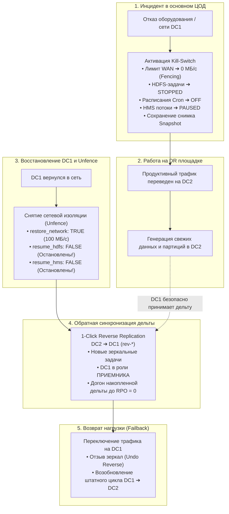
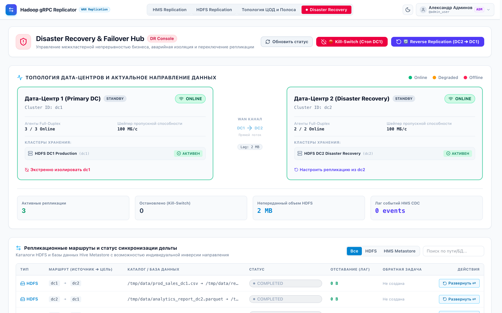
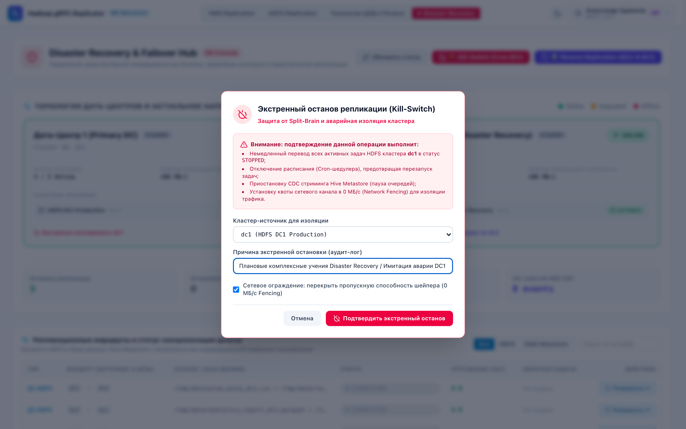
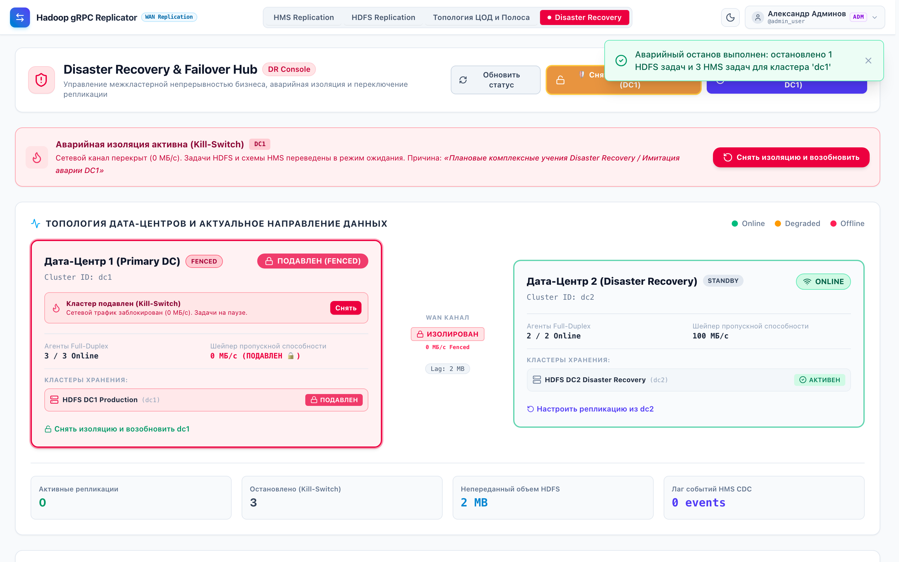
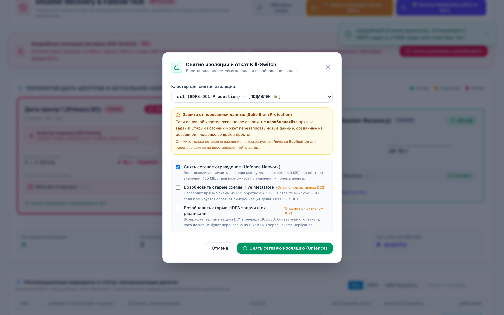
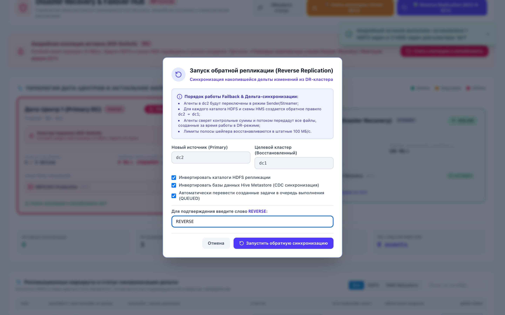

<div align="center">


# Руководство по Disaster Recovery: сетевая изоляция (Fencing), защита от перезаписи данных и Failback

</div>

Документ описывает, как в Hadoop gRPC Replicator при аварии основного ЦОД остановить репликацию из него (Kill-Switch), снять изоляцию после восстановления (Unfence), перенести накопленные изменения обратно (Reverse Replication) и вернуть нагрузку (Failback). Документ предназначен для дежурного администратора платформы: все управляющие действия в консоли Disaster Recovery и вызовы `POST /api/v1/dr/*` доступны только роли `ADMIN`.

---

## 1. Риск перезаписи данных при Split-Brain

Если основной ЦОД (DC1 / Primary) выходит из строя, а нагрузка переключается на резервный, при возврате DC1 возможны Split-Brain и потеря данных, записанных за время аварии.

### Сценарий перезаписи данных (Data Overwrite)

1. Штатный режим: данные реплицируются в прямом направлении `DC1 ➔ DC2`.
2. Авария DC1: основной ЦОД недоступен, продуктивный трафик переключается на резервный ЦОД (DC2 / Standby).
3. Работа на резерве: бизнес-системы, пайплайны Spark и Flink и пользователи пишут новые данные, создают таблицы и обновляют партиции в DC2. Теперь актуальное состояние — в DC2, а DC1 отстает на все изменения за время аварии.
4. Восстановление DC1: питание или сетевая связность в DC1 восстановлены, кластер возвращается в сеть со старым состоянием данных.
5. Снятие блокировки без мер защиты:
   > [!CAUTION]
   > **Внимание.** Если при восстановлении DC1 автоматически возобновить прежние прямые задачи репликации (`DC1 ➔ DC2`):
   > - воркеры репликации на DC1 начнут синхронизировать свои старые файлы в DC2;
   > - при синхронизации каталогов (зеркалировании) старый DC1 перезапишет или удалит в DC2 файлы, созданные во время аварии;
   > - CDC-стример Hive Metastore на DC1 применит устаревшие состояния схем и партиций поверх обновленных метаданных DC2.
   >
   > В результате данные, записанные в резервный ЦОД за время аварии, теряются без возможности восстановления.

---

## 2. Разделение сетевого ограждения и исполнения задач

Чтобы восстановление DC1 не запускало перезапись, управление разделено на независимые уровни:
1. Сетевое ограждение (Network Fencing, транспортный уровень) — лимиты пропускной способности WAN-канала в иерархическом шейпере Token Bucket.
2. Исполнение задач (Task Execution, уровень потока данных) — жизненный цикл задач репликации HDFS и стримеров Hive Metastore CDC.
3. Распределенный арбитраж с Fencing Tokens (RES-07 и RES-08). `DisasterRecoveryService` использует `DistributedLockService`: операции переключения (Kill-Switch, Unfence, Reverse) выполняются под именованной распределенной блокировкой в таблице `cluster_locks`, и при каждом захвате блокировки другим узлом увеличивается токен ограждения (колонка `epoch`). Поэтому параллельные вызовы от разных администраторов или с разных экземпляров Stateless Active-Active Orchestrator выполняются по очереди, а запрос с устаревшим токеном отклоняется.

Сетевой канал можно открыть, не возобновляя задачи, — на этом построен порядок действий в разделе 3.



---

## 3. Порядок действий при аварии (5 фаз)

<div align="center">
  
  <p><em>Рисунок 1: Консоль Disaster Recovery & Failover Hub в штатном режиме (активный WAN-канал DC1 ➔ DC2)</em></p>
</div>

### Фаза 1. Авария основного ЦОД и активация Kill-Switch

Когда сбой DC1 подтвержден, откройте раздел **Disaster Recovery** и нажмите **Kill-Switch (Стоп DC1)** или вызовите API (раздел 5).

<div align="center">
  
  <p><em>Рисунок 2: Модальное окно аварийного останова (Kill-Switch) с сетевым ограждением Fencing (0 МБ/с)</em></p>
</div>

Оркестратор выполняет:
1. Остановку задач HDFS: все активные передачи кластера-источника переводятся в статус `STOPPED`, активные запуски прерываются.
2. Отключение планировщика: у всех задач снимается признак периодического запуска (`isScheduled = false`), и Cron их больше не запускает.
3. Остановку CDC Hive Metastore и Kafka: потоки репликации метаданных HMS и зеркала топиков Kafka переводятся в статус `PAUSED`, пулы консьюмеров отключаются.
4. Сетевое ограждение (Network Fencing): шейпер выставляет лимит канала `DC1 ➔ Any` в `0 МБ/с`. Если изолированный агент попытается отправить чанк, Token Bucket не выдаст ему разрешения.
5. Создание снимка (Snapshot): сохраняется состояние системы — активные задачи, лимиты, расписания, автор и причина остановки. Из этого снимка выполняется откат в фазе 3.
6. Индикацию: панель DC1 выделяется красной рамкой со статусом `ПОДАВЛЕН (FENCED)`, кнопка управления становится янтарной кнопкой **«Снять изоляцию / Откат»**.

<div align="center">
  
  <p><em>Рисунок 3: Сетевое ограждение и подавленное состояние кластера DC1 (Fenced) с тревожным баннером</em></p>
</div>

---

### Фаза 2. Переключение нагрузки на резервный ЦОД (DC2)

- Сетевые балансировщики и DNS направляют клиентские подключения к NameNode и HiveServer2 в DC2.
- Приложения и ETL-процессы продолжают работу в DC2.
- В консоли DR суммарный лаг показывает объем изменений, накопленных в DC2.

---

### Фаза 3. Восстановление DC1 и снятие изоляции (Unfence) без возобновления прямых задач

После восстановления питания и сети в DC1 узлы кластера снова доступны (`ONLINE`).

> [!IMPORTANT]
> **Внимание.** При снятии аварийной блокировки восстанавливайте только сетевой канал.
> Прямые задачи `DC1 ➔ DC2` не возобновляйте: они перезапишут данные, записанные в DC2 во время аварии (раздел 1).

Действия оператора в UI:
1. Нажмите янтарную кнопку **«Снять изоляцию / Откат (DC1)»** или ссылку **«Снять»** на баннере подавленного кластера.
2. В открывшемся окне:
   - выберите кластер `dc1 [ПОДАВЛЕН]`;
   - оставьте включенным чекбокс **«Снять сетевое ограждение (Unfence Network)»** (`true`): канал вернется к штатным 100 МБ/с, оркестратор сможет управлять агентами DC1, а DC1 — принимать данные;
   - чекбоксы **«Возобновить старые схемы Hive Metastore»** и **«Возобновить старые HDFS-задачи и их расписания»** по умолчанию выключены (`false`) — не включайте их.
3. Нажмите **«Снять ограничения»**.

<div align="center">
  
  <p><em>Рисунок 4: Модальное окно безопасного снятия изоляции (Unfence) с защитой от Split-Brain и перезаписи данных</em></p>
</div>

Проверка:
- лимит сетевого канала — 100 МБ/с;
- кластер DC1 больше не помечен как подавленный;
- прежние прямые задачи остаются остановленными (`STOPPED` / `PAUSED`) и не пишут в DC2.

---

### Фаза 4. Обратная синхронизация дельты (Reverse Replication: `DC2 ➔ DC1`)

Сеть открыта, прямые задачи остановлены. Теперь перенесите в DC1 данные, накопленные в DC2 за время аварии.

Действия оператора в UI:
1. Нажмите **Reverse Replication (DC2 ➔ DC1)** в заголовке консоли DR или кнопки **«Развернуть ⇄»** в строках отдельных каталогов таблицы маршрутов.
2. Введите проверочное слово `REVERSE` и подтвердите операцию.

<div align="center">
  
  <p><em>Рисунок 5: Мастер запуска обратной репликации (Reverse Replication DC2 ➔ DC1)</em></p>
</div>

Оркестратор выполняет:
1. Находит все прямые задачи `DC1 ➔ DC2`, включая остановленные аварийным остановом.
2. Создает для них зеркальные задачи обратного направления `DC2 ➔ DC1` с префиксом `rev-...`:
   - кластеры меняются местами: `sourceClusterId = "dc2"`, `targetClusterId = "dc1"`;
   - каталоги меняются местами: `sourcePath = direct.getTargetPath()`, `targetPath = direct.getSourcePath()`;
   - параметры авторизации и UGI-принципалы сохраняются;
   - для баз Hive Metastore создаются обратные потоки CDC;
   - задачи ставятся в очередь (`QUEUED`) и запускаются воркерами DC2.
3. Помечает созданные задачи в таблице маршрутов фиолетовым бейджем **`Зеркало ⇄`**.
4. Меняет стрелку направления в блоке WAN-канала на `DC2 ➔ DC1`.

Следите за уменьшением лага (Delta Convergence) в консоли DR.

---

### Фаза 5. Возврат нагрузки (Failback) и возобновление штатного цикла

Когда лаг дельты достиг RPO = 0 (все байты и CDC-события из DC2 перенесены в DC1):
1. Переключите продуктивный трафик обратно на DC1.
2. В консоли DR нажмите янтарную кнопку **«Отозвать ↩»** у исходных маршрутов или **«Удалить зеркало ✕»** у зеркальных задач.
3. Оркестратор удаляет обратные задачи `DC2 ➔ DC1` и снимает блокировку прямого цикла `DC1 ➔ DC2`.

---

## 4. Матрица состояний задач на протяжении DR-цикла

Лимит `0 МБ/с` при ограждении означает запрет, а не «лимит не задан»: токен-бакет возвращает запретительное ожидание, и агенты не получают разрешения на передачу. Ограждение и прежние лимиты канала хранятся в БД (`replication_bandwidth_limits`, `replicator_dr_snapshots`), поэтому их видят все узлы active-active, а не только узел, принявший запрос, и перезапуск узла ограждение не снимает.

Откат требует снимка. `rollbackEmergencyStop` восстанавливает лимиты из снимка, сделанного при Kill-Switch. Если снимка для кластера нет, вызов возвращает ошибку и ничего не меняет. Прежняя реализация в этом случае снимала ограждение со всех известных каналов, в том числе с ЦОД, которых авария не касалась.

| Фаза | Прямые HDFS-задачи (DC1 ➔ DC2) | Прямые HMS-потоки (DC1 ➔ DC2) | Сетевой лимит DC1 | Обратные задачи (DC2 ➔ DC1) | Направление трафика |
|---|---|---|---|---|---|
| Штатный режим | `RUNNING` / `SCHEDULED` | `ACTIVE` | 100 МБ/с | Отсутствуют | Клиенты на DC1 |
| Kill-Switch (авария DC1) | `STOPPED` (`isScheduled=false`) | `PAUSED` | 0 МБ/с (Fenced) | Отсутствуют | Клиенты на DC2 |
| Unfence (восстановление DC1) | `STOPPED` (не запускаются) | `PAUSED` | 100 МБ/с (открыт) | Еще не созданы | Клиенты на DC2 |
| Reverse Replication | `STOPPED` | `PAUSED` | 100 МБ/с | `QUEUED` / `RUNNING` (`rev-*`) | Клиенты на DC2 |
| Failback завершен | `QUEUED` / `SCHEDULED` | `ACTIVE` | 100 МБ/с | Удалены (`undo-reverse`) | Клиенты на DC1 |

---

## 5. Автоматизация через REST API (Ansible / AWX / CI-CD)

Операции консоли DR доступны через REST API оркестратора. Управляющие вызовы `POST /api/v1/dr/*` выполняются от пользователя с ролью `ADMIN`.

Для скриптов передавайте токен в заголовке `Authorization: Bearer <token>`. Токен возвращает `POST /api/v1/auth/login` в поле `access_token`. При аутентификации заголовком проверка CSRF не выполняется; она нужна только для запросов с cookie сессии.

```bash
# 0. Получение токена: <admin_user> — логин пользователя с ролью ADMIN,
#    пароль подставляется из переменной окружения REPLICATOR_ADMIN_PASSWORD
TOKEN=$(curl -s -X POST "http://orchestrator:8005/api/v1/auth/login" \
  -H "Content-Type: application/json" \
  -d "{\"username\": \"<admin_user>\", \"password\": \"$REPLICATOR_ADMIN_PASSWORD\"}" | jq -r .access_token)

# 1. Проверка текущего DR-статуса и лага непереданных данных
curl -s -X GET "http://orchestrator:8005/api/v1/dr/status" \
  -H "Authorization: Bearer $TOKEN" | jq .

# 2. Экстренный останов аварийного кластера DC1 с сетевым ограждением (Fencing)
curl -s -X POST "http://orchestrator:8005/api/v1/dr/emergency-stop" \
  -H "Authorization: Bearer $TOKEN" \
  -H "Content-Type: application/json" \
  -d '{
    "cluster_id": "dc1",
    "reason": "Аварийный сбой энергоснабжения основного ЦОД",
    "fence_network": true
  }'

# 3. Снятие сетевой изоляции после восстановления DC1 БЕЗ возобновления старых задач
# ВНИМАНИЕ: resume_hdfs и resume_hms передаются как false во избежание перезаписи!
curl -s -X POST "http://orchestrator:8005/api/v1/dr/emergency-stop/rollback" \
  -H "Authorization: Bearer $TOKEN" \
  -H "Content-Type: application/json" \
  -d '{
    "cluster_id": "dc1",
    "restore_network": true,
    "resume_hms": false,
    "resume_hdfs": false
  }'

# 4. Запуск обратной синхронизации дельты из DC2 в DC1
curl -s -X POST "http://orchestrator:8005/api/v1/dr/reverse" \
  -H "Authorization: Bearer $TOKEN" \
  -H "Content-Type: application/json" \
  -d '{
    "from_cluster_id": "dc2",
    "to_cluster_id": "dc1",
    "include_hdfs": true,
    "include_hms": true,
    "auto_start": true
  }'

# 5. Отзыв обратного зеркала после схождения лага и завершения Failback
curl -s -X POST "http://orchestrator:8005/api/v1/dr/jobs/{directJobId}/undo-reverse" \
  -H "Authorization: Bearer $TOKEN"
```

`{directJobId}` — ID прямой задачи, для которой создано зеркало.

---

## 6. Чек-лист дежурного инженера при инциденте

- [ ] Зафиксировать недоступность DC1 в мониторинге.
- [ ] Нажать **Kill-Switch (Стоп DC1)** в консоли DR.
- [ ] Убедиться, что на карточке DC1 статус `ПОДАВЛЕН (FENCED)`, а лимит канала — `0 МБ/с`.
- [ ] Перевести продуктивный трафик приложений на DC2.
- [ ] После восстановления узлов DC1 выполнить **«Снять изоляцию / Откат»** с выключенными чекбоксами возобновления задач (`resume_hdfs=false`, `resume_hms=false`).
- [ ] Запустить **Reverse Replication (DC2 ➔ DC1)**.
- [ ] Дождаться нулевого лага непереданных данных (`Lag = 0 B`, `0 CDC events`).
- [ ] Переключить продуктивный трафик обратно на DC1.
- [ ] Отозвать обратные зеркала кнопкой **«Отозвать ↩»** и вернуть прямую репликацию в штатный режим.
