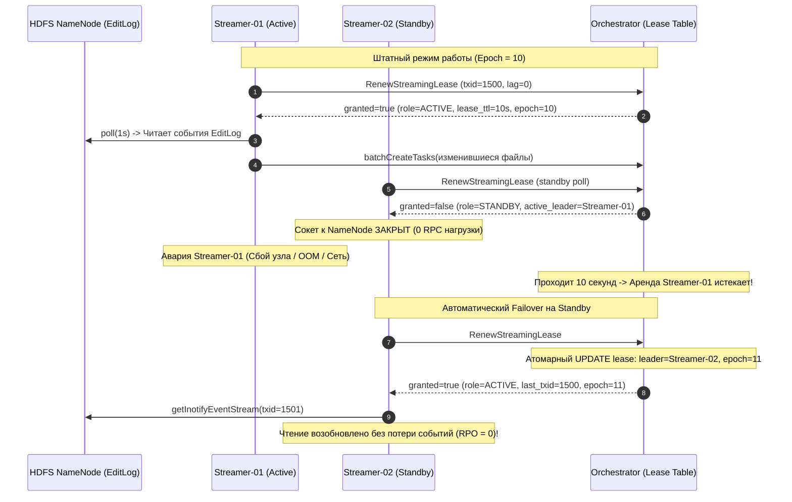
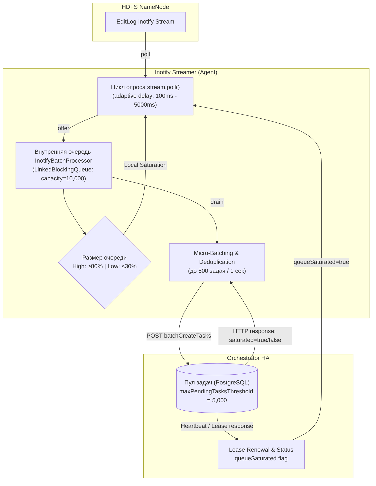
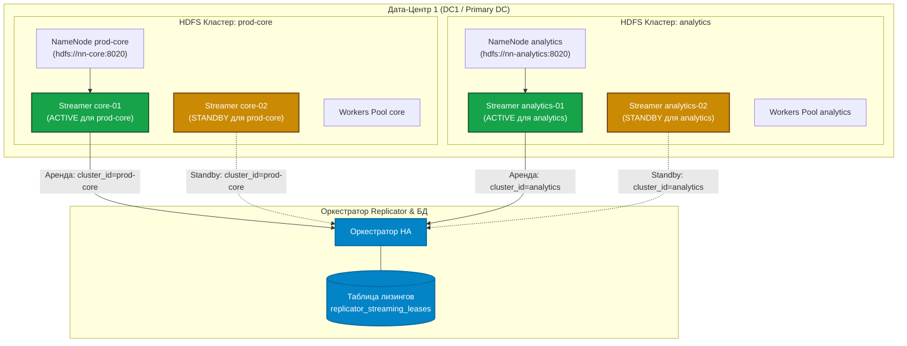
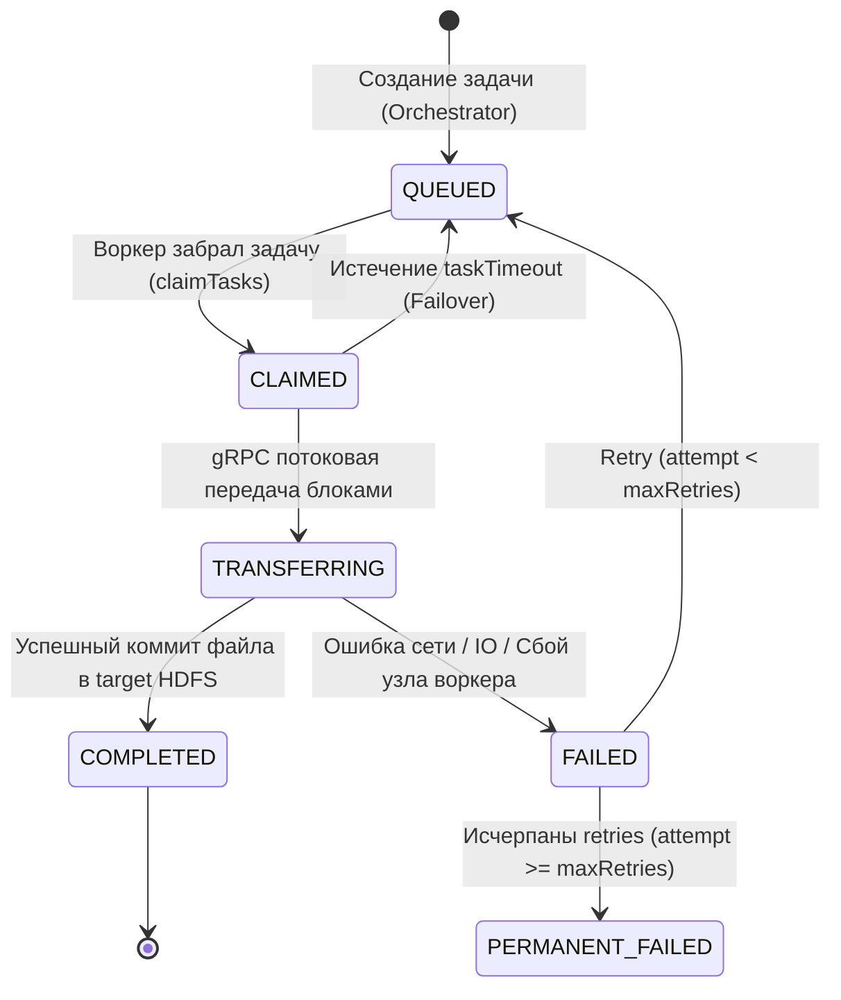
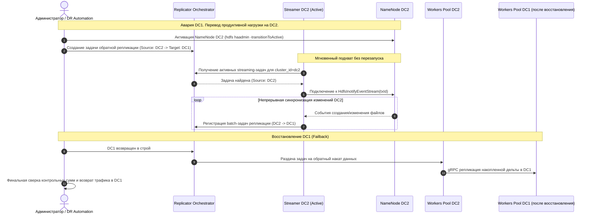
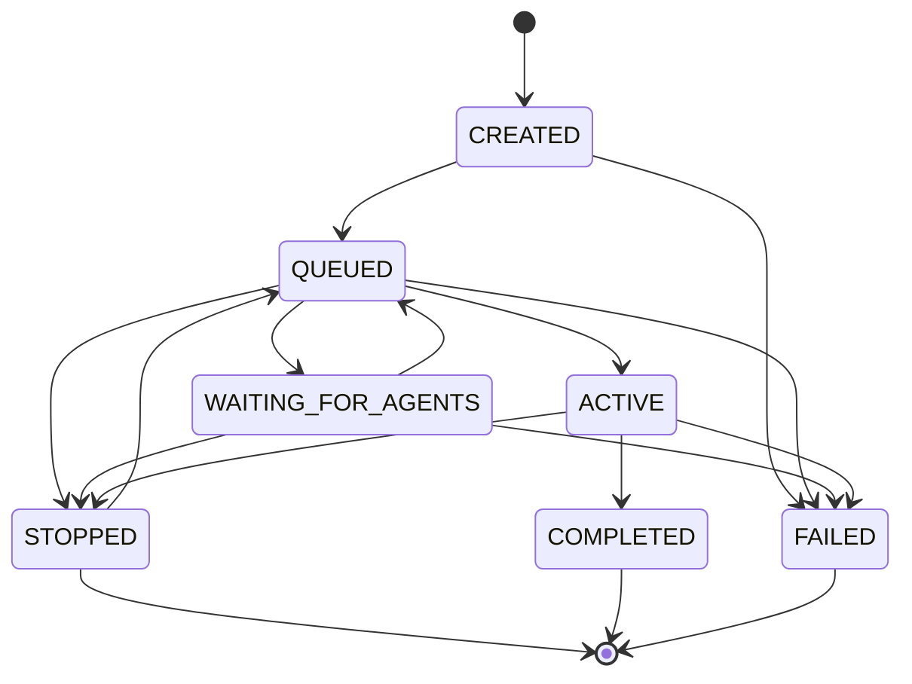

# Отказоустойчивость и высокая доступность Hadoop gRPC Replicator

Документ описывает, как компоненты Hadoop gRPC Replicator переживают отказы: резервирование, аварийное восстановление (Disaster Recovery), изоляцию привилегий и распределенную координацию. Для администраторов и разработчиков платформы.

---

## 1. Матрица отказов

| Компонент | Сценарий сбоя | Механизм обнаружения | Реакция системы и восстановление | RTO (время восстановления) | RPO (потеря данных) |
|---|---|---|---|---|---|
| Orchestrator | Падение экземпляра #1 (OOM, сбой сервера) | L7-балансировщик (таймаут `GET /api/v1/health`) | Балансировщик переключает HTTP/UI на экземпляр #2. ShedLock передает блокировку фоновых планировщиков. | 1–3 сек | 0 (stateless API + общая БД) |
| PostgreSQL (БД оркестратора) | Падение Primary | Кворумный мониторинг Patroni / etcd | Patroni повышает Standby-реплику до Primary. Пул PgBouncer переподключается. | 3–5 сек | 0 (синхронная репликация) |
| Inotify Streamer (Active) | Падение процесса стримера (DC1) | Истечение аренды heartbeat в БД оркестратора (> 10 сек) | Standby-стример захватывает лидерство и читает EditLog с `last_committed_txid`. | 5–10 сек | 0 (near-zero RPO) |
| Пул Inotify Streamer | Разрыв истории EditLog (`MissingEventsException`) | Перехват исключения клиентом `DFSInotifyEventInputStream` | `currentTxid` продвигается до актуального, запускается полная сверка директорий (`runReconciliationScan`). | Время сканирования | 0 (полная сверка каталогов) |
| Inotify Streamer / Orchestrator | Лавина событий EditLog (шторм транзакций, переполнение буфера) | Буфер событий заполнен, добавление отклоняется | Выброс `InotifyQueueOverflowException`, txid не продвигается, микробатчинг до 500 событий и гистерезис | 0 сек | 0 |
| Data Worker (пул отправителей) | Несколько агентов одновременно анализируют одно задание (`mode=all`) | Попытка одновременного перевода в `ANALYZING` | Атомарный SQL CAS (`claimJobForAnalysis`): задание анализирует ровно один агент, очереди не сбрасываются повторно. | 0 сек | 0 |
| Data Worker (отправитель) | Падение воркера во время передачи файла | Нет heartbeat воркера / таймаут задачи | Оркестратор возвращает задачу в `QUEUED`, другой воркер пула берет ее на повтор. | По таймауту задачи (60 сек) | 0 (повторная передача файла) |
| Data Receiver | Отмена передачи клиентом (`CANCELLED`) / сбой узла | Срабатывание `onCancelHandler` / обрыв сети | Принудительная отмена пула коммиттеров (`commitFutures.cancel(true)`), немедленное удаление staging-файлов; `rename` не выполняется параллельно с очисткой. | Сразу | 0 (атомарный commit из staging) |
| HDFS NameNode (источник/приемник) | Падение Active NameNode | Hadoop-клиент `ConfiguredFailoverProxyProvider` | Клиент переключается на Standby NameNode по виртуальному URI `hdfs://nameservice1`. | 1–3 сек | 0 (кворум JournalNodes) |
| HMS Replicator | Падение агента синхронизации схемы | Истечение распределенной аренды в `HmsCoordinatorService` | Задача переходит на резервный агент кластера. Чтение CDC продолжается с `last_event_id`. | 5–10 сек | 0 (at-least-once журнал DDL) |
| Kafka Replicator (Data Plane) | Деградация локального брокера Kafka / переполнение буфера | Задержка подтверждения ack, таймаут продюсера | Запись вынесена в пул виртуальных потоков Java 21, координация in-flight батчей и `onCancelHandler`; Netty EventLoop не блокируется | 0 сек (неблокирующая обработка) | 0 (retry/backpressure) |
| gRPC Sender (исходящий Data Plane) | Деградация канала WAN / переполнение исходящего буфера Netty | `clientCallStreamObserver.isReady() == false` | Чтение с HDFS приостанавливается (`awaitStreamReady`), чанки не отправляются, пока буфер TCP/Netty не опустеет; heap не переполняется | 0 сек (реактивный backpressure) | 0 |
| Token Throttler (Orchestrator) | Сотни параллельных воркеров одновременно исчерпали токены маршрута | Конкурентные вызовы RPC `RequestTokens` | Локальная порция токенов маршрута (`tokenBatchLease`, 2–16 МБ): чанки списываются из нее без RPC, `RequestTokens` уходит только при исчерпании порции; дедупликации одновременных запросов нет (см. 13.4) | 0 сек | 0 |

---

## 2. Отказоустойчивость оркестратора

Оркестратор не хранит состояние у себя: оно лежит в PostgreSQL с резервированием. Сетевые плоскости разделены: Control Plane (REST + gRPC) и Data Plane (gRPC между ЦОД).

```mermaid
flowchart TD
    subgraph Clients["Клиенты и агенты"]
        WebUI["Web UI Console (Svelte 5)"]
        AgentsCtrl["Агенты репликации (Control Plane)"]
        AgentSender["Agent Sender (DC1)"]
        AgentReceiver["Agent Receiver (DC2)"]
    end

    subgraph LB["Балансировщик нагрузки (High Availability)"]
        VIP_REST["Keepalived VIP: 8005<br/>(HTTPS / REST: Web UI Console & Admin API)"]
        VIP_GRPC["gRPC Load Balancer: 50050<br/>(HTTP/2 Control Plane: Task Claim, Heartbeat & Quotas)"]
    end

    subgraph Orchestrators["Пул экземпляров оркестратора (Active-Active Control Plane)"]
        Orch1["Replicator Orchestrator #1<br/>• REST API (:8005)<br/>• gRPC Control Plane (:50050)<br/>• [X] ShedLock Leader (Cron & Lease)"]
        Orch2["Replicator Orchestrator #2<br/>• REST API (:8005)<br/>• gRPC Control Plane (:50050)<br/>• [ ] ShedLock Standby"]
    end

    subgraph DataPlane["Data Plane между ЦОД (прямой транспорт без участия оркестратора)"]
        AgentSender -->|gRPC Data Plane :50051 (HDFS) / :50052 (Kafka)<br/>Потоковые батчи, Zstandard/LZ4, Sliding Window, Zero-Copy| AgentReceiver
    end

    subgraph Storage["Хранилище состояния с резервированием"]
        PGPrimary[("PostgreSQL Primary<br/>(Patroni / Master)")]
        PGStandby[("PostgreSQL Standby<br/>(Streaming Replica)")]
        Etcd["etcd кворум (консенсус Patroni)"]
    end

    WebUI --> VIP_REST
    AgentsCtrl -->|gRPC :50050 (HTTP/2 Control Plane)| VIP_GRPC
    VIP_REST -->|Round-Robin / Failover| Orch1
    VIP_REST -->|Round-Robin / Failover| Orch2
    VIP_GRPC -->|HTTP/2 Round-Robin| Orch1
    VIP_GRPC -->|HTTP/2 Round-Robin| Orch2

    Orch1 --> PGPrimary
    Orch2 --> PGPrimary
    PGPrimary -.->|Синхронная репликация| PGStandby
    Etcd -.->|Мониторинг и Failover| PGPrimary
    Etcd -.->|Мониторинг и Failover| PGStandby
```

### 2.1. Разделение сетевых плоскостей и балансировка запросов

1. Control Plane (управление и координация):
   - REST API (порт `:8005`) обслуживает Web UI Console (Svelte 5), эндпоинты Actuator/Prometheus, административный CRUD задач репликации и DR-сценарии. Точка входа — Keepalived VIP `https://replicator.company.local:8005`.
   - gRPC Control Plane (порт `:50050`) — сервис `OrchestratorControlPlaneService` (`orchestrator_control_plane.proto`). Через него распределенные агенты (HDFS, HMS, Kafka) регистрируются, шлют heartbeat, забирают задачи из очереди (`claimTasks`), подтверждают финализацию (`completeTask`), запрашивают квоты Token Bucket (`requestTokens`) и продлевают аренду стримеров, без накладных расходов JSON/HTTP.
2. Data Plane (передача данных между ЦОД):
   - Файлы HDFS, виртуальные TAR-архивы и батчи Kafka идут напрямую между агентами (`Agent Sender ➔ Agent Receiver`) через выделенные порты gRPC:
     - `:50051` — HDFS Data Plane (`DataTransferService`);
     - `:50052` — Kafka Data Plane (`KafkaDataTransferService`).
   - Полезная нагрузка через оркестратор не проходит, поэтому его пропускная способность не ограничивает скорость передачи по WAN.
3. Stateless-сессии: аутентификация через JWT-токены (`common-security-starter`), подписанные общим ключом. Запрос любого пользователя или агента может обработать любой экземпляр оркестратора, sticky sessions не нужны.
4. Проверка доступности: балансировщик опрашивает `GET /actuator/health` или `GET /api/v1/health`. При недоступности экземпляра трафик переключается за 1 секунду.

### 2.2. Защита от дублирования планировщиков (ShedLock)

Фоновые периодические задачи (Cron Scheduler, проверка брошенных задач HMS, мониторинг офлайн-агентов) защищены распределенными блокировками ShedLock в PostgreSQL:

```java
@Scheduled(fixedDelayString = "${hadoop.replicator.hms-failover-check-ms:3000}")
@SchedulerLock(name = "hms_failover_task_lock", lockAtLeastFor = "1s", lockAtMostFor = "10s")
public void checkAndFailoverOrphanedHmsJobs() {
    // Выполняется строго на одном инстансе оркестратора
}
```

Если активный экземпляр упал во время выполнения задачи, блокировка освобождается по таймауту `lockAtMostFor`, и следующий тик выполняет второй экземпляр.

### 2.3. Шардированный Token Bucket и виртуальные потоки

При межЦОДной репликации десятки параллельных воркеров обращаются к сервису шейпинга `POST /api/v1/tokens/request`:

1. Глобального мьютекса на весь оркестратор в `TokenBucketThrottler` нет.
2. Метод `calculateWaitAndConsume` выполняется под `ReentrantLock` внутри нужного `SingleBucket` (глобального, ЦОД-ЦОД или HDFS-HDFS).
3. `ReentrantLock` вместо `synchronized` не закрепляет виртуальный поток Java 21 за carrier-потоком (нет carrier thread pinning в Project Loom), поэтому тысячи одновременных запросов токенов не занимают потоки ОС на время ожидания.

### 2.4. Персистентный реестр агентов и stateless Active-Active (RES-01)

Реестр агентов перенесен из памяти экземпляров оркестратора в реляционную БД:

- Таблица `replication_agents` (`AgentEntity`) хранит статус (`ONLINE`, `STALE`, `OFFLINE`), идентификатор кластера, внешний gRPC-адрес, отметку последнего heartbeat и метрики нагрузки (`active_transfers`, `transferred_bytes`, `error_count`).
- Агент может отправлять heartbeat на любой экземпляр оркестратора через балансировщик L4/L7. Состояние пишется в общую БД, поэтому любой экземпляр может назначать задачи и определять доступность воркеров.
- Обновления heartbeat пишутся в БД пакетами, чтобы сотни агентов не занимали пул соединений СУБД.
- Живость агента определяется по БД: свежий heartbeat, принятый локально, имеет приоритет (запись в БД отстает на интервал write-behind), иначе берется отметка `last_heartbeat` из таблицы. Через эту единственную проверку идет failover и HDFS-задач, и HMS-потоков. Прежняя схема судила по локальному полю статуса: экземпляр, который heartbeat этого агента не принимает, считал живого агента офлайновым и переназначал его активные задачи, то есть один и тот же файл передавался дважды.

### 2.5. Распределение квот Token Bucket между экземплярами оркестратора (RES-06)

При горизонтальном масштабировании пула оркестраторов суммарная полоса WAN должна оставаться в пределах глобального лимита:

- Таблица `bandwidth_limits` (`BandwidthLimitEntity`) хранит сконфигурированные лимиты полосы.
- Таблица `orchestrator_nodes` (`OrchestratorNodeEntity`) отслеживает активные экземпляры оркестратора с таймаутом выявления сбоя.
- Координатор `OrchestratorClusterCoordinator` делит целевую полосу на число активных экземпляров. Если экземпляр выходит из строя, координатор в течение интервала обнаружения пересчитывает квоты и увеличивает емкость токенов на оставшихся экземплярах, и общая скорость WAN не падает.

### 2.6. Распределенные блокировки с монотонными fencing-токенами (RES-07, RES-08)

Защищают от гонок и split-brain при одновременном выполнении аварийных процедур (failover, failback, перехват аренды):

- Сервис `DistributedLockService` атомарно захватывает блокировку в таблице `cluster_locks` и выдает монотонно возрастающий токен (колонка `epoch`). Токен растет при каждой новой аренде и сохраняется при продлении своей; снятие аренды оставляет строку с накопленной эпохой, поэтому счетчик никогда не идет назад. Захват и продление выполняются в собственных транзакциях, так что аренда видна соседним экземплярам сразу, а не после коммита работы под блокировкой.
- Зомби-лидер: если экземпляр «завис» (GC-пауза, разрыв сети) и вернулся с устаревшим токеном, его операции отклоняются на уровне БД и доменной логики.
- Методы `failoverCluster` и `failbackCluster` в `DisasterRecoveryService` выполняются под распределенной блокировкой с проверкой fencing-токена, поэтому противоположные команды не могут выполняться параллельно.

---

## 3. Отказоустойчивость стримера HDFS Inotify

Стример читает транзакции EditLog NameNode через `DFSInotifyEventInputStream`; от него зависит near-zero RPO. Если стример упал или завис, изменения не попадают в очередь репликации.

### 3.1. Требование $N \ge 2$ и модель Active-Standby

На кластере-источнике разворачиваются минимум 2 экземпляра стримера (`streamer-01` и `streamer-02`), в статусе ACTIVE работает только один.



### 3.2. Защита от split-brain (lease fencing и эпохи)

Защищает от ситуации, когда «зависший» старый лидер восстанавливает связь и начинает параллельно слать события:

1. Дедлайн на клиенте: активный стример знает срок своей аренды (10 сек). Если за 10 секунд он не продлил аренду в оркестраторе, он немедленно закрывает стрим NameNode.
2. Проверка эпохи на сервере: каждая смена лидера увеличивает `epoch`. Оркестратор отклоняет запросы старого лидера с устаревшей эпохой (`409 Conflict: Stale leader epoch`).

### 3.3. Изоляция привилегий стримера

- Стример запускается в режиме `AGENT_MODE=streamer`.
- Исполнение задач для него заблокировано:
  - воркер-цикл не запускается: агент не вызывает `claimTasks`;
  - приемник не запускается: gRPC-сервер (`:50051`) не открывается;
  - оркестратор в `TaskService.claimTasks()` возвращает стримерам `403 Forbidden`.
- Стример работает под привилегированным Kerberos keytab (`hdfs-streamer@REALM` с правами `supergroup`), но содержимое пользовательских файлов не читает.

### 3.4. Обработка разрыва EditLog (`MissingEventsException`)

Если оба стримера были недоступны долго и NameNode уже удалил старые сегменты EditLog:

1. `stream.poll()` выбрасывает `MissingEventsException(expectedTxid, actualTxid)`.
2. `HdfsInotifyListener` перехватывает исключение, пишет в лог ошибку `[Inotify Gap Alert]` с `expected` и `actual` txid и сдвигает текущий txid на `actualTxid`. Отдельного статуса задания или метрики для разрыва нет: признак разрыва — только эта строка лога.
3. Запускается сверка `runReconciliationScan()` в том же потоке: для каждого потокового задания кластера агент рекурсивно обходит `sourcePath` (`fs.listFiles(path, true)`) и ставит в очередь `InotifyBatchProcessor` все файлы, кроме staging-путей. На время обхода чтение EditLog остановлено.
4. После обхода поток Inotify переоткрывается с `actualTxid`.

### 3.5. Игнорирование staging-директорий и коммит через `RenameEvent`

Во время записи Spark, Hive и Tez создают временные staging-каталоги (`.hive-staging`, `_temporary`, `.spark-staging`, `.staging`, `.tmp`).

- Незавершенные попытки не передаются:
  - события `CreateEvent`, `CloseEvent`, `AppendEvent` внутри таких путей стример отбрасывает через `HadoopFsManager.isIgnoredPath()`;
  - незавершенные и отмененные задачи (speculative execution, aborted tasks) не попадают на целевой кластер и не расходуют WAN.
- Распознавание коммита (staged ➔ committed):
  - при фиксации коммиттер выполняет `fs.rename(stagedFile, targetFile)`;
  - NameNode генерирует `RenameEvent`;
  - стример проверяет: `isIgnoredPath(srcPath) == true` и `isIgnoredPath(dstPath) == false`;
  - если условие выполнено, стример считает это финальным коммитом и ставит `dstPath` в очередь репликации как готовый файл.

### 3.6. Адаптивный backpressure и защита от шторма Inotify-событий

При пакетной генерации данных (завершение тяжелого Spark-пайплайна, массовое удаление устаревших партиций) HDFS выдает сотни тысяч Inotify-событий в секунду. Без регулирования скорости чтения стример упирается в OOM или переполняет пул задач оркестратора.

Регулирование двухуровневое, с гистерезисом:



#### Правила регулирования

1. Локальный буфер и микробатчинг (`InotifyBatchProcessor`):
   - очередь задач ограничена (`inotifyQueueCapacity = 10 000`);
   - события группируются в микробатчи до `inotifyMaxBatchSize = 500` задач или сбрасываются по таймеру `inotifyFlushIntervalMs = 1 000 мс`;
   - внутри батча повторные события для одного пути HDFS схлопываются.
2. Гистерезис локального насыщения (high/low watermark):
   - при заполнении очереди $\ge 80\%$ (`inotifyHighWatermark = 0.8`) процессор выставляет `queueSaturated = true`;
   - флаг снимается только когда очередь опустится до $\le 30\%$ (`inotifyLowWatermark = 0.3`). Без этого зазора флаг переключался бы на каждой пачке и частота опроса скакала бы.
3. Обратная связь от оркестратора:
   - оркестратор считает задачи в статусе `QUEUED` по каждому кластеру;
   - если их больше `maxPendingTasksThreshold` (по умолчанию 5 000), ответы `batchCreateTasks`, `renewLease` и `GET /api/v1/tasks/queue-status` возвращают `queueSaturated = true`.
4. Адаптивная задержка цикла опроса (`HdfsInotifyListener`):
   - при насыщении (локального буфера или оркестратора) задержка между вызовами `stream.poll()` растет с шагом 500 мс до `inotifyBackpressureMaxDelayMs = 5 000 мс`;
   - перед паузой стример вызывает `flush()` накопленных событий и освобождает память;
   - когда нагрузка спадает, задержка постепенно снижается до базовых 100 мс.
5. Локальный TTL-кэш активных streaming-задач (`cachedStreamingJobs`):
   - для фильтрации путей HDFS (`matchesPath`) стримеру нужен список активных задач репликации своего кластера;
   - вместо HTTP GET `/api/v1/jobs` на каждую пачку Inotify-событий стример кэширует список на 5 секунд (`STREAMING_JOBS_CACHE_TTL_MS = 5000`);
   - без кэша при интенсивной записи в HDFS к оркестратору уходили бы сотни HTTP-запросов в секунду.

### 3.7. Несколько кластеров в одном ЦОД: изоляция стримеров по `cluster_id`

В одном ЦОД (например, `dc1`) могут работать несколько независимых HDFS-кластеров, например `prod-core` (транзакционный data lake), `analytics` (витрины данных) и `archive` (холодный архив).



#### Правила разделения

1. У каждого кластера HDFS свой пул стримеров:
   - Inotify читается у NameNode конкретного кластера (`dfsClient.getInotifyEventStream()`). У каждого кластера свой EditLog и свой монотонный счетчик транзакций `txId`;
   - для каждого кластера запускается свой пул стримеров, минимум 2 экземпляра на кластер:
     - кластер `prod-core`: `CLUSTER_ID=prod-core`, `HADOOP_NAMENODE_RPC_ADDRESS=hdfs://nn-core:8020`;
     - кластер `analytics`: `CLUSTER_ID=analytics`, `HADOOP_NAMENODE_RPC_ADDRESS=hdfs://nn-analytics:8020`.
2. Аренда — отдельная на каждый кластер:
   - в таблице `replicator_streaming_leases` первичный ключ — `cluster_id`;
   - пул кластера `prod-core` соревнуется за запись `cluster_id='prod-core'`, пул `analytics` — за запись `cluster_id='analytics'`;
   - стримеры разных кластеров не блокируют друг друга и не конкурируют за одну запись.
3. Маршрутизация и фильтрация событий:
   - стример кластера `prod-core` запрашивает у оркестратора только задачи с `source_cluster_id == 'prod-core'` и отслеживает пути только своего NameNode;
   - стример кластера `analytics` так же обрабатывает только задачи с `source_cluster_id == 'analytics'`.
4. Kerberos realm:
   - если кластеры используют разные Kerberos realm или разные keytab администраторов HDFS, стримеры каждого пула монтируют keytab-файлы для своего NameNode.
5. Сетевой шейпинг (Hierarchical Token Bucket):
   - стримеры независимы, но оркестратор применяет к обоим кластерам общие лимиты ЦОД (`dc_limits: dc1 ➔ dc2`) и общий пул (`global_limit`). Трафик воркеров обоих кластеров суммируется и ограничивается этими лимитами.

---

## 4. Отказоустойчивость пула воркеров

Воркеры репликации (`AGENT_MODE=worker` или `all`) забирают задачи на передачу файлов из распределенной очереди оркестратора.



1. Пул воркеров масштабируется горизонтально: узлы DataNode или YARN-контейнеры добавляются и выводятся без остановки репликации.
2. Таймаут задачи (`taskTimeoutSeconds = 60`): если воркер взял задачу и пропал (сбой JVM, авария сети), фоновый монитор оркестратора возвращает задачу в `QUEUED`.
3. Повторы (`maxTaskRetries = 3`): при транзиентных сбоях сети задача передается повторно с экспоненциальной задержкой.
4. Идемпотентность передачи: приемник пишет файл во временный каталог `staging` (`.tmp-transfer-<uuid>`), сверяет размер и контрольную сумму и только затем выполняет атомарный `rename`.
5. Атомарный захват задания на анализ:
   - при работе нескольких агентов в режиме `AGENT_MODE=all` задание в статусе `QUEUED` анализирует только один агент;
   - захват выполняется атомарным SQL-запросом `claimJobForAnalysis`:
     ```sql
     UPDATE replicator_job SET status = 'ANALYZING', message = :message, updated_at = :now
     WHERE id = :jobId AND status = 'QUEUED'
     ```
   - задание захватывает ровно один агент. Остальные получают `updated == 0` и отступают, поэтому очереди не удаляются повторно и уже выполняющиеся подзадачи не уничтожаются.

---

## 5. Отказоустойчивость приемников

Приемник (`DataTransferServiceImpl`) разворачивается на каждом узле кластера назначения:

1. Выбор узла назначения: если целевой агент недоступен по gRPC, отправитель запрашивает у оркестратора другой узел из топологии кластера (`GET /api/v1/clusters/{id}/nodes`).
2. Очистка осиротевших staging-файлов (`HdfsStagingReaper`): после обрывов соединения, сетевых таймаутов и перезапусков агентов сервис сканирует целевые пути HDFS и локальной ФС и удаляет осиротевшие staging-файлы (`*._staging_*`) по `jobId` и возрасту (`olderThanMillis`).
3. Отмена gRPC-потока:
   - в обработчиках `TransferFileObserver` и `TarStreamObserver` зарегистрирован `serverCallStreamObserver.setOnCancelHandler(...)`;
   - при отмене со стороны клиента (`CANCELLED`) или обрыве сети (`onError`):
     1. выставляется атомарный флаг `cancelled.set(true)`;
     2. отменяется задача потоковой распаковки `unpackFuture.cancel(true)`;
     3. для всех активных задач записи на целевой HDFS вызывается `fut.cancel(true)`;
     4. воркеры проверяют флаг отмены перед `writeDirect` и перед `renameFile`, поэтому мусорные файлы не появляются, а очистка staging не пересекается с финализацией;
     5. все временные staging-файлы сразу удаляются из целевой файловой системы.
4. Kerberos-контексты (`KerberosUgiProvider`):
   - создает и кэширует контексты `UserGroupInformation` (UGI) и doAs-имперсонацию, чтобы в аудите Apache Ranger был виден реальный пользователь;
   - `validatePrincipalSafety` отклоняет path traversal и попытки работать под учетными записями `root`, `bin`, `daemon` и т.п.;
   - содержит многоуровневый fallback для JDK, где `Subject.getSubject` ограничен платформой (JDK 21+).

---

## 6. Отказоустойчивость синхронизации Hive Metastore

Синхронизация схем метаданных опирается на распределенную аренду в `HmsCoordinatorService.java`:

1. Failover брошенных задач: фоновый таймер `checkAndFailoverOrphanedHmsJobs()` каждые 3 секунды проверяет статус агентов. Если назначенный агент перешел в `OFFLINE`, аренда сбрасывается и задача переназначается живому агенту.
2. Барьер «данные прежде схемы» (data-first consistency barrier): DDL-операция для партиции применяется в целевом метасторе только после того, как файлы HDFS реплицированы и размещены на целевом кластере.
3. Пул соединений Thrift: чтобы потоки не конкурировали за один сокет, в `ThriftHmsClient` используется пул на Apache Commons-Pool2 (`GenericObjectPool<IMetaStoreClient>`). При `MetaException` или сетевом сбое соединение инвалидируется, из пула берется новое, и операция повторяется; репликация не прерывается.
4. Дельта-синхронизация CDC и проверка ответов: обработка `ADD_PARTITION` берет список значений затронутых партиций (`partitionValues`) из полезной нагрузки события, без сканирования всех партиций таблицы. Каждый ответ целевого агента проверяется по флагу `success`, поэтому сбой приемника не проходит молча.
5. Контроль доступа (IDOR) и каскадная очистка: управление задачами HMS (`pause`, `resume`, `rebootstrap`, `delete`) проверяет права владельца (`checkHmsJobAccess`). При аварийной смене направления (DR failback) прямые задачи удаляются каскадно с освобождением ресурсов.

---

## 7. Метрики и алерты отказоустойчивости

### Метрики Prometheus / Micrometer

| Метрика | Тип | Описание |
|---|---|---|
| `replicator_streamer_active_count` | Gauge | Количество активных лидеров стриминга (норма: ровно 1 на кластер) |
| `replicator_streamer_standby_count`| Gauge | Количество резервных стримеров в пуле (норма: $\ge 1$) |
| `replicator_streamer_txid_lag`      | Gauge | Отставание стримера от NameNode в количестве транзакций |
| `replicator_orchestrator_ha_leader`| Gauge | Флаг лидера фоновых процессов текущего экземпляра (1 или 0) |
| `replicator_worker_claimed_tasks`  | Gauge | Количество задач, находящихся в обработке воркерами |
| `replicator_task_retry_total`      | Counter | Общее количество перезапущенных задач из-за сбоев воркеров |

### Правила алертов

```yaml
groups:
  - name: replicator-ha-alerts
    rules:
      - alert: ReplicatorStreamerNoStandby
        expr: replicator_streamer_standby_count{cluster="dc1"} < 1
        for: 2m
        labels:
          severity: warning
        annotations:
          summary: "Отсутствует резервный Streamer инстанс для кластера {{ $labels.cluster }}"
          description: "В кластере работает только 1 стример. При его падении Near-Zero RPO будет нарушен."

      - alert: ReplicatorStreamerSplitBrainRisk
        expr: replicator_streamer_active_count{cluster="dc1"} > 1
        for: 10s
        labels:
          severity: critical
        annotations:
          summary: "Обнаружен Split-Brain стримеров в кластере {{ $labels.cluster }}"
          description: "Более одного активного стримера читают EditLog одновременно!"

      - alert: ReplicatorStreamerHighLag
        expr: replicator_streamer_txid_lag > 50000
        for: 3m
        labels:
          severity: warning
        annotations:
          summary: "Высокое отставание стримера Inotify (лаг > 50 000 транзакций)"
          description: "Риск переполнения EditLog и выпадения в MissingEventsException."
```

---

## 8. Чек-лист готовности к промышленной эксплуатации

- [ ] Развернуто минимум 2 экземпляра оркестратора за балансировщиком нагрузки с Keepalived VIP.
- [ ] PostgreSQL работает в режиме HA (Patroni / AWS RDS Multi-AZ).
- [ ] В каждом кластере-источнике запущено минимум 2 стримера (`AGENT_MODE=streamer`) на разных edge-узлах.
- [ ] Стримеры используют выделенный Kerberos keytab суперпользователя и не исполняют задачи (`claimTasks` заблокирован).
- [ ] Параметр `hadoop.replicator.streaming.auto-reconciliation-on-gap` установлен в `true`.
- [ ] Настроены алерты Prometheus на отсутствие standby-стримера и лаг транзакций.

---

## 9. Стримеры во втором ЦОД (DC2 / DR) и обратная синхронизация при failover

Стримеры можно развернуть в обоих ЦОД (DC1 и DC2) одновременно, чтобы после аварии DC1 обратная репликация из DC2 началась без развертывания новых процессов.

### Пулы стримеров в двух ЦОД

Каждый ЦОД обслуживается своей группой стримеров, привязанных к своему кластеру через `CLUSTER_ID`:

```mermaid
flowchart TB
    subgraph DC1 ["Первичный ЦОД (DC1 / Primary)"]
        NN1["NameNode DC1 (Active)"]
        S1A["Streamer DC1-01 (ACTIVE)"]
        S1B["Streamer DC1-02 (STANDBY)"]
        W1["Workers Pool DC1"]
    end

    subgraph OrchestratorCluster ["Кластер Оркестраторов & БД"]
        ORCH["Orchestrator HA (VIP)"]
        DB[(PostgreSQL)]
        ORCH --- DB
    end

    subgraph DC2 ["Второй ЦОД (DC2 / Disaster Recovery)"]
        NN2["NameNode DC2 (Standby / Target)"]
        S2A["Streamer DC2-01 (ACTIVE для DC2)"]
        S2B["Streamer DC2-02 (STANDBY для DC2)"]
        W2["Workers Pool DC2"]
    end

    NN1 -->|Inotify stream| S1A
    S1A -->|Прямой поток задач DC1->DC2| ORCH
    ORCH -->|Задачи копирования| W1
    W1 -->|gRPC Data Transfer| W2

    NN2 -.->|Inotify stream (Готовность)| S2A
    S2A -.->|Аренда dc2 удерживается (Idle)| ORCH

    classDef active fill:#22c55e,stroke:#15803d,color:#ffffff,stroke-width:2px;
    classDef standby fill:#eab308,stroke:#a16207,color:#ffffff,stroke-width:2px;
    classDef db fill:#0284c7,stroke:#0369a1,color:#ffffff,stroke-width:2px;

    class S1A,S2A active;
    class S1B,S2B standby;
    class DB,ORCH db;
```

### Стример DC2 в штатном режиме (warm standby)

1. Аренда — отдельная на каждый ЦОД:
   - в таблице `replicator_streaming_leases` записи разделены по ключу `cluster_id` (`dc1` и `dc2`);
   - стримеры DC2 соревнуются за лидерство только по ключу `cluster_id="dc2"`. Один становится `ACTIVE` для `dc2`, второй — `STANDBY`.
2. Фильтрация задач по кластеру:
   - `HdfsInotifyListener` сопоставляет задачи репликации с идентификатором своего кластера:
     ```java
     boolean matchesCluster(String jobClusterId, String agentClusterId)
     ```
   - в штатном режиме активные задачи репликации имеют `sourceClusterId="dc1"`. Стример DC2 их отфильтровывает, и список локальных задач у него пуст (`jobs.isEmpty()`);
   - стример DC2 удерживает аренду кластера `dc2`, не создает задач репликации и находится в горячем резерве (warm standby), отслеживая доступность NameNode DC2.

---

### Авария DC1 и переключение на DC2 (failover)

При аварии DC1 (отказ оборудования, каналов связи, потеря площадки):



### Что дает заранее запущенный стример в DC2

1. Во время аварии не нужно разворачивать или перенастраивать процессы стриминга: агент в DC2 уже запущен, аутентифицирован в Kerberos и держит соединение.
2. Как только появляется задача обратной репликации, стример начинает читать EditLog NameNode DC2 с сохраненного txid.
3. Стример DC2 работает в том же изолированном режиме (`AGENT_MODE=streamer`): права только на чтение EditLog своего кластера, задачи воркеров (`claimTasks`) не берет.

### Конфигурация запуска стримера в DC2

```bash
# Запуск основного стримера в DC2
export AGENT_MODE=streamer
export CLUSTER_ID=dc2
export HADOOP_STREAMING_ENABLED=true
export HADOOP_NAMENODE_RPC_ADDRESS=hdfs://nn-dc2-01.prod.corp:8020
export KERBEROS_PRINCIPAL=hdfs-streamer/edge-dc2-01.prod.corp@PROD.CORP
export KERBEROS_KEYTAB=/etc/security/keytabs/hdfs-streamer.keytab

java -jar /opt/replicator-agent/replicator-agent.jar
```

---

## 10. Консоль аварийного переключения (DR Console и 1-Click Reverse API)

Аварийные действия собраны в разделе Disaster Recovery веб-интерфейса и в REST API `/api/v1/dr/*`, чтобы оператор не выполнял их вручную по шагам:

1. Экстренный останов аварийного кластера (Kill-Switch):
   - одним действием переводит все активные задачи упавшего ЦОД в `STOPPED`, отключает периодический планировщик и включает сетевое ограждение (fencing, лимит канала 0 МБ/с), чтобы не возник split-brain.
2. Инверсия потока данных (1-Click Reverse Replication):
   - создает обратные задачи `DC2 ➔ DC1` для всех каталогов HDFS и баз Hive Metastore с сохранением UGI-принципалов и путей и запускает синхронизацию накопившейся дельты.
3. Мониторинг отставания дельты (delta lag convergence):
   - показывает объем несинхронизированных байт и событий CDC в реальном времени и сигнализирует, когда достигнут RPO = 0 и нагрузку можно возвращать.
4. Снятие изоляции без перезаписи данных (unfence и защита failback):
   - при восстановлении DC1 сетевое ограждение снимается (Unfence Network), но прямые задачи остаются остановленными, чтобы не перезаписать свежие данные в DC2;
   - пошаговый регламент и диаграммы: [Руководство по Disaster Recovery и защите от Split-Brain (replicator-disaster-recovery-guide.md)](replicator-disaster-recovery-guide.md).

---

## 11. Kafka Replicator: доставка at-least-once и backpressure

Kafka Replicator доставляет записи без потерь (`RPO = 0`) и ограничивает потребление памяти при сбоях сети или брокеров.

### 11.1 Доставка at-least-once

Смещения партиций коммитятся асинхронно и только после подтверждения от удаленного узла, а не автокоммитом:

1. Пул воркеров `KafkaBatchConsumerPool` читает батч записей из Kafka-источника без коммита смещений.
2. Батч регистрируется в трекере `inFlightBatches` и передается по gRPC Data Plane.
3. Только когда целевой агент подтверждает запись всех сообщений в целевой кластер (`ack.getSuccess() == true`), консьюмер выполняет `commitAsync` для максимальных смещений батча.
4. При сбое сети, таймауте gRPC или падении удаленного агента батч не коммитится, и после ребалансировки консьюмер перечитывает сообщения заново.

### 11.2 Flow control и защита от переполнения памяти

1. Backpressure на сервере:
   - `KafkaDataTransferServiceImpl` вызывает `callStream.disableAutoInboundFlowControl()`;
   - следующий батч запрашивается (`callStream.request(1)`) только после того, как все сообщения текущего батча отправлены и подтверждены локальным `KafkaProducer`;
   - если локальный кластер Kafka тормозит на дисковом вводе-выводе или репликации ISR, приемник не запрашивает новые батчи, и TCP-окно и gRPC-канал притормаживают отправителя.
2. Backpressure на клиенте:
   - отправитель ограничивает число батчей в транзите (`maxInFlight = 16`);
   - при достижении лимита рабочий поток ждет освобождения слота перед вызовом `consumer.poll(...)`, и память JVM не растет без ограничения.

### 11.3 Локализованный failover на consistent hashing (`KafkaTargetBalancer`)

- Прежний modulo-балансировщик (`partition % healthyNodes`) при выходе из строя одного узла переставлял 75–90% всех партиций. `KafkaTargetBalancer` использует consistent hashing (Rendezvous / Highest Random Weight).
- При сбое узла $K$ он уходит в карантин на 10 секунд, и перенаправляются только $1/M$ партиций, закрепленных за ним. Остальные $(M-1)/M$ партиций сохраняют привязку к своим целевым агентам: их сетевые буферы и TCP-соединения не пересоздаются, порядок сообщений не нарушается.
- Когда узел $K$ выходит из карантина, его партиции детерминированно возвращаются на него без влияния на другие потоки.
- Если недоступны все целевые узлы, балансировщик сбрасывает карантин и пробует переподключиться.

### 11.4 Перенос конфигурации топиков (`KafkaTopicProvisioner`)

При создании отсутствующих топиков на целевом кластере оркестратор переносит не только число партиций и фактор репликации, но и расширенные конфигурации:

1. `cleanup.policy=compact` — нужен для CDC-потоков (Debezium, ksqlDB, Kafka Streams): без него при retention по умолчанию на целевом брокере теряются промежуточные состояния ключей.
2. `min.insync.replicas` — задает на целевом кластере тот же уровень подтверждения записи (`acks=all`), что на источнике.
3. Параметры хранения и сжатия: `retention.ms`, `retention.bytes`, `max.message.bytes`, `compression.type`, `segment.bytes` и динамические переопределения источника (`DYNAMIC_TOPIC_CONFIG`).

### 11.5 Авторегистрация схем (`syncSchemaMetadata`)

Для Confluent Schema Registry и Hortonworks Schema Registry:

1. Метод `syncSchemaMetadata` сервиса `KafkaDataTransferServiceImpl` регистрирует схему в целевом реестре через HTTP-клиенты (`ConfluentRegistryClient`, `HwxRegistryClient`) с поддержкой Kerberos SPNEGO.
2. Полученный идентификатор схемы (`target_schema_id` / `versionId`) возвращается отправителю и кэшируется в двустороннем LRU-кэше `CachedSchemaRegistryResolver`.
3. Для следующих сообщений транскодер `ZeroCopyWireTranscoder` подставляет целевой ID в заголовок без повторных обращений к REST API.

---

## 12. Безопасность Control Plane и защита периметра (SSRF, zero-trust)

Раздел описывает проверки, которые не дают постороннему управлять потоками репликации, захватывать задачи и использовать оркестратор для атак на инфраструктуру.

### 12.1 Fail-closed аутентификация gRPC (`AgentGrpcAuthInterceptor`)

1. Fail-closed по умолчанию:
   - раньше при отсутствии или пустом значении `x-agent-secret` вызовы пропускались без авторизации;
   - сейчас, если секрет не сконфигурирован на сервере, входящие вызовы отклоняются со статусом `Status.UNAUTHENTICATED ("Agent authentication is unconfigured (Fail-Closed)")`;
   - для изолированных локальных тестов есть явный флаг `allowAnonymous = true`.
2. Защита от timing attack:
   - токен агента `X-Agent-Secret` сравнивается за постоянное время через `MessageDigest.isEqual(...)`, поэтому секрет нельзя подобрать по времени ответа.

### 12.2 Защита от SSRF

При регистрации и в каждом heartbeat агент сообщает оркестратору свой адрес для входящих gRPC-соединений (`advertisedGrpcAddress`). Чтобы этим адресом нельзя было заставить оркестратор сканировать внутреннюю сеть, адрес проверяется в несколько этапов:

1. Синтаксис и порт:
   - формат `host:port`, IPv6 в квадратных скобках (`[::1]:port`);
   - порт в диапазоне `1..65535`;
   - символы инъекций и управляющие последовательности запрещены (`matches("^[a-zA-Z0-9.\\-_:]+$")`).
2. Блокировка облачных эндпоинтов метаданных (IMDS):
   - AWS / OpenStack / Azure: `169.254.169.254`, `fd00:ec2::254`, `169.254.0.0/16`;
   - Google Cloud Platform: `metadata.google.internal`;
   - Alibaba Cloud: `100.100.100.200`.
3. Проверка через `InetAddress`:
   - для разрешенных хостов проверяются `isLinkLocalAddress()`, `isMulticastAddress()`, `isAnyLocalAddress()`;
   - блокируются IPv4-mapped IPv6 адреса диапазона `169.254.0.0/16` (`::ffff:169.254.x.x`);
   - проверка выполняется при регистрации и при каждом периодическом heartbeat.

### 12.3 Защита от захвата кластера агентом

1. Кластерная привязка агента неизменяема:
   - попытка зарегистрированного агента сменить `clusterId` (повторной регистрацией или через heartbeat) вызывает `SecurityException` и пишется в аудит-лог;
   - сменить кластер можно только после авторизованного снятия с регистрации (`unregister`).
2. Белый список кластеров (`enforce-cluster-whitelist`):
   - при `hadoop.replicator.enforce-cluster-whitelist=true` оркестратор проверяет `clusterId` агента по реестру топологии `TopologyRegistry`;
   - регистрация в неизвестном кластере отклоняется, посторонние узлы (rogue nodes) в реестр не попадают.

### 12.4 Аттестация задач HMAC-SHA256 (SEC-01)

- Угроза: скомпрометированный воркер или перехват gRPC-соединения используется для записи в неавторизованные каталоги HDFS или подмены doAs Kerberos-принципала.
- Защита: `TaskAttestationService` подписывает каноническую строку параметров задачи (`v1|taskId|jobId|targetPath|executionPrincipal|runAsServiceAccount|expiresAt`) по HMAC-SHA256 общим секретом `agentSecret`.
- Проверка на приемнике: `TaskAttestationValidator` проверяет подпись перед открытием HDFS OutputStream. Расхождение пути или принципала либо истекший TTL дает отказ `Status.PERMISSION_DENIED`.

### 12.5 Chroot-песочница целевых путей и защита системных файлов ОС (SEC-10)

- Изоляция локальной ФС: в `HadoopFsManager.validateSandboxAccess` локальные пути разрешаются относительно `localSandboxDir` (`REPLICATOR_LOCAL_SANDBOX` / `LOCAL_SANDBOX_DIR`) с проверкой `File.getCanonicalFile()`.
- Traversal и null byte: отклоняются попытки выйти из песочницы через символические ссылки, последовательности `..` и нулевой байт (`\0`).
- Системные каталоги и конфиденциальные файлы: каталоги ОС (`/bin`, `/sbin`, `/usr`, `/etc`, `/proc`, `/sys`, `/dev`, `/root`, системные разделы `/var`) и секреты (`.ssh`, `.gnupg`, `.bashrc`, `.env`, `crontab`) в черном списке.
- Проверки не зависят от формы URI: путь разбирается в формах `scheme://host/path`, `scheme:/path` и `scheme:path` с нормализацией точечных сегментов, а явная схема `file:` трактуется как локальная ФС независимо от `fs.defaultFS` — поэтому границы песочницы проверяются и для `file:///...` на кластере с HDFS по умолчанию.
- Явный отказ read-проб: `checkFile` и `getDirectoryManifest` отвечают на запрещенный путь статусом `PERMISSION_DENIED`, а не признаком отсутствия файла.
- Перенос смещений консьюмер-групп не перезаписывает живую группу: состояние группы в целевом ЦОД теперь трехзначное — активна, неактивна, неизвестно. Прежде любая ошибка опроса (недоступный брокер, таймаут, отказ по правам) означала «не активна», и смещения живой группы перезаписывались. Неизвестное состояние отменяет перенос (кроме явного `force_commit`). Отдельно проверяется монотонность: смещение не сдвигается назад, иначе целевой ЦОД перечитывает уже обработанное.
- Файл, выросший между анализом и передачей, не рвет бандл: в TAR-запись пишется ровно столько байт, сколько заявлено в манифесте. Раньше лишние байты рвали поток, и падал весь бандл, в котором до 500 файлов. Уменьшение файла по-прежнему проваливает бандл — заголовок записи уже отправлен, — но с внятной причиной.
- Смещение целиком отфильтрованной партиции фиксируется: если за опрос все записи партиции отбросил фильтр петель (эхо соседнего ЦОД в active-active), батч не отправляется и подтверждать нечего — смещение продвигается явно. Прежде оно стояло на месте вечно: лаг рос монотонно, а перезапуск перечитывал топик заново. Партиции, задержанные из-за отсутствующего маршрута, под это правило не попадают — их записи еще предстоит перенести.
- Состояние Kill-Switch одинаково на всех экземплярах оркестратора: снимки ограждения сверяются с базой при каждом чтении DR-статуса, а не наполняются только своими и читаются из БД один раз, при старте. За балансировщиком оператор видел разное в зависимости от того, какой экземпляр ответил: ограждение, включенное на соседнем экземпляре, выглядело выключенным (без сетевого ограждения — вовсе никак, там не было и нулевого лимита, по которому это можно было угадать), а снятое — все еще активным. База — источник правды: снимок, которого в ней нет, перестает считаться активным. Снимков единицы, чаще ни одного, поэтому сверка идет на чтении, без окна рассинхронизации. Недоступная база статус не гасит: экземпляр остается на том, что знает локально.
- Ожидание в потоке опроса не выбрасывает консьюмера из группы: ограничитель полосы, пустой буфер gRPC и переполненный буфер in-flight заставляют ждать в том самом потоке, который вызывает `poll()`. Heartbeat идет отдельным потоком, но `max.poll.interval.ms` отсчитывается именно от опроса: при узком WAN пауза выходила за него, брокер исключал консьюмера, и начинался ребаланс — ровно тогда, когда канал и без того перегружен. Теперь на время ожидания назначенные партиции ставятся на паузу, а опрос продолжается: записей он не возвращает, но участник группы остается живым. Партиции, приостановленные из-за отсутствующего маршрута, не возобновляются, а записи, которые успел вернуть опрос ожидания после ребаланса, не теряются — они обрабатываются следующей же пачкой.
- Недоступный реестр схем не опрашивается на каждую запись: отказ запоминается по идентификатору схемы на 10 секунд, и до конца паузы запись переносится с исходным идентификатором без обращения в сеть. Прежде single-flight снимал только одновременные запросы, а записи внутри одного опроса шли одна за другой: 500 записей — 500 HTTP-запросов с полным таймаутом, и консьюмер не успевал вернуться в брокер до `max.poll.interval.ms`. Пауза ведется по каждому идентификатору отдельно, поэтому одна нерешаемая схема не блокирует остальные.
- Партиции таблицы читаются порциями: сначала имена, затем выборка по 1000 партиций. Прежде `listPartitions(db, tbl, -1)` заставлял метастор собрать все партиции в один Thrift-ответ — на таблице в 100 тысяч партиций это сотни мегабайт в одном сообщении, то есть лимит размера ответа и таймаут. Память на стороне агента это не уменьшает: вызывающему по-прежнему возвращается полный список.
- Канал к приемнику переживает опрос CDC: опрос идет по расписанию для каждой задачи, и канал к агенту приемника теперь живет между вызовами, а не поднимается заново — прежде каждый опрос стоил разрешения имени, TCP-соединения и TLS-рукопожатия, при пустом журнале событий впустую. Бутстрап остается с собственным каналом: это разовая операция.
- Список заданий метастора отдается страницами, отбор делает база: прежде эндпоинт возвращал `findAll()` — все задания разом, а чужие вычеркивались уже в памяти, то есть оркестратор все равно поднимал в heap весь список вместе с именами баз и кластеров, которые этому пользователю видеть не полагалось. Теперь страница по умолчанию в сто записей (не больше тысячи по запросу), порядок задан явно — без него запись может попасть на две страницы сразу или не попасть никуда. Статус, поиск, автор и владелец ушли в запрос: отбор в браузере работал ровно до первой страницы, нужное задание просто не попадало в загруженную сотню, и поиск отвечал «ничего не найдено». Счетчики статусов, суммы перенесенного и список авторов приходят из `/hms/jobs/summary` по тому же условию, что и страница, — иначе чип показывает одно число, а страница другой набор. Суммы считает база одним запросом, а не перебор отобранных заданий.
- Секрет агента проверяется и тогда, когда заголовка нет: прежде проверка шла по условию «включен защищенный режим или заголовок прислан», и достаточно было не прислать `X-Agent-Secret`, чтобы она не выполнилась вовсе. При выключенном `enforce-agent-secret` — значении по умолчанию — заданный на сервере секрет защищал только тех, кто его присылал: кто угодно мог зарегистрировать агента, принять на себя его задачи и слать heartbeat за него. Теперь регистрация, heartbeat и снятие с регистрации проверяют секрет всегда. Контур без заданного секрета остается открытым осознанно — это режим разработки, и при старте он сопровождается предупреждением.
- Метастор видит пользователя, а не агента: соединения разделены по принципалу, и соединение пользователя идет по delegation token, который агент берет у метастора по своему keytab. SASL-аутентификация и `set_ugi` происходят при установке соединения, поэтому общий пул под техучеткой агента делал имперсонацию видимостью: `doAs` вокруг вызова менял Subject только внутри JVM агента, а метастор и Ranger видели агента. Открыть соединение прямо под пользователем нельзя — Kerberos требует его собственный билет, которого у агента нет, и SASL падает с «Failed to find any Kerberos tgt»: это проверено на стенде, штатный путь именно токен (DIGEST-MD5). Токен берется один раз на пользователя и обновляется раз в час; при отказе соединения запомненный токен сбрасывается. На стороне метастора нужны `hive.metastore.execute.setugi=true` (клиент выставляет его и сам) и доверие к принципалу агента как к proxy-пользователю. Проверено на демо-стенде (Hive 4.0.0 под Kerberos): владельцем базы, созданной от имени `analyst`, метастор записывает `analyst`, а на прежнем коде записывал `hdfs` — тест `HmsImpersonationStandTest`. На транспорте `HttpRemoteHmsClient` (демо-стенды, тестовые кластеры) имперсонации по-прежнему нет.
- Позиция журнала NameNode двигается только после обработки пачки: если список потоковых задач не удалось получить (оркестратор недоступен), позиция остается на месте и поток переоткрывается с нее же. Прежде позиция уезжала вперед до обработки, и события этого окна терялись безвозвратно: после перезапуска стример продолжал с новой позиции. Переполнение очереди событий тоже не двигает позицию — пачка будет перечитана. Сбой gRPC при запросе списка потоковых задач стример отличает от пустого списка: он вызывает `OrchestratorGrpcClient.fetchJobs`, который пробрасывает ошибку, а не `getJobs`, который возвращает при сбое пустой список. Ошибка NameNode при разборе события rename (`fs.exists`, `listFiles`) тоже не двигает позицию: пачка перечитывается через 2 с, в логе агента — `[Inotify Retry] Пачка событий не обработана и будет перечитана`.
- Переигрывание события из DLQ действительно переигрывает: запись возвращает позицию задачи к событию перед ядовитым, и агент перечитывает его при следующем опросе. Прежде кнопка только меняла статус записи на `REPLAYED`, не трогая позицию. Откат двигает позицию всей задачи, поэтому события после ядовитого применяются заново — применение DDL идемпотентно (upsert таблиц и партиций), а точечного механизма у агента нет.
- События CDC не пропускаются молча: `ALTER_TABLE` (добавление колонки, переименование, смена локации) применяется на приемнике, а типы событий, которые перенос схем не выполняет (`INSERT`, операции с базами данных), попадают в журнал задачи со статусом `SKIPPED_UNSUPPORTED`. Прежде такое событие проваливалось мимо всех веток, отмечалось обработанным и не оставляло следа — схема на приемнике расходилась навсегда.
- Коммит принятого файла сверяется с заявленным: перед атомарным переименованием приемник сравнивает число принятых байт с `total_bytes` из метаданных и, если отправитель прислал контрольную сумму, — вычисленный SHA-256 с заявленным. Прежде и то и другое считалось, но ни с чем не сверялось: усеченная передача коммитилась как успешная и вставала поверх валидного файла.
- Сквозная контрольная сумма пофайловой передачи: отправитель считает SHA-256 прочитанных байт и передает его завершающим чанком без данных (`FileChunk.file_checksum`), потому что `FileMetadata` уходит до чтения файла. Приемник сравнивает его со своим SHA-256 записанных байт и при расхождении не выполняет rename: ответ `success=false` с текстом «Контрольная сумма принятого файла ... не совпала с заявленной», задача повторяется. Отправитель дополнительно сравнивает свой SHA-256 с суммой из ответа приемника и при расхождении считает передачу неуспешной. Агенты выпуска без контрольных сумм по умолчанию отклоняются (`REPLICATOR_REQUIRE_CHECKSUM=true`): приемник не коммитит файл или бандл, если отправитель не прислал сумму, а отправитель завершает задачу ошибкой «приемник не подтвердил контрольную сумму», если приемник ее не вернул. Старый приемник в этом случае файл уже закоммитил: задача повторяется, пока агент не обновлен. На время обновления, когда в работе агенты обоих выпусков, задайте `REPLICATOR_REQUIRE_CHECKSUM=false` на новых агентах — тогда с агентом старого выпуска сверяется только длина. TAR-бандл мелких файлов сверяется целиком: отправитель завершает поток чанком с SHA-256 несжатого TAR-потока и числом отправленных записей (`TarStreamChunk.stream_checksum`, `files_sent`), приемник пишет файлы бандла в staging и переименовывает их в целевые пути только после конца потока и совпадения суммы и числа файлов. При расхождении или обрыве потока staging-файлы удаляются, ни один файл бандла не коммитится, прежние версии файлов на приемнике остаются.
- Атрибуты источника: права и время изменения файла применяются к staging-файлу до rename, сбой отменяет коммит. При пофайловой передаче они идут в `FileMetadata` (`file_mode`, `modification_time`, `owner`, `group`), в TAR-бандле — в PAX-заголовках записи (`HDFS.mode`, `HDFS.mtime_ms`, `HDFS.owner`, `HDFS.group`): поле mtime формата ustar хранит целые секунды. Владелец отдельно не меняется, когда задание исполняется от имени пользователя (`run_as_service_account=false`): приемник пишет файл под этим пользователем, и он же становится владельцем. `setOwner` вызывается, только если владелец или группа файла на источнике отличаются от получившихся на приемнике — файл чужого владельца или задание от техучетки. Для смены владельца нужны права суперпользователя HDFS; без них в логе приемника появляется `Владелец '...' не установлен`, файл остается за учетной записью, от имени которой шла запись, с правами источника. Фактор репликации, расширенные записи ACL и xattr пространства `user.` читаются на источнике и применяются на приемнике в HDFS: `setReplication`, `setAcl` (права и записи ACL вместе), `setXAttr`. Сбой любого из них отменяет коммит: если на NameNode приемника ACL или xattr выключены (`dfs.namenode.acls.enabled=false`, `dfs.namenode.xattrs.enabled=false`), файл, у которого они есть на источнике, не реплицируется. Если они выключены на источнике, переносить нечего. xattr пространств `trusted`, `security`, `system` и `raw`, ACL по умолчанию каталогов и атрибуты самих каталогов не переносятся; у файлов с erasure coding фактор репликации не переносится.
- Инкрементальный пропуск сравнивает размер и время изменения: файл пропускается, если на приемнике он того же размера и не старше, чем на источнике. Прежде сравнивался только размер, и файл, перезаписанный на источнике с той же длиной, не реплицировался. Сравниваются часы двух NameNode: если часы приемника спешат на X, перезапись в течение X после копирования останется незамеченной, поэтому на обоих кластерах нужен NTP.
- Отчет о задаче принимается только от агента, которому она назначена, и только пока она `RUNNING`. Запоздавший `failTask` или `completeTask` от агента, у которого задачу забрал failover, отклоняется с записью `Отчет «...» по задаче ... отклонен` в логе оркестратора и не меняет статус и `retry_count`.
- Разрыв журнала NameNode (`MissingEventsException`): стример заново обходит каталоги потоковых заданий и ставит их файлы в очередь, а для заданий с `sync_deletes` — задачу `DELETE` на корень задания, по которой воркер удаляет на приемнике файлы, отсутствующие на источнике. Позиция журнала двигается только после обхода всех каталогов; при ошибке обхода или недоступном оркестраторе она остается на месте, и восстановление повторяется через 5 с. Обход ставит в очередь все файлы каталога без сравнения с приемником, поэтому разрыв журнала приводит к полной повторной передаче каталогов потоковых заданий.
- «Не знаю» не выдается за «нет»: `exists`, `isDirectory`, `getFileSize` и чтение времени изменения в `HadoopFsManager` больше не глотают ошибку доступа. При истекшем тикете Kerberos или NameNode в safemode отправитель считал все файлы отсутствующими — бандл уходил пустым, приемник отвечал успехом на нуле файлов, задача закрывалась как выполненная. Теперь такой случай отличается от настоящего отсутствия файла (`FsStateUnknownException`), и задача падает, а не рапортует успех. Read-пробы приемника (`checkFile`, `getDirectoryManifest`) по-прежнему отвечают «файла нет»: для них это безопасное направление — отправитель скопирует файл заново.
- Имя subject экранируется в пути к Schema Registry: имя приходит из топика в gRPC-запросе и подставлялось в URL как есть, так что косая черта или `..` уводили запрос на другой путь API реестра.
- Сверка фактической длины распакованного чанка: ветка zstd возвращала массив заявленного размера, не проверяя, сколько байт реально распаковалось — при битой передаче или подделанном заголовке чанка хвост нулей записывался как данные. Теперь фактическая длина сверяется с заявленной (ветка LZ4 делала это всегда).
- Набор каталогов для очистки осиротевших staging-файлов ограничен (2000, вытеснение давно не встречавшихся): прежде он рос без предела, а планировщик рекурсивно обходил каждый накопленный каталог — утечка памяти приемника и шторм RPC к NameNode по каталогам, где давно ничего не происходит.
- Предел распакованного чанка следует из размера чанка: защита от decompression bomb (`WireCompressor`) считает предел как четыре размера чанка (`CHUNK_SIZE_BYTES`) с границами 1 МБ и 64 МБ. Прежний фиксированный предел 64 МБ был на три порядка выше реального чанка 64 КБ: отправитель объявлял в заголовке размер в тысячу реальных, приемник выделял под него массив, и несколько параллельных потоков съедали heap при формально работающей защите.

### 12.6 Защита Kerberos-стека: изоляция `krb5.conf` и проверка путей (SEC-11, SEC-15)

- Глобальное свойство JVM не перезаписывается (SEC-11): `KafkaSecurityConfigBuilder.initializeKrb5ConfSafely` проверяет системное свойство `java.security.krb5.conf` перед установкой. Если свойство уже задано другим кластером или процессом, перезапись блокируется, и сессии с KDC у других клиентов в той же JVM не рвутся.
- Проверка путей (SEC-15): пути keytab и конфигураций Kerberos проверяются на traversal и обращения к системным базам паролей.
- Взаимная аутентификация SPNEGO (SEC-15): подлинность Schema Registry проверяется через `context.requestMutualAuth(...)`.

### 12.7 Защита от BOLA/IDOR и пагинация API (P0)

- Контроль доступа к заданиям (BOLA/IDOR): эндпоинты `JobController.getJobRuns` и `TaskController.getTasks` проверяют права через `checkJobReadAccess(jobId, auth)`. Пользователь не видит структуру файлов и метаданные чужих заданий.
- Пагинация `TaskController.getTasks` по умолчанию (`page=0, size=100`, жесткий максимум 1000): без нее просмотр задания с миллионами файлов приводил к OutOfMemoryError.
- Скрейп метрик считается агрегатами: суммы байт, число плановых и ручных заданий, таблицы и партиции HMS, итоги Kafka и количество обратных заданий берутся запросами `sum`/`count`, признак изоляции кластера — из лимитов полосы и снимков ограждения без обращения к заданиям. Прежний рендер вычитывал таблицы заданий целиком около десяти раз за скрейп, то есть на каждом интервале Prometheus. Построчные метрики задач Kafka читаются проекцией с ограничением в 500 строк (итоговые счетчики при этом остаются точными, поскольку считаются агрегатом).
- Старт экземпляра не читает задания целиком: дозаполнение истории запусков выбирает задания без запусков порциями по 500 одним запросом вместо полной выборки с запросом количества запусков на каждое задание.
- Выборка активных задач Kafka для ЦОД выполняется запросом по статусу и направлению: метод вызывается на каждом обращении агента.
- Список заданий HDFS отдается страницами: `GET /api/v1/jobs` принимает `page` и `size` (по умолчанию `page=0, size=100`, жесткий максимум 1000) и возвращает страницу с полем `total_elements`. Фильтры по статусу, автору, поисковой подстроке, владельцу и служебным подзадачам метастора применяются запросом, не в памяти. Правило владельца повторено в условии отбора и сверяется с `JobService.matchesJobOwner` тестом, чтобы расхождение не превратилось в показ чужих заданий.
- Счетчики и авторы считаются по всему набору: `GET /api/v1/jobs/summary` отдает `total`, счет по статусам и список авторов одним набором запросов с тем же условием отбора, что у страницы (`JobListingSpecifications` — единственное место, где это условие описано). Интерфейс показывает постраничную навигацию (диапазон `N–M из T`, переходы, выбор размера страницы), а чипы статусов и фильтр по автору остаются счетом по заданиям, а не по загруженной странице.
- Выборка заданий для агента ограничена: `GetJobs` контрольного канала отбирает задания по кластеру-источнику запросом с пределом 5000 (превышение пишется в лог). Прежний проход читал таблицу заданий целиком, включая пофайловые подзадачи метастора, и фильтровал по кластеру в памяти — при опросе каждые несколько секунд каждым агентом.
- Сценарии аварийного переключения выбирают маршрут запросом: инверсия репликации и отзыв обратной задачи (HDFS и HMS) берут задания запросом `findByNormalizedRoute`, где кластеры сравниваются без регистра, дефисов и подчеркиваний — тем же правилом, что `matchesCluster` в коде. Проверка соответствия в коде оставлена как второй слой: при расхождении нормализаций объект не будет развернут не туда. Прежние проходы читали таблицы целиком именно в тот момент, когда один из ЦОД уже недоступен.
- Эвакуация задач HMS отключившегося агента выбирает задачи по `assigned_agent_id` запросом, а не перебором всей таблицы на каждом отключении.
- Сводка DR читает только корневые задания: `getDrStatus` выбирает задания без служебных подзадач метастора запросом (предел 2000 маршрутов, превышение пишется в лог), а счетчики сводки — активные, замороженные и сбойные задания, объем непереданных байт — считаются агрегатом по всем корневым заданиям, поэтому остаются точными даже при ограничении списка. Прежний проход читал таблицу целиком и отбрасывал подзадачи в памяти, хотя подзадач десятки тысяч, а маршрутов — сотни.
- Поиск зеркальной задачи идет по индексу маршрутов: раньше для каждого задания перебирался весь список, то есть квадрат от числа маршрутов. Ключ индекса нормализует идентификаторы кластеров тем же правилом, что `matchesCluster`.
- Проверка существующего зеркала смотрит на обратный маршрут: при инверсии репликации прямые задания и зеркала живут на разных маршрутах, и выборка для проверки берется отдельным запросом. Иначе повторный вызов инверсии создавал второе зеркало того же задания (поймано фоновой проверкой безопасности на коммите 0c60bb0, покрыто тестами на идемпотентность).
- Остаются непагинированными списки `GET /api/v1/hms/jobs` и `GET /api/v1/kafka/jobs`: записи создаются людьми, таблицы не растут сами.

---

## 13. Потоковая передача: zero-copy и backpressure

Оптимизации транспорта для каналов 10G / 40G / 100G / 200G / 400G+, где HDFS читается быстрее, чем WAN успевает передавать, и без регулирования накопленные данные приводят к OOM.

### 13.1 Исходящий flow control в gRPC-клиенте (`ReplicationSender`)

Если HDFS читается со скоростью в сотни мегабайт в секунду, а канал медленный, неотправленные сообщения копятся в буферах Netty и в итоге дают `OutOfMemoryError`.

1. Интеграция с `ClientResponseObserver`:
   - отправка чанков файлов (`transferSingleFileWithSync`), потоковых бандлов (`TarChunkingOutputStream`) и прямых стримов файлов использует `io.grpc.stub.ClientResponseObserver`;
   - в `beforeStart(ClientCallStreamObserver<Req> stream)` регистрируется обработчик готовности `setOnReadyHandler`:
     ```java
     @Override
     public void beforeStart(ClientCallStreamObserver<DataTransferRequest> stream) {
         clientObserverRef.set(stream);
         stream.setOnReadyHandler(() -> {
             synchronized (readyLock) {
                 readyLock.notifyAll();
             }
         });
     }
     ```
2. Блокирующее ожидание `awaitStreamReady`:
   - перед чтением очередного чанка из HDFS поток проверяет состояние сокета:
     ```java
     while (!stream.isReady() && !responseFuture.isDone()) {
         readyLock.wait(100);
     }
     ```
   - если сокет Netty насыщен (`isReady() == false`), поток не читает с диска, пока Netty не сбросит буфер в TCP-сокет и не вызовет `onReadyHandler`;
   - в heap накапливается не больше данных, чем помещается в буфер Netty, независимо от пропускной способности WAN.

### 13.2 Zero-copy чтение и запись чанков (`DataTransferServiceImpl`)

1. Запись Protobuf `ByteString` прямо в целевой HDFS:
   - для чанков с `COMPRESSION_NONE` и `UNRECOGNIZED` (основной объем: Parquet, ORC, Snappy, GZ, TAR) промежуточный массив `data.toByteArray()` не создается;
   - запись в целевой HDFS `OutputStream` идет напрямую через `data.writeTo(outputStream)`.
2. SHA-256 без копирования:
   - хеш считается по списку буферов `data.asReadOnlyByteBufferList()` без копирования и аллокации промежуточных массивов.
3. Декомпрессия (`WireCompressor`):
   - `decompress(ByteString, CompressionCodec, int uncompressedSize)` заранее выделяет буфер точного размера, повторных реаллокаций нет.

### 13.3 Неблокирующий fast path и кэш маршрутов в `TokenBucketThrottler`

1. Обновление лимитов без блокировки:
   - `limitBytesPerSec` объявлен как `volatile double`;
   - в `SingleBucket.updateLimit` есть fast path: если лимит не изменился (`Math.abs(limit - newLimit) < 1e-6`), метод возвращается сразу, без захвата `ReentrantLock`.
2. Кэш маршрутов (`RouteBinding`):
   - кэш `ConcurrentHashMap<String, RouteBinding> routeCache`;
   - маршрут (`sourceClusterId -> targetClusterId`) разрешается в идентификаторы ЦОД один раз, без блокировок в `TopologyRegistry` и аллокаций строк на каждый пакет токенов.

### 13.4 Локальная порция токенов на маршрут (`tokenBatchLease`)

Агент не запрашивает токены у оркестратора на каждый чанк: `ReplicationSender.acquireNetworkTokens` берет их из локальной порции маршрута `<source_cluster>-><target_cluster>`.

1. Списание без блокировок:
   - остаток порции хранится в `AtomicLong` в таблице `tokenBatchLease` (`ConcurrentHashMap` по ключу маршрута);
   - если остатка хватает на чанк, поток списывает байты через `compareAndSet` без RPC.
2. Пополнение:
   - если остатка не хватает, поток сам вызывает gRPC `RequestTokens` на `max(размер чанка, текущий размер порции)` и добавляет излишек в порцию;
   - дедупликации запросов нет: несколько потоков, одновременно обнаруживших нехватку, отправят по своему `RequestTokens`. Число таких запросов ограничивает размер порции (PERF-05, от 2 до 16 МБ по умолчанию), а не блокировка маршрута;
   - если оркестратор вернул ожидание больше 0,05 с, поток спит это время, а размер порции сбрасывается к минимуму.
3. Отказ в токенах. В обоих случаях чанк не отправляется, пока оркестратор не выдаст токены; прерывание потока завершает передачу исключением:
   - ни один адрес оркестратора не ответил на `RequestTokens` (ошибка gRPC или дедлайн 15 с): поток повторяет запрос с паузой от 0,2 с, удваивая ее до 5 с. В логе агента — `Оркестратор не выдал токены полосы для маршрута ...`, одна запись на 20 попыток подряд;
   - оркестратор ответил `blocked=true` (лимит одного из уровней равен 0, сетевое ограждение Kill-Switch): остаток локальной порции маршрута обнуляется, поток повторяет запрос не реже чем раз в 5 с. В логе агента — `Канал ... перекрыт оркестратором`. Оркестратор при таком ответе токены не списывает ни с одного уровня.

Внимание: при остановке всех экземпляров оркестратора HDFS-передачи на агентах останавливаются на ближайшем пополнении порции (через 2–16 МБ) и продолжаются после его возврата. Задачи при этом остаются в статусе `RUNNING`.

### 13.5 Очередь задач на `SKIP LOCKED` (PERF-03)

- Проблема: воркеры забирали задачи через `SELECT ... FOR UPDATE` по таблице `replication_jobs`, и при сотнях воркеров транзакции блокировали друг друга.
- Решение: невыполненные задачи выбираются из таблицы `replication_tasks` с `FOR UPDATE SKIP LOCKED`. Воркер берет свободные строки, не дожидаясь блокировок других транзакций, и не держит строчные блокировки на родительской `JobEntity`.

### 13.6 Кэш каталогов HDFS и двухфазный staging-коммит (PERF-04, P2)

- Кэш каталогов (PERF-04): при распаковке TAR-архивов с тысячами мелких файлов `HadoopFsManager` запоминает проверенные каталоги в `directoryCache` и `sessionVerifiedDirs` и не вызывает RPC `fs.mkdirs()` повторно для тех же путей. Экономия — до 90% нагрузки на NameNode.
- Двухфазный staging-коммит (P2): файлы из виртуального TAR-стрима пишутся во временные `._staging_<jobId>` и затем переименовываются атомарным `fs.rename()`. При аварии незавершенные файлы читателям не видны; их удаляет `HdfsStagingReaper`.

### 13.7 Адаптивный размер порции токенов для WAN (PERF-05)

- `ReplicationSender` подбирает размер порции токенов (token lease size) по наблюдаемой пропускной способности канала и RTT.
- На каналах 10G / 40G / 100G / 200G / 400G+ порция растет, и RPC к оркестратору становятся реже; передача не делает пауз в ожидании токенов.

### 13.8 Буфер прогресса задач и пакетное завершение (PERF-06)

- `JobProgressBuffer` копит обновления статусов задач в памяти и сбрасывает их раз в 500 мс или по достижении 1000 записей.
- `batchCompleteTasks` завершает сотни задач одной транзакцией, поэтому при репликации миллионов мелких файлов пул соединений HikariCP не переполняется.

### 13.9 Виртуальные потоки Java 21 в Netty-приемнике и отдельный пул распаковки TAR (P0, P1)

- gRPC-сервер приемника (P0) работает на виртуальных потоках Java 21 (`Executors.newVirtualThreadPerTaskExecutor()`): блокирующий ввод-вывод при приеме не исчерпывает пул потоков ОС.
- Распаковка TAR (P1) вынесена в пул виртуальных потоков `tarUnpackExecutor` (`tar-stream-unpacker-*`) и не занимает системный `ForkJoinPool.commonPool()`.

### 13.10 Кэш Schema Registry без блокировок и транскодинг без аллокаций (PERF-02, P2)

- Single-flight: разрешение схем Confluent / Hortonworks кэшируется в `ConcurrentHashMap`, одновременные запросы одной схемы схлопываются в один.
- Транскодинг (P2): `ZeroCopyWireTranscoder` заменяет идентификатор схемы в 5-байтном заголовке Confluent Wire Format; по умолчанию работает с защитной копией `.clone()`, чтобы не изменить данные в кэшах, а для нагруженных участков есть `transcodeInPlace`.

### 13.11 Адаптивный параллелизм Kafka Consumer Pool и емкость агентов

- Число потоков вычитки Kafka растет линейно, без потолка 40 Гбит/с: $\text{targetTotalThreads} = \max(64, \lceil \text{bandwidthMbS} / 30.0 \rceil)$. Микробатчи масштабируются от 10k до 50k сообщений (до 16 МБ) для сетей 100G/200G/400G+.
- Предел на один процесс: не больше 32 потоков ($\le 32$) на JVM агента, чтобы не исчерпать сокеты брокеров и не перегрузить CPU.
- Эффективный лимит пула агентов: $\min(\text{wanQuotaMbS}, \sum \text{agentConfiguredBandwidthMbS})$. Оркестратор не моделирует физику хостов (4x25G, L3-бондинг), а учитывает заданный DevOps лимит процесса `--max-bandwidth-mb-s` (`AGENT_MAX_BANDWIDTH_MB_S`).
- Репликация ISR между брокерами Kafka внутри ЦОД идет по локальным интерфейсам (2x25G) и в расчет межЦОДного WAN HTB не входит.
- Адреса брокеров Kafka разрешаются по `clusterId` через `TopologyRegistry` без зашитых констант по умолчанию (`defaultValue = "DC1"` удален; параметр `clusterId` обязателен).

---

## 14. Репликация Hive Metastore: барьеры согласованности

Репликация HMS связывает DDL-описания таблиц и партиций с файлами данных в HDFS. Ниже — механизмы, которые не дают метаданным разойтись с файлами и не дают одному сбойному событию остановить конвейер.

### 14.1 Конечный автомат задачи (`HmsJobStatus`)

Жизненный цикл задачи репликации задан конечным автоматом с белым списком переходов `ALLOWED_TRANSITIONS`:



- Недопустимый переход (например, из терминального `COMPLETED` в `ACTIVE`) отклоняется `IllegalStateException` в доменной модели `HmsReplicationJobEntity` и в контроллере.
- Переход в то же самое состояние разрешен и ошибки не дает.

### 14.2 Барьер «данные прежде схемы» (data-first consistency barrier)

Если таблица или партиция появляется в целевом Hive Metastore раньше, чем закончилось копирование файлов в HDFS, Trino, Spark и Hive читают неполные или пустые данные.

1. Связь задач HDFS и HMS:
   - при создании DDL-задачи агент связывает сущность с идентификатором фоновой задачи копирования HDFS (`subjobId`).
2. Синхронный барьер `awaitSubjobCompletion`:
   - в `OrchestratorGrpcClient` есть метод `awaitSubjobCompletion(subjobId, timeoutSeconds)`;
   - в `HmsTaskExecutor` перед `applyTable` и `applyPartitionBatch` агент запрашивает статус HDFS-подзадачи. Сущности в целевом HMS создаются только после перехода подзадачи в `COMPLETED`;
   - если HDFS-задача упала (`FAILED`), DDL отменяется, и пустые «фантомные» партиции не появляются.

### 14.3 Карантин и Dead-Letter Queue для ядовитых CDC-событий DDL

DDL, которые целевой кластер не может применить (специфичные SerDe, недоступные форматы хранения, ошибки прав), раньше уходили в бесконечный цикл повторов, и репликация всей БД останавливалась.

1. Изоляция после `maxEventRetries` (по умолчанию 3):
   - `HmsTaskExecutor` ведет счетчик сбоев `eventFailureCounts` для каждого `eventId`;
   - при превышении порога событие помечается статусом `"DLQ_ISOLATED"`, информация о сбое уходит в оркестратор в `updateJobProgress`;
   - курсор CDC продвигается дальше (`lastEventId = event.getEventId()`), и конвейер продолжает работу.
2. Хранение и аудит (`HmsDeadLetterEventEntity`):
   - оркестратор сохраняет проблемные события в таблицу `HmsDeadLetterEventEntity` с контекстом: `jobId`, `eventId`, `eventType`, `dbName`, `tableName`, `errorMessage`, `eventPayloadJson`.
3. REST API:
   - `GET /api/v1/hms/jobs/{id}/dlq` — очередь отравленных событий с фильтром по статусу (`NEW`, `IGNORED`, `REPLAYED`);
   - `POST /api/v1/hms/jobs/{id}/dlq/{dlqId}/skip` — оператор подтверждает пропуск события;
   - `POST /api/v1/hms/jobs/{id}/dlq/{dlqId}/replay` — повторное применение события после устранения причины на целевом кластере.

### 14.4 Preemptive fencing и защита от split-brain при DR

При переключении нагрузки на резервный ЦОД агенты в старом первичном ЦОД должны перестать писать сразу, иначе возникает конкурентная запись (split-brain).

1. Fencing в управляющем цикле:
   - после перевода задачи в `STOPPED` (оператором или автоматикой DR) оркестратор отвечает `false` на все последующие вызовы `updateJobProgress`.
2. Прерывание на агенте:
   - `HmsTaskExecutor` проверяет результат отчета о прогрессе. Получив `false`, агент выставляет `jobFencedFlags.put(jobId, true)` и прерывает фоновые потоки bootstrap и CDC;
   - аренда задачи аннулируется, устаревшие изменения не отправляются.

### 14.5 Детектор дрейфа схем (`HmsSchemaDriftDetector`)

Расхождения схем находит агент источника: он единственный видит и свой метастор, и метастор приемника (через gRPC `GetMetadataSnapshot`). Сравнение выполняется `HmsSchemaDriftDetector` перед применением DDL по каждой таблице — именно тогда видно, что на приемнике было до переноса: ручная правка схемы или отставание от источника. После применения таблицы совпадают по построению, и сравнивать нечего.

1. Что сравнивается:
   - тип таблицы (`EXTERNAL_TABLE` / `MANAGED_TABLE`);
   - состав колонок и их типы (с нормализацией синонимов типов);
   - ключи партиционирования (`partitionKeys`);
   - формат хранения (`InputFormat`, `OutputFormat`) и библиотека SerDe.
2. Куда попадает результат:
   - найденные расхождения агент присылает записью журнала задачи со статусом `SCHEMA_DRIFT` (список расхождений — в поле сообщения);
   - расхождение не останавливает перенос: DDL применяется и приводит таблицу к схеме источника, а запись в журнале остается следом того, что было исправлено;
   - `GET /api/v1/hms/jobs/{id}/drift` возвращает последнюю запись по каждой таблице в виде `HmsSchemaDriftReport` (`db_name`, `table_name`, `has_drift`, `discrepancies`, `checked_at`). Пустой ответ означает, что расхождений в журнале задачи нет, а не что сверка не делается.

---

## 15. Хаос-тесты и стресс-тесты

В фазе 5 добавлены наборы хаос-тестов (`ReplicatorChaosResilienceTest`, `OrchestratorChaosResilienceTest`) и стресс-тест (`ReplicatorHighConcurrencyStressTest`), которые проверяют поведение системы при авариях инфраструктуры и пиковой нагрузке.

### 15.1 Матрица хаос-сценариев

| Компонент | Сценарий | Тестовый класс | Ожидаемое поведение |
|---|---|---|---|
| Data Receiver (gRPC) | Обрыв TCP-соединения WAN (`CANCELLED` / `UNAVAILABLE`) посреди передачи файла | `ReplicatorChaosResilienceTest` | Недописанный целевой файл не коммитится, срабатывает `cleanup()`, `HdfsStagingReaper` удаляет временные файлы `._staging_<jobId>`. |
| Data Receiver (gRPC) | Разрыв сокета во время распаковки виртуального TAR-стрима | `ReplicatorChaosResilienceTest` | Семафор `tarStreamSemaphore` освобождается, конвейер `PipedOutputStream` закрывается без утечек потоков и памяти; сервер принимает следующий стрим. |
| TarStreamPipeline (отправитель) | Сбой канала при передаче пакета мелких файлов на недоступный узел | `ReplicatorChaosResilienceTest` | Откат передачи, фиксация ошибки и отправка структурированного отчета `failTask` в оркестратор. |
| Orchestrator Task Service | Смерть воркера во время выполнения задачи в статусе `RUNNING` | `OrchestratorChaosResilienceTest` | Обнаружение по таймауту heartbeat, перевод агента в `OFFLINE`, возврат задачи в `QUEUED`, исключение сбойного узла (`lastFailedAgentId`) и перехват задачи резервным агентом кластера. |
| Circuit Breaker (задачи) | Исчерпаны попытки передачи (`retryCount >= maxRetries`) | `OrchestratorChaosResilienceTest` | Атомарный перевод задачи в `FAILED`, задание переходит в `FAILED`, обновляется счетчик `failedObjects`. |
| Token Bucket Throttler | 20 параллельных потоков одновременно запрашивают полосу | `OrchestratorChaosResilienceTest` | Токены списываются атомарно под `ReentrantLock` без thread pinning на виртуальных потоках Java 21, расчет задержки монотонный. |
| Agent Registry | 30 параллельных агентов одновременно регистрируются и шлют heartbeat | `OrchestratorChaosResilienceTest` | Регистрация в `ConcurrentHashMap` без потерь, метрики латентности и коэффициенты сжатия консистентны. |
| Tar Stream Engine | Передача 500+ мелких файлов во вложенных каталогах с проверкой контрольных сумм | `ReplicatorHighConcurrencyStressTest` | Содержимое и права сохранены полностью, staging-файлов не осталось, задание финализировано. |
| OOM Backpressure Protection | Превышен лимит параллельных TAR-стримов (`maxConcurrentTarStreams = 2`) | `ReplicatorHighConcurrencyStressTest` | Быстрый отказ с сообщением о перегрузке пула распаковки; слот освобождается сразу после завершения активного потока. |
| Wire Compressor | Сжатие 10 000 чанков LZ4/ZSTD и подача битых данных | `ReplicatorHighConcurrencyStressTest` | Пропускная способность стабильна, поврежденные блоки распознаются и вызывают исключение. |

### 15.2 Защита памяти приемника от шторма TAR-стримов

Защита двухконтурная:

1. Семафор `tarStreamSemaphore` ограничивает число одновременно распаковываемых стримов на узле (`maxConcurrentTarStreams`, по умолчанию 16).
2. Таймаут ожидания `tarStreamAcquireTimeoutMs`: если слот не освободился за этот интервал, удаленному агенту возвращается отказ, буферы в heap не создаются.
3. Ограничение in-flight коммитов: внутри стрима размер буфера `tarPipeBufferBytes` фиксирован, параллелизм коммита в HDFS ограничен пулом `bundleCommitExecutor` и барьером `fileCommitLimiter`.

---

## 16. Kafka Replicator: отказоустойчивость и безопасность

Подсистема репликации Apache Kafka (`kafka-replicator-agent`) рассчитана на работу 24/7 с пиковой нагрузкой до 1 000 000 сообщений в секунду и переживает сетевые сбои, перегрузку брокеров и отказы отдельных воркеров.

### 16.1 Клиентская балансировка и карантин узлов (`KafkaTargetBalancer`)

1. Распределение партиций между агентами (multi-agent partition-pinned load balancing):
   - каждая задача репликации получает свою группу консьюмеров `kafka-replicator-<dc>-<jobId>` и свой пул консьюмеров с собственным списком целевых эндпоинтов. Прежняя схема с единым `group.id` на весь демон означала, что задачи делили партиции и перезапуск или остановка одной задачи вызывал ребаланс у остальных, а маршрутизация топиков уходила не к тем приемникам;
   - внутри группы партиции распределяет встроенный балансировщик Kafka, а привязка партиции к узлу-приемнику делается консистентным хешированием (HRW), поэтому порядок записей партиции сохраняется и при смене состава приемников.
2. Карантин сбойных узлов:
   - при сетевой ошибке или падении приемника целевой узел уходит в карантин (по умолчанию на 10 секунд);
   - балансировщик исключает узел из пула активных адресов и направляет батчи на остальные узлы; репликация не останавливается, сообщения не теряются;
   - после карантина узел возвращается в ротацию, если проходят healthcheck-запросы.
3. Обнаружение приемников через оркестратор:
   - список онлайн-приемников запрашивается у оркестратора (`GET /api/v1/replicator/kafka/agents/receivers?clusterId={clusterId}`). Новые приемники отправители подхватывают без перезапуска.

### 16.2 Двусторонний backpressure и защита от OOM

1. Backpressure на сервере (gRPC flow control):
   - в `KafkaDataTransferServiceImpl` отключен автоматический входящий поток (`disableAutoInboundFlowControl()`);
   - сервер открывает скользящее окно на `pipelineWindow` батчей (по умолчанию 16) и запрашивает следующий (`request(1)`) по мере подтверждения очередного: окно убирает задержку stop-and-wait на WAN, но не дает клиенту заполнить heap приемника;
   - порядок записей одной партиции при этом сохраняется: отправка батчей партиции выстроена в цепочку в `KafkaBatchProducer`, иначе конвейер мог записать батч с меньшими оффсетами после батча с большими.
2. Backpressure на клиенте (in-flight batch throttle):
   - `KafkaBatchConsumerPool` отслеживает окно незавершенных пакетов (`inFlightBatches`). При достижении лимита (по умолчанию 16 батчей на поток) вычитка из исходного топика приостанавливается, heap не переполняется.

### 16.3 Доставка at-least-once и подтверждение оффсетов

1. Коммит только непрерывного префикса:
   - оффсет партиции продвигается строго до конца непрерывно подтвержденной последовательности батчей. Неподтвержденный батч (`success=false`, обрыв стрима) блокирует коммит всех последующих: иначе записи между ними терялись бы безвозвратно, поскольку при перезапуске консьюмер начал бы читать уже за ними;
   - неуспешный батч переотправляется; после исчерпания попыток он уходит в DLQ, и только тогда оффсет сдвигается. Без настроенного DLQ-обработчика фиксация оффсетов партиции останавливается — репликация встает, но не теряет данные;
   - при ребалансе группы подтвержденный префикс фиксируется синхронно, а состояние отозванных партиций сбрасывается: их батчи ack уже не получат. При остановке пула подтвержденные оффсеты фиксируются синхронно до закрытия консьюмера, потому что `commitAsync` без последующего `poll` до брокера не доходит.
2. Сквозная цепочка подтверждений:
   - оффсет вычитанного сообщения в кластере-источнике коммитится в `__consumer_offsets` (`commitSync`) только после получения `KafkaBatchAck(status = OK)` от целевого агента;
   - целевой агент отправляет `KafkaBatchAck` только после того, как все записи батча сохранены брокерами целевого кластера с `acks=all` (или `min.insync.replicas`).
3. Идемпотентность:
   - после аварийного перезапуска агента-отправителя вычитка возобновляется с последнего зафиксированного оффсета;
   - продюсер целевого кластера работает с `enable.idempotence=true`, поэтому сетевые повторы не создают дубликатов на брокере.

### 16.4 Защита Schema Registry от thundering herd

> [!NOTE]
> Слой работает, когда демону заданы адреса обоих реестров схем
> (`--source-schema-registry-url` и `--target-schema-registry-url`). Если реестры не настроены,
> демон переносит идентификаторы схем как есть (passthrough) — безопасное поведение при
> совпадающих идентификаторах в кластерах. Резолвер получают и отправитель, и приемник.

1. Кэш схем без блокировок:
   - разрешение идентификаторов схем Avro/Protobuf/JSON кэшируется в `ConcurrentHashMap`.
2. Single-flight:
   - когда тысячи сообщений с новой схемой приходят одновременно, в Schema Registry уходит один HTTP-запрос, остальные потоки ждут результат через `CompletableFuture`. При рестарте задач реестр не получает лавину запросов.
3. Zero-copy транскодер (`ZeroCopyWireTranscoder`):
   - 5-байтный заголовок Schema ID в теле сообщения заменяется без аллокации промежуточных массивов, поэтому на скоростях свыше 1M msg/s транскодинг не создает нагрузки на G1GC.
