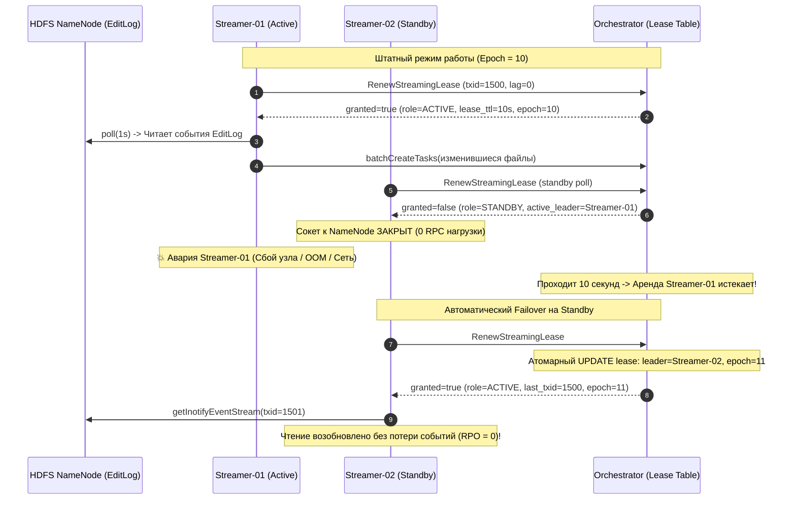
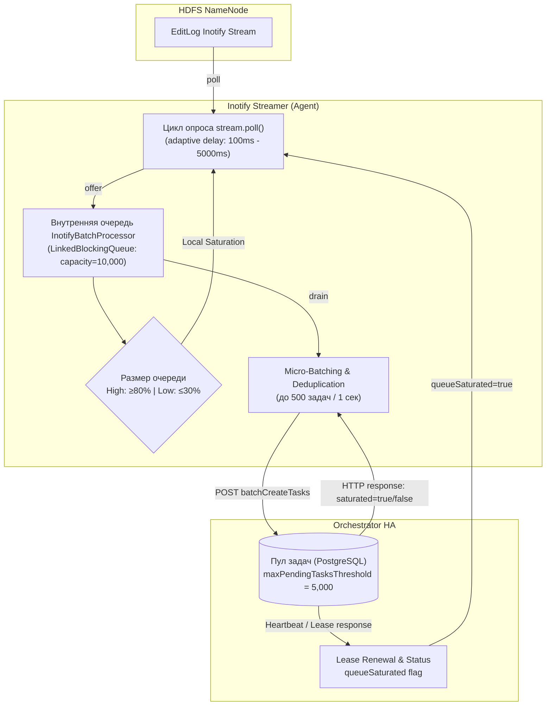
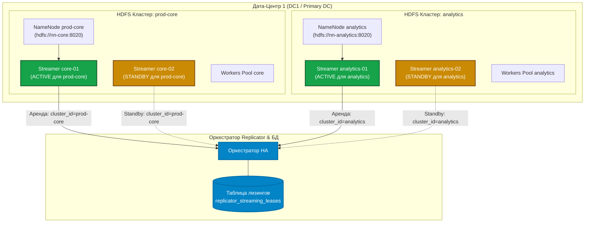
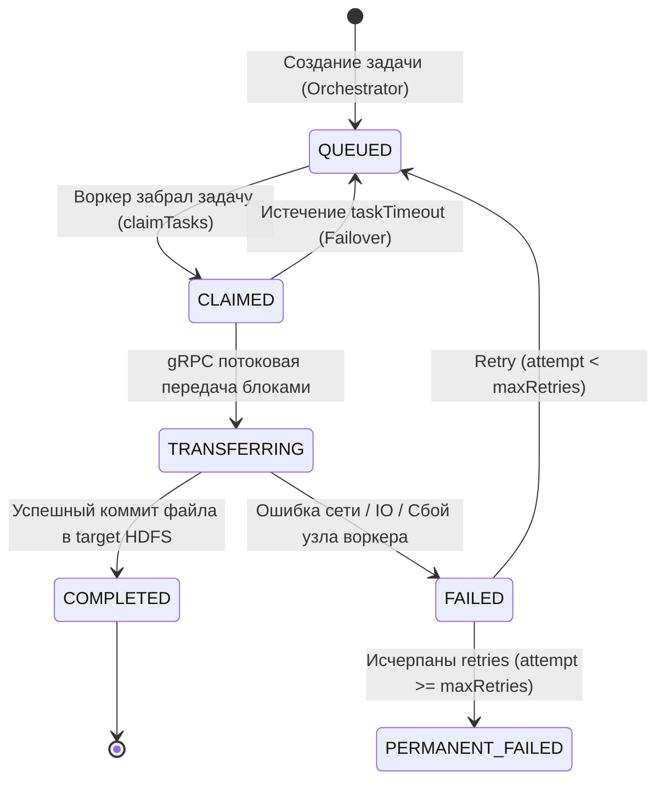
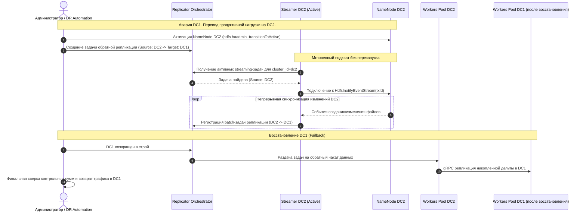
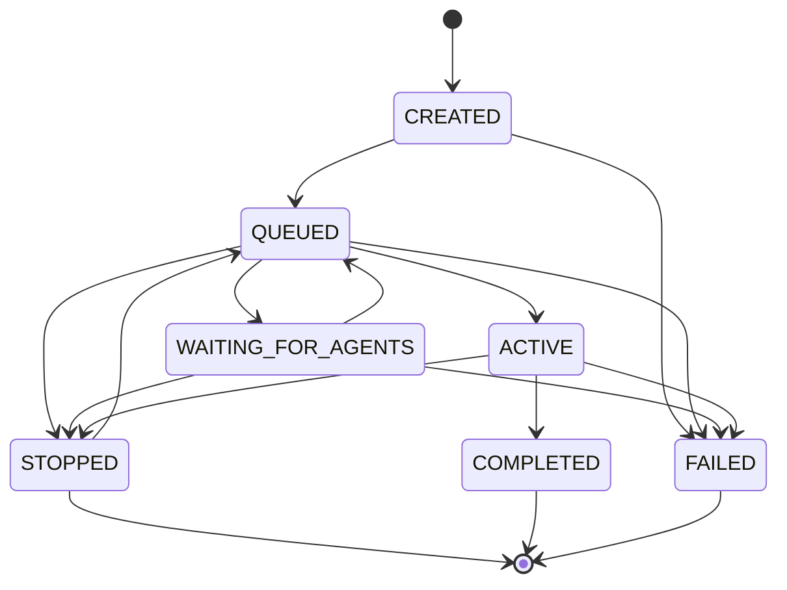

# 🛡️ Отказоустойчивость и высокая доступность (Hadoop gRPC Replicator HA Guide)

Этот документ описывает комплексную архитектуру отказоустойчивости, аварийного восстановления (Disaster Recovery), изоляции привилегий и распределенной координации всех компонентов платформы **Hadoop gRPC Replicator**.

---

## 1. Сводная матрица отказоустойчивости (Global Failure Matrix)

| Компонент | Сценарий сбоя | Механизм обнаружения | Реакция системы и восстановление | RTO (Время восстановления) | RPO (Потеря данных) |
|---|---|---|---|---|---|
| **Orchestrator** | Падение инстанса #1 (OOM, сбой сервера) | L7 Балансировщик (`GET /api/v1/health` таймаут) | Балансировщик переключает HTTP/UI на инстанс #2. ShedLock передает блокировку фоновых планировщиков (шедулеров). | **1–3 сек** | **0** (Stateless API + Shared DB) |
| **PostgreSQL (Orchestrator DB)** | Падение Primary БД | Patroni / etcd кворумный мониторинг | Patroni автоматически повышает Standby реплику до Primary. Пул PgBouncer переподключается. | **3–5 сек** | **0** (Синхронная репликация) |
| **Inotify Streamer (Active)** | Падение процесса стримера (DC1) | Heartbeat Lease Timeout в БД Оркестратора (> 10 сек) | Standby Streamer захватывает лидерство, читает EditLog с `last_committed_txid`. | **5–10 сек** | **0 (Near-Zero RPO)** |
| **Inotify Streamer Pool** | Разрыв истории EditLog (`MissingEventsException`) | Перехват исключения клиентом `DFSInotifyEventInputStream` | Автоматическое продвижение `currentTxid` до актуального и запуск глубокой сверки директорий (`runReconciliationScan`). | **Время сканирования** | **0** (Полная сверка каталогов) |
| **Inotify Streamer / Orchestrator** | Лавина событий EditLog (шторм транзакций / переполнение буфера) | Заполнение буфера событий, отказ добавления | Выброс `InotifyQueueOverflowException`, приостановка продвижения txid, микробатчинг до 500 событий и гистерезис | **0 сек** | **0** |
| **Data Worker (Sender Pool)** | Конкурентный анализ задания несколькими агентами (`mode=all`) | Попытка одновременного перевода в `ANALYZING` | Атомарный SQL CAS (`claimJobForAnalysis`): задачу анализирует ровно один агент, исключая гонки и сброс очередей. | **0 сек** | **0** |
| **Data Worker (Sender)** | Падение воркера во время передачи файла | Пропадание Heartbeat воркера / таймаут задачи | Оркестратор возвращает задачу в статус `QUEUED`. Другой воркер пула берет задачу на повтор. | **По таймауту задачи (60 сек)** | **0** (Повторная передача файла) |
| **Data Receiver** | Отмена передачи клиентом (`CANCELLED`) / сбой узла | Срабатывание `onCancelHandler` / обрыв сети | Принудительная отмена пула коммитеров (`commitFutures.cancel(true)`), немедленное удаление staging-файлов, предотвращение гонок `rename`. | **Мгновенно** | **0** (Атомарный commit в staging) |
| **HDFS NameNode (Source/Target)** | Падение Active NameNode | Hadoop Client `ConfiguredFailoverProxyProvider` | Прозрачный failover клиента на Standby NameNode по виртуальному URI `hdfs://nameservice1`. | **1–3 сек** | **0** (JournalNodes кворум) |
| **HMS Replicator** | Падение агента синхронизации схемы | Истечение Distributed Lease в `HmsCoordinatorService` | Авто-failover задачи на резервный агент кластера. Чтение CDC продолжается с `last_event_id`. | **5–10 сек** | **0** (At-least-once DDL лог) |
| **Kafka Replicator (Data Plane)** | Деградация локального брокера Kafka / переполнение буфера | Задержка подтверждения ack, тайм-аут продюсера | Offload в пул виртуальных потоков Java 21, координация in-flight батчей и onCancelHandler (Netty EventLoop не блокируется) | **0 сек (non-blocking)** | **0 (retry/backpressure)** |
| **gRPC Sender (Outbound Data Plane)** | Деградация сетевого канала WAN / переполнение исходящего буфера Netty | Сигнал `clientCallStreamObserver.isReady() == false` | Приостановка чтения с диска HDFS (`awaitStreamReady`), блокировка отправки чанков до опорожнения TCP/Netty буфера (Zero Heap Overflow) | **0 сек (реактивный backpressure)** | **0** |
| **Token Throttler (Orchestrator)** | Шторм сотен параллельных воркеров при исчерпании токенов маршрута | Конкурентные обращения к RPC `RequestTokens` | Single-Flight дедупликация: ровно один RPC-запрос на маршрут, остальные потоки ожидают локально на `routeRefillLocks` (устранение Thundering Herd) | **0 сек** | **0** |

---

## 2. Отказоустойчивость Оркестратора (Orchestrator HA)

Оркестратор репликации спроектирован как **Stateless вычислительный узел** с внешним распределенным состоянием в отказоустойчивой СУБД PostgreSQL и разделением сетевых плоскостей **Control Plane** (REST + gRPC) и **Data Plane** (межцодовый gRPC).

```mermaid
flowchart TD
    subgraph Clients["👥 Клиенты и агенты"]
        WebUI["💻 Web UI Console (Svelte 5)"]
        AgentsCtrl["⚡ Агенты репликации (Control Plane)"]
        AgentSender["⚡ Agent Sender (DC1)"]
        AgentReceiver["⚡ Agent Receiver (DC2)"]
    end

    subgraph LB["⚖️ Балансировщик нагрузки (High Availability)"]
        VIP_REST["🌐 Keepalived VIP: 8005<br/>(HTTPS / REST: Web UI Console & Admin API)"]
        VIP_GRPC["⚡ gRPC Load Balancer: 50050<br/>(HTTP/2 Control Plane: Task Claim, Heartbeat & Quotas)"]
    end

    subgraph Orchestrators["🎯 Пул инстансов Оркестратора (Active-Active Control Plane)"]
        Orch1["🎯 Replicator Orchestrator #1<br/>• REST API (:8005)<br/>• gRPC Control Plane (:50050)<br/>• [X] ShedLock Leader (Cron & Lease)"]
        Orch2["🎯 Replicator Orchestrator #2<br/>• REST API (:8005)<br/>• gRPC Control Plane (:50050)<br/>• [ ] ShedLock Standby"]
    end

    subgraph DataPlane["🚀 Межцодовый Data Plane (Прямой транспорт без участия оркестратора)"]
        AgentSender -->|gRPC Data Plane :50051 (HDFS) / :50052 (Kafka)<br/>Потоковые батчи, Zstandard/LZ4, Sliding Window, Zero-Copy| AgentReceiver
    end

    subgraph Storage["🗄️ Отказоустойчивое хранилище состояния"]
        PGPrimary[("🐘 PostgreSQL Primary<br/>(Patroni / Master)")]
        PGStandby[("🐘 PostgreSQL Standby<br/>(Streaming Replica)")]
        Etcd["🔐 etcd Кворум (Консенсус Patroni)"]
    end

    WebUI --> VIP_REST
    AgentsCtrl -->|gRPC :50050 (HTTP/2 Control Plane)| VIP_GRPC
    VIP_REST -->|Round-Robin / Failover| Orch1
    VIP_REST -->|Round-Robin / Failover| Orch2
    VIP_GRPC -->|HTTP/2 Round-Robin| Orch1
    VIP_GRPC -->|HTTP/2 Round-Robin| Orch2

    Orch1 --> PGPrimary
    Orch2 --> PGPrimary
    PGPrimary -.->|Синхронная репликация| PGStandby
    Etcd -.->|Мониторинг и Failover| PGPrimary
    Etcd -.->|Мониторинг и Failover| PGStandby
```

### 2.1. Разделение сетевых плоскостей и балансировка запросов
1. **Control Plane (Управление и координация)**:
   - **REST API (порт `:8005`)**: Обслуживает Web UI Console (Svelte 5), эндпоинты Actuator/Prometheus, административный CRUD задач репликации и DR-сценарии. Доступ защищен Keepalived VIP `https://replicator.company.local:8005`.
   - **gRPC Control Plane (порт `:50050`)**: Сервис `OrchestratorControlPlaneService` (`orchestrator_control_plane.proto`). Используется всеми распределенными агентами (HDFS, HMS, Kafka) для легковесной регистрации, периодического heartbeat, захвата задач из очереди (`claimTasks`), подтверждения финализации (`completeTask`), запроса квот Token Bucket (`requestTokens`) и лизинга стримеров без накладных расходов JSON/HTTP.
2. **Data Plane (Межцодовая передача данных)**:
   - Потоковая передача данных (файлы HDFS, виртуальные TAR-архивы, батчи Kafka) идет **напрямую между агентами** (`Agent Sender ➔ Agent Receiver`) через выделенные сокеты gRPC:
     - `:50051` — HDFS Data Plane (`DataTransferService`).
     - `:50052` — Kafka Data Plane (`KafkaDataTransferService`).
   - Оркестратор **не пропускает через себя полезную нагрузку**, что исключает появление «бутылочного горлышка» и гарантирует линейную масштабируемость при гигабитных скоростях WAN.
3. **Stateless сессии**: Аутентификация через JWT-токены (`common-security-starter`), подписанные общим ключом. Запросы любого пользователя или агента могут обрабатываться любым инстансом оркестратора без Sticky Sessions.
4. **Health Monitoring**: Балансировщик опрашивает `GET /actuator/health` или `GET /api/v1/health`. При недоступности инстанса трафик переключается за 1 секунду.

### 2.2. Защита от дублирования шедулеров (ShedLock & Distributed Locks)
Фоновые периодические задачи (Cron Scheduler, проверка брошенных задач HMS, мониторинг офлайн-агентов) защищены распределенными блокировками **ShedLock** на уровне PostgreSQL:
```java
@Scheduled(fixedDelayString = "${hadoop.replicator.hms-failover-check-ms:3000}")
@SchedulerLock(name = "hms_failover_task_lock", lockAtLeastFor = "1s", lockAtMostFor = "10s")
public void checkAndFailoverOrphanedHmsJobs() {
    // Выполняется строго на одном инстансе оркестратора
}
```
Если активный узел упал во время исполнения шедулера, блокировка автоматически освобождается по таймауту `lockAtMostFor`, и второй инстанс подхватывает выполнение следующего тика.

### 2.3. Шардированный шейпер Token Bucket и виртуальные потоки (Zero-Contention QoS)
В высоконагруженных сценариях межЦОДной репликации десятки параллельных воркеров обращаются к сервису шейпинга `POST /api/v1/tokens/request`:
1. **Ликвидация глобального замка**: В `TokenBucketThrottler` исключен глобальный мьютекс на уровне всего оркестратора.
2. **Атомарный расчет на уровне бакета**: Метод `calculateWaitAndConsume` выполняется под гранулярным `ReentrantLock` внутри соответствующего `SingleBucket` (глобального, ЦОД-ЦОД или HDFS-HDFS).
3. **Совместимость с виртуальными потоками Java 21**: Использование `ReentrantLock` вместо синхронизированных секций гарантирует отсутствие Carrier Thread Pinning в Project Loom, позволяя обрабатывать тысячи одновременных запросов токенов без задержек.

### 2.4. Персистентный реестр агентов и Stateless Active-Active Orchestration (RES-01)
Для устранения зависимости от разделяемой оперативной памяти между узлами Оркестратора реестр флота агентов перенесен в реляционную СУБД:
- **Таблица `replication_agents` (`AgentEntity`)**: хранит статус (`ONLINE`, `STALE`, `OFFLINE`), идентификатор кластера, внешний gRPC адрес, отметку последнего heartbeat и метрики нагрузки (`active_transfers`, `transferred_bytes`, `error_count`).
- **Свободная балансировка gRPC**: агент может отправлять heartbeat на любой узел оркестратора через балансировщик L4/L7. Состояние обновляется в общей БД, делая любой экземпляр оркестратора способным назначать задачи и определять доступность воркеров без задержек синхронизации.
- **Оптимизация обращений к БД**: пакетные обновления heartbeat сглаживают нагрузку на пул соединений СУБД при одновременной работе сотен агентов.
- **Решение о живости агента принимается по БД**: свежий heartbeat, принятый локально, имеет приоритет (запись в БД отстает на интервал write-behind), иначе берется отметка `last_heartbeat` из таблицы. Через эту единственную проверку идет failover и HDFS-задач, и HMS-потоков. Прежняя схема судила по локальному полю статуса: узел, который heartbeat этого агента не принимает, считал живого агента офлайновым и переназначал его активные задачи, то есть один и тот же файл передавался дважды.

### 2.5. Кластерное масштабирование и балансировка квот Token Bucket (RES-06)
При горизонтальном масштабировании пула оркестраторов суммарная пропускная способность WAN должна строго соответствовать глобальному SLA:
- **Таблица `bandwidth_limits` (`BandwidthLimitEntity`)**: персистентное хранилище сконфигурированных лимитов пропускной способности.
- **Динамический мониторинг узлов `orchestrator_nodes` (`OrchestratorNodeEntity`)**: отслеживание активных реплик оркестратора с тайм-аутом выявления сбоя.
- **Кластерный координатор `OrchestratorClusterCoordinator`**: делит целевую полосу на количество активных экземпляров оркестратора. Если один из узлов выходит из строя, координатор в течение интервала обнаружения пересчитывает квоты и увеличивает емкость токенов на выживших нодах, исключая просадку общей скорости WAN.

### 2.6. Распределенные блокировки с монотонными Fencing Tokens (RES-07 & RES-08)
Для защиты от гонок и Split-Brain при одновременном выполнении аварийных процедур (Failover, Failback, перехват лизинга):
- **Сервис `DistributedLockService`**: обеспечивает атомарный захват блокировок в таблице `cluster_locks` с генерацией монотонно возрастающего токена (колонка `epoch`). Токен растет при каждой новой аренде и сохраняется при продлении своей; снятие аренды оставляет строку с накопленной эпохой, поэтому счетчик никогда не идет назад. Захват и продление выполняются в собственных транзакциях, так что аренда видна соседним узлам сразу, а не после коммита работы под блокировкой.
- **Защита от зомби-лидеров**: при возникновении задержки (GC пауза, сплит сети) узел с устаревшим токеном блокируется на уровне БД и доменной логики.
- **Атомарность Disaster Recovery**: методы `failoverCluster` и `failbackCluster` в `DisasterRecoveryService` выполняются строго под распределенной блокировкой с проверкой токена ограждения, гарантируя невозможность параллельного исполнения противоположных команд.

---

## 3. Отказоустойчивость потокового стриминга HDFS Inotify (Streamer HA)

Потоковый слушатель транзакций EditLog NameNode (`DFSInotifyEventInputStream`) обеспечивает Near-Zero RPO. Потеря стримера или его зависание недопустимы.

### 3.1. Требование $N \ge 2$ и модель Active-Standby
На кластере источника обязательно развертываются **минимум 2 инстанса стримера** (`streamer-01` и `streamer-02`), но только **один работает в статусе ACTIVE**.



### 3.2. Защита от Split-Brain (Lease Fencing & Epochs)
Для предотвращения ситуации, когда «зависший» старый лидер восстанавливает связь и начинает параллельно слать события:
1. **Client-side Deadline**: Активный стример знает время жизни своей аренды (10 сек). Если в течение 10 секунд он не смог продлить аренду в Оркестраторе, он **обязан немедленно закрыть стрим NameNode**.
2. **Server-side Epoch Guard**: Каждая смена лидера инкрементирует `epoch`. Оркестратор отвергает любые запросы старого лидера с устаревшим токеном эпохи (`409 Conflict: Stale leader epoch`).

### 3.3. Изоляция безопасности (Security Privilege Isolation)
* Стример запускается в строго изолированном режиме: `AGENT_MODE=streamer`.
* **Полная блокировка исполнения задач**:
  * Воркер-цикл заблокирован: агент физически не вызывает `claimTasks`.
  * Приемник заблокирован: gRPC сервер (`:50051`) не открывается.
  * Оркестратор в `TaskService.claimTasks()` возвращает `403 Forbidden` для стримеров.
* Стример владеет привилегированным Kerberos Keytab (`hdfs-streamer@REALM` с правами `supergroup`), но **никогда не касается содержимого пользовательских данных**.

### 3.4. Обработка разрыва EditLog (`MissingEventsException`)
Если оба стримера были недоступны длительное время и NameNode уже удалила старые сегменты EditLog:
1. `stream.poll()` выбрасывает `MissingEventsException(expectedTxid, actualTxid)`.
2. Агент перехватывает исключение и фиксирует статус **`STREAM_GAP_DETECTED`**.
3. Запускается **автоматический Reconciliation Fallback**: фоновый инкрементальный обход каталогов через `analyzeAndCreateTaskPool` для восстановления консистентности.
4. После завершения обхода чтение Inotify возобновляется с `actualTxid`.

### 3.5. Игнорирование Staged-директорий и коммит через `RenameEvent`
Во время записи Spark, Hive и Tez создают временные staging-каталоги (`.hive-staging`, `_temporary`, `.spark-staging`, `.staging`, `.tmp`):
* **Защита от передачи незавершенных попыток**:
  * Любые события `CreateEvent`, `CloseEvent`, `AppendEvent` внутри таких путей **полностью игнорируются** стримером через `HadoopFsManager.isIgnoredPath()`.
  * Незавершенные или отмененные задачи (speculative execution / aborted tasks) не загрязняют целевой кластер и не тратят WAN-трафик.
* **Распознавание коммита (Staged ➔ Committed)**:
  * В момент фиксации коммиттер выполняет `fs.rename(stagedFile, targetFile)`.
  * NameNode генерирует `RenameEvent`.
  * Стример проверяет: `isIgnoredPath(srcPath) == true` и `isIgnoredPath(dstPath) == false`.
  * Стример фиксирует факт **финального коммита** и мгновенно ставит `dstPath` в очередь репликации как готовый файл.

### 3.6. Адаптивный Backpressure и защита от шторма Inotify-событий (Flow Control & Hysteresis)

При пакетной генерации данных (например, завершение тяжелого Spark-пайплайна или массовое удаление устаревших партиций данных) HDFS генерирует колоссальный поток Inotify-транзакций (сотни тысяч событий в секунду). Без регулирования скорости вычитывания стример рискует перегрузить собственную память (OOM) или вызвать переполнение пула задач Оркестратора.

Для предотвращения деградации системы реализован **двухуровневый адаптивный Backpressure с гистерезисом**:



#### Принципы регулирования:
1. **Локальный буфер и микробатчинг (`InotifyBatchProcessor`)**:
   - Очередь задач строго ограничена (`inotifyQueueCapacity = 10 000`).
   - События группируются в микробатчи до `inotifyMaxBatchSize = 500` задач либо сбрасываются по таймеру `inotifyFlushIntervalMs = 1 000 мс`.
   - На уровне батча выполняется автоматическая дедупликация повторных событий для одного и того же пути HDFS.
2. **Гистерезис локального насыщения (High/Low Watermark)**:
   - При заполнении локальной очереди $\ge 80\%$ (`inotifyHighWatermark = 0.8`) процессор взводит флаг насыщения `queueSaturated = true`.
   - Снятие флага насыщения происходит только при падении глубины очереди $\le 30\%$ (`inotifyLowWatermark = 0.3`). Такой гистерезис устраняет дребезг (chattering) и частые переключения частоты опроса.
3. **Обратная связь от Оркестратора (Orchestrator Feedback)**:
   - Оркестратор непрерывно отслеживает количество неразобранных задач в статусе `QUEUED` для каждого кластера.
   - Если количество задач превышает `maxPendingTasksThreshold` (по умолчанию 5 000), ответы `batchCreateTasks`, `renewLease` и `GET /api/v1/tasks/queue-status` возвращают `queueSaturated = true`.
4. **Адаптивная задержка цикла опроса (`HdfsInotifyListener`)**:
   - При обнаружении насыщения (локального буфера или Оркестратора) задержка между вызовами `stream.poll()` прогрессивно увеличивается с шагом 500 мс вплоть до `inotifyBackpressureMaxDelayMs = 5 000 мс`.
   - Перед засыпанием стример выполняет принудительный `flush()` накопившихся событий, освобождая память.
   - При нормализации нагрузки задержка плавно снижается до базовых 100 мс.
5. **Локальный TTL-кэш активных streaming-задач (`cachedStreamingJobs`)**:
   - Для фильтрации путей HDFS (`matchesPath`) стримеру требуется актуальный список активных задач репликации текущего кластера.
   - Вместо выполнения синхронного HTTP GET `/api/v1/jobs` на каждую пачку Inotify-событий стример кэширует список задач локально со сроком жизни 5 секунд (`STREAMING_JOBS_CACHE_TTL_MS = 5000`).
   - Это исключает лавинообразные всплески сотен HTTP-запросов к оркестратору в секунду во время интенсивной генерации файлов в HDFS, гарантируя стабильную работу контрольной панели (Control Plane).

### 3.7. Мультикластерная топология в одном ЦОД: изоляция стримеров по `cluster_id`

В корпоративной инфраструктуре в границах одного дата-центра (например, `dc1`) регулярно сосуществуют несколько независимых HDFS-кластеров: в частности, `prod-core` (транзакционный data lake), `analytics` (витрины данных) и `archive` (холодный архив).



#### Принципы разделения и изоляции:
1. **Каждому кластеру HDFS — свой выделенный пул стримеров**:
   - Inotify работает как сокет-протокол конкретного NameNode выбранного кластера (`dfsClient.getInotifyEventStream()`). У каждого кластера свой EditLog и независимый монотонный счетчик транзакций `txId`.
   - Для каждого кластера запускается собственный отказоустойчивый пул стримеров (минимум 2 инстанса на кластер):
     - Кластер `prod-core`: `CLUSTER_ID=prod-core`, `HADOOP_NAMENODE_RPC_ADDRESS=hdfs://nn-core:8020`.
     - Кластер `analytics`: `CLUSTER_ID=analytics`, `HADOOP_NAMENODE_RPC_ADDRESS=hdfs://nn-analytics:8020`.
2. **Изоляция распределенной аренды (Lease Per Cluster)**:
   - В таблице `replicator_streaming_leases` первичный ключ — `cluster_id`.
   - Запросы на продление аренды разделяются: пул кластера `prod-core` соревнуется за запись `cluster_id='prod-core'`, а пул кластера `analytics` — за запись `cluster_id='analytics'`.
   - Никаких взаимных блокировок, гонок или интерференций между стримерами разных кластеров не происходит.
3. **Маршрутизация и фильтрация событий**:
   - Стример кластера `prod-core` запрашивает у Оркестратора только те задачи репликации, где `source_cluster_id == 'prod-core'`, и отслеживает пути только своего NameNode.
   - Стример кластера `analytics` аналогично обрабатывает только задачи с `source_cluster_id == 'analytics'`.
4. **Безопасность и Kerberos Realms**:
   - Если кластеры используют разные Kerberos Realms или разные Keytabs администраторов HDFS, стримеры каждого пула монтируют соответствующие локальные keytab-файлы для своего NameNode.
5. **Сетевой шейпинг (Hierarchical Token Bucket)**:
   - Несмотря на независимость стримеров, Оркестратор объединяет оба кластера лимитами дата-центра (`dc_limits: dc1 ➔ dc2`) и общим пулом (`global_limit`). При передаче файлов воркерами трафик с обоих кластеров суммируется и никогда не перегружает общую сетевую магистраль ЦОД.

---

## 4. Отказоустойчивость пула воркеров (Data Worker Pool HA)

Воркеры репликации (`AGENT_MODE=worker` или `all`) забирают атомарные задачи на передачу файлов из распределенной очереди Оркестратора.



1. **Динамический пул воркеров**: Воркеры можно свободно масштабировать горизонтально (добавлять и выводить узлы DataNode или YARN-контейнеры) без остановки репликации.
2. **Таймауты задач (`taskTimeoutSeconds = 60`)**: Если воркер взял задачу и пропал (сбой JVM, авария сети), фоновый монитор Оркестратора возвращает задачу в статус `QUEUED`.
3. **Автоматические повторы (`maxTaskRetries = 3`)**: При транзиентных сбоях сети задача передается повторно с экспоненциальной задержкой.
4. **Идемпотентность передачи**: Приемник сохраняет файлы во временный каталог `staging` (`.tmp-transfer-<uuid>`), сверяет размер и контрольную сумму, и только затем выполняет атомарный `rename`.
5. **Атомарный CAS-анализ заданий (Split-Brain Prevention)**:
   - При работе нескольких агентов в режиме `AGENT_MODE=all` исключена конкуренция за анализ заданий в статусе `QUEUED`.
   - Захват задания на анализ выполняется атомарным SQL-запросом `claimJobForAnalysis`:
     ```sql
     UPDATE replicator_job SET status = 'ANALYZING', message = :message, updated_at = :now
     WHERE id = :jobId AND status = 'QUEUED'
     ```
   - Задание захватывает ровно один агент. Остальные агенты получают `updated == 0` и отступают, исключая повторное удаление очередей и уничтожение уже выполняющихся подзадач.

---

## 5. Отказоустойчивость приемников (Receiver HA)

Приемник (`DataTransferServiceImpl`) развертывается на каждом узле кластера назначения:
1. **Динамический выбор узла назначения**: Если целевой агент недоступен по gRPC, Sender запрашивает у Оркестратора альтернативный узел назначения из топологии кластера (`GET /api/v1/clusters/{id}/nodes`).
2. **Специализированный сборщик мусора (`HdfsStagingReaper`)**: При аварийных обрывах соединения, сетевых таймаутах и внезапных перезапусках агентов сервис `HdfsStagingReaper` гарантированно сканирует целевые пути HDFS и локальной ФС, удаляя осиротевшие временные staging-файлы (`*._staging_*`) по критериям `jobId` и возрасту (`olderThanMillis`).
3. **Безопасная отмена gRPC-потока (Cancel Handler & Worker Cancellation)**:
   - В обработчиках `TransferFileObserver` и `TarStreamObserver` зарегистрирован `serverCallStreamObserver.setOnCancelHandler(...)`.
   - При получении сигнала отмены от клиента (`CANCELLED`) или обрыве сети (`onError`):
     1. Выставляется атомарный флаг `cancelled.set(true)`.
     2. Принудительно отменяется задача потоковой распаковки `unpackFuture.cancel(true)`.
     3. Для всех активных параллельных задач записи на целевой HDFS вызывается `fut.cancel(true)`.
     4. Воркеры проверяют флаг отмены перед `writeDirect` и перед `renameFile`, предотвращая появление мусорных файлов и гонки между очисткой staging и финализацией.
     5. Все временные staging-файлы немедленно удаляются из целевой файловой системы.
4. **Отказоустойчивая аутентификация и изоляция Kerberos (`KerberosUgiProvider`)**:
   - Обеспечивает безопасное создание и кэширование контекстов `UserGroupInformation` (UGI) и doAs-имперсонации для аудита в Apache Ranger.
   - Механизм `validatePrincipalSafety` предотвращает Path Traversal и Privilege Escalation атаки под учетными записями `root`, `bin`, `daemon` и др.
   - Реализует многоуровневый fallback для бесшовной работы на современных LTS и будущих версиях Java (включая JDK 21+), где устаревший `Subject.getSubject` ограничен платформой.

---

## 6. Отказоустойчивость синхронизации Hive Metastore (HMS HA)

Синхронизация схем метаданных опирается на распределенный лизинг в `HmsCoordinatorService.java`:
1. **Автоматический Failover брошенных задач**: Фоновый таймер `checkAndFailoverOrphanedHmsJobs()` каждые 3 секунды проверяет статус агентов. Если назначенный агент перешел в `OFFLINE`, аренда сбрасывается и задача переназначается живому агенту.
2. **Гарантия согласованности (Data-First Consistency Barrier)**: DDL-операция для партиции в целевом метасторе применяется **строго после** того, как файлы HDFS гарантированно реплицированы и сопоставлены с целевым диском (размещены на целевом диске).
3. **Пул соединений Thrift с автовосстановлением (Thrift Connection Pool HA)**: Для предотвращения конкуренции за единый сокет в `ThriftHmsClient` реализован пул соединений на базе Apache Commons-Pool2 (`GenericObjectPool<IMetaStoreClient>`). При возникновении `MetaException` или сетевых сбоях неисправное соединение инвалидируется, автоматически извлекается новое валидное соединение, и операция повторяется без сбоя репликации.
4. **Целевая дельта-синхронизация CDC и валидация статусов**: Обработка событий `ADD_PARTITION` извлекает точный список значений затронутых партиций (`partitionValues`) из полезной нагрузки события, исключая тяжелое сканирование всех партиций таблицы. Все ответы целевого агента строго проверяются по флагу `success`, исключая незаметные сбои (Silent Failures).
5. **Изоляция доступа (IDOR Protection) и каскадная очистка**: Управление задачами HMS (`pause`, `resume`, `rebootstrap`, `delete`) защищено проверкой прав владельца задачи (`checkHmsJobAccess`), а при аварийной смене направления (DR Failback) обеспечивается каскадное удаление прямых задач с освобождением всех ресурсов.

---

## 7. Мониторинг, метрики и алерты отказоустойчивости

### Метрики Prometheus / Micrometer

| Метрика | Тип | Описание |
|---|---|---|
| `replicator_streamer_active_count` | Gauge | Количество активных лидеров стриминга (норма: ровно 1 на кластер) |
| `replicator_streamer_standby_count`| Gauge | Количество резервных стримеров в пуле (норма: $\ge 1$) |
| `replicator_streamer_txid_lag`      | Gauge | Отставание стримера от NameNode в количестве транзакций |
| `replicator_orchestrator_ha_leader`| Gauge | Флаг лидера фоновых процессов текущего инстанса (1 или 0) |
| `replicator_worker_claimed_tasks`  | Gauge | Количество задач, находящихся в обработке воркерами |
| `replicator_task_retry_total`      | Counter | Общее количество перезапущенных задач из-за сбоев воркеров |

### Критические алерты (Alerting Rules)

```yaml
groups:
  - name: replicator-ha-alerts
    rules:
      - alert: ReplicatorStreamerNoStandby
        expr: replicator_streamer_standby_count{cluster="dc1"} < 1
        for: 2m
        labels:
          severity: warning
        annotations:
          summary: "Отсутствует резервный Streamer инстанс для кластера {{ $labels.cluster }}"
          description: "В кластере работает только 1 стример. При его падении Near-Zero RPO будет нарушен."

      - alert: ReplicatorStreamerSplitBrainRisk
        expr: replicator_streamer_active_count{cluster="dc1"} > 1
        for: 10s
        labels:
          severity: critical
        annotations:
          summary: "Обнаружен Split-Brain стримеров в кластере {{ $labels.cluster }}"
          description: "Более одного активного стримера читают EditLog одновременно!"

      - alert: ReplicatorStreamerHighLag
        expr: replicator_streamer_txid_lag > 50000
        for: 3m
        labels:
          severity: warning
        annotations:
          summary: "Высокое отставание стримера Inotify (лаг > 50 000 транзакций)"
          description: "Риск переполнения EditLog и выпадения в MissingEventsException."
```

---

## 8. Чек-лист проверки готовности к промышленной эксплуатации (Production HA Checklist)

- [ ] Развернуто минимум **2 инстанса Оркестратора** за балансировщиком нагрузки с Keepalived VIP.
- [ ] База данных PostgreSQL сконфигурирована в режиме HA (Patroni / AWS RDS Multi-AZ).
- [ ] В каждом исходном кластере запущено минимум **2 стримера** (`AGENT_MODE=streamer`) на независимых Edge-нодах.
- [ ] Стримеры используют выделенный Kerberos Keytab суперпользователя и изолированы от исполнения задач (`claimTasks` заблокирован).
- [ ] Параметр `hadoop.replicator.streaming.auto-reconciliation-on-gap` установлен в `true`.
- [ ] Настроены Prometheus-алерты на отсутствие Standby-стримера и лаг транзакций.

---

## 9. Резервирование стримеров во втором ЦОД (DC2 / DR) и обратная синхронизация при Failover

Для обеспечения отказоустойчивости корпоративного уровня (Disaster Recovery) архитектура Replicator поддерживает развертывание стримеров в нескольких дата-центрах (DC1 и DC2) одновременно.

### Архитектура пулов стримеров между ЦОД

Каждый дата-центр обслуживается независимой группой стримеров, привязанных к своему кластеру через `CLUSTER_ID`:

```mermaid
flowchart TB
    subgraph DC1 ["Первичный ЦОД (DC1 / Primary)"]
        NN1["NameNode DC1 (Active)"]
        S1A["Streamer DC1-01 (ACTIVE)"]
        S1B["Streamer DC1-02 (STANDBY)"]
        W1["Workers Pool DC1"]
    end

    subgraph OrchestratorCluster ["Кластер Оркестраторов & БД"]
        ORCH["Orchestrator HA (VIP)"]
        DB[(PostgreSQL)]
        ORCH --- DB
    end

    subgraph DC2 ["Второй ЦОД (DC2 / Disaster Recovery)"]
        NN2["NameNode DC2 (Standby / Target)"]
        S2A["Streamer DC2-01 (ACTIVE для DC2)"]
        S2B["Streamer DC2-02 (STANDBY для DC2)"]
        W2["Workers Pool DC2"]
    end

    NN1 -->|Inotify stream| S1A
    S1A -->|Прямой поток задач DC1->DC2| ORCH
    ORCH -->|Задачи копирования| W1
    W1 -->|gRPC Data Transfer| W2

    NN2 -.->|Inotify stream (Готовность)| S2A
    S2A -.->|Аренда dc2 удерживается (Idle)| ORCH

    classDef active fill:#22c55e,stroke:#15803d,color:#ffffff,stroke-width:2px;
    classDef standby fill:#eab308,stroke:#a16207,color:#ffffff,stroke-width:2px;
    classDef db fill:#0284c7,stroke:#0369a1,color:#ffffff,stroke-width:2px;

    class S1A,S2A active;
    class S1B,S2B standby;
    class DB,ORCH db;
```

### Поведение стримера в DC2 в штатном режиме (Warm Standby)

1. **Независимый лизинг на уровне ЦОД**:
   - В таблице `replicator_streaming_leases` записи ведутся с разделением по ключу `cluster_id` (`dc1` и `dc2`).
   - Стримеры в DC2 соревнуются за лидерство исключительно по ключу `cluster_id="dc2"`. Один из них становится `ACTIVE` для `dc2`, второй — `STANDBY`.
2. **Изоляция потоков событий**:
   - Метод `HdfsInotifyListener` сопоставляет задачи репликации с локальным идентификатором кластера:
     ```java
     boolean matchesCluster(String jobClusterId, String agentClusterId)
     ```
   - В штатном режиме активные задачи репликации имеют `sourceClusterId="dc1"`. Стример в DC2 фильтрует их: для него список локальных задач пуст (`jobs.isEmpty()`).
   - Стример DC2 удерживает лизинг кластера `dc2`, не генерирует сетевых запросов на репликацию и находится в состоянии «горячего резерва» (Warm Standby), непрерывно отслеживая здоровье локального NameNode DC2.

---

### Сценарий аварии DC1 и переключения на DC2 (Failover)

При наступлении аварии в DC1 (отказ оборудования, каналов связи или затопление ЦОД):



### Преимущества запуска стримера во втором ЦОД:

1. **Zero Downtime при Failover**: Не требуется развертывать или переконфигурировать новые процессы стриминга во время аварии — агент в DC2 уже запущен, аутентифицирован по Kerberos и держит соединение.
2. **Мгновенный старт с сохраненного TxID**: При появлении задачи обратной репликации стример начинает чтение EditLog NameNode DC2 с актуальной сохраненной точки.
3. **Безопасность**: Стример в DC2 также работает в изолированном режиме (`AGENT_MODE=streamer`), имеет права только на чтение EditLog своего кластера и не берет на исполнение задачи воркеров (`claimTasks`).

### Конфигурация запуска Streamer для DC2

```bash
# Запуск основного стримера в DC2
export AGENT_MODE=streamer
export CLUSTER_ID=dc2
export HADOOP_STREAMING_ENABLED=true
export HADOOP_NAMENODE_RPC_ADDRESS=hdfs://nn-dc2-01.prod.corp:8020
export KERBEROS_PRINCIPAL=hdfs-streamer/edge-dc2-01.prod.corp@PROD.CORP
export KERBEROS_KEYTAB=/etc/security/keytabs/hdfs-streamer.keytab

java -jar /opt/replicator-agent/replicator-agent.jar
```

---

## 10. Консоль аварийного переключения (DR Console & 1-Click Reverse API)

Для исключения человеческого фактора во время инцидентов платформа оснащена выделенным разделом **Disaster Recovery** в веб-интерфейсе и REST API `/api/v1/dr/*`:

1. **Экстренный останов аварийного кластера (Kill-Switch)**:
   - В один клик переводит все активные задачи упавшего дата-центра в статус `STOPPED`, отключает периодический планировщик и активирует сетевое ограждение (Fencing, лимит канала 0 МБ/с), предотвращая Split-Brain.
2. **Автоматическая инверсия потока данных (1-Click Reverse Replication)**:
   - Создает обратные задачи `DC2 ➔ DC1` для всех каталогов HDFS и баз данных Hive Metastore с сохранением UGI-принципалов и путей, автоматически запуская синхронизацию накопившейся дельты изменений.
3. **Мониторинг отставания дельты (Delta Lag Convergence)**:
   - Отображает объемы несинхронизированных байтов и событий CDC в реальном времени, сигнализируя о моменте достижения RPO = 0 для безопасного возврата продуктивной нагрузки.
4. **Безопасное снятие изоляции без перезаписи данных (Unfence & Failback Protection)**:
   - При восстановлении DC1 выполняется снятие сетевого ограждения (Unfence Network), но прямые задачи остаются остановленными во избежание перезаписи свежих данных на DC2.
   - Детальный пошаговый регламент и архитектурные диаграммы представлены в документе: [Руководство по Disaster Recovery и защите от Split-Brain (replicator-disaster-recovery-guide.md)](replicator-disaster-recovery-guide.md).

---

## 11. Отказоустойчивость Kafka Replicator (At-Least-Once Delivery & Backpressure)

Подсистема **Kafka Replicator** гарантирует непрерывную доставку потоковых данных без потерь (`RPO = 0`) и защиту от деградации памяти при сбоях сети или брокеров.

### 11.1 Механизм At-Least-Once и защита от потери данных

В отличие от стандартных консьюмеров с автокоммитом смещений, в Kafka Replicator смещения партиций коммитятся **строго асинхронно после получения подтверждения от удаленного узла**:

1. Пул воркеров `KafkaBatchConsumerPool` читает батч записей из Kafka-источника без коммита оффсетов.
2. Батч регистрируется в трекере `inFlightBatches` и передается по gRPC Data Plane.
3. Только когда целевой агент подтверждает успешную запись всех сообщений в целевой кластер (`ack.getSuccess() == true`), консьюмер выполняет `commitAsync` для максимальных смещений данного батча.
4. При сбое сети, таймауте gRPC или падении удаленного агента батч не коммитится, и после ребалансировки консьюмер перечитывает сообщения заново (At-Least-Once).

### 11.2 Flow Control и защита от переполнения памяти (Backpressure)

1. **Серверный Backpressure**:
   - `KafkaDataTransferServiceImpl` вызывает `callStream.disableAutoInboundFlowControl()`.
   - Следующий батч запрашивается (`callStream.request(1)`) только после того, как все сообщения текущего батча успешно отправлены и подтверждены локальным `KafkaProducer`.
   - Если локальный кластер Kafka испытывает задержки дискового ввода-вывода или репликации ISR, приемник не запрашивает новые батчи из сети, заставляя TCP-окно и gRPC-канал притормаживать отправителя.

2. **Клиентский Backpressure**:
   - Отправитель ограничивает число одновременно находящихся в транзите батчей (`maxInFlight = 16`).
   - Если лимит достигнут, рабочий поток ожидает освобождения слота перед вызовом `consumer.poll(...)`, предотвращая неконтролируемый рост памяти JVM (OOM).

### 11.3 Локализованный Failover на базе Consistent Hashing (`KafkaTargetBalancer`)

- **Ликвидация каскадного Reshuffle**: В отличие от наивных modulo-балансировщиков (`partition % healthyNodes`), вызывавших перестановку до 75–90% всех партиций при выходе из строя хотя бы одного узла, `KafkaTargetBalancer` использует **Consistent Hashing (Rendezvous / Highest Random Weight Hashing)**.
- **Инвариант минимальных перестановок**: При сбое узла $K$ в карантин (на 10 секунд) перенаправляются **строго $1/M$ партиций**, закрепленных за этим узлом. Все остальные $(M-1)/M$ партиций **на 100% сохраняют привязку к своим целевым агентам**, предотвращая сброс сетевых буферов, пересоздание TCP-соединений и гонки порядков сообщений.
- **Полная обратимость**: При выходе узла $K$ из карантина все его исходные партиции детерминированно возвращаются на него без влияния на другие потоки.
- Если все целевые узлы оказались недоступны, балансировщик производит экстренный сброс карантина для непрерывного перезапуска связи.

### 11.4 Сохранение топологии и критических конфигураций топиков (`KafkaTopicProvisioner`)

При автоматическом создании отсутствующих топиков на целевом кластере оркестратор не просто копирует количество партиций и фактор репликации, но и переносит расширенные конфигурации:
1. **Политика очистки журнала (`cleanup.policy=compact`)**: Критически важно для CDC-потоков (Debezium, ksqlDB, Kafka Streams). Исключает потерю промежуточных состояний ключей при дефолтном retention на целевом брокере.
2. **Фактор надежности (`min.insync.replicas`)**: Гарантирует идентичный уровень отказоустойчивости записи (`acks=all`) на целевом кластере.
3. **Параметры хранения и сжатия**: Реплицируются `retention.ms`, `retention.bytes`, `max.message.bytes`, `compression.type`, `segment.bytes` и динамические переопределения источника (`DYNAMIC_TOPIC_CONFIG`).

### 11.5 Сквозная авторегистрация метаданных схем (`syncSchemaMetadata`)

В распределенных гетерогенных и гомогенных контурах (Confluent Schema Registry, Hortonworks Schema Registry):
1. Метод `syncSchemaMetadata` сервиса `KafkaDataTransferServiceImpl` регистрирует схему в целевом реестре через нативные HTTP-клиенты (`ConfluentRegistryClient`, `HwxRegistryClient`) с поддержкой Kerberos SPNEGO.
2. Полученный локальный идентификатор схемы (`target_schema_id` / `versionId`) возвращается отправителю и кэшируется в двустороннем LRU-кэше `CachedSchemaRegistryResolver`.
3. При передаче последующих сообщений транскодер `ZeroCopyWireTranscoder` подставляет уже зарегистрированный целевой ID в заголовок без задержек на повторные обращения к REST API.

---

## 12. Архитектурная безопасность и периметральная защита (Security Hardening, SSRF & Zero-Trust Control Plane)

Подсистема безопасности оркестратора и распределенных агентов исключает возможность несанкционированного управления потоками репликации, захвата задач и атак на инфраструктуру.

### 12.1 Режим Fail-Closed аутентификации gRPC (`AgentGrpcAuthInterceptor`)

1. **Ликвидация уязвимости Fail-Open**:
   - Ранее при отсутствии или пустом значении `x-agent-secret` вызовы пропускались в систему без авторизации.
   - В новой архитектуре интерцептор работает в режиме **Fail-Closed по умолчанию**: если секрет не сконфигурирован на сервере, входящие вызовы отклоняются со статусом `Status.UNAUTHENTICATED ("Agent authentication is unconfigured (Fail-Closed)")`.
   - Для изолированных локальных тестов предусмотрен явный флаг `allowAnonymous = true`.

2. **Защита от Timing Attack**:
   - Верификация переданного токена агента `X-Agent-Secret` выполняется в constant-time через `MessageDigest.isEqual(...)`, исключая атаку по времени на подбор секретов.

### 12.2 Защита от Server-Side Request Forgery (SSRF Guard)

При регистрации и периодических heartbeat агент сообщает оркестратору свой адрес входящих gRPC соединений (`advertisedGrpcAddress`). Для предотвращения эксплуатации оркестратора как прокси для сканирования внутренней инфраструктуры внедрена многоуровневая валидация:

1. **Синтаксический анализ и проверка портов**:
   - Проверка формата `host:port` с поддержкой IPv6 в квадратных скобках (`[::1]:port`).
   - Допустимы только валидные сетевые порты `1..65535`.
   - Запрещены любые символы инъекций и управляющие последовательности (`matches("^[a-zA-Z0-9.\\-_:]+$")`).

2. **Блокировка облачных эндпоинтов метаданных**:
   - Заблокированы IP-адреса и доменные имена сервисов метаданных (IMDS):
     - AWS / OpenStack / Azure: `169.254.169.254`, `fd00:ec2::254`, `169.254.0.0/16`.
     - Google Cloud Platform: `metadata.google.internal`.
     - Alibaba Cloud: `100.100.100.200`.

3. **Сетевая валидация через `InetAddress`**:
   - Для всех разрешаемых хостов проверяются флаги `isLinkLocalAddress()`, `isMulticastAddress()`, `isAnyLocalAddress()`.
   - Детектируются и блокируются IPv4-mapped IPv6 представления диапазона `169.254.0.0/16` (`::ffff:169.254.x.x`).
   - Валидация выполняется не только при первичной регистрации, но и при каждом периодическом Heartbeat.

### 12.3 Предотвращение захвата кластеров (Cluster Hijacking Prevention)

1. **Иммутабельность кластерной привязки агента**:
   - При попытке зарегистрированного агента сменить свой `clusterId` (как через повторную регистрацию, так и через Heartbeat) система генерирует `SecurityException` и фиксирует инцидент в аудит-логе.
   - Смена кластера допускается строго после авторизованной процедуры снятия с регистрации (`unregister`).

2. **Политика белого списка кластеров (`enforce-cluster-whitelist`)**:
   - При активации настройки `hadoop.replicator.enforce-cluster-whitelist=true` оркестратор проверяет `clusterId` агента по реестру топологии `TopologyRegistry`.
   - Регистрация в неизвестных или произвольных кластерах категорически блокируется, исключая появление неконтролируемых узлов (Rogue Nodes).

### 12.4 Криптографическая аттестация задач (HMAC-SHA256 Task Attestation, SEC-01)
- **Угроза**: Компрометация воркера или перехват gRPC соединений с попыткой записи в неавторизованные каталоги HDFS или подмены doAs Kerberos-принципала.
- **Архитектурная защита**: Сервис `TaskAttestationService` подписывает каноническую строку параметров задачи (`v1|taskId|jobId|targetPath|executionPrincipal|runAsServiceAccount|expiresAt`) с использованием HMAC-SHA256 и общего секрета `agentSecret`.
- **Проверка на приемнике**: Компонент `TaskAttestationValidator` валидирует подпись перед открытием HDFS OutputStream. Любое расхождение пути, принципала или истечение TTL приводит к немедленному отказу `Status.PERMISSION_DENIED`.

### 12.5 Chroot-песочница целевых путей и защита системных файлов ОС (SEC-10)
- **Изоляция локальной ФС**: В `HadoopFsManager.validateSandboxAccess` все локальные файловые пути разрешаются относительно `localSandboxDir` (`REPLICATOR_LOCAL_SANDBOX` / `LOCAL_SANDBOX_DIR`) с проверкой `File.getCanonicalFile()`.
- **Защита от Traversal и Null-Byte**: Пресекаются попытки обхода песочницы через символические ссылки, последовательности `..` и внедрение нулевого байта (`\0`).
- **Блокировка системных директорий и конфиденциальных файлов**: Системные каталоги ОС (`/bin`, `/sbin`, `/usr`, `/etc`, `/proc`, `/sys`, `/dev`, `/root`, системные разделы `/var`) и секреты (`.ssh`, `.gnupg`, `.bashrc`, `.env`, `crontab`) включены в черный список.
- **Независимость проверок от формы URI**: путь разбирается в формах `scheme://host/path`, `scheme:/path` и `scheme:path` с нормализацией точечных сегментов, а явная схема `file:` трактуется как локальная ФС независимо от `fs.defaultFS` — поэтому границы песочницы проверяются и для `file:///...` на кластере с HDFS по умолчанию.
- **Явный отказ read-проб**: `checkFile` и `getDirectoryManifest` отвечают на запрещенный путь статусом `PERMISSION_DENIED`, а не признаком отсутствия файла.
- **Предел распакованного чанка следует из размера чанка**: защита от decompression bomb (`WireCompressor`) считает предел как четыре размера чанка (`CHUNK_SIZE_BYTES`) с границами 1 МБ и 64 МБ. Прежний фиксированный предел 64 МБ был на три порядка выше реального чанка 64 КБ: отправитель объявлял в заголовке размер в тысячу реальных, приемник выделял под него массив, и несколько параллельных потоков съедали heap при формально работающей защите.

### 12.6 Защита Kerberos-стека: изоляция `krb5.conf` и валидация путей (SEC-11 & SEC-15)
- **Устранение глобальной мутации JVM (SEC-11)**: Метод `KafkaSecurityConfigBuilder.initializeKrb5ConfSafely` проверяет системное свойство `java.security.krb5.conf` перед установкой. Если свойство уже задано другим кластером или процессом, перезапись блокируется, что предотвращает разрыв сессий с KDC в гетерогенных окружениях.
- **Проверка легитимности путей (SEC-15)**: Пути keytab и конфигураций Kerberos валидируются на отсутствие traversal-атак и обращений к системным базам паролей.
- **SPNEGO Mutual Auth (SEC-15)**: Поддержка взаимной проверки подлинности Schema Registry через `context.requestMutualAuth(...)`.

### 12.7 Защита от BOLA/IDOR и пагинация API (P0)
- **Контроль доступа к заданиям (BOLA/IDOR)**: Эндпоинты `JobController.getJobRuns` и `TaskController.getTasks` защищены методом `checkJobReadAccess(jobId, auth)`. Пользователям запрещен просмотр структуры файлов и метаданных чужих заданий.
- **Защитная пагинация API**: В `TaskController.getTasks` внедрена обязательная пагинация по умолчанию (`page=0, size=100`, жесткий максимум 1000). Это исключает исчерпание памяти JVM (OutOfMemoryError) при инспекции заданий с миллионами файлов.
- **Скрейп метрик считается агрегатами**: суммы байт, число плановых и ручных заданий, таблицы и партиции HMS, итоги Kafka и количество обратных заданий берутся запросами `sum`/`count`, признак изоляции кластера — из лимитов полосы и снимков ограждения без обращения к заданиям. Прежний рендер вычитывал таблицы заданий целиком около десяти раз за скрейп, то есть на каждом интервале Prometheus. Построчные метрики задач Kafka читаются проекцией с ограничением в 500 строк (итоговые счетчики при этом остаются точными, поскольку считаются агрегатом).
- **Старт узла не читает задания целиком**: дозаполнение истории запусков выбирает задания без запусков порциями по 500 одним запросом вместо полной выборки с запросом количества запусков на каждое задание.
- **Выборка активных задач Kafka для ЦОД** выполняется запросом по статусу и направлению: метод вызывается на каждом обращении агента.
- **Список заданий HDFS отдается страницами**: `GET /api/v1/jobs` принимает `page` и `size` (по умолчанию `page=0, size=100`, жесткий максимум 1000) и возвращает страницу с полем `total_elements`. Фильтры по статусу, автору, поисковой подстроке, владельцу и служебным подзадачам метастора применяются запросом, не в памяти. Правило владельца повторено в условии отбора и сверяется с `JobService.matchesJobOwner` тестом, чтобы расхождение не превратилось в показ чужих заданий.
- **Счетчики и авторы считаются по всему набору**: `GET /api/v1/jobs/summary` отдает `total`, счет по статусам и список авторов одним набором запросов с тем же условием отбора, что у страницы (`JobListingSpecifications` — единственное место, где это условие описано). Интерфейс показывает постраничную навигацию (диапазон `N–M из T`, переходы, выбор размера страницы), а чипы статусов и фильтр по автору остаются счетом по заданиям, а не по загруженной странице.
- **Выборка заданий для агента ограничена**: `GetJobs` контрольного канала отбирает задания по кластеру-источнику запросом с пределом 5000 (превышение пишется в лог). Прежний проход читал таблицу заданий целиком, включая пофайловые подзадачи метастора, и фильтровал по кластеру в памяти — при опросе каждые несколько секунд каждым агентом.
- Остаются непагинированными списки `GET /api/v1/hms/jobs` и `GET /api/v1/kafka/jobs` (записи создаются людьми, таблицы не растут сами) и сводка `getDrStatus`: ее агрегация по маршрутам опирается на нечеткое сопоставление идентификаторов кластеров, которое не переносится в SQL один-в-один.

---

## 13. Высокопроизводительная потоковая обработка и управление противодавлением (Performance, Zero-Copy & Backpressure Architecture)

Для масштабирования репликации на каналы 10G / 40G / 100G / 200G / 400G+ и предотвращения исчерпания памяти (OOM) при асимметрии скоростей чтения с HDFS и медленных WAN-сетей реализован комплекс оптимизаций уровня ядра транспорта.

### 13.1 Исходящий Flow Control и Backpressure в gRPC клиенте (`ReplicationSender`)

В высоконагруженных сценариях при медленном канале связи или сетевых задержках непрерывное чтение данных из исходного HDFS со скоростью сотен мегабайт в секунду способно переполнить сетевые буферы Netty и привести к фатальному `OutOfMemoryError` из-за накопления неотправленных сообщений в оперативной памяти.

1. **Интеграция с `ClientResponseObserver`**:
   - Отправка потоковых чанков файлов (`transferSingleFileWithSync`), потоковых бандлов (`TarChunkingOutputStream`) и прямых стримов файлов переведена на использование `io.grpc.stub.ClientResponseObserver`.
   - В методе жизненного цикла `beforeStart(ClientCallStreamObserver<Req> stream)` регистрируется канонический обработчик готовности `setOnReadyHandler`:
     ```java
     @Override
     public void beforeStart(ClientCallStreamObserver<DataTransferRequest> stream) {
         clientObserverRef.set(stream);
         stream.setOnReadyHandler(() -> {
             synchronized (readyLock) {
                 readyLock.notifyAll();
             }
         });
     }
     ```
2. **Блокирующий шлюз `awaitStreamReady`**:
   - Перед считыванием каждого очередного чанка из HDFS поток проверяет состояние сетевого сокета:
     ```java
     while (!stream.isReady() && !responseFuture.isDone()) {
         readyLock.wait(100);
     }
     ```
   - Если сокет Netty насыщен (`isReady() == false`), поток приостанавливает чтение с диска до тех пор, пока Netty не сбросит накопленный буфер в TCP-сокет и не вызовет `onReadyHandler`.
   - Это гарантирует нулевое накопление буферов в Heap (Heap-Safe Streaming) при любой пропускной способности WAN.

### 13.2 Zero-Copy чтение и запись чанков (`DataTransferServiceImpl`)

1. **Прямой сброс Protobuf ByteString в целевой HDFS**:
   - Для чанков с алгоритмами `COMPRESSION_NONE` и `UNRECOGNIZED` (основной объем данных Parquet, ORC, Snappy, GZ, TAR) полностью исключено промежуточное создание массивов байт `data.toByteArray()`.
   - Сброс в целевой HDFS `OutputStream` выполняется напрямую через `data.writeTo(outputStream)`.
2. **Zero-Copy расчет контрольной суммы SHA-256**:
   - Хеширование выполняется через список доступных буферов `data.asReadOnlyByteBufferList()` без копирования и аллокации промежуточных массивов в куче.
3. **Безопасная декомпрессия (`WireCompressor`)**:
   - Метод `decompress(ByteString, CompressionCodec, int uncompressedSize)` распаковывает данные с предвыделением целевого буфера точного размера, исключая повторные реаллокации.

### 13.3 Неблокирующий Fast-Path и кэш маршрутов в Throttler (`TokenBucketThrottler`)

1. **Lock-Free обновление лимитов**:
   - Параметр `limitBytesPerSec` переведен в `volatile double`.
   - В методе `SingleBucket.updateLimit` внедрен fast-path: при повторном поступлении неизменного значения лимита (`Math.abs(limit - newLimit) < 1e-6`) метод завершается мгновенно без захвата `ReentrantLock`.
2. **Кэширование топологических связок (`RouteBinding`)**:
   - Введен потокобезопасный кэш `ConcurrentHashMap<String, RouteBinding> routeCache`.
   - Разрешение маршрутов (`sourceClusterId -> targetClusterId`) к идентификаторам ЦОД выполняется один раз, исключая постоянные блокировки в `TopologyRegistry` и аллокации строк на каждый пакет токенов.

### 13.4 Паттерн Single-Flight для пополнения пула токенов (`routeRefillLocks`)

При конкурентной передаче десятков файлов между одной парой кластеров исчерпание локального лизинга токенов (порции 2 МБ) ранее приводило к шторму одновременных RPC-запросов к оркестратору (`RequestTokens`).

1. **Дедупликация запросов по маршрутам**:
   - В `ReplicationSender` введена статическая таблица блокировок маршрутов:
     ```java
     private static final ConcurrentHashMap<String, Object> routeRefillLocks = new ConcurrentHashMap<>();
     ```
2. **Double-Checked Locking**:
   - Первый поток, обнаруживший исчерпание токенов, захватывает монитор маршрута и запрашивает пакет у оркестратора.
   - Параллельные потоки блокируются на локальном мониторе. После пополнения пула первым потоком они мгновенно списывают необходимые токены из локальной пачки без отправки паразитных сетевых RPC.
   - Это снижает сетевую нагрузку на Control Plane оркестратора в 10–50 раз при пиковых нагрузках.

### 13.5 Изолированные очереди задач и предотвращение блокировок строк (PERF-03)
- **Проблема**: Конкурентный забор задач воркерами через `SELECT ... FOR UPDATE` по таблице `replication_jobs` приводил к взаимным блокировкам транзакций и снижению производительности при сотнях воркеров.
- **Решение**: Выборка невыполненных задач переведена на изолированные запросы к таблице `replication_tasks` с модификатором `FOR UPDATE SKIP LOCKED`. Воркеры мгновенно забирают свободные строки без ожидания блокировок других транзакций и без удержания строчных локов на уровне родительской сущности `JobEntity`.

### 13.6 HDFS Directory Cache и Two-Phase Staging Commit (PERF-04 & P2)
- **Directory Cache (PERF-04)**: При распаковке TAR-архивов с тысячами мелких файлов `HadoopFsManager` кэширует проверенные каталоги в `directoryCache` и `sessionVerifiedDirs`. Это предотвращает вызовы RPC `fs.mkdirs()` для одних и тех же путей, экономя до 90% нагрузки на NameNode HDFS.
- **Двухфазный Staging-коммит (P2)**: Запись файлов из виртуального TAR-стрима выполняется во временные файлы `._staging_<jobId>` с последующим атомарным `fs.rename()`. Это обеспечивает консистентность: при аварии незавершенные файлы не будут доступны читателям и будут корректно утилизированы демоном `HdfsStagingReaper`.

### 13.7 Адаптивное динамическое масштабирование лизинга токенов для WAN (PERF-05)
- В `ReplicationSender` внедрен адаптивный алгоритм подбора порции токенов (Token Lease Size) в зависимости от наблюдаемой пропускной способности канала и Round-Trip Time (RTT).
- На каналах 10G / 40G / 100G / 200G / 400G+ размер пакета динамически увеличивается, что снижает частоту сетевых RPC к оркестратору до минимума и позволяет полностью утилизировать доступную полосу без пауз.

### 13.8 Дебаунсинг буфера прогресса задач и пакетное завершение (PERF-06)
- **Компонент `JobProgressBuffer`**: Буферизует обновления статусов задач в оперативной памяти с интервалом дебаунсинга 500 мс (или по достижении 1000 записей).
- **Пакетная фиксация `batchCompleteTasks`**: Завершение сотен задач выполняется за одну транзакцию в СУБД, снимая пиковую нагрузку с пула соединений HikariCP и исключая деградацию базы данных при репликации миллионов мелких файлов.

### 13.9 Виртуальные потоки Java 21 в Netty Receiver и выделенный распаковщик TAR (P0 & P1)
- **gRPC Netty Receiver (P0)**: Входящий Netty gRPC сервер переведен на виртуальные потоки Java 21 (`Executors.newVirtualThreadPerTaskExecutor()`). Блокирующий ввод-вывод при приеме потоков не приводит к исчерпанию пула потоков ОС.
- **Выделенный TAR Unpack Executor (P1)**: Потоковая распаковка виртуальных TAR-стримов изолирована в пул виртуальных потоков `tarUnpackExecutor` (`tar-stream-unpacker-*`). Это исключает замедление других задач и системного пула `ForkJoinPool.commonPool()`.

### 13.10 Lock-Free Schema Registry Caching & Zero-Allocation Transcoding (PERF-02 & P2)
- **Single-Flight Resolution**: Резолюция схем Confluent / Hortonworks кэшируется в потокобезопасной структуре на базе `ConcurrentHashMap`. Повторные запросы одной и той же схемы схлопываются, предотвращая шквал обращений к Schema Registry.
- **Иммутабельный Zero-Copy транскодинг (P2)**: Замена идентификатора схемы в 5-байтном заголовке Confluent Wire Format в `ZeroCopyWireTranscoder` по умолчанию работает с защитной копией `.clone()`, исключая случайную мутацию данных в кэшах, а для высоконагруженных участков доступен метод `transcodeInPlace`.

### 13.11 Адаптивный параллелизм Kafka Consumer Pool и согласование емкости агентов
- **Линейный сайзинг без потолка 40 GBit/s**: целевое количество потоков вычитки Kafka рассчитывается по формуле $\text{targetTotalThreads} = \max(64, \lceil \text{bandwidthMbS} / 30.0 \rceil)$ с динамическим масштабированием микробатчей от 10k до 50k сообщений (до 16 МБ) для сетей 100G/200G/400G+.
- **Защитный потолок per-node**: на уровне отдельной JVM агента установлен защитный лимит $\le 32$ потоков во избежание истощения сетевых сокетов брокеров и конкуренции CPU.
- **Согласование емкости пула агентов**: эффективный лимит вычисляется как $\min(\text{wanQuotaMbS}, \sum \text{agentConfiguredBandwidthMbS})$. Оркестратор не моделирует физику хостов (4x25G, L3 бондинг), а учитывает явно сконфигурированный DevOps лимит процесса `--max-bandwidth-mb-s` (`AGENT_MAX_BANDWIDTH_MB_S`).
- **Изоляция брокерного ISR**: репликация ISR между брокерами Kafka внутри дата-центра вынесена на локальные сетевые интерфейсы (2x25G) и полностью исключена из расчетов межЦОДного WAN HTB.
- **Динамический резолвинг топологии**: адреса брокеров Kafka разрешаются по `clusterId` через `TopologyRegistry` без зашитых дефолтных констант (`defaultValue = "DC1"` ликвидирован; обязательная валидация параметра `clusterId`).

---

## 14. Отказоустойчивость и барьеры согласованности репликации Hive Metastore (HMS Replicator Hardening)

Репликация метаданных Hive Metastore (HMS) связывает логические DDL-описания таблиц и партиций с физическими файлами данных в HDFS. Для исключения повреждения каталогов, рассогласования состояний и блокировок конвейера реализован комплекс отказоустойчивых механизмов.

### 14.1 Матрица состояний и строгий конечный автомат (FSM) задачи (`HmsJobStatus`)

Жизненный цикл задачи репликации формализован строгим конечным автоматом с белым списком допустимых переходов `ALLOWED_TRANSITIONS`:



- Любая попытка невалидного перехода (например, из терминального `COMPLETED` в `ACTIVE`) немедленно пресекается `IllegalStateException` на уровне доменной модели `HmsReplicationJobEntity` и контроллера.
- Повторные переходы в то же самое состояние (идемпотентность) разрешены без генерации ошибок.

### 14.2 Барьер согласованности "Данные прежде схемы" (Data-First Consistency Barrier)

Классическая проблема асинхронной репликации Lakehouse — опережающее создание таблицы или партиции в целевом Hive Metastore до завершения физического копирования файлов в HDFS, что приводит к чтению неполных или пустых данных аналитическими движками (Trino, Spark, Hive).

1. **Координация зависимостей HDFS и HMS**:
   - При создании DDL-задачи репликации агент связывает создание сущности с идентификатором фоновой задачи копирования данных HDFS (`subjobId`).
2. **Синхронный барьер `awaitSubjobCompletion`**:
   - В `OrchestratorGrpcClient` реализован метод `awaitSubjobCompletion(subjobId, timeoutSeconds)`.
   - В `HmsTaskExecutor` перед вызовами `applyTable` и `applyPartitionBatch` агент запрашивает статус HDFS-подзадачи. Создание сущностей в целевом HMS выполняется **строго после** перехода подзадачи в статус `COMPLETED`.
   - В случае ошибки HDFS-задачи (`FAILED`) операция DDL отменяется, предотвращая появление "фантомных" пустых партиций.

### 14.3 Карантин и Dead-Letter Queue (DLQ) для ядовитых CDC DDL-событий

При потоковой репликации событий Hive Notification Log синтаксически некорректные или неподдерживаемые целевым кластером DDL (например, специфичные SerDe, недоступные форматы хранения, ошибки прав) ранее приводили к бесконечному циклу ретраев и полному зависанию репликации всей БД.

1. **Изоляция после `maxEventRetries` (по умолчанию 3)**:
   - В `HmsTaskExecutor` ведется счетчик сбоев `eventFailureCounts` для каждого `eventId`.
   - При превышении порога событие маркируется статусом `"DLQ_ISOLATED"`, а информация о сбое отправляется в Оркестратор в цикле `updateJobProgress`.
   - Курсор CDC продвигается дальше (`lastEventId = event.getEventId()`), исключая зависание конвейера репликации базы данных.
2. **Персистентность и аудит (`HmsDeadLetterEventEntity`)**:
   - Оркестратор сохраняет проблемные события в таблицу `HmsDeadLetterEventEntity` с полным контекстом: `jobId`, `eventId`, `eventType`, `dbName`, `tableName`, `errorMessage`, `eventPayloadJson`.
3. **Операционный REST API**:
   - `GET /api/v1/hms/jobs/{id}/dlq` — просмотр очереди отравленных событий с фильтрацией по статусу (`NEW`, `IGNORED`, `REPLAYED`).
   - `POST /api/v1/hms/jobs/{id}/dlq/{dlqId}/skip` — подтверждение пропуска события оператором.
   - `POST /api/v1/hms/jobs/{id}/dlq/{dlqId}/replay` — принудительный перезапуск применения события после устранения причины в целевом кластере.

### 14.4 Preemptive Fencing и предотвращение Split-Brain при катастрофах (Disaster Recovery)

В случае переключения нагрузки на резервный ЦОД (Disaster Recovery Failover) критически важно мгновенно нейтрализовать агентов в старом первичном ЦОД, чтобы исключить конкурентную запись (Split-Brain).

1. **Preemptive Fencing в управляющем цикле**:
   - При переводе задачи в статус `STOPPED` (например, оператором или автоматикой DR) оркестратор возвращает `false` на все последующие вызовы `updateJobProgress`.
2. **Немедленное прерывание на агенте**:
   - `HmsTaskExecutor` проверяет результат отчета прогресса. При получении `false` агент немедленно выставляет флаг `jobFencedFlags.put(jobId, true)` и прерывает фоновые потоки Bootstrap и CDC.
   - Лизинг на задачу аннулируется, предотвращая отправку устаревших изменений.

### 14.5 Детектор дрейфа схем и сверка метаданных (Schema Drift Detector)

Расхождения схем находит агент источника: он единственный видит и свой метастор, и метастор приемника (через gRPC `GetMetadataSnapshot`). Сравнение выполняется `HmsSchemaDriftDetector` **перед применением DDL** по каждой таблице — именно тогда видно, что на приемнике было до переноса: ручная правка схемы или отставание от источника. После применения таблицы совпадают по построению, и сравнивать нечего.

1. **Что сравнивается**:
   - тип таблицы (`EXTERNAL_TABLE` / `MANAGED_TABLE`);
   - состав колонок и их типы (с нормализацией синонимов типов);
   - ключи партиционирования (`partitionKeys`);
   - формат хранения (`InputFormat`, `OutputFormat`) и библиотека SerDe.
2. **Куда попадает результат**:
   - найденные расхождения агент присылает записью журнала задачи со статусом `SCHEMA_DRIFT` (список расхождений — в поле сообщения);
   - расхождение не останавливает перенос: DDL применяется и приводит таблицу к схеме источника, а запись в журнале остается следом того, что было исправлено;
   - `GET /api/v1/hms/jobs/{id}/drift` возвращает последнюю запись по каждой таблице в виде `HmsSchemaDriftReport` (`db_name`, `table_name`, `has_drift`, `discrepancies`, `checked_at`). Пустой ответ означает, что расхождений в журнале задачи нет, а не что сверка не делается.

---

## 15. Хаос-тестирование, стресс-верификация и устойчивость к пиковым нагрузкам (Chaos & Stress Engineering)

В рамках Фазы 5 платформа покрыта специализированными наборами тестов хаос-инженерии (`ReplicatorChaosResilienceTest`, `OrchestratorChaosResilienceTest`) и экстремальных стресс-нагрузок (`ReplicatorHighConcurrencyStressTest`), верифицирующими поведение системы в условиях жестких аварий инфраструктуры.

### 15.1 Матрица хаос-сценариев и верификации

| Компонент | Симулируемый аварийный сценарий | Тестовый класс | Результат и поведение системы |
|---|---|---|---|
| **Data Receiver (gRPC)** | Внезапный обрыв WAN TCP-соединения (`CANCELLED` / `UNAVAILABLE`) посреди передачи файла | `ReplicatorChaosResilienceTest` | Недописанный целевой файл не коммитится, срабатывает `cleanup()`, `HdfsStagingReaper` гарантированно удаляет временные `._staging_<jobId>` файлы. |
| **Data Receiver (gRPC)** | Аварийный разрыв сокета во время распаковки потокового виртуального TAR-стрима | `ReplicatorChaosResilienceTest` | Немедленное освобождение семафора `tarStreamSemaphore`, разрыв конвейера `PipedOutputStream` без утечек потоков и памяти; сервер готов принимать следующий стрим. |
| **TarStreamPipeline (Sender)** | Сетевой сбой канала передачи пакета мелких файлов на недоступный узел | `ReplicatorChaosResilienceTest` | Откат передачи, фиксация ошибки и автоматическая отправка структурированного отчета `failTask` в Оркестратор. |
| **Orchestrator Task Service** | Внезапная смерть воркера (Worker Death) во время выполнения задачи в статусе `RUNNING` | `OrchestratorChaosResilienceTest` | Авто-обнаружение по таймауту heartbeat, перевод агента в `OFFLINE`, эвакуация задачи в `QUEUED`, изоляция сбойного узла (`lastFailedAgentId`) и перехват задачи резервным агентом кластера. |
| **Circuit Breaker (Tasks)** | Исчерпание максимального числа попыток передачи (`retryCount >= maxRetries`) | `OrchestratorChaosResilienceTest` | Атомарный перевод задачи в `FAILED`, фиксация ошибки задания в `FAILED`, обновление счетчика `failedObjects`. |
| **Token Bucket Throttler** | Шторм конкурентных запросов полосы пропускания (20 параллельных потоков) | `OrchestratorChaosResilienceTest` | Атомарное бесконфликтное списание токенов под `ReentrantLock` без thread pinning на виртуальных потоках Java 21, строго монотонный расчет задержки. |
| **Agent Registry** | Конкурентный шторм регистраций и heartbeat (30 параллельных агентов) | `OrchestratorChaosResilienceTest` | Безопасная конкурентная регистрация в `ConcurrentHashMap`, сохранение консистентности метрик латентности и коэффициентов сжатия. |
| **Tar Stream Engine** | Потоковая передача 500+ мелких файлов во вложенных каталогах с проверкой контрольных сумм | `ReplicatorHighConcurrencyStressTest` | 100% сохранение контента и прав, отсутствие остаточных staging-файлов, корректная финализация задания. |
| **OOM Backpressure Protection** | Превышение лимита параллельных TAR-стримов (`maxConcurrentTarStreams = 2`) | `ReplicatorHighConcurrencyStressTest` | Быстрый защитный отказ с сообщением о перегрузке пула памяти распаковки, освобождение слота сразу после завершения активного потока. |
| **Wire Compressor** | Экстремальная компрессия 10 000 чанков LZ4/ZSTD и защита от битых данных | `ReplicatorHighConcurrencyStressTest` | Стабильная пропускная способность, корректная детекция и выброс исключений при получении поврежденных блоков. |

### 15.2 Архитектура OOM Backpressure и защиты памяти

Для предотвращения исчерпания памяти при шторме входящих TAR-стримов на узлах-приемниках внедрена двухконтурная защита:
1. **Семафорный лимитер `tarStreamSemaphore`**: жестко ограничивает число одновременно распаковываемых стримов на узле (`maxConcurrentTarStreams`, по умолчанию 16).
2. **Конфигурируемый таймаут ожидания `tarStreamAcquireTimeoutMs`**: если в течение заданного интервала слот памяти не освобождается, удаленному агенту возвращается защитный отказ без создания буферов в куче JVM.
3. **Ограничение конвейера in-flight коммитов**: внутри каждого стрима размер буфера `tarPipeBufferBytes` фиксирован, а параллелизм коммита в HDFS ограничен пулом `bundleCommitExecutor` с дополнительным барьером `fileCommitLimiter`.

---

## 16. Отказоустойчивость и безопасность подсистемы Kafka Replicator

Подсистема потоковой репликации очередей Apache Kafka (`kafka-replicator-agent`) спроектирована для работы в режиме 24/7 под пиковой нагрузкой до 1 000 000 сообщений в секунду с аппаратной защитой от сетевых сбоев, перегрузок брокеров и отказов отдельных воркеров.

### 16.1 Динамическая клиентская балансировка и автоматический карантин узлов (`KafkaTargetBalancer`)

1. **Multi-Agent Partition-Pinned Load Balancing**:
   - Каждая задача репликации получает **свою** группу консьюмеров `kafka-replicator-<dc>-<jobId>` и свой пул консьюмеров с собственным списком целевых эндпоинтов. Прежняя схема с единым `group.id` на весь демон означала, что задачи делили партиции и перезапуск или остановка одной задачи вызывал ребаланс у остальных, а маршрутизация топиков уходила не к тем приемникам.
   - Внутри группы партиции распределяются встроенным балансировщиком Kafka, а привязка партиции к конкретному узлу-приемнику выполняется консистентным хешированием (HRW), поэтому порядок записей партиции сохраняется и при смене состава приемников.
2. **Автоматический карантин сбойных узлов (Quarantine & Health Recovery)**:
   - При возникновении сетевой ошибки или падении приемника целевой узел временно изолируется в карантин (по умолчанию на 10 секунд).
   - Балансировщик мгновенно исключает изолированный узел из пула активных адресов и перенаправляет поток батчей на здоровые узлы без остановки репликации и потери сообщений.
   - По истечении интервала карантина узел плавно возвращается в ротацию при условии успешного прохождения healthcheck-запросов.
3. **Автодискавери топологии через Оркестратор**:
   - Список онлайн-приемников запрашивается по REST API Оркестратора (`GET /api/v1/replicator/kafka/agents/receivers?clusterId={clusterId}`). При масштабировании пула приемников новые узлы подхватываются отправителями на лету.

### 16.2 Двусторонний потоковый Backpressure и защита от OOM

1. **Серверный Backpressure (gRPC Flow Control)**:
   - В реализации `KafkaDataTransferServiceImpl` отключен автоматический входящий поток (`disableAutoInboundFlowControl()`).
   - Сервер открывает скользящее окно на `pipelineWindow` батчей (по умолчанию 16) и запрашивает следующий (`request(1)`) по мере подтверждения очередного: окно убирает задержку stop-and-wait на WAN, но не дает клиенту заполнить heap приемника.
   - Порядок записей одной партиции при этом сохраняется: отправка батчей партиции выстроена в цепочку в `KafkaBatchProducer`, иначе конвейер мог записать батч с меньшими оффсетами после батча с большими.
2. **Клиентский Backpressure (In-Flight Batch Throttle)**:
   - Пул консьюмеров `KafkaBatchConsumerPool` отслеживает окно незавершенных пакетов (`inFlightBatches`). При достижении лимита (по умолчанию 16 батчей на поток) вычитка из исходного топика блокируется, предотвращая переполнение кучи JVM (OOM).

### 16.3 Семантика доставки At-Least-Once и надежное подтверждение оффсетов

1. **Коммит только непрерывного префикса**:
   - Оффсет партиции продвигается строго до конца непрерывно подтвержденной последовательности батчей. Неподтвержденный батч (`success=false`, обрыв стрима) блокирует коммит всех последующих: иначе записи между ними терялись бы безвозвратно, поскольку при перезапуске консьюмер начал бы читать уже за ними.
   - Неуспешный батч переотправляется; после исчерпания попыток он уходит в DLQ, и только тогда оффсет сдвигается. Без настроенного DLQ-обработчика фиксация оффсетов партиции останавливается — репликация встает, но не теряет данные.
   - При ребалансе группы подтвержденный префикс фиксируется синхронно, а состояние отозванных партиций сбрасывается: их батчи ack уже не получат. При остановке пула подтвержденные оффсеты фиксируются синхронно до закрытия консьюмера, потому что `commitAsync` без последующего `poll` до брокера не доходит.

2. **Сквозная цепочка подтверждений (End-to-End Acks)**:
   - Оффсет вычитанного сообщения в кластере-источнике коммитится в системный топик `__consumer_offsets` (`commitSync`) строго после получения `KafkaBatchAck(status = OK)` от целевого агента.
   - Целевой агент отправляет `KafkaBatchAck` только после того, как все записи батча успешно сохранены на диск брокерами целевого кластера с кворумом `acks=all` (или `min.insync.replicas`).
3. **Идемпотентность и предотвращение дубликатов**:
   - При аварийном перезапуске агента-отправителя вычитка возобновляется с последнего зафиксированного оффсета.
   - Продюсер целевого кластера сконфигурирован с флагом `enable.idempotence=true`, исключая появление дубликатов сообщений на стороне брокера при сетевых ретраях.

### 16.4 Защита Schema Registry от эффекта Thundering Herd

> [!NOTE]
> Слой работает, когда демону заданы адреса **обоих** реестров схем
> (`--source-schema-registry-url` и `--target-schema-registry-url`). Если реестры не настроены,
> демон переносит идентификаторы схем как есть (passthrough) — безопасное поведение при
> совпадающих идентификаторах в кластерах. Резолвер получают и отправитель, и приемник.

1. **Lock-Free кэш схем данных**:
   - Разрешение идентификаторов схем Avro/Protobuf/JSON кэшируется в потокобезопасной структуре `ConcurrentHashMap`.
2. **Паттерн Single-Flight Resolution**:
   - При одновременном поступлении тысяч сообщений с новой схемой в Schema Registry отправляется ровно один HTTP-запрос. Все остальные потоки ожидают результат через `CompletableFuture`, защищая Schema Registry от эффекта Thundering Herd при рестарте задач.
3. **Zero-Copy транскодер (`ZeroCopyWireTranscoder`)**:
   - Замена 5-байтного заголовка Schema ID в теле сообщения производится без аллокации промежуточных массивов байт, обеспечивая нулевую нагрузку на сборщик мусора G1GC на скоростях свыше 1M msg/s.

