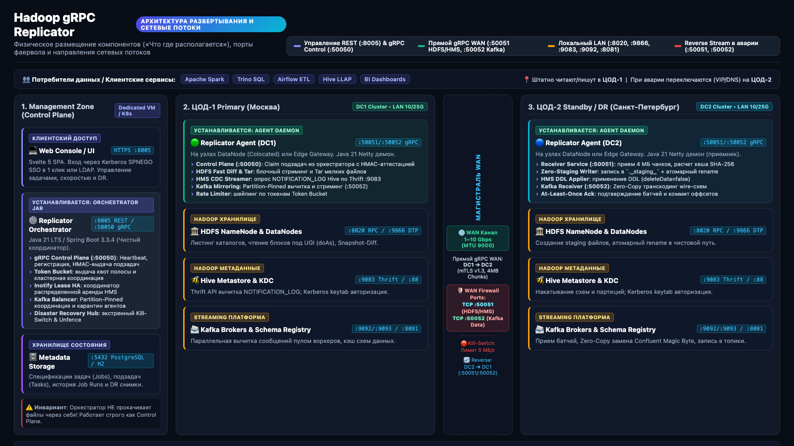
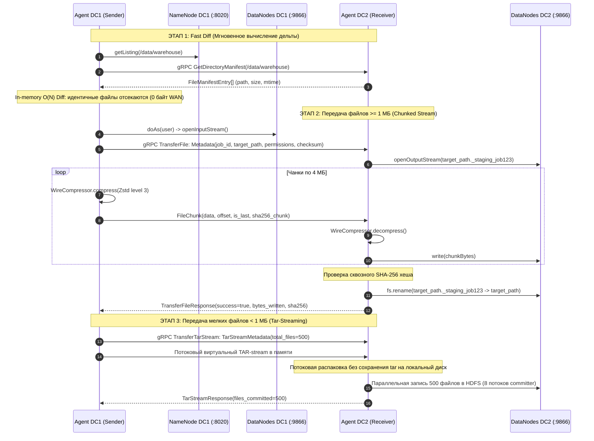
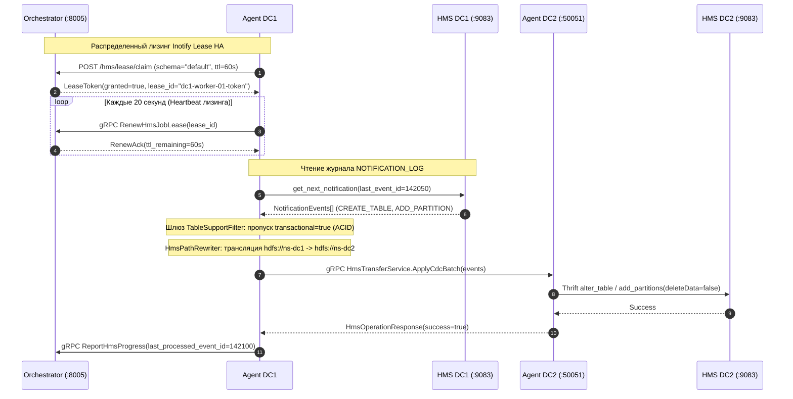
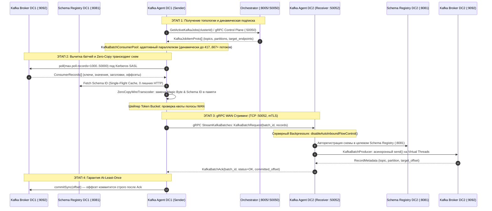
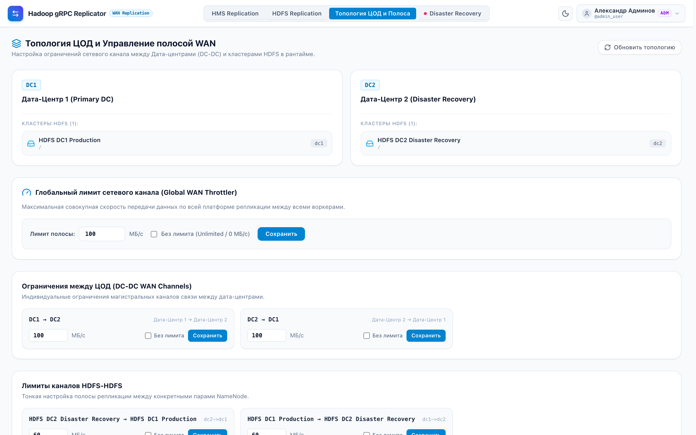
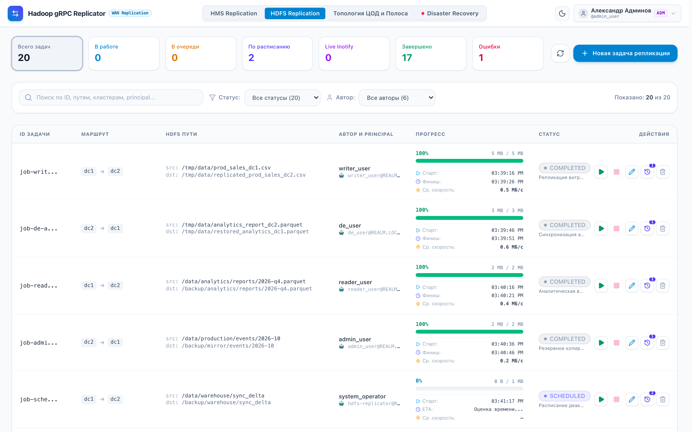
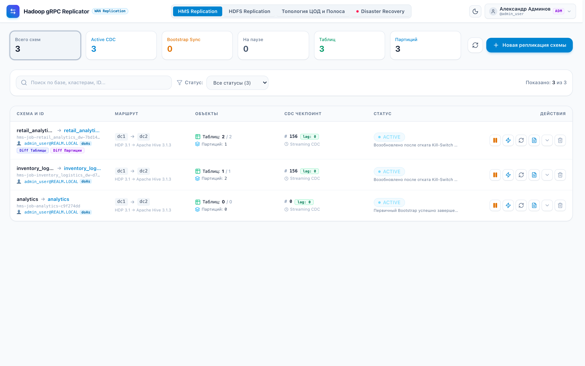
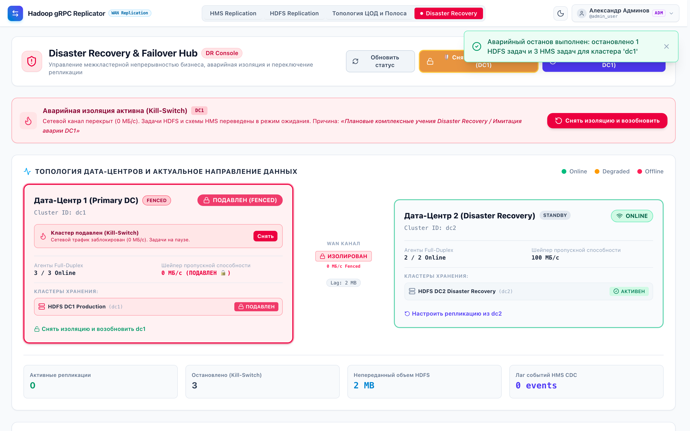
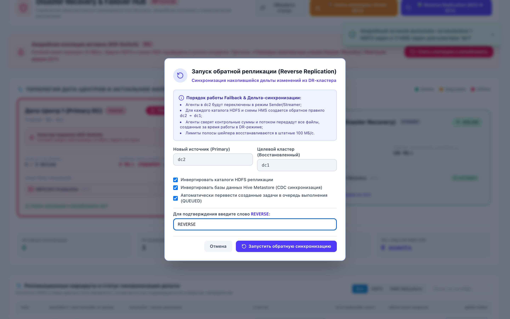

# Техническая спецификация и архитектура: Hadoop gRPC Replicator
## Для системных архитекторов, DevOps-инженеров и администраторов Data Platform

<div align="center">
  
  <p>Архитектура, сетевые протоколы, шейпинг и Disaster Recovery</p>
  <p><a href="replicator-presentation.html">Слайдовая презентация в браузере (HTML)</a> &nbsp;|&nbsp; <a href="replicator-presentation.pdf">PDF-версия</a> &nbsp;|&nbsp; <a href="#содержание-инженерных-разделов">Содержание</a></p>
</div>

---

## Содержание инженерных разделов

1. [Слайд 1: Генеральная схема развертывания: что где располагается (топология и сетевые потоки)](#слайд-1-генеральная-схема-развертывания-что-где-располагается-топология-и-сетевые-потоки)
2. [Слайд 2: Спецификация компонентов платформы, роли хостов и инварианты](#слайд-2-спецификация-компонентов-платформы-роли-хостов-и-инварианты)
3. [Слайд 3: Модель развертывания, параметры CLI и конфигурация процессов](#слайд-3-модель-развертывания-параметры-cli-и-конфигурация-процессов)
4. [Слайд 4: Сетевая матрица портов, правила фаервола и L4/L7 протоколы](#слайд-4-сетевая-матрица-портов-правила-фаервола-и-l4l7-протоколы)
5. [Слайд 5: Протокол HDFS Data Plane: wire-формат, чанкирование и Zero-Staging](#слайд-5-протокол-hdfs-data-plane-wire-формат-чанкирование-и-zero-staging)
6. [Слайд 6: Алгоритм сетевого шейпинга: иерархический Token Bucket](#слайд-6-алгоритм-сетевого-шейпинга-иерархический-token-bucket)
7. [Слайд 7: Протокол Hive Metastore CDC, распределенный лизинг и Non-ACID Gate](#слайд-7-протокол-hive-metastore-cdc-распределенный-лизинг-и-non-acid-gate)
8. [Слайд 8: Потоковая репликация Apache Kafka (Kafka Streaming Data Plane & Mirroring)](#слайд-8-потоковая-репликация-apache-kafka-kafka-streaming-data-plane--mirroring)
9. [Слайд 9: Безопасность, Kerberos Impersonation (doAs) и Apache Ranger Audit](#слайд-9-безопасность-kerberos-impersonation-doas-и-apache-ranger-audit)
10. [Слайд 10: SRE Runbook: авария основного ЦОД и сетевое ограждение (Fencing Kill-Switch)](#слайд-10-sre-runbook-авария-основного-цод-и-сетевое-ограждение-fencing-kill-switch)
11. [Слайд 11: SRE Runbook: восстановление, безопасный Unfence и Reverse Replication](#слайд-11-sre-runbook-восстановление-безопасный-unfence-и-reverse-replication)
12. [Слайд 12: Управление платформой в Web UI: топология, задачи, HMS, Kafka и DR Hub](#слайд-12-управление-платформой-в-web-ui-топология-задачи-hms-kafka-и-dr-hub)
13. [Слайд 13: Наблюдаемость (Observability): метрики Prometheus, healthcheck и алерты](#слайд-13-наблюдаемость-observability-метрики-prometheus-healthcheck-и-алерты)
14. [Слайд 14: Сайзинг оборудования, тюнинг ОС Linux, JVM и траблшутинг](#слайд-14-сайзинг-оборудования-тюнинг-ос-linux-jvm-и-траблшутинг)

---

## Слайд 1: Генеральная схема развертывания: что где располагается (топология и сетевые потоки)

<div align="center">
  
  <p><em>Генеральная архитектура: порты Control Plane (TCP :8005 / :50050), межЦОДного WAN Data Plane (TCP :50051 / :50052) и кластерного LAN</em></p>
</div>

### Физические контуры и направления трафика

1. Контур потребителей данных (clients / workloads):
   - аналитические движки (Apache Spark, Trino SQL, Airflow ETL, BI-дашборды, Hive LLAP);
   - в штатном режиме работают только с ЦОД-1 Primary (Москва);
   - в аварийном режиме (DR) переключаются на ЦОД-2 Standby (Санкт-Петербург) сменой DNS/VIP или конфигураций JDBC/HDFS.
2. Контур управления (Management Zone / Control Plane):
   - разворачивается на выделенной виртуальной машине или в Kubernetes Pod в управляющем сегменте сети (Management VLAN);
   - устанавливается `hadoop-grpc-replicator-orchestrator.jar` (Spring Boot 3.3.4, Java 21, `TCP :8005` и `TCP :50050`);
   - на порту `:8005` — REST API и веб-консоль (Kerberos SPNEGO SSO, LDAP, RBAC), на порту `:50050` — gRPC Control Plane (`orchestrator_control_plane.proto`);
   - состояние хранится в PostgreSQL 14+ (`TCP :5432` / Patroni HA): реестр агентов `replication_agents` (`AgentEntity`), таблица лимитов `bandwidth_limits` и блокировки `cluster_locks` с монотонными fencing-токенами;
   - stateless Active-Active: несколько реплик оркестратора работают одновременно без локального состояния в памяти; квоты Token Bucket между ними распределяет `OrchestratorClusterCoordinator`;
   - общается с агентами обоих ЦОД по gRPC Control Plane (`:50050`) и REST API (`:8005`): регистрация агентов, heartbeat каждые 3–5 с, выдача подзадач с HMAC-подписью, распределенная аренда Inotify Lease HA;
   - инвариант: оркестратор не пропускает через себя байты файлов, он координирует только метаданные.
3. Контур ЦОД-1 Primary (Москва):
   - устанавливаются демоны `hadoop-grpc-replicator-agent.jar` (HDFS/HMS) и `kafka-replicator-agent` (Kafka Streaming Data Plane);
   - варианты размещения: на узлах Hadoop DataNode и брокерах Kafka (colocated) либо на выделенных серверах Edge Gateway;
   - в LAN ЦОД-1 (10/25 Gbps) агенты обращаются к сервисам:
     - NameNode (`TCP :8020/:9000`) — структура директорий, списки файлов и снапшоты (`SnapshotDiffReport`);
     - DataNodes (`TCP :9866`) — чтение блоков HDFS по SASL Data Transfer Protocol от имени пользователя (`doAs`);
     - Hive Metastore (`TCP :9083 Thrift`) — периодический опрос таблицы `NOTIFICATION_LOG` для вычитки DDL/DML-событий;
     - Kafka Brokers (`TCP :9092/:9093`) — параллельная вычитка сообщений пулом `KafkaBatchConsumerPool` с Kerberos SASL;
     - Schema Registry (`TCP :8081`) — схемы данных Avro/Protobuf/JSON;
     - Kerberos KDC (`TCP/UDP :88`) — аутентификация по keytab;
   - локальные файловые пути ограничены chroot-песочницей `localSandboxDir` (`REPLICATOR_LOCAL_SANDBOX`), системные каталоги ОС заблокированы (`FORBIDDEN_OS_PREFIXES`).
4. Магистраль WAN между ЦОД (Москва ➔ Санкт-Петербург):
   - в межсетевом экране открыты только порты `TCP :50051` (HDFS/HMS gRPC) и `TCP :50052` (Kafka Data Plane gRPC, mTLS v1.3, MTU 9000);
   - данные идут напрямую peer-to-peer от агента DC1 к агенту DC2, минуя оркестратор и внутренние кластерные порты;
   - скорость канала ограничивает шейпер Token Bucket; размер порции токенов подстраивается под RTT и пропускную способность WAN (Adaptive Token Lease Scaling);
   - при аварии включается сетевой Kill-Switch: полоса сбрасывается в 0 МБ/с, монотонный fencing-токен отсекает команды от отставших участников (защита от split-brain).
5. Контур ЦОД-2 Standby / DR (Санкт-Петербург):
   - устанавливаются демоны `hadoop-grpc-replicator-agent.jar` (приемник HDFS/HMS на `:50051`) и `kafka-replicator-agent` (приемник Kafka на `:50052`);
   - слушают входящие порты `TCP :50051` и `TCP :50052`; серверы Netty работают на виртуальных потоках Java 21 (`Executors.newVirtualThreadPerTaskExecutor()`);
   - проверяют HMAC-SHA256-подпись задачи (`TaskAttestationValidator`) перед созданием целевых файлов;
   - принимают чанки данных HDFS по 4 МБ, считают SHA-256 на лету и пишут во временные файлы `._staging_<jobId>` локальной HDFS (`TCP :9866`);
   - если контрольная сумма совпала, вызывают атомарный `fs.rename()` в целевой путь через NameNode DC2 (`TCP :8020`);
   - мелкие файлы распаковывают из потокового TAR-стрима в пуле виртуальных потоков `tarUnpackExecutor` с двухфазным коммитом и кэшем каталогов NameNode `directoryCache` (до 90% меньше RPC);
   - принимают пакеты Hive DDL, переписывают URI путей NameService и применяют схему в локальном Hive Metastore DC2 (`TCP :9083`) с флагом `deleteData=false`;
   - принимают батчи Kafka на `TCP :50052`, транскодируют заголовки схем (`ZeroCopyWireTranscoder`), регистрируют схемы в целевом Schema Registry (`:8081`) и асинхронно пишут сообщения в локальную Kafka (`TCP :9092/:9093`) через `KafkaBatchProducer`.

---

## Слайд 2: Спецификация компонентов платформы, роли хостов и инварианты

### Назначение и стек технологий

`Hadoop gRPC Replicator` — сервис межкластерной репликации файлов HDFS, метаданных Hive Metastore (HMS CDC) и очередей Apache Kafka между изолированными ЦОД (on-premises, private cloud, hybrid cloud) с ограничением полосы WAN и защитой от split-brain.

| Параметр | Control Plane (оркестратор) | Data Plane (агенты репликации) |
| :--- | :--- | :--- |
| Бинарный пакет | `hadoop-grpc-replicator-orchestrator.jar` | `hadoop-grpc-replicator-agent.jar` |
| Среда исполнения | Java 21 LTS (Spring Boot 3.3.4) | Java 21 LTS (Netty 4.1 на Virtual Threads, tarUnpackExecutor) |
| Сетевые интерфейсы | `TCP :8005` (REST, SSE, Web UI), `TCP :50050` (gRPC Control Plane) | `TCP :50051` (gRPC HDFS/HMS), `TCP :50052` (Kafka Data Plane) |
| База метаданных | PostgreSQL 14+ (`replication_agents`, `bandwidth_limits`, `cluster_locks`) | Нет (stateless-воркеры) |
| Аутентификация | Kerberos SPNEGO SSO, LDAP Bind, JWT HttpOnly, Agent Secret | Kerberos keytab (`hdfs.headless.keytab`), mTLS x509, HMAC Attestation |
| Целевые системы | Браузеры операторов, Prometheus scraper | Hadoop 3.x (RPC :8020/:9000, DTP :9866), Hive Metastore (:9083), Kafka |

### Архитектурные инварианты

1. Control Plane и Data Plane разделены:
   - оркестратор только координирует: планирует задачи, учитывает воркеров, распределяет квоты полосы Token Bucket и аренду HMS Lease;
   - байты файлов и DDL-пакеты через оркестратор не проходят.
2. Агенты обмениваются данными по WAN напрямую (peer-to-peer):
   - HDFS/HMS-данные идут между демонами `replicator-agent-dc1` и `replicator-agent-dc2` через порт `TCP :50051`;
   - для HDFS/HMS в фаерволе между ЦОД открывается один порт, Kafka использует отдельный `TCP :50052`. Кластерные порты Hadoop (NameNode, DataNodes) наружу не выставляются.
3. Stateless-воркеры и Active-Active оркестратор:
   - агенты не сохраняют состояние задач на диск. Реестр агентов хранится в БД (`replication_agents`), поэтому оркестраторы работают в пуле Active-Active, а токены между ними распределяет `OrchestratorClusterCoordinator`.
4. Запись через staging и двухфазный коммит (Zero-Staging):
   - файлы на приемнике не перезаписываются напрямую. Запись идет в `._staging_*` и только после проверки SHA-256 атомарно переименовывается в NameNode. TAR-бандлы мелких файлов коммитятся в две фазы; незавершенные staging-файлы удаляет `HdfsStagingReaper`.
5. HMAC-SHA256-аттестация задач:
   - `TaskAttestationService` подписывает каждую подзадачу при выдаче воркеру. Приемник проверяет HMAC перед записью в HDFS через `TaskAttestationValidator`, поэтому подменить целевой путь или doAs-принципал нельзя.
6. Chroot-песочница и защита ОС:
   - локальные файловые пути проверяются относительно `localSandboxDir` (`REPLICATOR_LOCAL_SANDBOX`); symlink traversal, null byte и системные пути Linux/macOS блокируются.

---

## Слайд 3: Модель развертывания, параметры CLI и конфигурация процессов

### Параметры запуска Replicator Orchestrator

```bash
# Запуск Orchestrator как systemd-сервиса или в Docker-контейнере
java -Xms4g -Xmx8g -XX:+UseG1GC \
  -Dserver.port=8005 \
  -Dspring.datasource.url=jdbc:postgresql://postgres.infra:5432/replicator_db \
  -Dspring.datasource.username=replicator_app \
  -Dspring.datasource.password=${DB_PASSWORD} \
  -jar replicator-orchestrator.jar
```

### Параметры запуска Replicator Agent (CLI)

Точка входа: `org.apache.hadoop.explorer.replicator.agent.ReplicatorAgentMain`.

| Параметр CLI | Переменная окружения | По умолчанию | Что делает |
| :--- | :--- | :--- | :--- |
| `-id`, `--agent-id` | `AGENT_ID` | `hostname` | Уникальный идентификатор агента в реестре |
| `-c`, `--cluster-id` | `CLUSTER_ID` | `default` | ID обслуживаемого HDFS-кластера (`dc1` или `dc2`) |
| `-m`, `--mode` | `AGENT_MODE` | `all` | Режим работы демона: `all` (sender+receiver), `sender`, `receiver` |
| `-o`, `--orchestrator`| `ORCHESTRATOR_URL` | `http://localhost:8005` | URL оркестратора для регистрации и heartbeat |
| `-p`, `--port` | `AGENT_RECEIVER_PORT`| `50051` | Порт локального gRPC Netty-сервера для входящего WAN-трафика |
| `-b`, `--bandwidth`, `--max-bandwidth-mb-s` | `AGENT_MAX_BANDWIDTH_MB_S` / `AGENT_MAX_BANDWIDTH` | `0` (unlimited) | Локальный лимит процесса агента в МБ/с. Передается оркестратору в heartbeat (`configuredBandwidthMbS`) для расчета суммарной емкости пула |
| `-s`, `--staging-dir` | `AGENT_STAGING_DIR` | `/tmp/staging` | Локальный каталог временных метаданных staging |
| `-z`, `--compression` | `WIRE_COMPRESSION` | `zstd` | Алгоритм сжатия потока в канале WAN: `zstd`, `lz4`, `none` |
| `-zl`, `--compression-level` | `ZSTD_LEVEL` | `3` | Уровень сжатия Zstandard (от 1 до 22; баланс CPU и сети — 3) |
| — | `REPLICATOR_AGENT_SECRET` | — | Общий секрет взаимной аутентификации агента и оркестратора (токен x-agent-secret) |
| — | `REPLICATOR_LOCAL_SANDBOX` | `/tmp/sandbox` | Корневой каталог chroot-песочницы локальной ФС с защитой системных путей ОС (SEC-10) |
| — | `REPLICATOR_ENFORCE_TASK_ATTESTATION` | `true` | Обязательная проверка HMAC-токена задачи перед записью в HDFS |

### Размещение агентов: colocated или выделенный шлюз

| Характеристика | Colocated (на узлах DataNode) | Выделенный Edge Gateway |
| :--- | :--- | :--- |
| Физическое размещение | Устанавливается на физические DataNode кластера | Выделенные 2–4 сервера в стойке с 25G / 40G / 100G+ NIC |
| Локальность данных | Short-Circuit Local Read (чтение блоков напрямую с дисков узла) | Чтение блоков по LAN ЦОД (DTP RPC) |
| Нагрузка на LAN ЦОД | 0 байт дополнительного трафика в сети ЦОД | Двойная прокачка (чтение из DataNode + отправка в WAN) |
| Влияние на Hadoop | Потребляет 2-4 vCPU и 4-8 GB RAM на узле DataNode | Не занимает ресурсы узлов Hadoop |
| Когда выбирать | Есть запас по дисковому I/O на DataNode | Политики ИБ запрещают ставить сторонние процессы на серверы Hadoop |

---

## Слайд 4: Сетевая матрица портов, правила фаервола и L4/L7 протоколы

### Сетевая матрица для NetOps и информационной безопасности

| Сетевой сегмент | Источник | Назначение | Протокол L4 / L7 | Порт | Описание потока трафика |
| :--- | :--- | :--- | :--- | :--- | :--- |
| WAN (между ЦОД) | `Agent DC1` | `Agent DC2` | TCP / gRPC (mTLS v1.3) | 50051 | Прямой стриминг чанков HDFS и пакетов DDL Hive CDC |
| WAN (между ЦОД) | `Agent DC2` | `Agent DC1` | TCP / gRPC (mTLS v1.3) | 50051 | Обратный поток при Reverse Replication в сценарии DR |
| WAN (между ЦОД) | `Kafka Agent DC1` | `Kafka Agent DC2` | TCP / gRPC (mTLS v1.3) | 50052 | Потоковая репликация батчей Kafka, zero-copy транскодинг схем |
| WAN (между ЦОД) | `Kafka Agent DC2` | `Kafka Agent DC1` | TCP / gRPC (mTLS v1.3) | 50052 | Обратный поток репликации Kafka при Reverse Replication в DR |
| Corporate LAN | Браузер оператора | `Orchestrator` | TCP / HTTPS (TLS 1.3) | 8005 | Web UI (Svelte 5), REST API, SSE-подписки |
| Management LAN | Агенты DC1/DC2 | `Orchestrator` | TCP / gRPC (HTTP/2) | 50050 | Control Plane: heartbeat, захват задач с HMAC, квоты токенов |
| Management LAN | Агенты DC1/DC2 | `Orchestrator` | TCP / HTTP REST | 8005 | Резервный REST-канал, опрос топологии, healthcheck |
| DC LAN (Primary) | `Agent DC1` | `NameNode DC1` | TCP / Hadoop RPC | 8020 / 9000 | Листинг каталогов, получение блочных манифестов |
| DC LAN (Primary) | `Agent DC1` | `DataNodes DC1`| TCP / SASL DTP | 9866 | Блочное чтение данных под Kerberos UGI (`doAs`) |
| DC LAN (Primary) | `Agent DC1` | `Hive Metastore 1`| TCP / Thrift RPC | 9083 | Опрос журнала `NOTIFICATION_LOG` Hive Metastore |
| DC LAN (Primary) | `Kafka Agent DC1` | `Kafka Brokers 1` | TCP / Kafka Protocol | 9092 / 9093 | Вычитка сообщений пулом `KafkaBatchConsumerPool` (SASL/SSL) |
| DC LAN (Primary) | `Kafka Agent DC1` | `Schema Registry 1` | TCP / HTTP(S) | 8081 | Выгрузка схем данных (Avro / Protobuf / JSON) |
| DC LAN (Standby) | `Agent DC2` | `NameNode DC2` | TCP / Hadoop RPC | 8020 / 9000 | Создание каталогов, атомарный `fs.rename()` |
| DC LAN (Standby) | `Agent DC2` | `DataNodes DC2`| TCP / SASL DTP | 9866 | Запись блоков данных в целевую HDFS |
| DC LAN (Standby) | `Agent DC2` | `Hive Metastore 2`| TCP / Thrift RPC | 9083 | Применение DDL-изменений схемы (`deleteData=false`) |
| DC LAN (Standby) | `Kafka Agent DC2` | `Kafka Brokers 2` | TCP / Kafka Protocol | 9092 / 9093 | Асинхронная запись пакетов `KafkaBatchProducer` на Virtual Threads |
| DC LAN (Standby) | `Kafka Agent DC2` | `Schema Registry 2` | TCP / HTTP(S) | 8081 | Авторегистрация и трансляция Schema ID в целевом реестре |
| DC LAN (оба ЦОД) | Агенты DC1/DC2 | `Kerberos KDC` | TCP/UDP / Kerberos | 88 | Получение TGT по системному keytab |

### Сетевые рекомендации

- Jumbo frames (MTU 9000): включите MTU 9000 на межЦОДной магистрали — на 4-мегабайтных чанках и streaming-пакетах Kafka это уменьшает число кадров и прерываний сетевой карты.
- Изоляция портов: в межсетевом экране WAN открываются только порты `50051` (HDFS/HMS) и `50052` (Kafka Streaming). Внутренние порты брокеров Kafka (`9092/9093`) и Hadoop (`9000`, `9866`, `9083`, `88`) наружу не выставляются.

---

## Слайд 5: Протокол HDFS Data Plane: wire-формат, чанкирование и Zero-Staging

### Жизненный цикл передачи данных



### Механизмы Data Plane

1. Zero-Staging:
   - приемник `Agent DC2` пишет входящий поток прямо в целевой HDFS во временный файл `<targetPath>._staging_<jobId>`;
   - локальный диск приемника под буферизацию не используется, лишних циклов чтения/записи на NVMe/SATA нет.
2. Атомарное переименование и двухфазный TAR-коммит:
   - временный файл `._staging_<jobId>` переименовывается в `<targetPath>` вызовом HDFS RPC `fs.rename()` — в NameNode это атомарное обновление дерева метаданных, поэтому читатели не видят неполный файл;
   - мелкие файлы из виртуального TAR-стрима распаковываются пулом виртуальных потоков `tarUnpackExecutor` с двухфазным staging-коммитом: сбой воркера не оставляет в каталоге частично записанных файлов.
3. Кэш каталогов NameNode (PERF-04):
   - `HadoopFsManager` держит потокобезопасный LRU-кэш проверенных каталогов `directoryCache` и не вызывает `mkdirs` повторно для родительских папок; нагрузка на NameNode RPC снижается на 85–92%.
4. Очистка staging (Safe Staging Reaper, RES-03, SEC-03):
   - в `DataTransferServiceImpl` работает метод `cleanOrphanedStaging(ttlMillis)`;
   - раз в 15 минут сканируются известные целевые директории; перед удалением проверяется `DistributedFileSystem.isFileClosed(path)`, чтобы не удалить файл медленной, но живой передачи. Пути нормализуются против path traversal (`..`).
5. Транскодинг Kafka wire-формата без аллокаций (PERF-02, P2):
   - кэш схем на `ConcurrentHashMap` с single-flight: одновременные запросы одной схемы в Schema Registry схлопываются в один;
   - `ZeroCopyWireTranscoder` заменяет 5-байтный заголовок Confluent Schema ID без промежуточных аллокаций; по умолчанию работает с копией (`.clone()`), исходный массив не изменяется.

---

## Слайд 6: Алгоритм сетевого шейпинга: иерархический Token Bucket

### Пирамида лимитов

Шейпинг реализован в приложении на уровне буферов Netty по алгоритму Hierarchical Token Bucket (HTB), без системных `tc/iptables`:

```
[Глобальный лимит платформы (Global Limit)] = 200 МБ/с
       │
       ├──► [Канал DC1 ➔ DC2 (Inter-DC WAN)] = 150 МБ/с
       │         │
       │         ├──► Класс HDFS: до 60% лимита канала (90 МБ/с)
       │         ├──► Класс Kafka: до 40% лимита канала (60 МБ/с)
       │         └──► Пара HDFS-кластеров: отдельная корзина, если для пары source/target задан лимит
       │
       └──► [Канал DC2 ➔ DC1 (Reverse WAN / DR)] = 50 МБ/с (в штатном режиме)
```

### Троттлинг в агенте (`LocalBandwidthLimiter`)

1. Пополнение токенов: при каждом вызове `reserve`/`throttle` корзина пополняется на `прошедшее время × лимит` (по `System.nanoTime()`). Емкость корзины равна `лимит × burstSeconds` (по умолчанию `burstSeconds = 0.5`, то есть всплеск не больше половины секундного лимита).
2. Запрос квоты (`throttle(bytes)`): перед отправкой каждого чанка агент вызывает `limiter.throttle(chunkSize)`.
3. Ожидание без spin-lock: если токенов меньше размера чанка, `reserve` вычисляет время ожидания `дефицит / лимит`, а `throttle` засыпает на это время через `Thread.sleep(millis, nanos)`.
4. Разделение канала между HDFS и Kafka: приоритетных очередей в агенте нет. В оркестраторе `TokenBucketThrottler` внутри канала DC-DC ведет отдельные корзины классов трафика: HDFS ограничен 60% лимита канала, Kafka — 40%. Неиспользованную долю другой класс не забирает: ожидание равно максимуму по всем корзинам (глобальная, DC-DC, класс, пара HDFS-кластеров).
5. Изменение лимита на лету: лимит агентам не рассылается. `PUT /api/v1/tokens/limit` сохраняет глобальный лимит в `bandwidth_limits` и применяет его в `TokenBucketThrottler` принявшего запрос экземпляра оркестратора; остальные экземпляры подхватывают его из БД в цикле `OrchestratorClusterCoordinator` (каждые 5 с). Агент получает новый лимит неявно: в ответе на следующий gRPC `RequestTokens` приходит время ожидания, рассчитанное по новому лимиту. Перезапуск агентов не нужен.
6. Распределение квот между экземплярами оркестратора (RES-06): таблица `bandwidth_limits` и `OrchestratorClusterCoordinator` делят глобальные лимиты между активными экземплярами (`orchestrator_nodes`), так что при сбое или добавлении экземпляра суммарный лимит не меняется.
7. Адаптивный размер порции токенов (PERF-05): агент подбирает размер порции по RTT и скорости WAN, чтобы на магистралях 10G / 40G / 100G / 200G / 400G+ передача не ждала ответов Control Plane.
8. Модель полосы агентов и WAN HTB: оркестратор не моделирует физическую сетевую топологию хостов (4x25G, L3-бондинг, маршрутизацию интерфейсов), а сводит квоту WAN HTB и заданный оператором лимит процесса `--max-bandwidth-mb-s` (`AGENT_MAX_BANDWIDTH_MB_S`). Эффективная полоса пула агентов: $\min(\text{wanQuotaMbS}, \sum \text{agentConfiguredBandwidthMbS})$, то есть не выше ни квоты WAN, ни суммы лимитов хостов.
9. Трафик ISR брокеров: межброкерная синхронизация реплик Kafka (ISR) идет внутри ЦОД по выделенным локальным адаптерам (например, 2x25G) и в расчет WAN HTB не входит.

---

## Слайд 7: Протокол Hive Metastore CDC, распределенный лизинг и Non-ACID Gate

### Вычитка и применение изменений каталога Hive



### Правила репликации метаданных

- Распределенная аренда Inotify Lease HA и epoch fencing (RES-02):
  - поток событий конкретной БД в кластере читает ровно один воркер;
  - каждая аренда несет монотонную эпоху (`epoch`). События от отставшего стримера отклоняются сразу и не откатывают состояние транзакции (устранена ловушка rollback-only);
  - если воркер не шлет heartbeat дольше 60 секунд, аренда освобождается, и другой живой агент продолжает чтение с сохраненной позиции.
- Non-ACID Gate (`TableSupportFilter`):
  - таблицы с `'transactional'='true'` (Hive full ACID с delta-файлами) пропускаются: копирование их каталогов на лету до compaction нарушает транзакционную целостность.
- Трансляция Federation NameService (`HmsPathRewriter`):
  - пути схем и партиций (`sdLocation`) переписываются с пространства имен источника на пространство имен приемника (`hdfs://ns-dc1/apps/hive/...` ➔ `hdfs://ns-dc2/apps/hive/...`).
- Защита от удаления данных (`deleteData=false`):
  - при репликации `DROP_TABLE` и `DROP_PARTITION` в целевой вызов Thrift API всегда передается `deleteData=false`. Метаданные удаляются, файлы в HDFS остаются.
- doAs и политики Ranger в Hive Thrift-клиенте (SEC-06):
  - вызовы Thrift API к удаленному HMS выполняются в контексте пользователя через `UGI.doAs`, поэтому Apache Ranger применяет политики этого пользователя и пишет его в аудит.

---

## Слайд 8: Потоковая репликация Apache Kafka (Kafka Streaming Data Plane & Mirroring)

### Зеркалирование топиков и транскодинг схем



### Механизмы потокового Data Plane

1. Распределение партиций между агентами (multi-agent partition-pinned load balancing):
   - консистентное хеширование топиков и номеров партиций распределяет нагрузку по пулу агентов-отправителей с единым `group.id`, чтобы одну партицию не вычитывали дважды и потоки не блокировали друг друга;
   - на стороне отправителя `KafkaTargetBalancer` выбирает приемник; список приемников берется у оркестратора (`/api/v1/replicator/kafka/agents/receivers`);
   - сбойный целевой агент уходит в карантин на 10 секунд, его партиции перераспределяются по оставшимся узлам; репликация не останавливается, данные не теряются.
2. Адаптивный пул потребителей `KafkaBatchConsumerPool`:
   - число потоков вычитки растет линейно, без потолка 40 Гбит/с: $\text{targetTotalThreads} = \max(64, \lceil \text{bandwidthMbS} / 30.0 \rceil)$, при этом на одну JVM агента не больше 32 потоков ($\le 32$), чтобы не исчерпать сокеты и не перегрузить CPU. Для каналов 80G/100G/200G+ суммарный пул по кластеру агентов достигает 334..667+ потоков;
   - размер микробатча меняется от 10 000 до 50 000 записей (`batch.max.bytes` до 16 МБ) на скоростях 100G+, чтобы канал не простаивал между батчами;
   - брокеры и топики разрешаются через `TopologyRegistry` по `clusterId` без зашитых констант по умолчанию (`defaultValue = "DC1"` удален; параметр `clusterId` обязателен);
   - при изменении состава топиков в оркестраторе пул переподписывается (`resubscribe`) без перезапуска JVM агента.
3. Асинхронная запись на виртуальных потоках Java 21:
   - `KafkaBatchProducer` и `KafkaDataTransferServiceImpl` отправляют батчи в целевой кластер через неблокирующие callback'и `producer.send(...)` в пуле виртуальных потоков, EventLoop-потоки Netty не блокируются;
   - at-least-once: оффсеты на источнике подтверждаются (`commitSync`) только после получения `KafkaBatchAck` от целевого брокера.
4. Двусторонний backpressure:
   - на сервере отключен автоматический входящий поток Netty (`disableAutoInboundFlowControl()`), следующий батч запрашивается (`callStream.request(1)`) только после подтверждения локальным `KafkaProducer`;
   - на клиенте окно незавершенных батчей (`inFlightBatches`, до 16) ограничивает рост heap.
5. Автосоздание топиков и транскодинг wire-формата:
   - `KafkaTopicProvisioner` создает топики в целевом кластере с тем же числом партиций, фактором репликации и конфигурацией (`min.insync.replicas`, `cleanup.policy`, `retention.ms`);
   - синхронизация Schema Registry (Confluent / Aiven, порт 8081): `ZeroCopyWireTranscoder` заменяет Magic Byte и Schema ID в заголовках Avro/Protobuf без аллокаций, разрешение схем — single-flight в `ConcurrentHashMap`.

---

## Слайд 9: Безопасность, Kerberos Impersonation (doAs) и Apache Ranger Audit

### Сквозная аутентификация и авторизация

```
[Пользователь / ETL Job: ivan_de]
        │
        ▼ (Создание задачи в UI / REST API с JWT-токеном)
[Replicator Orchestrator]
        │
        ▼ (Выдача задания агенту: author="ivan_de", run_as_service=false)
[Replicator Agent (DC1)]
        │ 1. Авторизация агента по системному keytab: hdfs-replicator@REALM
        │ 2. Создание прокси-пользователя: UGI.createProxyUser("ivan_de", systemUGI)
        │ 3. Вызов блочного чтения: proxyUGI.doAs(() -> hdfs.open(path))
        ▼
[HDFS NameNode / DataNodes] ──► [Apache Ranger Plugin]
                                      │
                                      ▼
                        Логирование в Ranger Audit:
                        • User: "ivan_de" (реальный автор задачи)
                        • Proxy: "hdfs-replicator" (техучетка агента)
                        • Action: "READ"
                        • Resource: "/data/raw/transactions"
                        • Result: ALLOWED / DENIED
```

### Механизмы безопасности

1. Kerberos Impersonation (`UserGroupInformation.doAs`):
   - агент запускается под системным принципалом (например, `hdfs-replicator/node01@REALM`), прописанным в `core-site.xml` в параметрах `hadoop.proxyuser.hdfs-replicator.hosts` и `hadoop.proxyuser.hdfs-replicator.groups`;
   - каждое обращение к файловой системе выполняется под логином инициатора задачи через proxy user. Если у пользователя `ivan_de` нет прав на чтение директории, NameNode отклонит операцию с `AccessControlException`.
2. Сохранение POSIX-атрибутов:
   - в `FileMetadata` передаются исходный режим доступа (`file_mode`), владелец (`owner`) и группа (`group`);
   - на целевой стороне агент восстанавливает их вызовами `fs.setPermission()` и `fs.setOwner()`.
3. mTLS межЦОДного канала:
   - канал `TCP :50051` защищен взаимной TLS-аутентификацией (mTLS v1.3);
   - агент DC1 проверяет сертификат агента DC2, а агент DC2 принимает подключения только от клиентов с сертификатом доверенного корпоративного CA.
4. HMAC-SHA256-аттестация задач (SEC-01):
   - при выдаче подзадачи оркестратор подписывает ее канонические параметры HMAC-SHA256 (`TaskAttestationService`);
   - перед созданием целевого файла в HDFS приемник проверяет подпись через `TaskAttestationValidator`, поэтому подменить целевой каталог или doAs-принципал нельзя.
5. Chroot-песочница локальных путей и защита системных каталогов ОС (SEC-10):
   - локальные пути проверяются относительно `localSandboxDir` (`REPLICATOR_LOCAL_SANDBOX`) через `File.getCanonicalFile()`;
   - блокируются symlink traversal, null byte injection, системные каталоги (`/bin`, `/sbin`, `/etc`, `/usr`, `/proc`, `/sys`) и приватные файлы хоста (`.ssh`, `.gnupg`, `.env`, `crontab`).
6. Защита JVM от перезаписи `krb5.conf` и проверка путей (SEC-11, SEC-15):
   - системное свойство инициализируется потокобезопасно и не перезаписывается, если уже задано, поэтому KDC-сессии других кластеров в той же JVM не рвутся; пути keytab проверяются на traversal.
7. Защита от BOLA/IDOR и обязательная пагинация API (P0):
   - `getJobRuns` и `getTasks` проверяют доступ через `checkJobReadAccess`. Пагинация по умолчанию (`page=0, size=100`, максимум 1000) не дает оркестратору упасть в OOM на больших заданиях.

---

## Слайд 10: SRE Runbook: авария основного ЦОД и сетевое ограждение (Fencing Kill-Switch)

### Действия при падении DC1

```
СОСТОЯНИЕ: Полный отказ инфраструктуры ЦОД-1 (Пожар / Сетевой сплит / Питание)

[1. ДЕТЕКТИРОВАНИЕ]
  • Оркестратор фиксирует таймаут heartbeat от агентов DC1 (> 15 сек).
  • Внутренний мониторинг фиксирует недоступность NameNode DC1.

[2. СЕТЕВОЕ ОГРАЖДЕНИЕ: АКТИВАЦИЯ KILL-SWITCH]
  • Дежурный SRE / Администратор нажимает Kill-Switch в UI DR Hub.
  • Или через автоматический CLI скрипт:
    curl -X POST http://orchestrator:8005/api/dr/fencing/activate \
         -H "Authorization: Bearer ${JWT_TOKEN}"

[3. СИСТЕМНЫЕ ДЕЙСТВИЯ ПЛАТФОРМЫ ПОД КАПОТОМ]
  ├── DistributedLockService: атомарный захват блокировки и инкремент монотонной эпохи (fencing token).
  ├── Лимит WAN-полосы в Token Bucket Шейпере принудительно сбрасывается в 0 МБ/с.
  ├── Все активные входящие/исходящие gRPC стримы отменяются (Status.CANCELLED).
  ├── Все прямые задачи репликации переходят в статус STOPPED.
  └── Фоновый планировщик Cron Schedules принудительно деактивируется.

[4. ПРОМОУШЕН РЕЗЕРВНОГО ЦОД (DC2 PROMOTION)]
  • Клиентский трафик (Spark, Trino, BI) переключается на ЦОД-2.
  • ЦОД-2 становится основным активным кластером на запись.
```

### Защита от split-brain: зачем нужны Kill-Switch и fencing-токен

Если ЦОД-1 оживет без сетевого ограждения, его фоновые задачи репликации начнут перезаписывать файлы, которые клиенты записали в ЦОД-2 во время аварии. Kill-Switch обнуляет полосу (0 МБ/с) и останавливает задачи, а распределенная блокировка с монотонным fencing-токеном (`ClusterLockEntity`) отклоняет команды от участников с устаревшей эпохой.

---

## Слайд 11: SRE Runbook: восстановление, безопасный Unfence и Reverse Replication

### Возврат ЦОД-1 в строй

```
СОСТОЯНИЕ: ЦОД-1 восстановлен после аварии. Необходимо синхронизировать дельту.

[1. СНЯТИЕ ИЗОЛЯЦИИ (UNFENCE)]
  • В UI DR Hub нажимается кнопка "Снять изоляцию" (Unfence).
  • Снимается ограничение 0 МБ/с, восстанавливается лимит канала.
  • ВАЖНО: Прямые задачи (DC1 -> DC2) ОСТАЮТСЯ В СТАТУСЕ STOPPED!
    Автоматический перезапуск прямых задач строго заблокирован ядром платформы.

[2. ЗАПУСК REVERSE REPLICATION (ДОГОН ДЕЛЬТЫ)]
  • В 1-Click мастере выбираются таблицы и директории, измененные во время аварии.
  • Автоматически генерируются зеркальные задачи:
    Source: DC2 (Standby Cluster) ➔ Target: DC1 (Primary Cluster)
  • Поток данных РАЗВОРАЧИВАЕТСЯ: Agent DC2 стримит блоки в Agent DC1 по WAN :50051.

[3. ВЫРАВНИВАНИЕ ДЕЛЬТЫ И МЕТРИК]
  • Мониторинг отслеживает:
    - Bytes remaining = 0
    - HMS Event Lag = 0
  • Данные на ЦОД-1 догнали все изменения, внесенные на ЦОД-2.

[4. ПЕРЕКЛЮЧЕНИЕ ТРАФИКА (FAILBACK)]
  • Клиентские приложения переключаются обратно на ЦОД-1.
  • Обратные задачи останавливаются, возобновляется штатная репликация DC1 -> DC2.
```

---

## Слайд 12: Управление платформой в Web UI: топология, задачи, HMS, Kafka и DR Hub

### Экраны администратора и инженера данных

#### 1. Топология ЦОД и шейпер полосы
<div align="center">
  
</div>
*Глобальные лимиты WAN, лимиты каналов между ЦОД и приоритетные очереди; изменения применяются без перезапуска демонов.*

---

#### 2. Панель задач и мониторинг передачи
<div align="center">
  
</div>
*Активные потоки данных, текущая утилизация сети в МБ/с, переданные байты и прогноз времени завершения (ETA).*

---

#### 3. Консоль CDC-репликации Hive Metastore
<div align="center">
  
</div>
*Отставание событий (lag), статус распределенной аренды Inotify Lease HA и журнал трансляции DDL.*

---

#### 4. Консоль репликации Apache Kafka
*Управление репликацией топиков: суммарный лимит подключенных агентов и лимиты процессов агентов, управление полосой для каналов 100G/200G/400G+ без потолка в 5000 МБ/с, скорость в msg/s и МБ/с, лаг партиций, трансляция схем Confluent/Aiven Schema Registry и балансировка узлов.*

---

#### 5. DR Hub в режиме изоляции Kill-Switch
<div align="center">
  
</div>
*Индикация сетевого барьера (0 МБ/с), замороженные прямые задачи, защита кластера от split-brain.*

---

#### 6. Снятие изоляции и мастер 1-Click Reverse Replication
<div align="center">
  
</div>
*Unfence без автоматического старта прямых задач и запуск обратного потока DC2 ➔ DC1 для догона дельты.*

---

## Слайд 13: Наблюдаемость (Observability): метрики Prometheus, healthcheck и алерты

### Эндпоинты мониторинга

- Метрики Prometheus: `GET http://orchestrator:8005/actuator/prometheus`
- Healthcheck: `GET http://orchestrator:8005/actuator/health`
  - проверяет соединение с БД, активность зарегистрированных агентов и статус Token Bucket.

### Метрики Prometheus

| Название метрики | Тип | Лейблы | Описание |
| :--- | :--- | :--- | :--- |
| `replicator_throughput_bytes_total` | Counter | `dc`, `cluster_id` | Суммарный объем переданных байтов по WAN-каналу |
| `replicator_throughput_bytes_per_second` | Gauge | `dc`, `cluster_id` | Текущая скорость передачи данных |
| `replicator_task_duration_seconds` | Histogram | `status`, `job_id` | Длительность выполнения задач и подзадач |
| `replicator_hms_lag_events` | Gauge | `db_name` | Количество необработанных событий в NOTIFICATION_LOG |
| `replicator_active_streams_count` | Gauge | `direction` | Количество одновременно открытых gRPC-потоков |
| `replicator_staging_orphans_count` | Gauge | `cluster_id` | Количество обнаруженных осиротевших файлов staging |
| `replicator_agent_heartbeat_timestamp`| Gauge | `agent_id`, `dc` | Временная метка последнего успешного heartbeat |
| `replicator_kafka_bytes_mirrored_total` | Counter | `topic`, `cluster_id` | Объем зеркалированных байтов Kafka |
| `replicator_kafka_messages_mirrored_total` | Counter | `topic`, `cluster_id` | Количество зеркалированных сообщений Kafka |
| `replicator_kafka_schema_resolution_duration` | Histogram | `registry` | Латентность разрешения схем в кэше с single-flight |

### Правила для Prometheus Alertmanager

```yaml
groups:
  - name: replicator-alerts
    rules:
      - alert: ReplicatorAgentOffline
        expr: time() - replicator_agent_heartbeat_timestamp > 30
        for: 1m
        labels:
          severity: critical
        annotations:
          summary: "Агент репликатора {{ $labels.agent_id }} не отвечает более 30 секунд"

      - alert: ReplicatorHmsLagHigh
        expr: replicator_hms_lag_events > 10000
        for: 5m
        labels:
          severity: warning
        annotations:
          summary: "Высокое отставание репликации Hive Metastore в БД {{ $labels.db_name }} (> 10000)"

      - alert: ReplicatorThroughputZeroOnActiveJobs
        expr: replicator_throughput_bytes_per_second == 0 and replicator_active_streams_count > 0
        for: 3m
        labels:
          severity: warning
        annotations:
          summary: "Зависание gRPC стримов передачи данных при активных заданиях"
```

---

## Слайд 14: Сайзинг оборудования, тюнинг ОС Linux, JVM и траблшутинг

### Ресурсы и оборудование

| Узел / компонент | vCPU | RAM | Сетевой адаптер (NIC) | Дисковая подсистема |
| :--- | :--- | :--- | :--- | :--- |
| Orchestrator Host | 4–8 vCPU | 8–16 GB | 1 Gbps / 10 Gbps | 50 GB SSD (NVMe) под базу данных |
| HDFS/HMS Agent Colocated | 4 vCPU | 8 GB JVM Heap | 10 Gbps / 25 Gbps | Совместно с DataNode Hadoop |
| HDFS/HMS Agent Dedicated | 8–16 vCPU | 16–32 GB RAM | 25 Gbps / 40 Gbps / 100 Gbps+ | 200 GB SSD под системные журналы |
| Kafka Agent Colocated | 2–4 vCPU | 4–8 GB JVM Heap | 10 Gbps / 25 Gbps | Совместно с брокером Kafka (in-memory, без staging) |
| Kafka Agent Dedicated | 8–16 vCPU | 16–32 GB RAM | 25 Gbps / 40 Gbps / 100 Gbps+ | До 1M+ msg/s throughput (Virtual Threads) |

> [!TIP]
> Размещение Kafka Replicator Agent:
> - Colocated (на узлах брокеров Kafka): вычитка идет локально по `localhost:9092` и не нагружает внутреннюю сеть ЦОД. Буферизация в памяти на виртуальных потоках Java 21 не требует отдельного staging-диска; при скорости до 400k msg/s агент занимает 2–4 vCPU.
> - Dedicated (выделенные Edge Gateway): выбирайте, если ИБ требует изоляции брокеров или суммарный поток реплицируемых топиков доходит до 1M+ msg/s.
> - Трафик ISR брокеров: внутрикластерная синхронизация реплик (ISR) идет по локальным интерфейсам (например, 2x25G) и не делит полосу с WAN-трафиком репликации.
> - Пошаговое развертывание colocated с systemd-юнитом и изоляцией через cgroups: [Руководство администратора, разд. 8.6](replicator-admin-guide.md#86-пошаговая-настройка-и-запуск-kafka-replicator-agent-в-режиме-colocated-на-узлах-брокеров-kafka).

### Тюнинг ядра Linux для WAN-каналов 10G / 40G / 100G / 200G / 400G+ (`/etc/sysctl.conf`)

```ini
# Увеличение максимального размера сетевых буферов TCP для исключения потери пакетов
net.core.rmem_max = 67108864
net.core.wmem_max = 67108864
net.core.rmem_default = 33554432
net.core.wmem_default = 33554432

# Автотюнинг TCP-окон (min, default, max)
net.ipv4.tcp_rmem = 4096 87380 33554432
net.ipv4.tcp_wmem = 4096 65536 33554432

# Увеличение очереди подключений и дескрипторов файлов
net.core.somaxconn = 4096
net.core.netdev_max_backlog = 10000
fs.file-max = 2097152
```

### Тюнинг JVM (Java 21 LTS) и параллелизма

```bash
# Рекомендуемые опции JVM для воркеров репликатора
-XX:+UseG1GC \
-XX:MaxGCPauseMillis=50 \
-XX:InitiatingHeapOccupancyPercent=45 \
-XX:+ExplicitGCInvokesConcurrent \
-Dio.netty.allocator.type=pooled \
-Dio.netty.allocator.numDirectArenas=4
```

- Виртуальные потоки (P0, P1): Netty-сервер приемника работает на `Executors.newVirtualThreadPerTaskExecutor()`, потоковая распаковка TAR вынесена в `tarUnpackExecutor`; тысячи соединений не исчерпывают пул потоков ОС.
- Кэш директорий NameNode (PERF-04): `HadoopFsManager` кэширует проверенные каталоги в памяти, что экономит до 90% RPC-вызовов `mkdirs`.
- Очередь задач на SKIP LOCKED (PERF-03): воркеры выбирают задачи из `replication_tasks` с `FOR UPDATE SKIP LOCKED` и не блокируют строки родительской `JobEntity`.
- Буфер прогресса (PERF-06): `JobProgressBuffer` копит статусы задач 500 мс и пишет их в СУБД пакетом, что снимает до 90% транзакционной нагрузки.

### Диагностика типовых инцидентов

1. Ошибка `GSSException: No valid credentials provided (Mechanism level: Failed to find any Kerberos tgt)`:
   - причина: истек TGT технической учетной записи демона;
   - решение: проверьте keytab командой `klist -kt /etc/security/keytabs/hdfs.headless.keytab`. Агент сам обновляет тикет за 10 минут до истечения.
2. Ошибка `org.apache.hadoop.ipc.RemoteException: Cannot create file ... NameNode is in safe mode`:
   - причина: целевой кластер в safe mode после рестарта;
   - решение: дождитесь выхода из safe mode (`hdfs dfsadmin -safemode wait`) или выполните `hdfs dfsadmin -safemode leave`.
3. Зависание gRPC-потоков за stateful firewall:
   - причина: межсетевой экран закрывает неактивные TCP-соединения по таймауту;
   - решение: в конфигурации Netty включен gRPC keepalive: `keepAliveTime(30, TimeUnit.SECONDS)`, `keepAliveTimeout(10, TimeUnit.SECONDS)`.
