

# Руководство пользователя SQL Web Explorer

Веб-интерфейс для выполнения аналитических запросов к Trino и Apache Hive с ИИ-ассистентом

---

Руководство для аналитиков данных и дата-инженеров, которые работают в SQL Web Explorer. Это веб-консоль для SQL-движков Trino (PrestoSQL) и Apache Hive (HiveServer2 / Cloudera / Hortonworks): навигация по метаданным (Hive Metastore / Iceberg / Delta Lake), редактор Monaco с несколькими вкладками, потоковая отдача результатов и ИИ-ассистент.

---

## Содержание

1. [Функции SQL Web Explorer](#1-функции-sql-web-explorer)
2. [Архитектура и потоки данных](#2-архитектура-и-потоки-данных)
3. [Аутентификация и ролевая модель безопасности](#3-аутентификация-и-ролевая-модель-безопасности)
4. [Главный экран](#4-главный-экран)
5. [Дерево каталогов, схем и таблиц](#5-дерево-каталогов-схем-и-таблиц)
6. [Редактор SQL и выполнение запросов](#6-редактор-sql-и-выполнение-запросов)
   - [Редактор Monaco и автодополнение](#61-редактор-monaco-и-автодополнение)
   - [Асинхронное выполнение и потоковая отдача данных (SSE)](#62-асинхронное-выполнение-и-потоковая-отдача-данных-sse)
   - [Таблица результатов, фильтрация и экспорт (CSV / JSON)](#63-таблица-результатов-фильтрация-и-экспорт-csv--json)
7. [Вкладки и сохранение сессий](#7-вкладки-и-сохранение-сессий)
8. [История запросов и кэш результатов](#8-история-запросов-и-кэш-результатов)
9. [Очередь запросов и отмена](#9-очередь-запросов-и-отмена)
10. [ИИ-ассистент (AI SQL Studio)](#10-ии-ассистент-ai-sql-studio)
    - [Генерация SQL по описанию](#101-генерация-sql-по-описанию)
    - [Анализ безопасности, линтинг и поиск антипаттернов](#102-анализ-безопасности-линтинг-и-поиск-антипаттернов)
    - [Объяснение и оптимизация запроса](#103-объяснение-и-оптимизация-запроса)
11. [Горячие клавиши](#11-горячие-клавиши)
12. [Частые вопросы](#12-частые-вопросы)

---

## 1. Функции SQL Web Explorer

С консольными клиентами (`beeline`, `trino-cli`) аналитик сам следит за `LIMIT`, долго ждет загрузки схем и теряет историю сессий при смене устройства. SQL Web Explorer закрывает эти задачи в браузере:

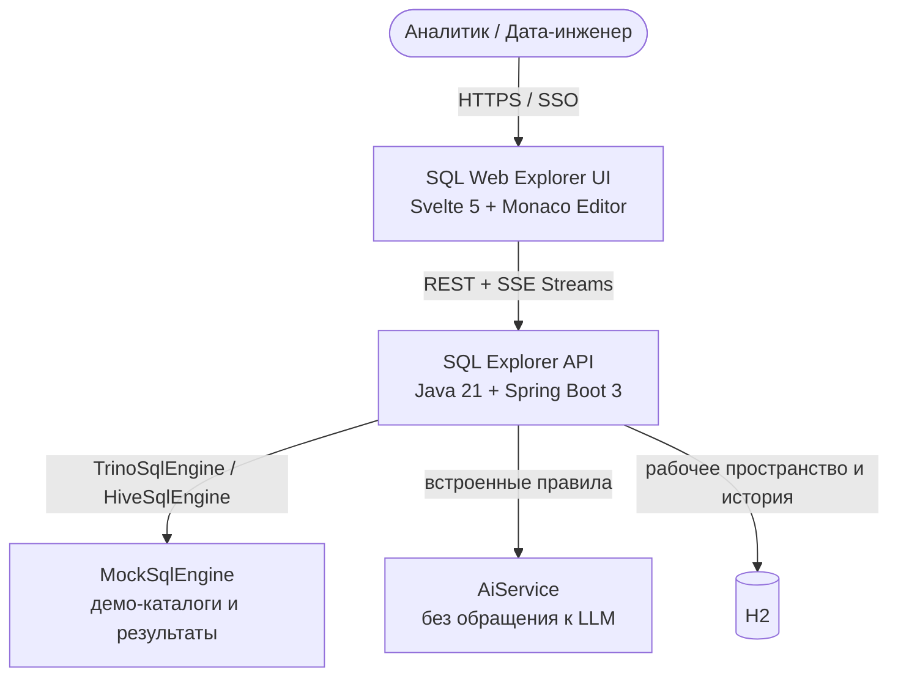

В текущей версии `TrinoSqlEngine` и `HiveSqlEngine` делегируют все вызовы в `MockSqlEngine`: запросы в Trino и HiveServer2 не отправляются, каталоги, схемы и результаты берутся из встроенного демо-набора.

- Trino и Apache Hive в одном окне: переключение между Trino и HiveServer2 без смены инструмента.
- Редактор Monaco: подсветка синтаксиса, автодополнение ключевых слов и имен таблиц и колонок, форматирование SQL, несколько вкладок запросов.
- Потоковая отдача результатов через Server-Sent Events (SSE): строки выводятся по мере их получения с кластера, интерфейс при этом не блокируется.
- ИИ-ассистент: генерация SQL по текстовому описанию, AST-проверка запроса на запрещенные DML/DDL, статический анализ производительности (декартовы произведения, отсутствие фильтра по партициям, лишний shuffle) и пошаговое объяснение логики.
- Сохранение рабочего пространства: открытые вкладки, текст запросов, расположение панелей и история хранятся в базе данных сервера, поэтому работу можно продолжить на другом компьютере.
- Кэш результатов и экспорт: ранее выполненные выборки открываются без повторного запуска на кластере; фильтрация на клиенте; экспорт в CSV (с защитой от Formula Injection) и JSON.
- Безопасность: вход через Kerberos SPNEGO SSO или LDAP, разграничение доступа к кластерам по ролям (RBAC). Метод имперсонации (`impersonation.method`: `header`, `doAs`, `session`) задается в конфигурации кластера и показывается в списке кластеров; к Trino и Hive он не применяется, потому что движки не обращаются к кластерам.

---

## 2. Архитектура и потоки данных

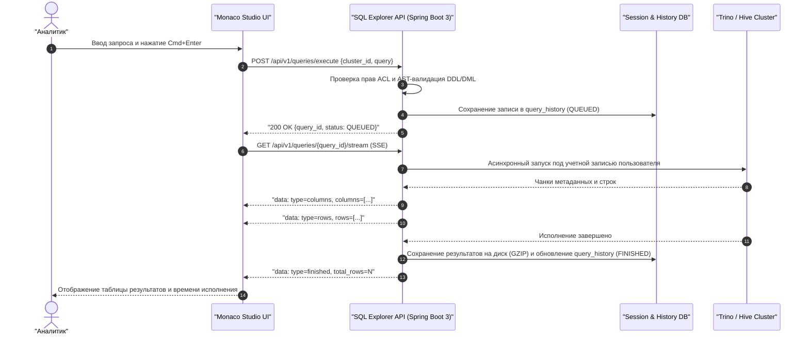

---

## 3. Аутентификация и ролевая модель безопасности

SQL Web Explorer проверяет пользователей через Active Directory / OpenLDAP и поддерживает Kerberos SPNEGO SSO.

  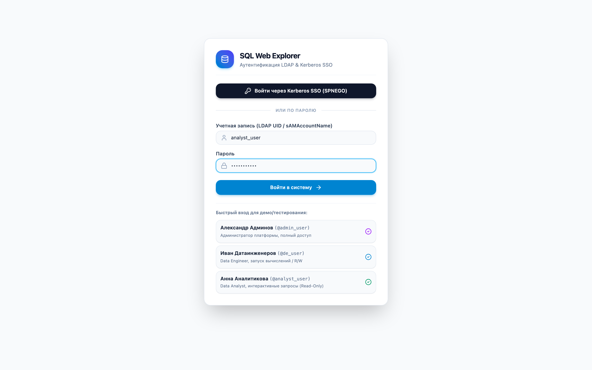
  
<em>Рисунок 1: Экран аутентификации LDAP & Kerberos SPNEGO SSO</em>

### Ролевые группы и доступ к кластерам

Доступ к кластерам задает администратор в секции `sql.clusters` файла `application.yml` (см. [руководство администратора](sql-admin-guide.md), раздел 2, шаг 4): у каждого кластера есть списки `allowed-users` и `allowed-groups`. Кластер доступен пользователю, если его имя или одна из его групп есть в этих списках, если оба списка пусты или если пользователь входит в группу администраторов (`hadoop.security.auth.admin-groups`). Ограничения по типу операций (только SELECT, запрет DDL/DML) Explorer не проверяет: в таблице ниже это пример политик на стороне кластера.

| Группа пользователей | Trino Analytics (Prod) | Hive HDP Cluster | Apache HiveServer2 | DDL/DML (DROP, ALTER) |
| :--- | :---: | :---: | :---: | :---: |
| Data Platform Admins (`data-platform-admins`) | полный доступ | полный доступ | полный доступ | да |
| Data Engineers (`data-engineers`) | полный доступ | полный доступ | полный доступ | только в staging/dev |
| BI Analysts (`bi-analysts`, `reporting`) | только SELECT | нет (закрыто ACL) | только SELECT | нет (read-only) |

Заголовок `X-Trino-User` и параметр `hive.server2.proxy.user` сервис не передает: `TrinoSqlEngine` и `HiveSqlEngine` делегируют запросы в `MockSqlEngine` и к кластерам не подключаются, поэтому политики Ranger на кластере к ним не применяются.

---

## 4. Главный экран

  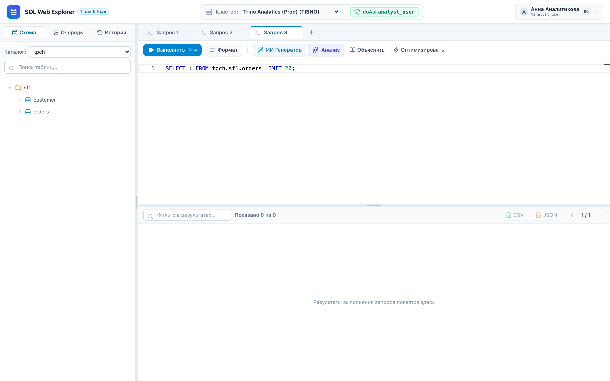
  
<em>Рисунок 2: Главный экран рабочей студии SQL Web Explorer</em>

### Элементы интерфейса

1. Верхняя панель (Header):
   - переключатель активного кластера Trino/Hive;
   - профиль пользователя и назначенные роли;
   - кнопка **Logout**.
2. Левая боковая панель (Sidebar):
   - вкладка **«Схема»** — дерево каталогов, схем, таблиц и колонок;
   - вкладка **«Очередь»** — активные запросы на кластере;
   - вкладка **«История»** — журнал выполненных запросов.
3. Разделитель панелей (Resizable Splitter):
   - перетаскиванием мыши меняет ширину боковой панели и высоту области результатов;
   - двойной клик сбрасывает размеры к значениям по умолчанию.
4. Панель вкладок (Tabs Bar):
   - кнопка **«+»** создает вкладку;
   - вкладки можно переименовывать, переключать и закрывать.
5. Панель инструментов (Query Toolbar):
   - **«Выполнить»** (Cmd+Enter / Ctrl+Enter);
   - **«Остановить»** — отмена запроса;
   - **«Формат»** — форматирование SQL;
   - кнопки ИИ-ассистента: **«ИИ Генератор»**, **«Анализ»**, **«Объяснить»**, **«Оптимизировать»**.

---

## 5. Дерево каталогов, схем и таблиц

Вкладка **«Схема»** показывает структуру данных; метаданные кэшируются на сервере.

  
  
<em>Рисунок 3: Раскрытое дерево каталогов tpch → sf1 → таблица customer с типами данных</em>

### Работа со схемой
- Выпадающий список каталогов: выбор каталога Trino (`tpch`, `analytics`, `hive`, `iceberg`, `postgresql`).
- Поле фильтра: отбор схем и таблиц по названию.
- Структура полей: клик по таблице раскрывает список колонок с типами данных (`bigint`, `varchar`, `double`, `timestamp`, `date`).
- Шаблон запроса: клик по таблице вставляет в редактор `SELECT * FROM ... LIMIT 50`.

---

## 6. Редактор SQL и выполнение запросов

### 6.1. Редактор Monaco и автодополнение
- Подсветка синтаксиса SQL (ANSI SQL, Trino SQL, HiveQL).
- Автодополнение ключевых слов, агрегатных и оконных функций, колонок.
- Выполнение выделенного фрагмента: если в редакторе выделен блок текста, `Cmd+Enter` выполняет только его.

### 6.2. Асинхронное выполнение и потоковая отдача данных (SSE)
После запуска запроса интерфейс подключается к SSE-потоку. Панель инструментов показывает статус («Постановка в очередь...», «Исполнение на кластере...»), время выполнения и число полученных строк.

  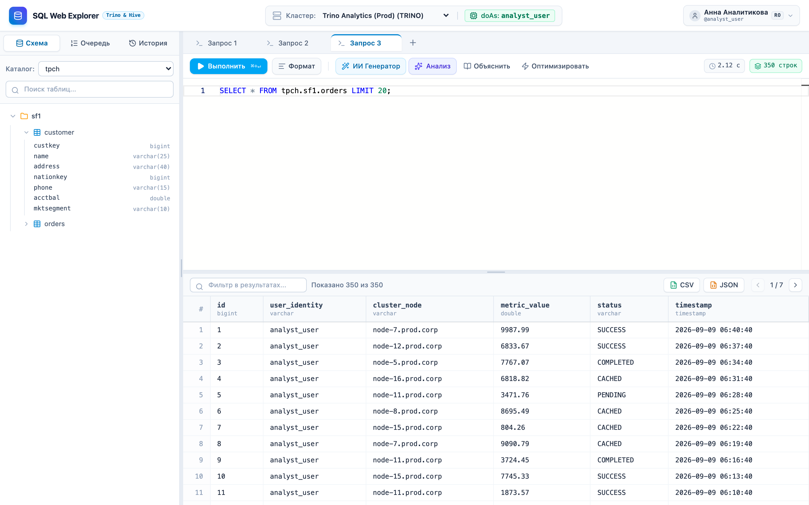
  
<em>Рисунок 4: Таблица результатов выборки из таблицы customer (время исполнения 0.44 с, 50 строк)</em>

### 6.3. Таблица результатов, фильтрация и экспорт (CSV / JSON)
- Фильтрация на клиенте: поле поиска отбирает строки в таблице без повторного запроса к серверу.
- Пагинация: переключение между страницами результатов.
- Экспорт в CSV: спецсимволы экранируются, значения защищены от CSV Formula Injection (DDE).
- Экспорт в JSON: массив JSON-объектов.

---

## 7. Вкладки и сохранение сессий

  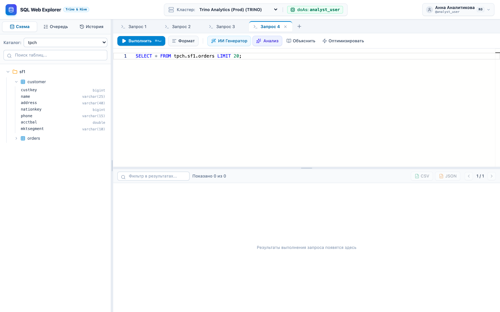
  
<em>Рисунок 5: Работа с несколькими независимыми вкладками запросов</em>

- Каждая вкладка хранит свой текст запроса, статус выполнения, время и результаты.
- Состояние вкладок синхронизируется с сервером. После перезагрузки страницы или входа с другого устройства открытые вкладки и их текст восстанавливаются.

---

## 8. История запросов и кэш результатов

Вкладка **«История»** содержит все запросы, выполненные текущим пользователем.

  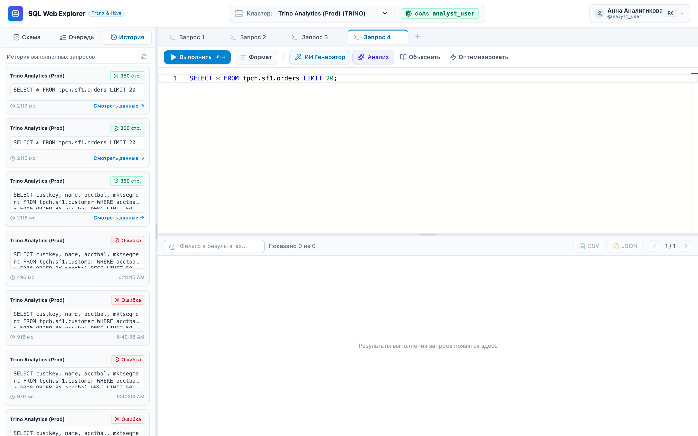
  
<em>Рисунок 6: Панель истории запросов с цветовой индикацией статусов и длительности</em>

- Цвет статуса: зеленый — `COMPLETED`, красный — `FAILED`, желтый — `RUNNING`.
- Клик по тексту запроса переносит SQL в активный редактор.
- Кнопка с иконкой архива открывает сохраненный результат из кэша сервера без повторного запуска на кластере Trino/Hive.

---

## 9. Очередь запросов и отмена

Вкладка **«Очередь»** показывает фоновые и выполняющиеся запросы пользователя на кластере.

  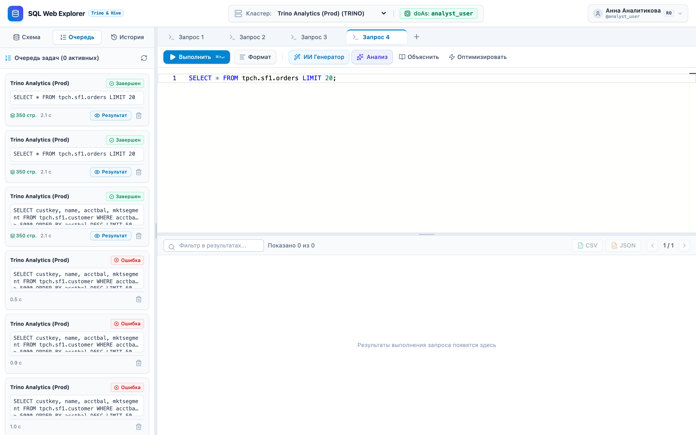
  
<em>Рисунок 7: Мониторинг очереди запросов с возможностью отмены</em>

- Статус запроса: `QUEUED` или `RUNNING`.
- Кнопка с красным крестиком отправляет сигнал отмены в координатор Trino или в сессию Hive; кластер освобождает ресурсы запроса.

---

## 10. ИИ-ассистент (AI SQL Studio)

ИИ-ассистент работает на встроенных правилах, без обращения к LLM (см. раздел 12).

### 10.1. Генерация SQL по описанию

Опишите задачу на русском или английском языке — ассистент вернет SQL-запрос.

  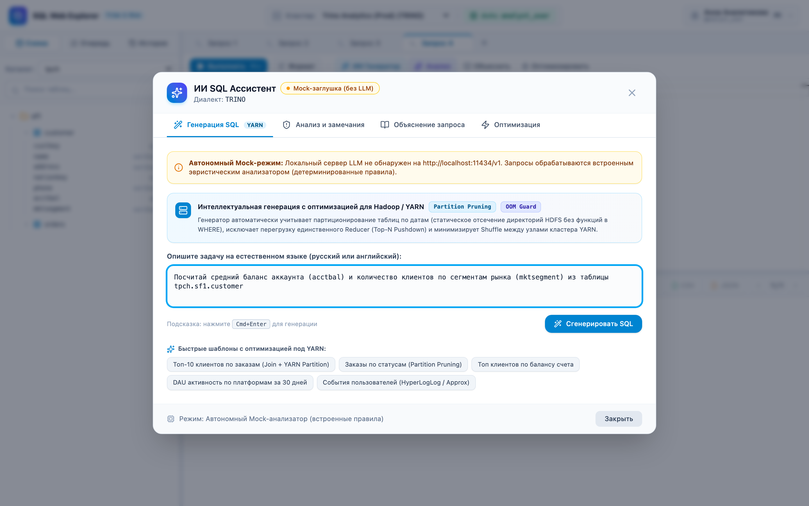
  
<em>Рисунок 8: Генерация аналитического SQL с учетом отсечения партиций HDFS и защиты OOM</em>

Генератор применяет приемы оптимизации:
- Partition Pruning: условия на поля партиционирования в `WHERE` пишутся без оборачивания полей в функции, чтобы движок отсекал каталоги HDFS по датам.
- Top-N Pushdown: снижает нагрузку на единственный Reducer.
- Сокращение сетевого shuffle между узлами YARN.

---

### 10.2. Анализ безопасности, линтинг и поиск антипаттернов

Вкладка **«Анализ и замечания»** выполняет статическую проверку текста запроса.

  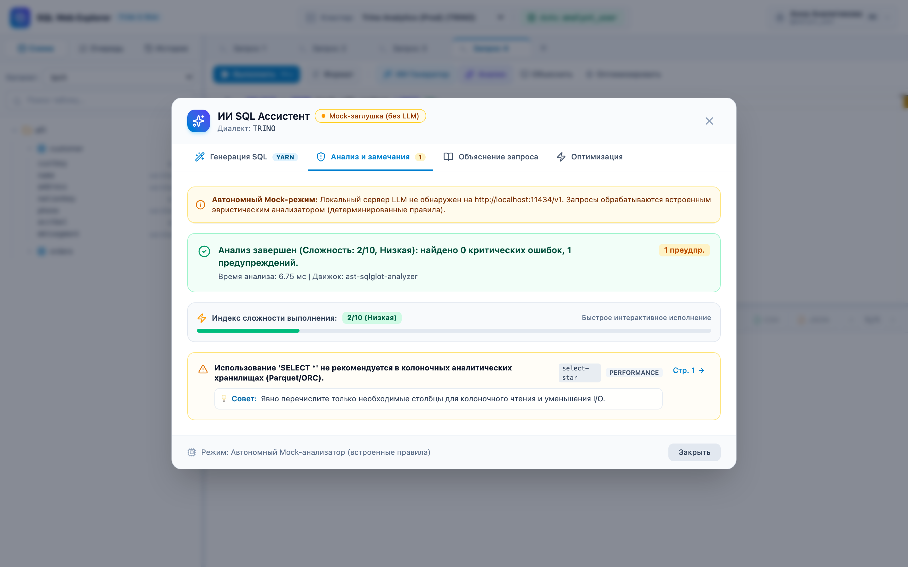
  
<em>Рисунок 9: Анализ запроса на деструктивные операции, антипаттерны и декартовы произведения</em>

- Безопасность: поиск деструктивных команд (`DROP`, `TRUNCATE`, `ALTER`) для кластеров только на чтение.
- Производительность: предупреждения об отсутствии `LIMIT`, сканировании всех партиций (Full Table Scan), скрытых декартовых произведениях (`Cartesian Product / CROSS JOIN`) и условиях вида `LIKE '%text%'`.

---

### 10.3. Объяснение и оптимизация запроса

Вкладка **«Объяснение запроса»** разбивает запрос (с CTE, оконными функциями и джойнами) на пошаговые блоки с описанием на русском языке.

  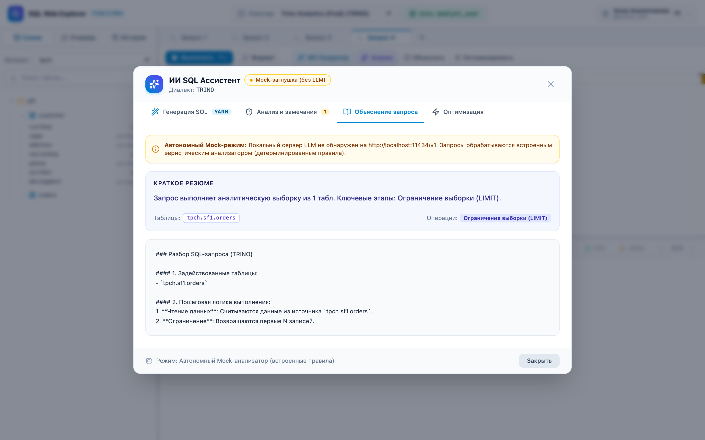
  
<em>Рисунок 10: Пошаговый разбор логики выполнения аналитического запроса</em>

---

## 11. Горячие клавиши

| Комбинация | Область действия | Действие |
| :--- | :--- | :--- |
| `Cmd + Enter` / `Ctrl + Enter` | Редактор Monaco | Выполнить текущий запрос (или выделенный блок текста) |
| `Shift + Alt + F` | Редактор Monaco | Форматировать SQL |
| `Escape` | Модальные окна | Закрыть окно ИИ-ассистента или диалог |
| `Cmd + T` / клик по `+` | Вкладки | Открыть новую вкладку запроса |
| Двойной клик по разделителю | Разделитель панелей | Сбросить ширину боковой панели к 320 px |

---

## 12. Частые вопросы

### Почему запрос в Hive начинает выполняться с задержкой?

Trino выполняет запросы в памяти на worker-узлах. Apache Hive компилирует запрос в DAG Apache Tez или задачу MapReduce и запрашивает контейнеры у YARN ResourceManager — это время уходит до старта выполнения. Прогресс виден на панели инструментов.

---

### Сохраняются ли результаты запросов после закрытия браузера?

Да. Сервер сохраняет результаты завершенных запросов на диск в формате GZIP. Откройте вкладку **«История»**, найдите запрос и нажмите **«Загрузить результат»** — результат откроется без повторного выполнения на кластере.

---

### Как подключить локальную LLM к ИИ-ассистенту?

В текущей версии подключить LLM нельзя. Ассистент (`AiService` в `backend/sql`) проверяет, форматирует и переписывает SQL встроенными правилами и не отправляет запросы к модели. Параметры `sql.ai.url`, `sql.ai.model` и `sql.ai.provider` (по умолчанию `mock-builtin`) в `application.yml` только отображаются в статусе ассистента.
