<div align="center">


# Руководство пользователя: YARN Queue Explorer

</div>

YARN Queue Explorer — веб-приложение для просмотра и изменения иерархии очередей Apache YARN Capacity Scheduler на кластерах Hadoop. Изменения проходят согласование и доставляются на ResourceManager через Ansible AWX. Руководство описывает работу в интерфейсе для ролей READER, WRITER и ADMIN и относится к Hadoop Explorer Platform v1.0.0 и новее.

## Содержание

1. [Назначение и функции](#1-назначение-и-функции)
2. [Роли и принцип четырех глаз](#2-роли-и-принцип-четырех-глаз)
3. [Вход в систему](#3-вход-в-систему)
4. [Главный экран](#4-главный-экран)
5. [Режимы отображения ресурсов: проценты и GB / vCores](#5-режимы-отображения-ресурсов-проценты-и-gb--vcores)
6. [Редактирование параметров очередей](#6-редактирование-параметров-очередей)
7. [Создание и удаление очередей](#7-создание-и-удаление-очередей)
8. [Конструктор правил сопоставления очередей (Queue Mappings)](#8-конструктор-правил-сопоставления-очередей-queue-mappings)
9. [Просмотр изменений (Diff Panel)](#9-просмотр-изменений-diff-panel)
10. [Согласование и применение изменений](#10-согласование-и-применение-изменений)
11. [Экспорт правок и ручное применение](#11-экспорт-правок-и-ручное-применение)
12. [Горячие клавиши](#12-горячие-клавиши)
13. [Вопросы и диагностика](#13-вопросы-и-диагностика)
14. [Связанная документация](#14-связанная-документация)

---

## 1. Назначение и функции

Apache YARN Capacity Scheduler распределяет вычислительные ресурсы (оперативную память RAM и ядра vCPU) между организациями, командами и приложениями (Spark, Flink, Trino, MapReduce) с помощью иерархического дерева очередей.

Ручное редактирование XML-файлов конфигурации `capacity-scheduler.xml` сопряжено с рисками:
- Нарушение инварианта 100%-й емкости на уровнях иерархии;
- Ошибки в именовании путей очередей (`root.dept.team`);
- Отсутствие версионирования и согласования изменений;
- Сложность пересчета относительных долей (%) в физические ресурсы (гигабайты памяти и количество ядер);
- Ошибки при ручной доставке на хосты ResourceManager и отсутствие автоматического отката при сбоях.

Как YARN Queue Explorer проводит изменение:

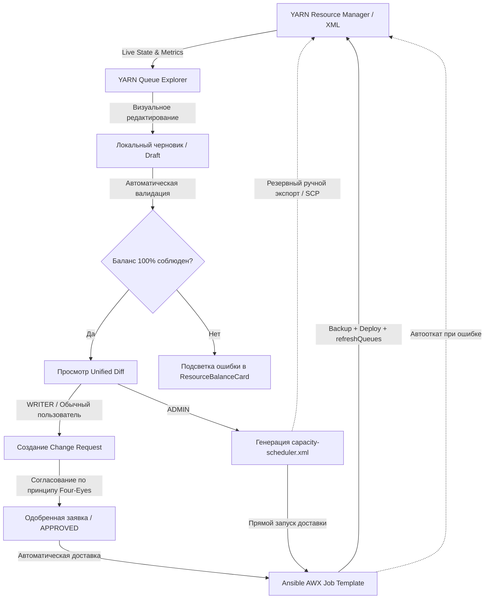

### Функции
- Дерево очередей: ветки и листовые очереди, статусы (`RUNNING`/`STOPPED`), политики упорядочивания (`FAIR`/`FIFO`), лимиты и текущая загрузка.
- Проверка баланса: сумма емкостей дочерних очередей пересчитывается при каждом изменении черновика, недовыделение (`underallocated`) и перевыделение (`overallocated`) подсвечиваются.
- Двусторонний пересчет (% ↔ GB / vCores): емкость задается в процентах или в гигабайтах и ядрах; в связанном режиме (Linked Mode) доли памяти и vCPU меняются синхронно.
- Конструктор Queue Mappings: правила распределения задач пользователей и групп по очередям (`u:%user`, `g:%group`).
- Принцип четырех глаз (Four-Eyes Principle): изменение готовит один пользователь, утверждает другой, через центр согласования заявок (Change Requests).
- Доставка через Ansible AWX: правки применяются к `capacity-scheduler.xml` на всех узлах ResourceManager (Active и Standby) после резервного копирования, затем выполняется `yarn rmadmin -refreshQueues` без перезапуска RM; при ошибке файл возвращается к прежней версии. Лог выполнения доступен в карточке заявки.
- Экспорт правок в XML: перечень изменяемых свойств `capacity-scheduler.xml` с инструкцией для ручного применения, если AWX недоступен.

---

## 2. Роли и принцип четырех глаз

Права пользователя определяются ролью (RBAC). Роли назначаются по группам Active Directory / OpenLDAP:

| Роль | Бейдж в UI | Права и доступные действия |
| :--- | :---: | :--- |
| `READER` (наблюдатель) | `RO` | Просмотр дерева очередей, мониторинг утилизации ресурсов и метрик кластера, просмотр согласованных заявок. Редактирование заблокировано. |
| `WRITER` (оператор, инженер) | `RW` | Создание локальных черновиков, редактирование параметров очередей, добавление и удаление очередей, создание заявок на изменение (Change Requests) с обоснованием. |
| `ADMIN` (администратор) | `ADM` | Права `WRITER`, а также: согласование и отклонение заявок других пользователей, запуск деплоя через AWX, экспорт правок `capacity-scheduler.xml`, полная замена файла через API (`deploy-xml`), если отключен `yarn.acl.enforce-four-eyes`. |

Принцип четырех глаз: администратор не может утвердить собственную заявку, ее утверждает другой администратор кластера.

---

## 3. Вход в систему

При открытии приложения показывается экран входа.

<div align="center">
  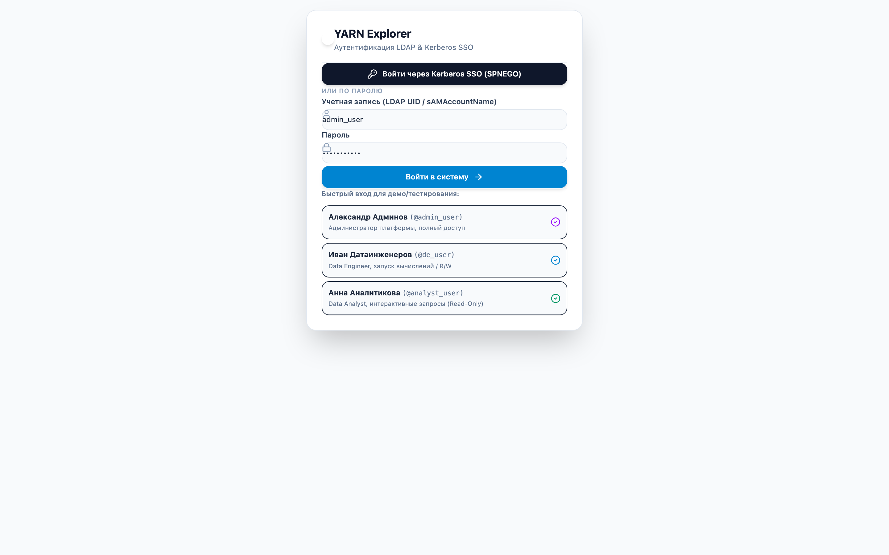
  <p><em>Рисунок 1: Экран аутентификации LDAP & Kerberos Single Sign-On (SPNEGO)</em></p>
</div>

### Способы входа
1. Kerberos Single Sign-On (SPNEGO): если рабочая станция входит в домен Active Directory / FreeIPA и у браузера есть Kerberos-тикет, нажмите **«Войти через Kerberos SSO (SPNEGO)»**. Пароль вводить не нужно.
2. Логин и пароль (LDAP / AD): введите корпоративный логин (например, `sAMAccountName` или `uid`) и пароль и нажмите **«Войти в систему»**.
3. Демо-вход: на демонстрационных и тестовых стендах внизу формы есть готовые профили:
   - Александр Админов (`admin_user`) — администратор платформы (роль `ADMIN`);
   - Владимир Инженеров (`writer_user`) — Data Platform Engineer (роль `WRITER`);
   - Екатерина Наблюдателева (`reader_user`) — BI Analyst (роль `READER`).

---

## 4. Главный экран

После входа открывается главный экран с очередями выбранного кластера:

<div align="center">
  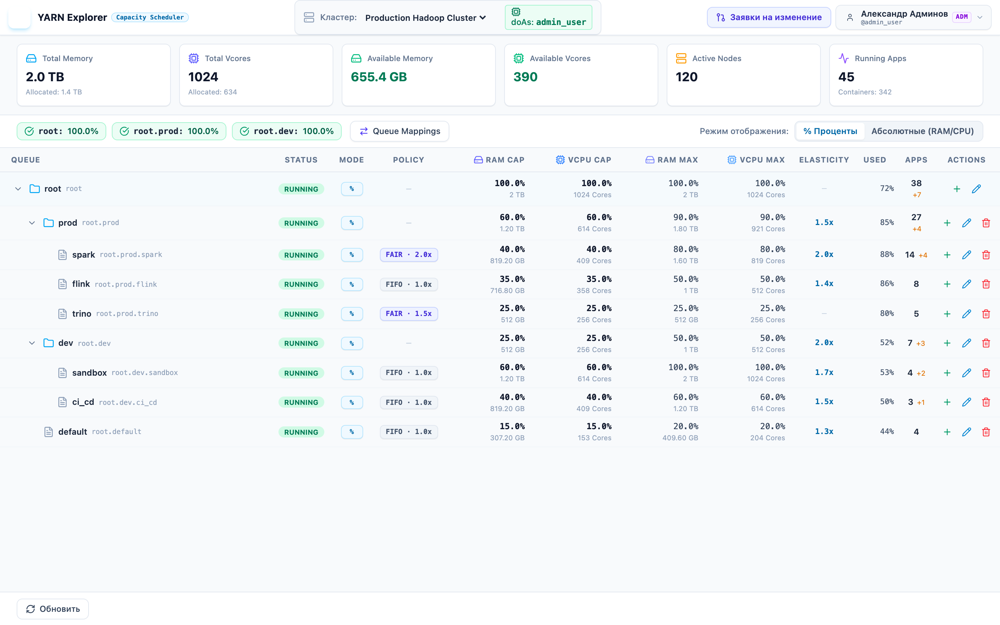
  <p><em>Рисунок 2: Главная панель управления очередями YARN Capacity Scheduler</em></p>
</div>

### Зоны экрана

```
┌──────────────────────────────────────────────────────────────────────────────────────────────┐
│  [1] Верхняя панель (Header): Логотип | Селектор кластера | doAs-пользователь | Профиль (ADM)│
├──────────────────────────────────────────────────────────────────────────────────────────────┤
│  [2] Метрики кластера: Память (Used/Total) | Ядра vCPU | Активные узлы | Контейнеры | Задачи │
├──────────────────────────────────────────────────────────────────────────────────────────────┤
│  [3] Тулбар: Партиции (DEFAULT) | Баланс веток (100% OK) | Queue Mappings | Режим (% / ABS) │
├──────────────────────────────────────────────────────────────────────────────────────────────┤
│                                                                                              │
│  [4] Интерактивная таблица иерархии очередей (QueueTreeTable)                                │
│      - Queue (путь и вложенность)                                                            │
│      - Status (RUNNING / STOPPED)                                                            │
│      - Mode (% / ABS)                                                                        │
│      - Policy (FAIR 2.0x / FIFO 1.0x)                                                        │
│      - RAM Capacity & Max Capacity                                                           │
│      - vCPU Capacity & Max Capacity                                                          │
│      - Used (% утилизации с цветовым прогресс-баром)                                         │
│      - Apps (активные и ожидающие приложения)                                                │
│      - Actions (+ Добавить дочернюю, Редактировать, Удалить)                                 │
│                                                                                              │
│  [5] Нижняя панель действий (Footer Bar): Обновить | Сбросить | Просмотр Diff | XML / Заявка │
└──────────────────────────────────────────────────────────────────────────────────────────────┘
```

1. Верхняя панель (Header):
   - Переключатель кластеров (например, `Production Hadoop Cluster` и `Analytics & ML Cluster`).
   - Бейдж impersonation `doAs: admin_user`.
   - Кнопка вызова центра заявок с бейджем количества заявок, ожидающих рассмотрения.
   - Меню профиля с отображением LDAP-групп и кнопкой выхода.
2. Панель метрик кластера (Cluster Metrics Bar): объем памяти RAM, количество vCPU, число активных узлов NodeManager и запущенных приложений.
3. Панель баланса (Resource Balance Card) и тулбар:
   - Селектор разделов (Partitions): выбор активного раздела (`DEFAULT`, `GPU`, `HIGH_MEM`). Заголовки столбцов квот показывают текущий раздел (например, `RAM Cap [GPU]`).
   - Разделы в таблице:
     - Рядом с названием очереди выводятся метки разделов (например, `GPU`), для которых у нее заданы квоты. Для раздела `DEFAULT` метка не выводится.
     - Если в выбранном разделе у очереди нет своих квот, ее название показано перечеркнутым и приглушенным, строка полупрозрачная, а всплывающая подсказка поясняет, что действуют квоты `DEFAULT`.
   - Индикатор баланса: зеленый бейдж `100.0% · OK` означает, что на всех уровнях дерева сумма емкостей дочерних очередей равна 100%. При нарушении бейдж показывает величину недостающей или избыточной емкости.

Выбранные кластер, раздел и очередь сохраняются в URL-хэше браузера (например, `#cluster=cluster-1&partition=gpu&queue=root.ml.training`). По такой ссылке коллега откроет то же состояние, а кнопки браузера «Назад» и «Вперед» переключают сохраненные состояния.

---

## 5. Режимы отображения ресурсов: проценты и GB / vCores

Квоты показываются в процентах или в абсолютных величинах (RAM и vCPU). Переключатель находится в правой части тулбара: **«% Проценты»** и **«Абсолютные (RAM/CPU)»**.

<div align="center">
  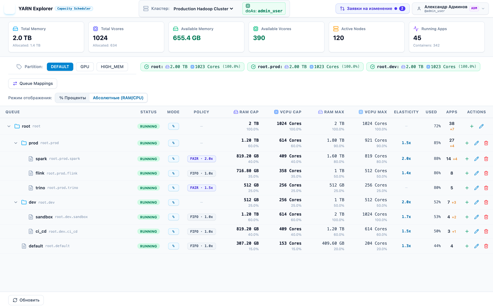
  <p><em>Рисунок 3: Просмотр абсолютных физических ресурсов кластера (RAM и vCPU)</em></p>
</div>

### Режимы
- Процентный режим (`%`): показывает долю емкости очереди относительно родительского узла (Capacity %) и максимальный потолок при заимствовании ресурсов (Max Capacity %). Под основным числом мелким шрифтом выводится эквивалент в GB/TB.
- Абсолютный режим (`ABS`): показывает гарантированные ресурсы в гигабайтах RAM и количестве ядер vCPU (например, `819.2 GB` и `409.6 Cores`).
- Коэффициент эластичности (Elasticity Ratio): столбец показывает, во сколько раз очередь может превысить гарантированную квоту при наличии свободных ресурсов в кластере (например, `2.0x` для эластичной очереди `root.prod.spark` с емкостью 40% и лимитом 80%).

---

## 6. Редактирование параметров очередей

Чтобы изменить параметры очереди, нажмите иконку карандаша (**Pencil**) в столбце **Actions** строки очереди или кликните по бейджу политики или режима. Справа откроется панель редактирования:

<div align="center">
  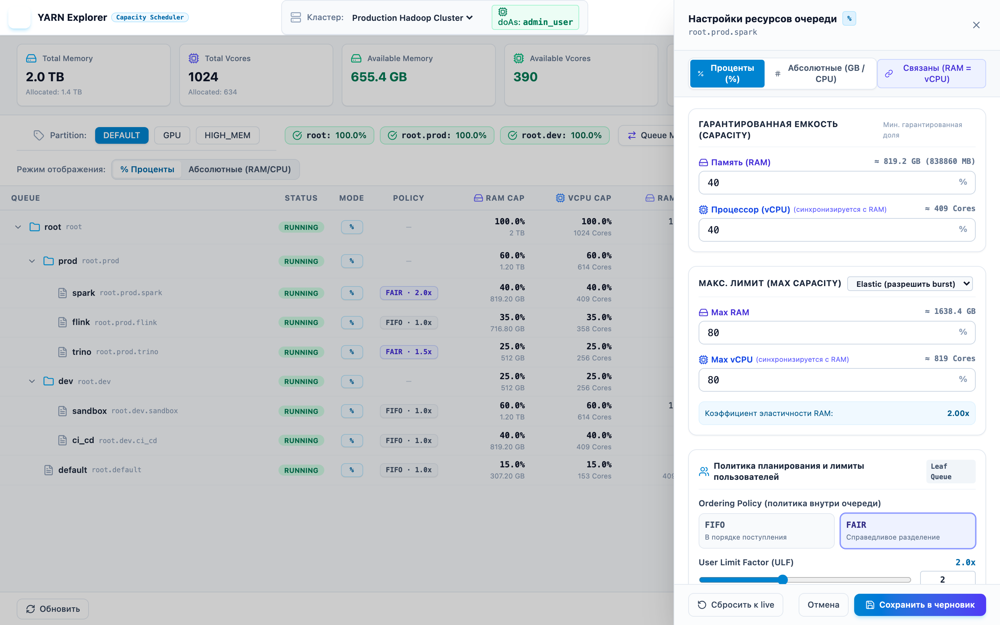
  <p><em>Рисунок 4: Боковая панель детального редактирования параметров очереди</em></p>
</div>

### Параметры очереди

#### 1. Гарантированная емкость (Guaranteed Capacity) и максимальная емкость (Max Capacity)
- Связанный режим (Linked Mode): включен по умолчанию. Изменение доли памяти синхронно меняет долю vCPU. Чтобы задать их раздельно, нажмите кнопку с иконкой замка (**Unlink**).
- Тип очереди:
  - `Эластичная (Elastic)`: очередь занимает свободные ресурсы кластера до Max Capacity.
  - `Фиксированная (Fixed)`: Max Capacity = Capacity, очередь не выходит за свою емкость.

#### 2. Политика планирования и лимиты пользователей
- Ordering Policy:
  - `FAIR` (Честное распределение): ресурсы делятся поровну между параллельно запущенными приложениями в очереди.
  - `FIFO` (Первым пришел — первым обслужен): приложения выполняются строго по очереди поступления.
- User Limit Factor (ULF): доля гарантированной емкости очереди, которую может занять один пользователь. При `1.0` — не более 100% емкости очереди, при `2.0` — до 200%, если других пользователей в очереди нет.

#### 3. Лимиты приложений (Application Limits)
- `maximum-applications`: максимальное число одновременно зарегистрированных приложений в очереди; ограничивает расход памяти RM на учет приложений.
- `maximum-am-resource-percent`: доля ресурсов очереди под контейнеры ApplicationMaster (например, `0.3` = 30%). Без этого лимита ApplicationMaster-контейнеры могут занять всю очередь, и контейнерам задач не останется ресурсов (AM deadlock).
- `max-parallel-apps`: жесткий лимит одновременно исполняемых приложений.
- `maximum-application-lifetime`: максимальное время жизни приложения в секундах, после которого оно автоматически завершается планировщиком.

#### 4. Разделы (Partitions) и метки узлов (Node Labels)
- Селектор раздела (верх формы):
  - Кнопка раздела показывает его статус: сплошная кнопка с зеленым маркером `● GPU` — у очереди есть свои квоты в разделе, пунктирная `○ HIGH_MEM (нет квот)` — нет.
  - Для раздела без квот выводится предупреждение и кнопка **«+ Настроить раздел»**; поля формы заполняются значениями из `DEFAULT`. Раздел также добавляется в черновик при любом изменении слайдеров или числовых полей.
  - Для раздела с квотами есть кнопка **«Сбросить квоты»**: она удаляет квоты очереди в разделе, после чего действуют квоты `DEFAULT`.
- Доступные метки узлов (Accessible Labels, низ формы): список меток (`yarn.scheduler.capacity.<queue>.accessible-node-labels`), на узлах с которыми очередь может размещать контейнеры. При добавлении квот раздела его метка добавляется в этот список.
- Метка по умолчанию (Default Label Expression): параметр `yarn.scheduler.capacity.<queue>.default-node-label-expression` направляет приложения очереди на узлы с заданной меткой (например, `GPU`), если метка не указана при запуске (`spark-submit`, `flink run`).

Закончив правку, нажмите **«Сохранить в черновик»**. Изменения хранятся в памяти сессии, подсвечиваются в таблице желтым и сразу учитываются в балансе веток; кластер не меняется.

---

## 7. Создание и удаление очередей

### Добавление дочерней очереди
Чтобы создать очередь, нажмите иконку **Plus** («+») в строке родительской очереди (например, `root.dev`):

<div align="center">
  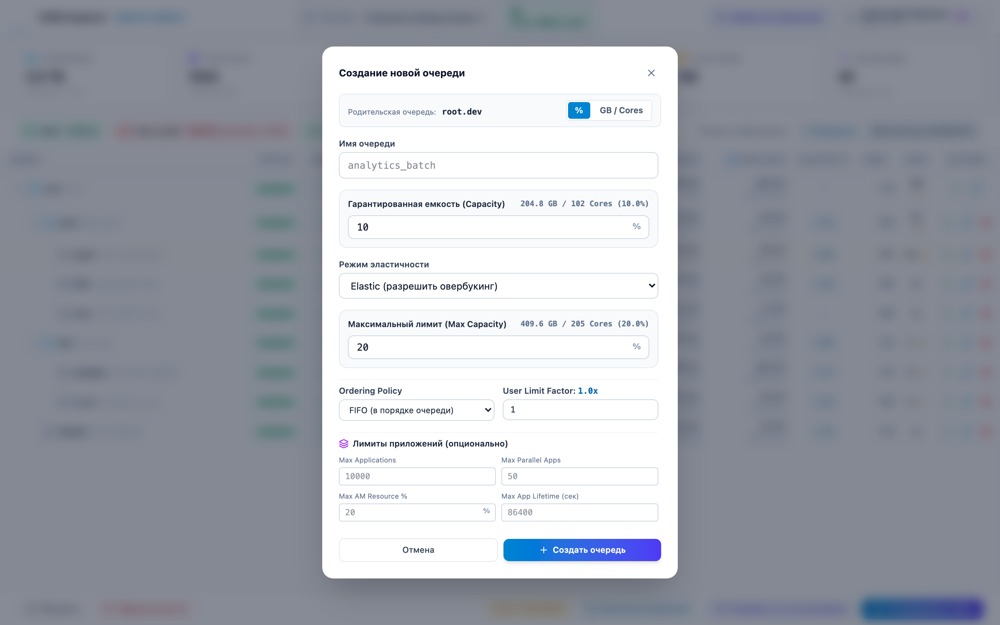
  <p><em>Рисунок 5: Модальное окно добавления новой дочерней очереди</em></p>
</div>

1. Введите системное имя новой очереди (латинские буквы, цифры, символы подчеркивания).
2. Задайте начальные значения гарантированной емкости и максимального потолка.
3. Выберите статус (`RUNNING`) и политику упорядочивания (`FAIR` / `FIFO`).
4. Нажмите **«Создать очередь»**. Очередь появится в дереве с зеленым бейджем `NEW`.

### Удаление очереди
- Нажмите иконку корзины (**Trash**) в строке очереди.
- Очередь вместе с дочерними очередями помечается в черновике красным бейджем `DEL`, строка становится полупрозрачной.
- Заявка с удалением пройдет проверку, только если удаляемая очередь остановлена (`STOPPED`).

---

## 8. Конструктор правил сопоставления очередей (Queue Mappings)

Queue Mappings направляют задачи пользователей в очереди, когда очередь не указана явно (`-Dmapreduce.job.queuename`). Чтобы открыть конструктор, нажмите **«Queue Mappings»** на панели инструментов:

<div align="center">
  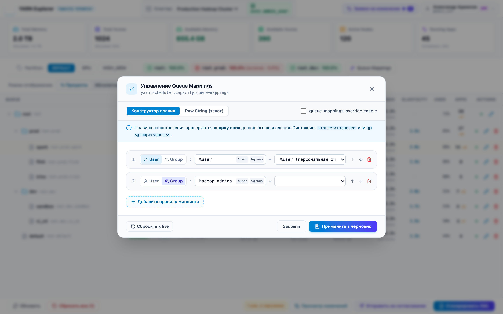
  <p><em>Рисунок 6: Конструктор правил сопоставления очередей (Queue Mappings & Overrides)</em></p>
</div>

### Правила
- Типы правил:
  - Сопоставление пользователя: `u:%user:%user` (направление пользователя в очередь с его именем).
  - Сопоставление конкретного пользователя в целевую очередь: `u:etl_service:root.prod.spark`.
  - Сопоставление группы: `g:data-engineers:root.prod.spark`.
- Переопределение очереди клиента (Override): чекбокс **«Разрешить принудительное переопределение очереди (Override client specified queue)»** выставляет `yarn.scheduler.capacity.queue-mappings-override.enable=true`. Тогда очередь из правила применяется, даже если клиент указал другую.
- Порядок правил: планировщик проверяет правила сверху вниз до первого совпадения. Порядок меняется перетаскиванием или стрелками.
- Чтобы перенести правила в черновик, нажмите **«Применить в черновик»**.

---

## 9. Просмотр изменений (Diff Panel)

Когда в черновике есть изменения, в нижнем тулбаре выводится счетчик (например, `1 изм. в черновике`). Нажмите **«Просмотр изменений»**, чтобы открыть панель Unified Diff:

<div align="center">
  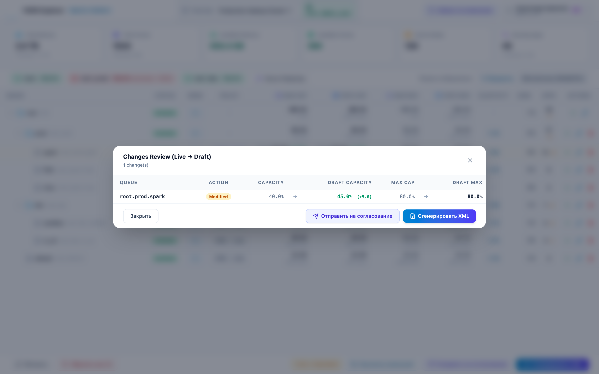
  <p><em>Рисунок 7: Панель сравнения параметров конфигурации Live vs Draft</em></p>
</div>

### Содержимое панели
- Сравнение текущих значений кластера (Live Configuration) и черновика (Draft Configuration) по строкам и столбцам.
- Числовая дельта (например, `40.0% → 45.0% (+5.0)`).
- Изменения остальных атрибутов: ULF, Ordering Policy, Application Limits, Node Labels.
- Изменения правил сопоставления (Queue Mappings & Overrides).

---

## 10. Согласование и применение изменений

### Шаг 1: Создание заявки (роли WRITER и ADMIN)
Из панели Diff или нижнего тулбара нажмите **«Отправить на согласование»**:

<div align="center">
  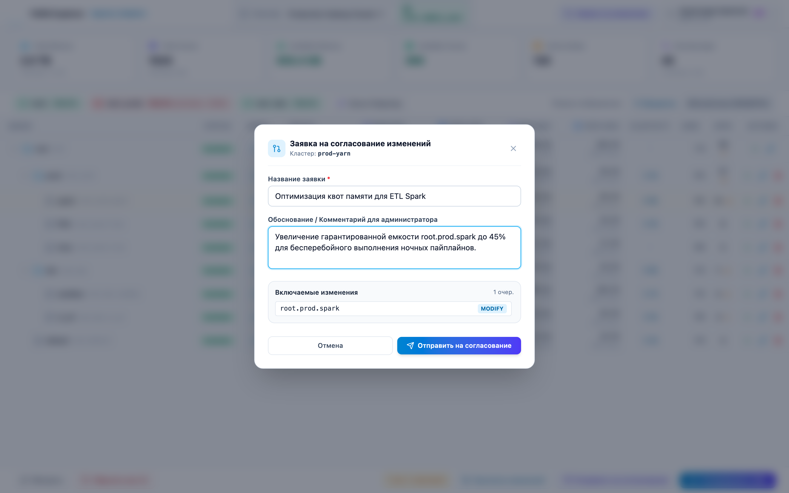
  <p><em>Рисунок 8: Модальное окно подачи заявки на изменение (Change Request)</em></p>
</div>

1. Укажите название заявки (например, «Перераспределение квот памяти для ETL Spark»).
2. Укажите обоснование: что меняется и зачем, номер тикета в Jira или другом трекере, период ожидаемой нагрузки.
3. Нажмите **«Отправить на согласование»**. Заявка сохраняется со статусом `SUBMITTED` (на согласовании).

### Шаг 2: Центр согласования заявок (роль ADMIN)
В шапке приложения выводится мигающий индикатор и счетчик заявок на согласовании; счетчик обновляется раз в 10 секунд. Кнопка **«Заявки на изменение»** открывает центр согласования:

<div align="center">
  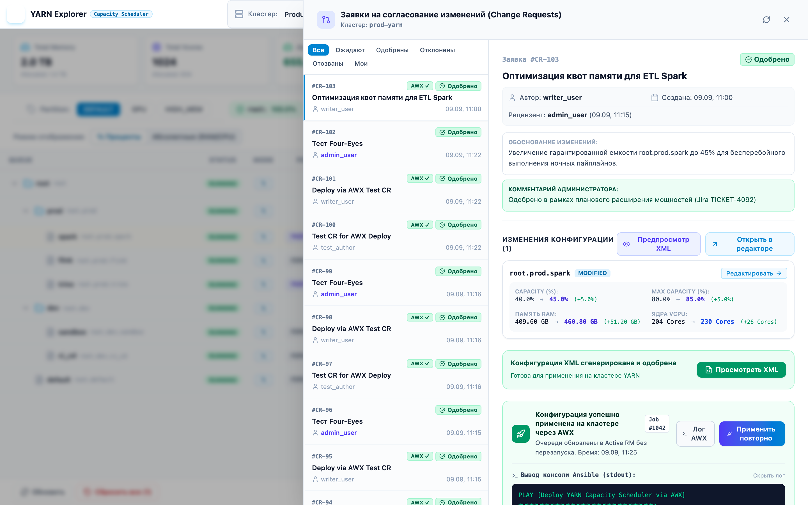
  <p><em>Рисунок 9: Центр согласования и аудита заявок на изменение</em></p>
</div>

#### Центр согласования
- Фильтры: просмотр заявок со статусами `Все`, `Мои`, `На согласовании (SUBMITTED)`, `Одобренные (APPROVED)`, `Отклоненные (REJECTED)`, `Отозванные (CANCELLED)`.
- Карточка заявки:
  - Имя автора, время подачи, статус, текстовое обоснование.
  - Список всех затрагиваемых очередей с точными дельтами ресурсов.
- Действия:
  - **«Одобрить и сгенерировать XML»** (Approve): утверждение заявки с комментарием. Правки пересчитываются против текущего состояния кластера и сохраняются в заявке.
  - **«Отклонить заявку»** (Reject): отклонение с обязательным указанием причины.
  - **«Открыть в редакторе очередей»**: загрузка изменений заявки (своей, чужой или завершенной) в активный черновик для доработки.
  - **«Предпросмотр XML»**: перечень правок `capacity-scheduler.xml`, сформированный для заявки.

### Шаг 3: Применение на кластере через AWX

После утверждения (статус `APPROVED`) в карточке заявки появляется блок доставки через AWX:

<div align="center">
  
  <p><em>Рисунок 10: Утвержденная заявка со статусом доставки, Job ID и встроенным просмотром логов AWX</em></p>
</div>

1. Запуск доставки: нажмите **«Применить на кластере»** в карточке одобренной заявки (после успешного деплоя кнопка называется **«Применить повторно»**). YARN Explorer передает список правок в Base64 (`capacity_scheduler_patch_b64`) и запускает Job Template в AWX через REST API.
2. Статус доставки:
   - `AWX...` — задача выполняется в AWX. Интерфейс ждет ее завершения не дольше `yarn.awx.timeout-seconds` (по умолчанию 180 секунд).
   - `AWX ✓` (`SUCCESSFUL`) — файл разложен на все узлы ResourceManager и применен командой `yarn rmadmin -refreshQueues`. В карточке сохраняются дата и время деплоя.
   - `AWX ✕` (`FAILED`) — задача завершилась ошибкой (например, кластер отклонил параметры очереди).
3. Номер задачи: в карточке заявки выводится номер задачи (например, `AWX Job #1042`) со ссылкой на нее в AWX.
4. Кнопка **«Лог AWX»** показывает вывод плейбука (`stdout`), полученный из AWX на момент нажатия: pre-flight-проверка, резервное копирование, деплой, `refreshQueues`. Переходить в AWX для этого не нужно.
5. Откат при ошибке: если `yarn rmadmin -refreshQueues` завершился ошибкой (например, при удалении очереди, в которой еще есть приложения), роль Ansible восстанавливает резервную копию `capacity-scheduler.xml` на всех узлах и повторно выполняет `refreshQueues`. Очереди остаются в конфигурации, действовавшей до деплоя.

---

## 11. Экспорт правок и ручное применение

Кнопка **«Сгенерировать XML»** (роль ADMIN) открывает окно **«Правки capacity-scheduler.xml»** с перечнем свойств, которые меняет черновик. Это не полный файл: ResourceManager не отдает развернутый `capacity-scheduler.xml` по REST, поэтому YARN Explorer описывает только изменяемые свойства.

<div align="center">
  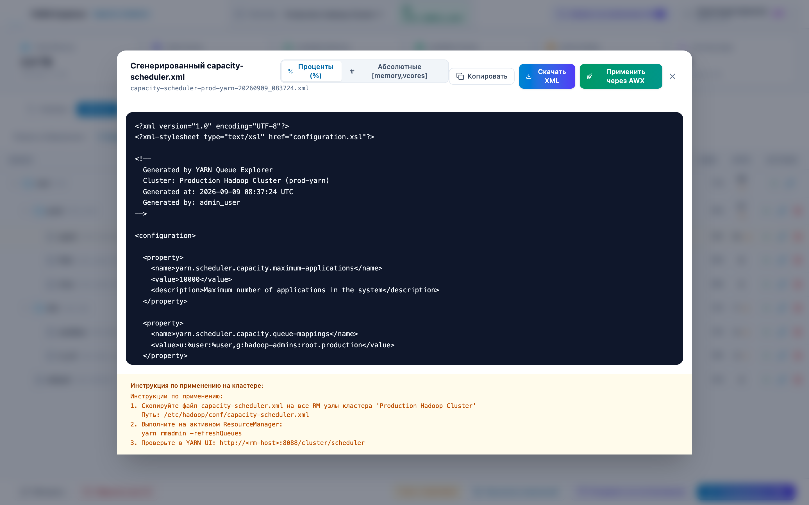
  <p><em>Рисунок 11: Окно экспорта правок capacity-scheduler.xml</em></p>
</div>

### Элементы окна
1. Переключатель **«Проценты (%)»** / **«Абсолютные [memory,vcores]»** задает формат значений емкости: проценты или абсолютные ресурсы (Absolute Resource Allocation).
2. **«Копировать»** копирует перечень правок в буфер обмена.
3. **«Скачать»** сохраняет перечень в файл `capacity-scheduler-patch-<cluster_id>-<timestamp>.xml`.
4. Под перечнем выводится инструкция по применению на кластере.

Запуска AWX в этом окне нет. Чтобы применить изменения через AWX, оформите заявку (раздел 10). API-метод `deploy-xml`, заменяющий файл целиком, запрещен при `yarn.acl.enforce-four-eyes: true` (значение по умолчанию), см. [awx-yarn-deployment.md](awx-yarn-deployment.md).

### Применение правок на кластере

#### Способ 1: через заявку и Ansible AWX
- Доставка запускается из карточки согласованной заявки.
- Файл обновляется на всех узлах ResourceManager (Active и Standby).
- Перед заменой на каждом узле создается резервная копия.
- Очереди применяются командой `yarn rmadmin -refreshQueues` без перезапуска RM.
- Если YARN отклонил конфигурацию, роль возвращает прежний файл.
- История запусков хранится в AWX.
- Настройка интеграции и роли: [руководство по интеграции с Ansible AWX](awx-yarn-deployment.md).

#### Способ 2: вручную, если AWX недоступен

**Внимание**: скачанный файл содержит только правки. Не копируйте его поверх `capacity-scheduler.xml`: из конфигурации пропадут все свойства, которых нет в перечне, включая очереди, ACL и глобальные лимиты.

1. Внесите правки из перечня в `/etc/hadoop/conf/capacity-scheduler.xml` на каждом узле ResourceManager (Active и Standby). Файлы на узлах должны остаться одинаковыми: при расхождении следующий деплой через AWX остановится с ошибкой `capacity-scheduler.xml differs between ResourceManagers`.
2. Примените очереди на Active ResourceManager под пользователем из `yarn.admin.acl`:
   ```bash
   yarn rmadmin -refreshQueues
   ```
3. Проверьте результат в Scheduler UI: `http://<yarn-rm-host>:8088/cluster/scheduler`, где `<yarn-rm-host>` — хост активного ResourceManager.

---

## 12. Горячие клавиши

| Клавиша / Комбинация | Контекст | Действие |
| :--- | :--- | :--- |
| `Escape` | Любое модальное окно / Drawer | Закрыть текущее модальное окно или боковую панель |
| `Enter` | Форма аутентификации | Отправить учетные данные и выполнить вход |
| `Click` по строке очереди | Таблица очередей | Открыть панель редактирования очереди |
| `Click` по шеврону `▼` / `▶` | Таблица очередей | Свернуть или развернуть ветку дочерних очередей |

---

## 13. Вопросы и диагностика

### Q1: Почему кнопка «Сгенерировать XML» неактивна или отсутствует?
Экспорт правок доступен только роли `ADMIN` (бейдж `ADM`). Пользователи с ролью `WRITER` подают заявки кнопкой **«Отправить на согласование»**.

### Q2: В тулбаре горит красное предупреждение «Баланс ветки нарушен: 105% (overallocated)». Что делать?
В YARN Capacity Scheduler сумма `capacity` непосредственных дочерних очередей любой родительской очереди (включая `root`) должна быть равна 100%. Измените емкости дочерних очередей так, чтобы сумма стала 100%.

### Q3: Можно ли переименовать существующую очередь?
Нет. В YARN Capacity Scheduler путь очереди — ее идентификатор. Создайте очередь с нужным именем, перенесите квоты, а старую очередь остановите и пометьте на удаление.

### Q4: Что происходит при нажатии «Сбросить все»?
Черновик очищается, таблица возвращается к состоянию, загруженному с кластера YARN (Live State).

### Q5: Как настроить интеграцию с Ansible AWX для автоматической доставки конфигурации?
Интеграция задается в `backend/yarn/src/main/resources/application.yml`: общие параметры в секции `yarn.awx:`, параметры отдельного кластера в `yarn.clusters[].awx:`. Для кластера указывается `job-template-id`, а также токен доступа и URL сервера AWX. Настройка роли, плейбука и AWX описана в [руководстве по интеграции с Ansible AWX](awx-yarn-deployment.md).

### Q6: Что произойдет, если YARN не примет новую конфигурацию при выполнении AWX Job?
В роли `yarn_capacity_scheduler` есть блок `rescue`: если `yarn rmadmin -refreshQueues` завершился ошибкой, плейбук возвращает резервную копию `capacity-scheduler-<timestamp>.xml` из `backup_dir` на всех узлах ResourceManager и повторно выполняет `refreshQueues`. Очереди остаются в прежней конфигурации, в карточке заявки выводится бейдж `AWX ✕`, вывод плейбука доступен по кнопке **«Лог AWX»**.

---

## 14. Связанная документация

- [Доставка конфигурации через Ansible AWX](awx-yarn-deployment.md) — последовательность деплоя, настройка роли и Job Template в AWX, откат.
- [Руководство по конфигурации Hadoop Explorer Platform](CONFIGURATION.md) — параметры `application.yml`, переменные окружения, подключение к кластерам YARN, RBAC.
- [Архитектура платформы Hadoop Explorer](ARCHITECTURE.md) — архитектура, подсистемы безопасности (Kerberos SPNEGO, LDAP, JWT) и отказоустойчивости (Circuit Breaker, Distributed Lock).
- [Главная страница репозитория](../README.md) — обзор монорепозитория, запуск демо-стендов, тесты.
